# So thiết kế Figma ↔ Android — Xác thực & Phiên đăng nhập (`AUTH`)

| Mục | Giá trị |
|---|---|
| Mode | MOBILE |
| Ngày chạy | 20-10-2026 13:58 – 14:10 · **bổ sung** A-07, A-08 và toast A-05: 20-10-2026 14:28 – 14:40 (cùng bản build, cùng thiết bị) |
| Figma | File `hEWOqd9cGxTwZoVOJCg7nM` · page `AUTH — Xác thực` · https://www.figma.com/design/hEWOqd9cGxTwZoVOJCg7nM |
| Độ trung thực thiết kế | **Wireframe có bảng màu thật** — banner/ảnh là khung giữ chỗ (icon ảnh + chú thích), icon nét đơn giản; màu chữ, màu nền khối, font DM Sans lấy theo app (biến `Wireframe`, mode "App"). Tiêu đề page ghi *"Dựng theo app chạy thật + evidence"* |
| Phạm vi so | Nội dung chữ · có/thiếu phần tử · bố cục, khoảng cách · trạng thái · màu chữ. Gradient nền thẻ, đổ bóng, ảnh thật, kiểu icon → **tham khảo** (mục 6) |
| Bản build | Android `com.anhtester.book` 1.0 (versionCode 1) — Hybrid Capacitor, WebView **không** bật debug (`appium_context` chỉ có `NATIVE_APP`) |
| Môi trường | Emulator Pixel 10 Pro XL · Android 17 · 1344×2992 px · density 480 (×3) → **448 dp** rộng · status bar 53 dp · thanh cử chỉ 24 dp · `font_scale` 1.0 · dark mode tắt · locale en_US |
| Mốc dọc | Đỉnh header: thiết kế 36 dp (dưới status bar giả lập) ↔ app **40 dp** — app vẽ header lấn vào vùng status bar 13 dp (mục 6) |
| Dung sai | Vị trí ±4 dp (⚠️ ≤ 12) · ΔE chữ ≤ 6 · ΔE nền ≤ 3 — rule `design_compare_rules.md` mục 4 |
| Phạm vi khung | **8/8** khung của page (A-01 → A-08) |
| Tài khoản | Tài khoản test trong `.env` (không ghi vào tài liệu) |
| Tài liệu liên quan | REQ: [`REQUIREMENTS_AUTH_SUMMARY.md`](../../../../../requirements/_book-api/auth/REQUIREMENTS_AUTH_SUMMARY.md) · bản đồ app: [`system_map.md`](../../../../../requirements/_book-api/_discovery/system_map.md) |
| Công cụ | `/compare-ui-from-figma-design MOBILE` · `scripts/design-compare/` (figma_extract.js · dc.py) |

## 1. Tóm tắt

| Mức độ | DIFF 🔴 Mở | Dev | Design | Cần PO quyết | ✅ Khắc phục lượt này | ⚪ Chấp nhận |
|---|---|---|---|---|---|---|
| High | 1 | | | 1 | — | — |
| Medium | 3 | | 3 | | — | — |
| Low | 11 | | 11 | | — | — |
| **Tổng** | **15** | **0** | **14** | **1** | — (lần chạy đầu) | — |

**Nhận xét chung:** App bám sát wireframe về **nội dung chữ** (mọi chữ của 8 khung đều có trên app, đúng chính tả), **màu chữ** (ΔE 0,1–1,5 ở tiêu đề, link, thông báo lỗi) và **trạng thái lỗi validation**. Lệch tập trung ở **khoảng cách dọc** (form, card Sign up, banner Dashboard) và **chi tiết kiểu** (placeholder, link, tab đang chọn, menu). Vì wireframe được dựng theo app, gần như mọi DIFF là **thiết kế chưa cập nhật** → `Design`. Riêng **DIFF-BK-AUTH-09** là phần chức năng trên Dashboard (thẻ Promotion + khối *Test message server*) mà thiết kế không vẽ, cần PO quyết có đưa vào thiết kế hay không.

**Bổ sung A-07, A-08:** *My Profile* thêm 1 DIFF (**DIFF-BK-AUTH-15** — nút *Reset* xám khi form chưa sửa) và lặp lại các lệch đã có ở form Sign up (placeholder → DIFF-02, fieldset Address → DIFF-07). Dòng định dạng ảnh thiếu dấu phân cách ở A-07 là thành phần dùng chung với form người dùng → [DIFF-BK-USER-08](../../../user/mobile/run_20261020_150000/design_compare_report.md), không cấp mã mới. *Setting account* khớp — bảng màu lược bớt đúng như ghi chú của thiết kế.

## 2. Bản đồ màn hình

| Mã khung | Khung Figma (node-id) | Trạng thái vẽ | Cách tới trên app | Kết quả | DIFF |
|---|---|---|---|---|---|
| A-01 | Sign in (`6:123`) | Mặc định, ô trống | Menu avatar › *Logout* → app chuyển thẳng Sign in | ⚠️ 3 DIFF | 01 · 02 · 03 |
| A-02 | Sign in — validation (`6:168`) | Lỗi bắt buộc 2 ô **+** toast "Invalid password." | A-01 › bấm *Login account* khi để trống · toast: email đúng + mật khẩu sai | ⚠️ 3 DIFF | 01 · 04 · 05 |
| A-03 | Sign up — toàn trang (`6:220`) | Mặc định | A-01 › *Get started* · cuộn 2 đoạn (độ cuộn thật −225 dp · lệch dọc chung so với thiết kế −171 dp) | ⚠️ 5 DIFF | 01 · 02 · 03 · 06 · 07 |
| A-04 | Dashboard — khách (`6:317`) | Chưa đăng nhập | Từ Sign in bấm Back hệ thống | ⚠️ 4 DIFF | 08 · 09 · 11 · 12 |
| A-05 | Dashboard — đã đăng nhập (`6:405`) | Đã đăng nhập **+** toast "Login successfully." | Đăng nhập tài khoản test | ⚠️ 5 DIFF · toast ✅ | 08 · 09 · 10 · 11 · 12 |
| A-06 | Menu tài khoản (`6:497`) | Menu mở | A-05 › bấm avatar | ⚠️ 2 DIFF | 13 · 14 |
| A-07 | My Profile (`6:607`) | Mặc định, đã có dữ liệu tài khoản | Menu avatar › *Profile* · cuộn 2 đoạn | ⚠️ 1 DIFF mới · lặp 02, 07 | 02 · 07 · 15 |
| A-08 | Setting account (`6:752`) | Theme *System* · bảng màu (lược bớt) | Menu avatar › *Settings* · cuộn 2 đoạn | ✅ khớp | — |

## 3. Danh sách DIFF

| Mã | Trạng thái | Khung | Loại | Mức độ | Ai xử lý | Mô tả | Thực tế (số đo) | Thiết kế (số đo) | Evidence |
|---|---|---|---|---|---|---|---|---|---|
| DIFF-BK-AUTH-01 | 🔴 Mở | A-01 · A-02 · A-03 | LAYOUT | Low | Design | Khoảng cách dọc trong form lớn hơn thiết kế | Dòng *Don't have an account?* → ô Email **77 dp** · giữa 2 ô nhập **80 dp** · ô Password → nút **+7 dp** | 57 dp · 74 dp · — | [A-01 side](evidence/A-01_sign_in_side.png) · [marked](evidence/A-01_sign_in_marked.png) |
| DIFF-BK-AUTH-02 | 🔴 Mở | A-01 · A-03 | STYLE | Low | Design | Placeholder ô nhập chữ đậm hơn thiết kế; ô chọn (Division, Ward) và textarea thì đúng | Email/Password/Name/Phone `#607080` | `#919eab` (ΔE **17,0**) — Division/Ward app `#909ca8` (ΔE 0,8) | [marked](evidence/A-01_sign_in_marked.png) |
| DIFF-BK-AUTH-03 | 🔴 Mở | A-01 · A-03 | STYLE | Low | Design | Link *Get started* / *Sign in* không gạch chân, nét trông đậm hơn | Không gạch chân · màu `#40bc40` | Gạch chân · DM Sans Medium 500 · `#42bc40` (ΔE 0,1) | [A-01 side](evidence/A-01_sign_in_side.png) |
| DIFF-BK-AUTH-04 | 🔴 Mở | A-02 | STATE | Medium | Design | Khung A-02 ghép **hai trạng thái không xảy ra cùng lúc**: lỗi "bắt buộc" (ô trống) và toast "Invalid password." (chỉ hiện khi đã nhập email hợp lệ + mật khẩu sai) | Để trống → chỉ có 2 lỗi inline, **không** toast · email + sai mật khẩu → toast, **không** lỗi inline | Cả hai trên cùng một khung | [validation marked](evidence/A-02_sign_in_validation_marked.png) · [toast](evidence/A-02_invalid_password_toast_marked.png) |
| DIFF-BK-AUTH-05 | 🔴 Mở | A-02 | LAYOUT | Low | Design | Toast nằm cao hơn so với đáy màn hình | y 829–885 dp · cách đáy vùng nội dung **88 dp** · cao 56 dp | y 829–883 · cách đáy **34 dp** · cao 54 dp | [toast marked](evidence/A-02_invalid_password_toast_marked.png) |
| DIFF-BK-AUTH-06 | 🔴 Mở | A-03 | LAYOUT | Medium | Design | Card Sign up trên app bắt đầu thấp hơn — cùng vị trí với card Sign in; thiết kế đặt card Sign up cao hơn card Sign in | Tiêu đề *Sign up* **+46 dp** so với thiết kế (card cách header ~96 dp như Sign in) | Card cách header 48 dp (A-01 cách 96 dp) | [A-03 side](evidence/A-03_sign_up_side.png) · [marked](evidence/A-03_sign_up_marked.png) |
| DIFF-BK-AUTH-07 | 🔴 Mở | A-03 | LAYOUT | Low | Design | Khoảng đệm trong fieldset khác: ô nhập hẹp hơn, textarea Address thấp hơn, fieldset Address/Account ngắn hơn | Ô nhập 318 dp (đã bù bề ngang màn) · textarea **79 dp** · fieldset Account cao 200 dp · nút Register lệch +15 | 332 dp · **96 dp** · 242 dp | [marked](evidence/A-03_sign_up_marked.png) · [đoạn 2](evidence/A-03_sign_up_app_part2.png) |
| DIFF-BK-AUTH-08 | 🔴 Mở | A-04 · A-05 | LAYOUT | Medium | Design | Banner trên app cao hơn khung giữ chỗ → mọi khối bên dưới xô xuống | Banner 416 × **218 dp** · tiêu đề thẻ *Welcome* / *Book management sign in* **+28 dp** | 380 × 180 dp (cùng tỉ lệ ở 416 dp rộng = 197 dp) | [A-04 side](evidence/A-04_dashboard_guest_side.png) · [marked](evidence/A-04_dashboard_guest_marked.png) |
| DIFF-BK-AUTH-09 | 🔴 Mở | A-04 · A-05 | EXTRA | **High** | **Cần PO quyết** | Dashboard trên app có thêm thẻ **Promotion mgt** (*total: 109 promotions*) và khối **Test message server** (thanh *Timeout*, ô *Status Code* "200 - OK", nút *Submit*) — thiết kế chỉ vẽ 3 thẻ và không có bản cuộn | 4 thẻ thống kê + 1 khối thao tác, trang cuộn được | 3 thẻ (User · Book · Category), khung cố định 917 dp | [marked](evidence/A-04_dashboard_guest_part2_marked.png) |
| DIFF-BK-AUTH-10 | 🔴 Mở | A-05 | ASSET | Low | Design | Nút avatar hiển thị ảnh đại diện thay vì chữ cái đầu tên | Ảnh minh hoạ, viền vàng-xanh, 40 dp | Chữ "A" trên nền `#f4f6f8`, viền `#42bc40` 2 dp, 44 dp | [A-05 side](evidence/A-05_dashboard_signed_in_side.png) · [marked](evidence/A-05_dashboard_signed_in_marked.png) |
| DIFF-BK-AUTH-11 | 🔴 Mở | A-04 · A-05 | STYLE | Low | Design | Tab đang chọn của bottom nav không có nền xanh nhạt | Nền trắng `#fcfcfc` có đổ bóng | Nền `#e8f6e8` bo 12 dp (ΔE 9,6) | [marked](evidence/A-04_dashboard_guest_marked.png) |
| DIFF-BK-AUTH-12 | 🔴 Mở | A-04 · A-05 | LAYOUT | Low | Design | Bottom nav cao hơn, nhãn tab cao hơn 6,8 dp so với đáy | Khung tab 81 dp · nhãn cách đáy vùng nội dung lớn hơn 6,8 dp | Khung tab 63 dp · thanh 80 dp | [marked](evidence/A-04_dashboard_guest_marked.png) |
| DIFF-BK-AUTH-13 | 🔴 Mở | A-06 | LAYOUT | Low | Design | Menu tài khoản hẹp hơn, các mục cách nhau xa hơn | Rộng **200 dp** · mục cách nhau **56 dp** (cao 48) · menu bắt đầu ngay dưới avatar (y 92 dp) | Rộng 248 dp · cách 48 dp (cao 46) · y 96 dp | [A-06 side](evidence/A-06_account_menu_side.png) · [marked](evidence/A-06_account_menu_marked.png) |
| DIFF-BK-AUTH-14 | 🔴 Mở | A-06 | STYLE | Low | Design | Chữ các mục menu không đang chọn màu xám; chỉ *Home* (đang chọn) màu đậm | Profile · Settings · Exit app `#607080` (lấy mẫu ảnh) · Home `#1c242c` | Mọi mục `#1c252e` (ΔE **25,2**) | [marked](evidence/A-06_account_menu_marked.png) |
| DIFF-BK-AUTH-15 | 🔴 Mở | A-07 (+ B-06, B-08) | STATE | Low | Design | Nút **Reset** xám (vô hiệu) khi form chưa sửa gì; thiết kế vẽ *Reset* chữ đậm như đang bấm được (riêng *Save Profile* thì cả hai cùng xám) | *Reset* `#919eab`, vô hiệu tới khi sửa một ô | *Reset* `#1c252e` | [marked](evidence/A-07_my_profile_marked.png) · [A-07 side đoạn 2](evidence/A-07_my_profile_side_part2.png) |

## 4. Chi tiết từng khung

Mốc so: dp, tính từ đỉnh header ở cả hai phía (`--actual-top 40`). Bảng đo là **dữ liệu thô** của `dc.py match` — kết luận nằm ở mục 3.

### A-01 · Sign in

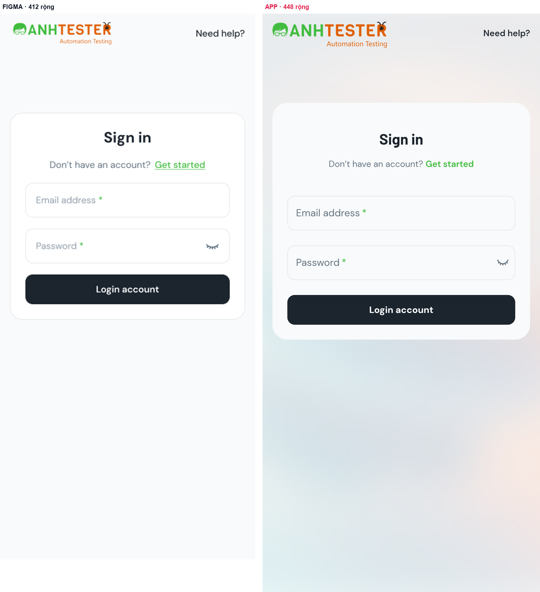

Bảng đo tự động (dc.py match)

> Khung thiết kế rộng **412** · màn thật rộng **448** (cùng đơn vị) · bỏ status bar: thiết kế 36 / thật 40 · dung sai vị trí ±4

**Tổng:** ✅ Khớp **4** · ⚠️ Lệch nhỏ **4** · ❌ Lệch **2**

| # | Trạng thái | Chữ trong thiết kế | Trên app | Δx (neo) | Δy | Δ khoảng cách | Δ cao | Màu (thiết kế → app · ΔE) | Ghi chú |
|---|---|---|---|---|---|---|---|---|---|
| 1 | ✅ | Need help? | Need help? | +4 (phải) | +1 | — | -3 | `#1c252e` → `#1c242c` · 0.6 |  |
| 2 | ⚠️ | Sign in | Sign in | +0 (giữa) | -1 | -2 | +6 | `#1c252e` → `#1c242c` · 0.6 |  |
| 3 | ⚠️ | Don’t have an account? | Don’t have an account? | +8 (giữa) | +0 | +1 | -3 | `#637381` → `#607080` · 1.5 |  |
| 4 | ⚠️ | Get started | Get started | -5 (giữa) | +0 | +0 | -3 | `#42bc40` → `#40bc40` · 0.1 |  |
| 5 | ❌ | Email address * | Email address | -4 (trái) | +20 | +20 | +1 | `#919eab` → `#607080` · 17.0 | chữ khác phần đuôi: “Email address *” ↔ “Email address” (phần thiếu có thể nằm ở node/span riêng — xem ảnh) khoảng cách tới “Get started” lệch +20 — điểm khởi phát xô lệch màu chữ #607080 vs #919eab (ΔE 17.0) |
| 6 | ❌ | Password * | Password | -4 (trái) | +26 | +6 | +1 | `#919eab` → `#607080` · 17.0 | chữ khác phần đuôi: “Password *” ↔ “Password” (phần thiếu có thể nằm ở node/span riêng — xem ảnh) khoảng cách tới “Email address *” lệch +6 — điểm khởi phát xô lệch màu chữ #607080 vs #919eab (ΔE 17.0) |
| 7 | ⚠️ | Login account | Login account | +0 (tâm-giữa) | +33 | +7 | +28 | — | khoảng cách tới “Password *” lệch +7 — điểm khởi phát xô lệch khung phần tử app lớn hơn hộp chữ (gồm icon/padding) — không đo được số dòng, so theo tâm màu chữ không lấy mẫu được (khung có cả icon/nền) — đối chiếu bằng ảnh |

> Khối có nền/viền ghép qua chữ nằm bên trong — **heuristic**: phần tử app được chọn là khung nhỏ nhất chứa đủ các chữ đó, màu nền lấy mẫu ở mép trái. Dòng ❌ ở đây phải xem ảnh trước khi tin.

| # | Trạng thái | Khối (thiết kế) | Phần tử app | Δ rộng | Δ cao | Màu nền (thiết kế → app · ΔE) | Ghi chú |
|---|---|---|---|---|---|---|---|
| B1 | ✅ | Box [41, 309, 330, 56] | `View` [40, 334, 368, 56] | +2 | +0 | `#ffffff` → `#f8f8f8` · 1.4 |  |
| B2 | ✅ | Box [41, 383, 330, 56] | `View` [40, 414, 368, 56] | +2 | +0 | `#ffffff` → `#f8f8f8` · 1.4 |  |
| B3 | ✅ | Button [41, 457, 330, 48] | `Button` [40, 494, 368, 48] | +2 | +0 | `#1c252e` → `#1c242c` · 0.6 |  |

### A-02 · Sign in — validation

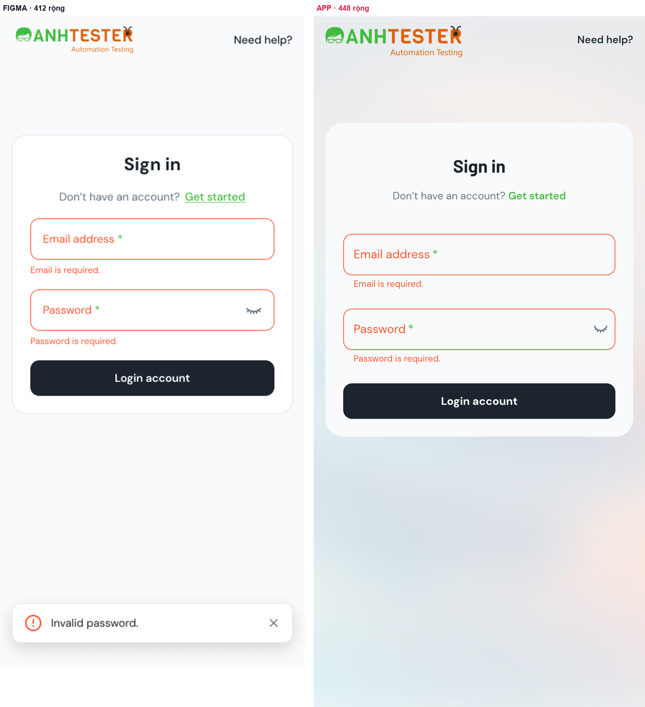

Bảng đo tự động (dc.py match)

> Khung thiết kế rộng **412** · màn thật rộng **448** (cùng đơn vị) · bỏ status bar: thiết kế 36 / thật 40 · dung sai vị trí ±4

**Tổng:** ✅ Khớp **4** · ⚠️ Lệch nhỏ **7** · ❌ Lệch **1** · 🔍 Thiếu trên app **1**

| # | Trạng thái | Chữ trong thiết kế | Trên app | Δx (neo) | Δy | Δ khoảng cách | Δ cao | Màu (thiết kế → app · ΔE) | Ghi chú |
|---|---|---|---|---|---|---|---|---|---|
| 1 | ✅ | Need help? | Need help? | +4 (phải) | +1 | — | -3 | `#1c252e` → `#1c242c` · 0.6 |  |
| 2 | ⚠️ | Sign in | Sign in | +0 (giữa) | -1 | -2 | +6 | `#1c252e` → `#1c242c` · 0.6 |  |
| 3 | ⚠️ | Don’t have an account? | Don’t have an account? | +8 (giữa) | +0 | +1 | -3 | `#637381` → `#607080` · 1.5 |  |
| 4 | ⚠️ | Get started | Get started | -5 (giữa) | +0 | +0 | -3 | `#42bc40` → `#40bc40` · 0.1 |  |
| 5 | ❌ | Email address * | Email address | -4 (trái) | +20 | +20 | +1 | `#ff5630` → `#fc5430` · 0.8 | chữ khác phần đuôi: “Email address *” ↔ “Email address” (phần thiếu có thể nằm ở node/span riêng — xem ảnh) khoảng cách tới “Get started” lệch +20 — điểm khởi phát xô lệch |
| 6 | ⚠️ | Email is required. | Email is required. | -5 (giữa) | +18 | -2 | +2 | `#ff5630` → `#fc5430` · 0.8 | Δy +18 kế thừa từ phía trên — không tính lỗi riêng |
| 7 | ⚠️ | Password * | Password | -4 (trái) | +25 | +7 | +1 | `#ff5630` → `#fc5430` · 0.8 | chữ khác phần đuôi: “Password *” ↔ “Password” (phần thiếu có thể nằm ở node/span riêng — xem ảnh) khoảng cách tới “Email is required.” lệch +7 — điểm khởi phát xô lệch |
| 8 | ⚠️ | Password is required. | Password is required. | -5 (giữa) | +23 | -2 | +2 | `#ff5630` → `#fc5430` · 0.8 | Δy +23 kế thừa từ phía trên — không tính lỗi riêng |
| 9 | ⚠️ | Login account | Login account | +0 (tâm-giữa) | +31 | +8 | +28 | — | khoảng cách tới “Password is required.” lệch +8 — điểm khởi phát xô lệch khung phần tử app lớn hơn hộp chữ (gồm icon/padding) — không đo được số dòng, so theo tâm màu chữ không lấy mẫu được (khung có cả icon/nền) — đối chiếu bằng ảnh |
| 10 | 🔍 | Invalid password. | — | — | — | — | — | — |  |

> Khối có nền/viền ghép qua chữ nằm bên trong — **heuristic**: phần tử app được chọn là khung nhỏ nhất chứa đủ các chữ đó, màu nền lấy mẫu ở mép trái. Dòng ❌ ở đây phải xem ảnh trước khi tin.

| # | Trạng thái | Khối (thiết kế) | Phần tử app | Δ rộng | Δ cao | Màu nền (thiết kế → app · ΔE) | Ghi chú |
|---|---|---|---|---|---|---|---|
| B1 | ✅ | Box [41, 309, 330, 56] | `View` [40, 334, 368, 56] | +2 | +0 | `#ffffff` → `#f8f8f8` · 1.4 |  |
| B2 | ✅ | Box [41, 405, 330, 56] | `View` [40, 435, 368, 56] | +2 | +0 | `#ffffff` → `#f8f8f8` · 1.4 |  |
| B3 | ✅ | Button [41, 501, 330, 48] | `Button` [40, 536, 368, 48] | +2 | +0 | `#1c252e` → `#1c242c` · 0.6 |  |

### A-03 · Sign up (toàn trang, 2 đoạn cuộn)

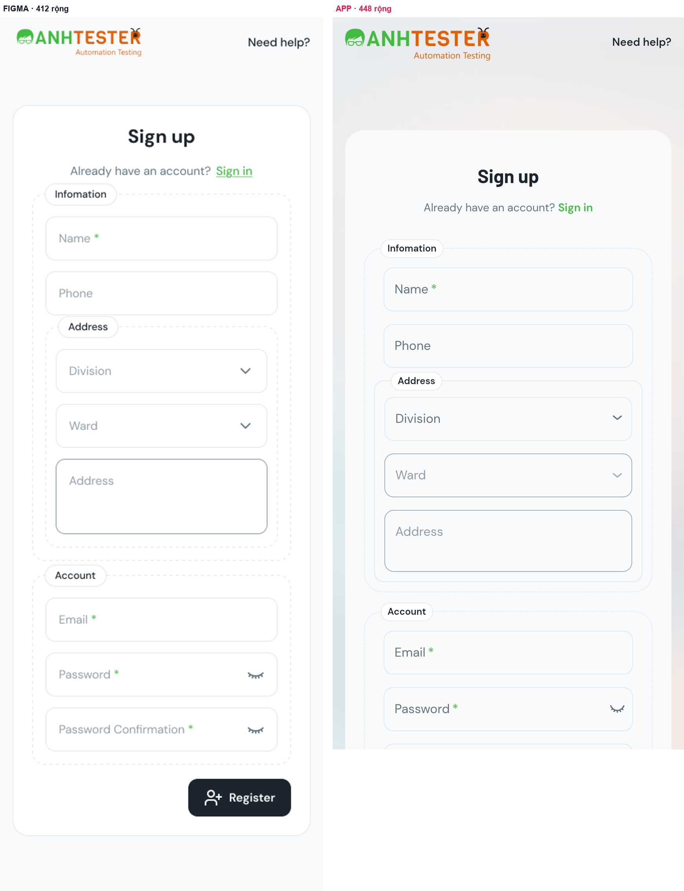

Bảng đo tự động — đoạn 1 (dc.py match)

> Khung thiết kế rộng **412** · màn thật rộng **448** (cùng đơn vị) · bỏ status bar: thiết kế 36 / thật 40 · dung sai vị trí ±4

**Tổng:** ✅ Khớp **2** · ❌ Lệch **17** · ⚠️ Lệch nhỏ **6** · ⤵️ Ngoài màn hình đã chụp **2**

| # | Trạng thái | Chữ trong thiết kế | Trên app | Δx (neo) | Δy | Δ khoảng cách | Δ cao | Màu (thiết kế → app · ΔE) | Ghi chú |
|---|---|---|---|---|---|---|---|---|---|
| 1 | ✅ | Need help? | Need help? | +4 (phải) | +1 | — | -3 | `#1c252e` → `#1c242c` · 0.6 |  |
| 2 | ❌ | Sign up | Sign up | +0 (giữa) | +47 | +46 | +6 | `#1c252e` → `#1c242c` · 0.6 | khoảng cách tới “Need help?” lệch +46 — điểm khởi phát xô lệch |
| 3 | ⚠️ | Already have an account? | Already have an account? | +8 (giữa) | +48 | +1 | -3 | `#637381` → `#607080` · 1.5 | Δy +48 kế thừa từ phía trên — không tính lỗi riêng |
| 4 | ⚠️ | Sign in | Sign in | -7 (giữa) | +48 | +0 | -3 | `#42bc40` → `#40bc40` · 0.1 | Δy +48 kế thừa từ phía trên — không tính lỗi riêng |
| 5 | ❌ | Infomation | Infomation | +0 (trái) | +70 | +22 | -2 | `#1c252e` → `#1c242c` · 0.6 | khoảng cách tới “Sign in” lệch +22 — điểm khởi phát xô lệch |
| 6 | ❌ | Name * | Name | -2.6 (tỉ lệ) | +64 | -6 | +1 | `#919eab` → `#607080` · 17.0 | chữ khác phần đuôi: “Name *” ↔ “Name” (phần thiếu có thể nằm ở node/span riêng — xem ảnh) khoảng cách tới “Infomation” lệch -6 — điểm khởi phát xô lệch màu chữ #607080 vs #919eab (ΔE 17.0) |
| 7 | ❌ | Phone | Phone | -2.6 (tỉ lệ) | +66 | +2 | +1 | `#919eab` → `#607080` · 17.0 | Δy +66 kế thừa từ phía trên — không tính lỗi riêng màu chữ #607080 vs #919eab (ΔE 17.0) |
| 8 | ✅ | Address | Address | -4 (trái) | +70 | +4 | -2 | `#1c252e` → `#1c242c` · 0.6 | Δy +70 kế thừa từ phía trên — không tính lỗi riêng |
| 9 | ❌ | Division | Division | -8 (trái) | +60 | -10 | +1 | `#919eab` → `#607080` · 17.0 | khoảng cách tới “Address” lệch -10 — điểm khởi phát xô lệch màu chữ #607080 vs #919eab (ΔE 17.0) |
| 10 | ⚠️ | Ward | Ward | -8 (trái) | +62 | +2 | +1 | `#919eab` → `#909ca8` · 0.8 | Δy +62 kế thừa từ phía trên — không tính lỗi riêng |
| 11 | ⚠️ | Address | Address | -8 (trái) | +64 | +2 | +1 | `#919eab` → `#909ca8` · 0.8 | Δy +64 kế thừa từ phía trên — không tính lỗi riêng |
| 12 | ❌ | Account | Account | +0 (trái) | +47 | -17 | -2 | `#1c252e` → `#1c242c` · 0.6 | khoảng cách tới “Address” lệch -17 — điểm khởi phát xô lệch |
| 13 | ❌ | Email * | Email | -2.6 (tỉ lệ) | +41 | -6 | +1 | `#919eab` → `#607080` · 17.0 | chữ khác phần đuôi: “Email *” ↔ “Email” (phần thiếu có thể nằm ở node/span riêng — xem ảnh) khoảng cách tới “Account” lệch -6 — điểm khởi phát xô lệch màu chữ #607080 vs #919eab (ΔE 17.0) |
| 14 | ❌ | Password * | Password | -2.6 (tỉ lệ) | +43 | +2 | +1 | `#919eab` → `#607080` · 17.0 | chữ khác phần đuôi: “Password *” ↔ “Password” (phần thiếu có thể nằm ở node/span riêng — xem ảnh) Δy +43 kế thừa từ phía trên — không tính lỗi riêng màu chữ #607080 vs #919eab (ΔE 17.0) |
| 15 | ⤵️ | Password Confirmation * | — | — | — | — | — | — | có trên app nhưng bị mép màn cắt dở — đo ở đoạn cuộn khác |
| 16 | ⤵️ | Register | — | — | — | — | — | — |  |

> Khối có nền/viền ghép qua chữ nằm bên trong — **heuristic**: phần tử app được chọn là khung nhỏ nhất chứa đủ các chữ đó, màu nền lấy mẫu ở mép trái. Dòng ❌ ở đây phải xem ảnh trước khi tin.

| # | Trạng thái | Khối (thiết kế) | Phần tử app | Δ rộng | Δ cao | Màu nền (thiết kế → app · ΔE) | Ghi chú |
|---|---|---|---|---|---|---|---|
| B1 | ❌ | Auth card [16, 148, 380, 932] | `View` [0, 104, 448, 893.3] | +32 | -38.7 | `#ffffff` → `#e4ecec` · 5.7 | cao 893.3 vs 932 rộng 448 vs 380 (đã trừ phần chênh bề ngang màn hình) màu nền #e4ecec vs #ffffff (ΔE 5.7) |
| B2 | ❌ | Fieldset · Infomation [41, 261, 330, 468] | `View` [40, 334, 368, 439] | +2 | -29 | — | cao 439 vs 468 |
| B3 | ❌ | Box [58, 290, 296, 56] | `View` [65, 359, 318, 56] | -14 | +0 | `#ffffff` → `#f8f8f8` · 1.4 | rộng 318 vs 296 (đã trừ phần chênh bề ngang màn hình) |
| B4 | ❌ | Box [58, 360, 296, 56] | `View` [65, 431, 318, 56] | -14 | +0 | `#ffffff` → `#f8f8f8` · 1.4 | rộng 318 vs 296 (đã trừ phần chênh bề ngang màn hình) |
| B5 | ❌ | Fieldset · Address [58, 430, 296, 282] | `View` [53, 503, 342, 257] | +10 | -25 | — | cao 257 vs 282 rộng 342 vs 296 (đã trừ phần chênh bề ngang màn hình) |
| B6 | ⚠️ | Box [71, 459, 270, 56] | `View` [66, 524, 316, 56] | +10 | +0 | `#ffffff` → `#f8f8f8` · 1.4 | rộng 316 vs 270 (đã trừ phần chênh bề ngang màn hình) |
| B7 | ⚠️ | Box [71, 529, 270, 56] | `View` [66, 596, 316, 56] | +10 | +0 | `#ffffff` → `#f8f8f8` · 1.4 | rộng 316 vs 270 (đã trừ phần chênh bề ngang màn hình) |
| B8 | ❌ | TextArea [71, 599, 270, 96] | `View` [66, 668, 316, 79] | +10 | -17 | `#ffffff` → `#f8f8f8` · 1.4 | cao 79 vs 96 rộng 316 vs 270 (đã trừ phần chênh bề ngang màn hình) |
| B9 | ❌ | Fieldset · Account [41, 747, 330, 242] | `View` [40, 797, 368, 200.3] | +2 | -41.7 | — | cao 200.3 vs 242 |
| B10 | ❌ | Box [58, 776, 296, 56] | `View` [65, 822, 318, 56] | -14 | +0 | `#ffffff` → `#f8f8f8` · 1.4 | rộng 318 vs 296 (đã trừ phần chênh bề ngang màn hình) |
| B11 | ❌ | Box [58, 846, 296, 56] | `View` [65, 894, 318, 56] | -14 | +0 | `#ffffff` → `#f8f8f8` · 1.4 | rộng 318 vs 296 (đã trừ phần chênh bề ngang màn hình) |

Bảng đo tự động — đoạn 2 (dc.py match)

> Khung thiết kế rộng **412** · màn thật rộng **448** (cùng đơn vị) · bỏ status bar: thiết kế 36 / thật 40 · đã bù lệch dọc chung -171 (= độ cuộn + lệch bố cục tích luỹ phía trên, không phải độ cuộn) · dung sai vị trí ±4

**Tổng:** ❔ Không so được **1** · ⤵️ Ngoài màn hình đã chụp **3** · ❌ Lệch **17** · ✅ Khớp **2** · ⚠️ Lệch nhỏ **5**

| # | Trạng thái | Chữ trong thiết kế | Trên app | Δx (neo) | Δy | Δ khoảng cách | Δ cao | Màu (thiết kế → app · ΔE) | Ghi chú |
|---|---|---|---|---|---|---|---|---|---|
| 1 | ❔ | Need help? | Need help? | — | — | — | — | — | phần tử cố định khi cuộn (header/bottom nav) — đã đo ở đoạn đầu |
| 2 | ⤵️ | Sign up | — | — | — | — | — | — |  |
| 3 | ⤵️ | Already have an account? | — | — | — | — | — | — |  |
| 4 | ⤵️ | Sign in | — | — | — | — | — | — |  |
| 5 | ❌ | Infomation | Infomation | +0 (trái) | +16 | — | -2 | `#1c252e` → `#1c242c` · 0.6 | lệch +16 tính từ đầu vùng nội dung — nguyên nhân có thể nằm ở phần tử không có chữ phía trên (ảnh, banner, header) |
| 6 | ❌ | Name * | Name | -2.6 (tỉ lệ) | +10 | -6 | +1 | `#919eab` → `#607080` · 17.0 | chữ khác phần đuôi: “Name *” ↔ “Name” (phần thiếu có thể nằm ở node/span riêng — xem ảnh) khoảng cách tới “Infomation” lệch -6 — điểm khởi phát xô lệch màu chữ #607080 vs #919eab (ΔE 17.0) |
| 7 | ❌ | Phone | Phone | -2.6 (tỉ lệ) | +12 | +2 | +1 | `#919eab` → `#607080` · 17.0 | Δy +12 kế thừa từ phía trên — không tính lỗi riêng màu chữ #607080 vs #919eab (ΔE 17.0) |
| 8 | ✅ | Address | Address | -4 (trái) | +16 | +4 | -2 | `#1c252e` → `#1c242c` · 0.6 | Δy +16 kế thừa từ phía trên — không tính lỗi riêng |
| 9 | ❌ | Division | Division | -8 (trái) | +6 | -10 | +1 | `#919eab` → `#607080` · 17.0 | khoảng cách tới “Address” lệch -10 — điểm khởi phát xô lệch màu chữ #607080 vs #919eab (ΔE 17.0) |
| 10 | ⚠️ | Ward | Ward | -8 (trái) | +8 | +2 | +1 | `#919eab` → `#909ca8` · 0.8 | Δy +8 kế thừa từ phía trên — không tính lỗi riêng |
| 11 | ⚠️ | Address | Address | -8 (trái) | +10 | +2 | +1 | `#919eab` → `#909ca8` · 0.8 | Δy +10 kế thừa từ phía trên — không tính lỗi riêng |
| 12 | ❌ | Account | Account | +0 (trái) | -7 | -17 | -2 | `#1c252e` → `#1c242c` · 0.6 | khoảng cách tới “Address” lệch -17 — điểm khởi phát xô lệch |
| 13 | ❌ | Email * | Email | -2.6 (tỉ lệ) | -13 | -6 | +1 | `#919eab` → `#607080` · 17.0 | chữ khác phần đuôi: “Email *” ↔ “Email” (phần thiếu có thể nằm ở node/span riêng — xem ảnh) khoảng cách tới “Account” lệch -6 — điểm khởi phát xô lệch màu chữ #607080 vs #919eab (ΔE 17.0) |
| 14 | ❌ | Password * | Password | -2.6 (tỉ lệ) | -11 | +2 | +1 | `#919eab` → `#607080` · 17.0 | chữ khác phần đuôi: “Password *” ↔ “Password” (phần thiếu có thể nằm ở node/span riêng — xem ảnh) Δy -11 kế thừa từ phía trên — không tính lỗi riêng màu chữ #607080 vs #919eab (ΔE 17.0) |
| 15 | ❌ | Password Confirmation * | Password Confirmation | -2.6 (tỉ lệ) | -9 | +2 | +1 | `#919eab` → `#607080` · 17.0 | chữ khác phần đuôi: “Password Confirmation *” ↔ “Password Confirmation” (phần thiếu có thể nằm ở node/span riêng — xem ảnh) Δy -9 kế thừa từ phía trên — không tính lỗi riêng màu chữ #607080 vs #919eab (ΔE 17.0) |
| 16 | ❌ | Register | Register | +4 (tâm-giữa) | +6 | +15 | +28 | — | khoảng cách tới “Password Confirmation *” lệch +15 — điểm khởi phát xô lệch khung phần tử app lớn hơn hộp chữ (gồm icon/padding) — không đo được số dòng, so theo tâm màu chữ không lấy mẫu được (khung có cả icon/nền) — đối chiếu bằng ảnh |

> Khối có nền/viền ghép qua chữ nằm bên trong — **heuristic**: phần tử app được chọn là khung nhỏ nhất chứa đủ các chữ đó, màu nền lấy mẫu ở mép trái. Dòng ❌ ở đây phải xem ảnh trước khi tin.

| # | Trạng thái | Khối (thiết kế) | Phần tử app | Δ rộng | Δ cao | Màu nền (thiết kế → app · ΔE) | Ghi chú |
|---|---|---|---|---|---|---|---|
| B1 | ❌ | Fieldset · Infomation [41, 261, 330, 468] | `View` [40, 109, 368, 439] | +2 | -29 | — | cao 439 vs 468 |
| B2 | ❌ | Box [58, 290, 296, 56] | `View` [65, 134, 318, 56] | -14 | +0 | `#ffffff` → `#f8f8f8` · 1.4 | rộng 318 vs 296 (đã trừ phần chênh bề ngang màn hình) |
| B3 | ❌ | Box [58, 360, 296, 56] | `View` [65, 206, 318, 56] | -14 | +0 | `#ffffff` → `#f8f8f8` · 1.4 | rộng 318 vs 296 (đã trừ phần chênh bề ngang màn hình) |
| B4 | ❌ | Fieldset · Address [58, 430, 296, 282] | `View` [53, 278, 342, 257] | +10 | -25 | — | cao 257 vs 282 rộng 342 vs 296 (đã trừ phần chênh bề ngang màn hình) |
| B5 | ⚠️ | Box [71, 459, 270, 56] | `View` [66, 299, 316, 56] | +10 | +0 | `#ffffff` → `#f8f8f8` · 1.4 | rộng 316 vs 270 (đã trừ phần chênh bề ngang màn hình) |
| B6 | ⚠️ | Box [71, 529, 270, 56] | `View` [66, 371, 316, 56] | +10 | +0 | `#ffffff` → `#f8f8f8` · 1.4 | rộng 316 vs 270 (đã trừ phần chênh bề ngang màn hình) |
| B7 | ❌ | TextArea [71, 599, 270, 96] | `View` [66, 443, 316, 79] | +10 | -17 | `#ffffff` → `#f8f8f8` · 1.4 | cao 79 vs 96 rộng 316 vs 270 (đã trừ phần chênh bề ngang màn hình) |
| B8 | ⚠️ | Fieldset · Account [41, 747, 330, 242] | `View` [40, 572, 368, 250] | +2 | +8 | — | cao 250 vs 242 |
| B9 | ❌ | Box [58, 776, 296, 56] | `View` [65, 597, 318, 56] | -14 | +0 | `#ffffff` → `#f8f8f8` · 1.4 | rộng 318 vs 296 (đã trừ phần chênh bề ngang màn hình) |
| B10 | ❌ | Box [58, 846, 296, 56] | `View` [65, 669, 318, 56] | -14 | +0 | `#ffffff` → `#f8f8f8` · 1.4 | rộng 318 vs 296 (đã trừ phần chênh bề ngang màn hình) |
| B11 | ❌ | Box [58, 916, 296, 56] | `View` [65, 741, 318, 56] | -14 | +0 | `#ffffff` → `#f8f8f8` · 1.4 | rộng 318 vs 296 (đã trừ phần chênh bề ngang màn hình) |
| B12 | ✅ | Button [240, 1007, 131, 48] | `Button` [279, 846, 129, 48] | -2 | +0 | `#1c252e` → `#1c242c` · 0.6 |  |

### A-04 · Dashboard — khách

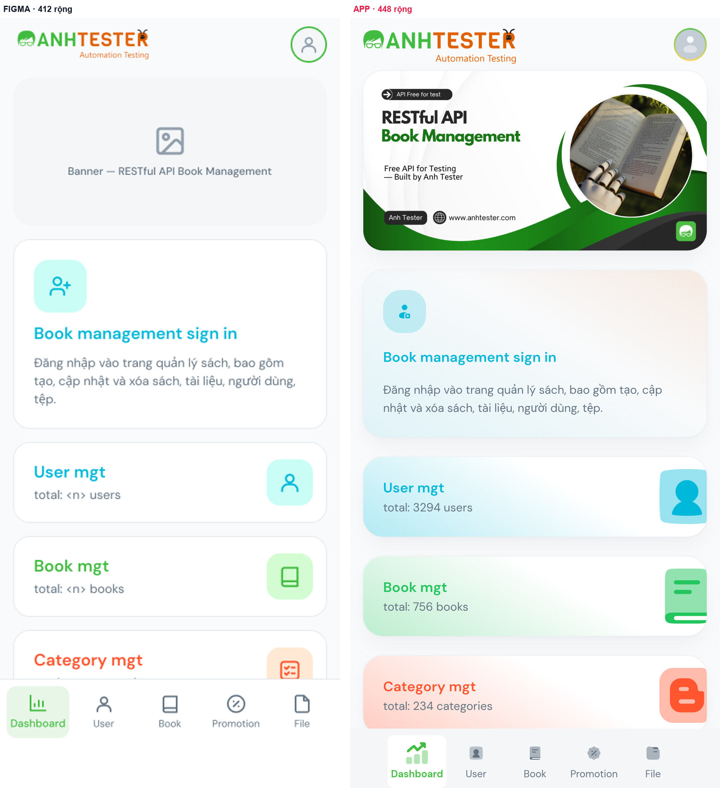

Bảng đo tự động (dc.py match)

> Khung thiết kế rộng **412** · màn thật rộng **448** (cùng đơn vị) · bỏ status bar: thiết kế 36 / thật 40 · dung sai vị trí ±4

**Tổng:** 🔍 Thiếu trên app **1** · ❌ Lệch **5** · ❔ Không so được **6** · ⚠️ Lệch nhỏ **5**

| # | Trạng thái | Chữ trong thiết kế | Trên app | Δx (neo) | Δy | Δ khoảng cách | Δ cao | Màu (thiết kế → app · ΔE) | Ghi chú |
|---|---|---|---|---|---|---|---|---|---|
| 1 | 🔍 | Banner — RESTful API Book Management | — | — | — | — | — | — |  |
| 2 | ❌ | Book management sign in | Book management sign in | -1 (trái) | +28 | — | +2 | `#00b8d9` → `#00b8d8` · 0.3 | lệch +28 tính từ đầu vùng nội dung — nguyên nhân có thể nằm ở phần tử không có chữ phía trên (ảnh, banner, header) |
| 3 | ❌ | Đăng nhập vào trang quản lý sách, bao gồm tạo, cập nhật và xóa sách, tài liệu, người dùng, tệp. | Đăng nhập vào trang quản lý sách, bao gồm tạo, cập nhật và xóa sách, tài liệu, người dùng, tệp. | -1 (trái) | +33 | +5 | -21 | `#637381` → `#607080` · 1.5 | khoảng cách tới “Book management sign in” lệch +5 — điểm khởi phát xô lệch cao 45 vs 66 — khác số dòng (≈2.0 vs 3.0 dòng) |
| 4 | ❔ | User mgt | User mgttotal: 3294 users | — | — | — | — | — | chữ có trên app nhưng nằm chung node “User mgttotal: 3294 users” — vị trí, màu không đo tự động, đối chiếu bằng ảnh |
| 5 | ❔ | total: <n> users | User mgttotal: 3294 users | — | — | — | — | — | chữ có trên app nhưng nằm chung node “User mgttotal: 3294 users” — vị trí, màu không đo tự động, đối chiếu bằng ảnh |
| 6 | ❔ | Book mgt | Book mgttotal: 756 books | — | — | — | — | — | chữ có trên app nhưng nằm chung node “Book mgttotal: 756 books” — vị trí, màu không đo tự động, đối chiếu bằng ảnh |
| 7 | ❔ | total: <n> books | Book mgttotal: 756 books | — | — | — | — | — | chữ có trên app nhưng nằm chung node “Book mgttotal: 756 books” — vị trí, màu không đo tự động, đối chiếu bằng ảnh |
| 8 | ❔ | Category mgt | Category mgttotal: 234 categories | — | — | — | — | — | chữ có trên app nhưng nằm chung node “Category mgttotal: 234 categories” — vị trí, màu không đo tự động, đối chiếu bằng ảnh |
| 9 | ❔ | total: <n> categories | Category mgttotal: 234 categories | — | — | — | — | — | chữ có trên app nhưng nằm chung node “Category mgttotal: 234 categories” — vị trí, màu không đo tự động, đối chiếu bằng ảnh |
| 10 | ⚠️ | Dashboard | Dashboard | -1.5 (tâm-phải · neo đáy) | -6.8 | — | +63 | — | neo đáy màn hình — Δy đo theo khoảng cách tới đáy vùng nội dung khung phần tử app lớn hơn hộp chữ (gồm icon/padding) — không đo được số dòng, so theo tâm màu chữ không lấy mẫu được (khung có cả icon/nền) — đối chiếu bằng ảnh |
| 11 | ⚠️ | User | User | +3 (trái · neo đáy) | -6.8 | — | +65 | — | neo đáy màn hình — Δy đo theo khoảng cách tới đáy vùng nội dung khung phần tử app lớn hơn hộp chữ (gồm icon/padding) — không đo được số dòng, so theo tâm màu chữ không lấy mẫu được (khung có cả icon/nền) — đối chiếu bằng ảnh |
| 12 | ⚠️ | Book | Book | +0 (tâm-giữa · neo đáy) | -6.8 | — | +65 | — | neo đáy màn hình — Δy đo theo khoảng cách tới đáy vùng nội dung khung phần tử app lớn hơn hộp chữ (gồm icon/padding) — không đo được số dòng, so theo tâm màu chữ không lấy mẫu được (khung có cả icon/nền) — đối chiếu bằng ảnh |
| 13 | ⚠️ | Promotion | Promotion | +2 (trái · neo đáy) | -6.8 | — | +65 | — | neo đáy màn hình — Δy đo theo khoảng cách tới đáy vùng nội dung khung phần tử app lớn hơn hộp chữ (gồm icon/padding) — không đo được số dòng, so theo tâm màu chữ không lấy mẫu được (khung có cả icon/nền) — đối chiếu bằng ảnh |
| 14 | ⚠️ | File | File | +0.5 (tâm-trái · neo đáy) | -6.8 | — | +65 | — | neo đáy màn hình — Δy đo theo khoảng cách tới đáy vùng nội dung khung phần tử app lớn hơn hộp chữ (gồm icon/padding) — không đo được số dòng, so theo tâm màu chữ không lấy mẫu được (khung có cả icon/nền) — đối chiếu bằng ảnh |

> Khối có nền/viền ghép qua chữ nằm bên trong — **heuristic**: phần tử app được chọn là khung nhỏ nhất chứa đủ các chữ đó, màu nền lấy mẫu ở mép trái. Dòng ❌ ở đây phải xem ảnh trước khi tin.

| # | Trạng thái | Khối (thiết kế) | Phần tử app | Δ rộng | Δ cao | Màu nền (thiết kế → app · ΔE) | Ghi chú |
|---|---|---|---|---|---|---|---|
| B1 | ❌ | Card · Book management sign in [16, 304, 380, 230] | `View` [16, 345, 416, 204] | +0 | -26 | `#ffffff` → `#e8f4f8` · 5.8 | cao 204 vs 230 màu nền #e8f4f8 vs #ffffff (ΔE 5.8) |
| B2 | ❌ | BottomNav [0, 837, 412, 80] | `View` [37, 901, 374, 81] | -74 | +1 | `#ffffff` → `#fcfcfc` · 0.6 | rộng 374 vs 412 (đã trừ phần chênh bề ngang màn hình) |
| B3 | ❌ | Tab Dashboard [8, 846, 76, 63] | `View` [45, 901, 72, 81] | -4 | +18 | `#e8f6e8` → `#fcfcfc` · 9.6 | cao 81 vs 63 màu nền #fcfcfc vs #e8f6e8 (ΔE 9.6) |

### A-05 · Dashboard — đã đăng nhập

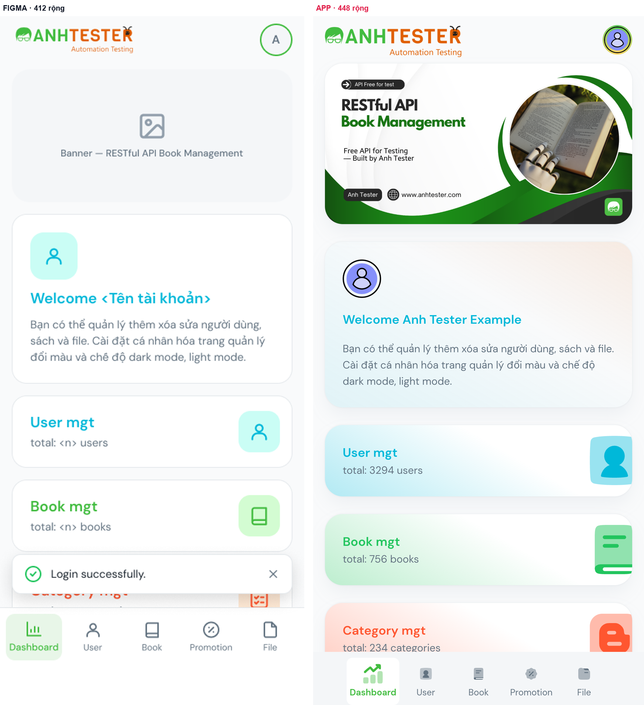

> **Toast "Login successfully."** (so bổ sung): chụp ngay sau khi bấm *Login account* — nội dung, icon ✓, nút × khớp; cách mép trên bottom nav **≈ 17 dp** (thiết kế 18 dp) → ✅. Ảnh: [A-05_login_toast_app.png](evidence/A-05_login_toast_app.png)

Bảng đo tự động (dc.py match)

> Khung thiết kế rộng **412** · màn thật rộng **448** (cùng đơn vị) · bỏ status bar: thiết kế 36 / thật 40 · dung sai vị trí ±4

**Tổng:** 🔍 Thiếu trên app **3** · ❌ Lệch **3** · ⚠️ Lệch nhỏ **7** · ❔ Không so được **6**

| # | Trạng thái | Chữ trong thiết kế | Trên app | Δx (neo) | Δy | Δ khoảng cách | Δ cao | Màu (thiết kế → app · ΔE) | Ghi chú |
|---|---|---|---|---|---|---|---|---|---|
| 1 | 🔍 | A | — | — | — | — | — | — |  |
| 2 | 🔍 | Banner — RESTful API Book Management | — | — | — | — | — | — |  |
| 3 | ❌ | Welcome <Tên tài khoản> | Welcome Anh Tester Example | -1 (trái) | +28 | — | +2 | `#00b8d9` → `#00b8d8` · 0.3 | lệch +28 tính từ đầu vùng nội dung — nguyên nhân có thể nằm ở phần tử không có chữ phía trên (ảnh, banner, header) |
| 4 | ⚠️ | Bạn có thể quản lý thêm xóa sửa người dùng, sách và file. Cài đặt cá nhân hóa trang quản lý đổi màu và chế độ dark mode, light mode. | Bạn có thể quản lý thêm xóa sửa người dùng, sách và file. Cài đặt cá nhân hóa trang quản lý đổi màu và chế độ dark mode, light mode. | -1 (trái) | +33 | +5 | +1 | `#637381` → `#607080` · 1.5 | khoảng cách tới “Welcome <Tên tài khoản>” lệch +5 — điểm khởi phát xô lệch |
| 5 | ❔ | User mgt | User mgttotal: 3294 users | — | — | — | — | — | chữ có trên app nhưng nằm chung node “User mgttotal: 3294 users” — vị trí, màu không đo tự động, đối chiếu bằng ảnh |
| 6 | ❔ | total: <n> users | User mgttotal: 3294 users | — | — | — | — | — | chữ có trên app nhưng nằm chung node “User mgttotal: 3294 users” — vị trí, màu không đo tự động, đối chiếu bằng ảnh |
| 7 | ❔ | Book mgt | Book mgttotal: 756 books | — | — | — | — | — | chữ có trên app nhưng nằm chung node “Book mgttotal: 756 books” — vị trí, màu không đo tự động, đối chiếu bằng ảnh |
| 8 | ❔ | total: <n> books | Book mgttotal: 756 books | — | — | — | — | — | chữ có trên app nhưng nằm chung node “Book mgttotal: 756 books” — vị trí, màu không đo tự động, đối chiếu bằng ảnh |
| 9 | 🔍 | Login successfully. | — | — | — | — | — | — |  |
| 10 | ❔ | Category mgt | Category mgttotal: 234 categories | — | — | — | — | — | chữ có trên app nhưng nằm chung node “Category mgttotal: 234 categories” — vị trí, màu không đo tự động, đối chiếu bằng ảnh |
| 11 | ❔ | total: <n> categories | Category mgttotal: 234 categories | — | — | — | — | — | chữ có trên app nhưng nằm chung node “Category mgttotal: 234 categories” — vị trí, màu không đo tự động, đối chiếu bằng ảnh |
| 12 | ⚠️ | Dashboard | Dashboard | -1.5 (tâm-phải · neo đáy) | -6.8 | — | +63 | — | neo đáy màn hình — Δy đo theo khoảng cách tới đáy vùng nội dung khung phần tử app lớn hơn hộp chữ (gồm icon/padding) — không đo được số dòng, so theo tâm màu chữ không lấy mẫu được (khung có cả icon/nền) — đối chiếu bằng ảnh |
| 13 | ⚠️ | User | User | +3 (trái · neo đáy) | -6.8 | — | +65 | — | neo đáy màn hình — Δy đo theo khoảng cách tới đáy vùng nội dung khung phần tử app lớn hơn hộp chữ (gồm icon/padding) — không đo được số dòng, so theo tâm màu chữ không lấy mẫu được (khung có cả icon/nền) — đối chiếu bằng ảnh |
| 14 | ⚠️ | Book | Book | +0 (tâm-giữa · neo đáy) | -6.8 | — | +65 | — | neo đáy màn hình — Δy đo theo khoảng cách tới đáy vùng nội dung khung phần tử app lớn hơn hộp chữ (gồm icon/padding) — không đo được số dòng, so theo tâm màu chữ không lấy mẫu được (khung có cả icon/nền) — đối chiếu bằng ảnh |
| 15 | ⚠️ | Promotion | Promotion | +2 (trái · neo đáy) | -6.8 | — | +65 | — | neo đáy màn hình — Δy đo theo khoảng cách tới đáy vùng nội dung khung phần tử app lớn hơn hộp chữ (gồm icon/padding) — không đo được số dòng, so theo tâm màu chữ không lấy mẫu được (khung có cả icon/nền) — đối chiếu bằng ảnh |
| 16 | ⚠️ | File | File | +0.5 (tâm-trái · neo đáy) | -6.8 | — | +65 | — | neo đáy màn hình — Δy đo theo khoảng cách tới đáy vùng nội dung khung phần tử app lớn hơn hộp chữ (gồm icon/padding) — không đo được số dòng, so theo tâm màu chữ không lấy mẫu được (khung có cả icon/nền) — đối chiếu bằng ảnh |

> Khối có nền/viền ghép qua chữ nằm bên trong — **heuristic**: phần tử app được chọn là khung nhỏ nhất chứa đủ các chữ đó, màu nền lấy mẫu ở mép trái. Dòng ❌ ở đây phải xem ảnh trước khi tin.

| # | Trạng thái | Khối (thiết kế) | Phần tử app | Δ rộng | Δ cao | Màu nền (thiết kế → app · ΔE) | Ghi chú |
|---|---|---|---|---|---|---|---|
| B1 | ⚠️ | Card · Welcome [16, 304, 380, 230] | `View` [16, 345, 416, 226] | +0 | -4 | `#ffffff` → `#e8f4f8` · 5.8 | màu nền #e8f4f8 vs #ffffff (ΔE 5.8) |
| B2 | ❌ | BottomNav [0, 837, 412, 80] | `View` [37, 901, 374, 81] | -74 | +1 | `#ffffff` → `#fcfcfc` · 0.6 | rộng 374 vs 412 (đã trừ phần chênh bề ngang màn hình) |
| B3 | ❌ | Tab Dashboard [8, 846, 76, 63] | `View` [45, 901, 72, 81] | -4 | +18 | `#e8f6e8` → `#fcfcfc` · 9.6 | cao 81 vs 63 màu nền #fcfcfc vs #e8f6e8 (ΔE 9.6) |

### A-06 · Menu tài khoản (chỉ so lớp phủ menu — `SCOPE = Menu`)

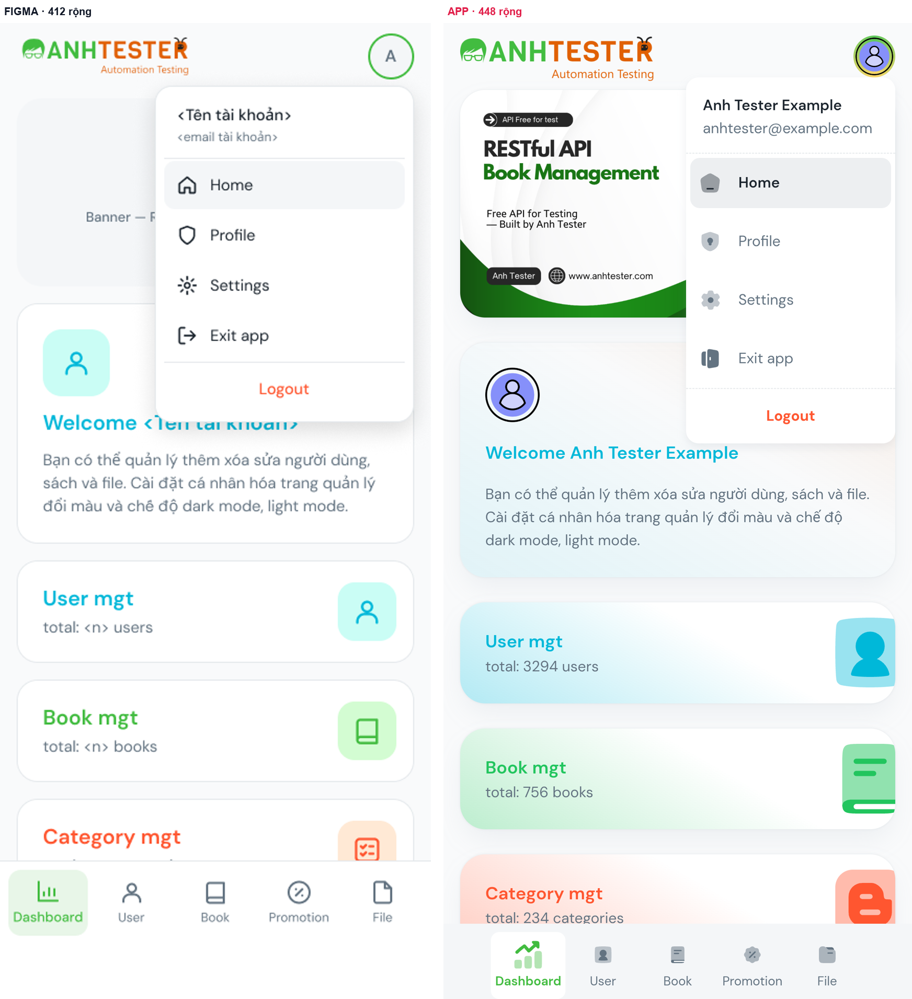

Bảng đo tự động (dc.py match)

> Khung thiết kế rộng **412** · màn thật rộng **448** (cùng đơn vị) · bỏ status bar: thiết kế 36 / thật 40 · dung sai vị trí ±4

**Tổng:** ❌ Lệch **4** · ⚠️ Lệch nhỏ **5**

| # | Trạng thái | Chữ trong thiết kế | Trên app | Δx (neo) | Δy | Δ khoảng cách | Δ cao | Màu (thiết kế → app · ΔE) | Ghi chú |
|---|---|---|---|---|---|---|---|---|---|
| 1 | ❌ | <Tên tài khoản> | Anh Tester Example | +43 (phải) | -9 | — | +0 | `#1c252e` → `#1c242c` · 0.6 | lệch -9 tính từ đầu vùng nội dung — nguyên nhân có thể nằm ở phần tử không có chữ phía trên (ảnh, banner, header) |
| 2 | ❌ | <email tài khoản> | anhtester@example.com | +43 (phải) | -11 | -2 | +6 | `#637381` → `#607080` · 1.5 | Δy -11 kế thừa từ phía trên — không tính lỗi riêng |
| 3 | ⚠️ | Home | Home | -1 (phải) | -2 | +9 | +26 | — | khoảng cách tới “<email tài khoản>” lệch +9 — điểm khởi phát xô lệch khung phần tử app lớn hơn hộp chữ (gồm icon/padding) — không đo được số dòng, so theo tâm màu chữ không lấy mẫu được (khung có cả icon/nền) — đối chiếu bằng ảnh |
| 4 | ⚠️ | Profile | Profile | -1 (phải) | +6 | +8 | +26 | — | khoảng cách tới “Home” lệch +8 — điểm khởi phát xô lệch khung phần tử app lớn hơn hộp chữ (gồm icon/padding) — không đo được số dòng, so theo tâm màu chữ không lấy mẫu được (khung có cả icon/nền) — đối chiếu bằng ảnh |
| 5 | ⚠️ | Settings | Settings | -1 (phải) | +14 | +8 | +26 | — | khoảng cách tới “Profile” lệch +8 — điểm khởi phát xô lệch khung phần tử app lớn hơn hộp chữ (gồm icon/padding) — không đo được số dòng, so theo tâm màu chữ không lấy mẫu được (khung có cả icon/nền) — đối chiếu bằng ảnh |
| 6 | ⚠️ | Exit app | Exit app | -1 (phải) | +22 | +8 | +26 | — | khoảng cách tới “Settings” lệch +8 — điểm khởi phát xô lệch khung phần tử app lớn hơn hộp chữ (gồm icon/padding) — không đo được số dòng, so theo tâm màu chữ không lấy mẫu được (khung có cả icon/nền) — đối chiếu bằng ảnh |
| 7 | ⚠️ | Logout | Logout | -8 (trái) | +26 | +4 | +14 | — | Δy +26 kế thừa từ phía trên — không tính lỗi riêng khung phần tử app lớn hơn hộp chữ (gồm icon/padding) — không đo được số dòng, so theo tâm màu chữ không lấy mẫu được (khung có cả icon/nền) — đối chiếu bằng ảnh |

> Khối có nền/viền ghép qua chữ nằm bên trong — **heuristic**: phần tử app được chọn là khung nhỏ nhất chứa đủ các chữ đó, màu nền lấy mẫu ở mép trái. Dòng ❌ ở đây phải xem ảnh trước khi tin.

| # | Trạng thái | Khối (thiết kế) | Phần tử app | Δ rộng | Δ cao | Màu nền (thiết kế → app · ΔE) | Ghi chú |
|---|---|---|---|---|---|---|---|
| B1 | ❌ | Menu [148, 96, 248, 322] | `View` [232, 92, 200, 350] | -48 | +28 | `#ffffff` → `#fcfcfc` · 0.6 | cao 350 vs 322 rộng 200 vs 248 |
| B2 | ❌ | Item · Home [157, 168, 230, 46] | `MenuItem` [236, 169, 192, 48] | -38 | +2 | `#f4f6f8` → `#ececf0` · 2.6 | rộng 192 vs 230 |

### A-07 · My Profile (toàn trang, 2 đoạn cuộn)

> Tên / email tài khoản trong thiết kế là ô động `<Tên tài khoản>` · `<email tài khoản>`; số điện thoại `09xxxxxxxx` là khuôn. 🔒 Số điện thoại thật của tài khoản test đã **che** trên ảnh và trong bảng đo.

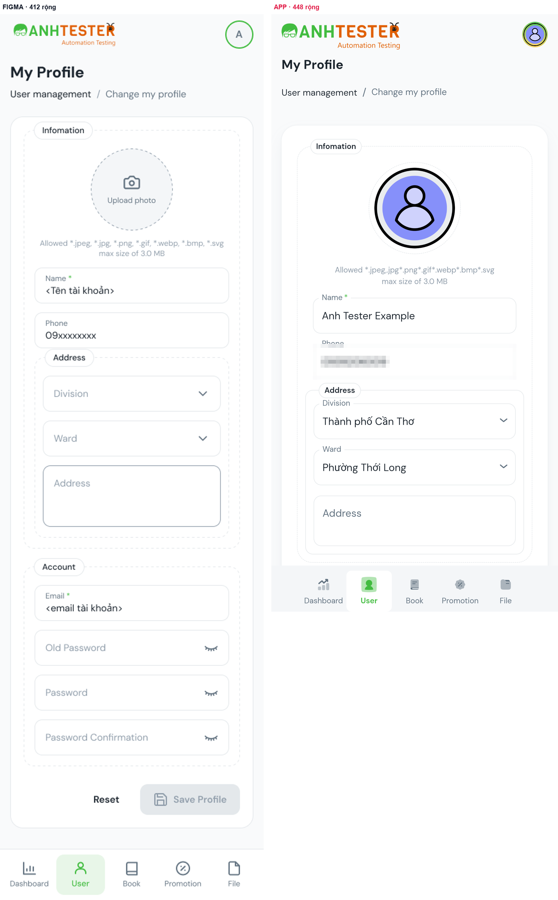

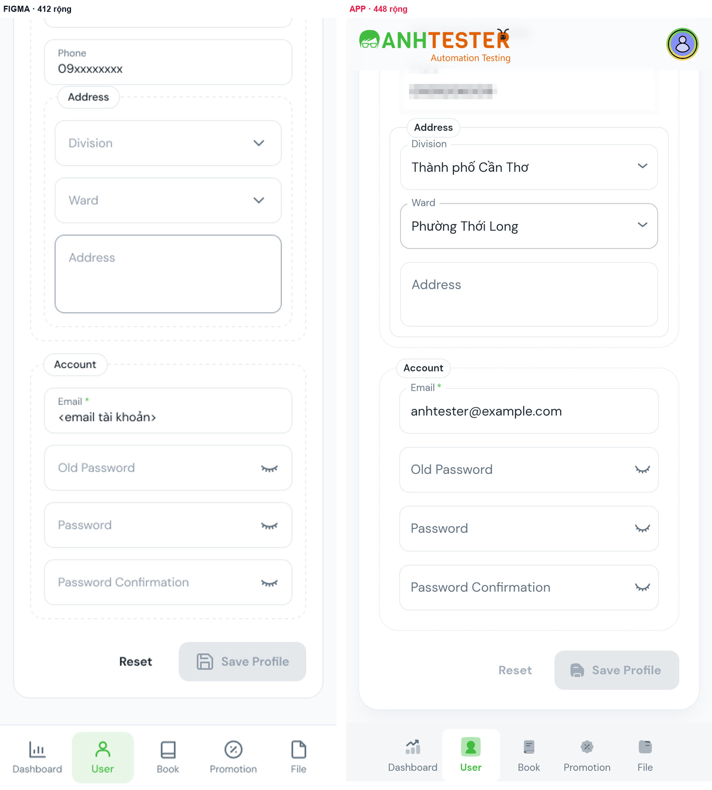

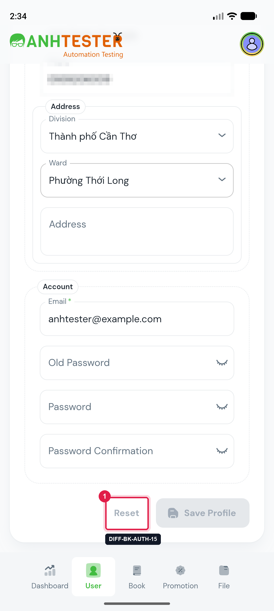

Bảng đo tự động — đoạn 1 (dc.py match)

> Khung thiết kế rộng **412** · màn thật rộng **448** (cùng đơn vị) · bỏ status bar: thiết kế 36 / thật 40 · dung sai vị trí ±4

**Tổng:** 🔍 Thiếu trên app **3** · ⚠️ Lệch nhỏ **11** · ❌ Lệch **17** · ⤵️ Ngoài màn hình đã chụp **6** · ➕ Thừa trên app **12** · ✅ Khớp **1**

| # | Trạng thái | Chữ trong thiết kế | Trên app | Δx (neo) | Δy | Δ khoảng cách | Δ cao | Màu (thiết kế → app · ΔE) | Ghi chú |
|---|---|---|---|---|---|---|---|---|---|
| 1 | 🔍 | A | — | — | — | — | — | — |  |
| 2 | ⚠️ | My Profile | My Profile | +0 (trái) | -12 | — | +0 | — | lệch -12 tính từ đầu vùng nội dung — nguyên nhân có thể nằm ở phần tử không có chữ phía trên (ảnh, banner, header) khung phần tử app lớn hơn hộp chữ (gồm icon/padding) — không đo được số dòng, so theo tâm màu chữ không lấy mẫu được (khung có cả icon/nền) — đối chiếu bằng ảnh |
| 3 | ⚠️ | User management | User management | +0 (trái) | -1 | +11 | -3 | `#1c252e` → `#1c242c` · 0.6 | khoảng cách tới “My Profile” lệch +11 — điểm khởi phát xô lệch |
| 4 | 🔍 | / | — | — | — | — | — | — |  |
| 5 | ⚠️ | Change my profile | Change my profile | -9 (trái) | -3 | -2 | +0 | `#637381` → `#607080` · 1.5 |  |
| 6 | ❌ | Infomation | Infomation | -1.8 (tỉ lệ) | +26 | +29 | -2 | `#1c252e` → `#1c242c` · 0.6 | khoảng cách tới “Change my profile” lệch +29 — điểm khởi phát xô lệch |
| 7 | ❌ | Upload photo | Upload photo | +0 (giữa) | +32 | +6 | +0 | `#637381` → `#000000` · 35.4 | khoảng cách tới “Infomation” lệch +6 — điểm khởi phát xô lệch màu chữ #000000 vs #637381 (ΔE 35.4) |
| 8 | 🔍 | Allowed *.jpeg, *.jpg, *.png, *.gif, *.webp, *.bmp, *.svg
max size of 3.0 MB | — | — | — | — | — | — |  |
| 9 | ⚠️ | Name * | Name | +1.8 (tỉ lệ) | +29 | -3 | +2 | `#637381` → `#607080` · 1.5 | chữ khác phần đuôi: “Name *” ↔ “Name” (phần thiếu có thể nằm ở node/span riêng — xem ảnh) Δy +29 kế thừa từ phía trên — không tính lỗi riêng |
| 10 | ❌ | <Tên tài khoản> | Anh Tester Example | -6 (trái) | +22 | -7 | +34 | — | ô nhập đang có giá trị — không phải placeholder khoảng cách tới “Name *” lệch -7 — điểm khởi phát xô lệch cao 56 vs 22 — khác số dòng (≈2.5 vs 1.0 dòng) |
| 11 | ⚠️ | Phone | Phone | +1.8 (tỉ lệ) | +31 | +9 | +2 | `#637381` → `#607080` · 1.5 | khoảng cách tới “<Tên tài khoản>” lệch +9 — điểm khởi phát xô lệch |
| 12 | ❌ | 09xxxxxxxx | <số đt đã che> | -6 (trái) | +24 | -7 | +34 | — | ô nhập đang có giá trị — không phải placeholder khoảng cách tới “Phone” lệch -7 — điểm khởi phát xô lệch cao 56 vs 22 — khác số dòng (≈2.5 vs 1.0 dòng) |
| 13 | ❌ | Address | Address | +0 (trái) | +52 | +28 | -2 | `#1c252e` → `#1c242c` · 0.6 | khoảng cách tới “09xxxxxxxx” lệch +28 — điểm khởi phát xô lệch |
| 14 | ❌ | Division | Division | -4 (trái) | +17 | -35 | -4 | `#919eab` → `#607080` · 17.0 | khoảng cách tới “Address” lệch -35 — điểm khởi phát xô lệch màu chữ #607080 vs #919eab (ΔE 17.0) |
| 15 | ❌ | Ward | Ward | -4 (trái) | +19 | +2 | -4 | `#919eab` → `#607080` · 17.0 | Δy +19 kế thừa từ phía trên — không tính lỗi riêng màu chữ #607080 vs #919eab (ΔE 17.0) |
| 16 | ❌ | Address | Address | -4 (trái) | +46 | +27 | +1 | `#919eab` → `#607080` · 17.0 | khoảng cách tới “Ward” lệch +27 — điểm khởi phát xô lệch màu chữ #607080 vs #919eab (ΔE 17.0) |
| 17 | ❌ | Account | Account | -1.8 (tỉ lệ) | +19 | -27 | -2 | `#1c252e` → `#607080` · 25.2 | khoảng cách tới “Address” lệch -27 — điểm khởi phát xô lệch màu chữ #607080 vs #1c252e (ΔE 25.2) |
| 18 | ❌ | Email * | Email | +1.8 (tỉ lệ) | -4 | -23 | +2 | `#637381` → `#607080` · 1.5 | chữ khác phần đuôi: “Email *” ↔ “Email” (phần thiếu có thể nằm ở node/span riêng — xem ảnh) khoảng cách tới “Account” lệch -23 — điểm khởi phát xô lệch |
| 19 | ⤵️ | <email tài khoản> | — | — | — | — | — | — | có trên app nhưng bị mép màn cắt dở — đo ở đoạn cuộn khác |
| 20 | ⤵️ | Old Password | — | — | — | — | — | — |  |
| 21 | ⤵️ | Password | — | — | — | — | — | — |  |
| 22 | ⤵️ | Password Confirmation | — | — | — | — | — | — |  |
| 23 | ⤵️ | Reset | — | — | — | — | — | — |  |
| 24 | ⤵️ | Save Profile | — | — | — | — | — | — |  |
| 25 | ⚠️ | User | User | -4.8 (tỉ lệ · neo đáy) | -6.8 | — | +63 | — | neo đáy màn hình — Δy đo theo khoảng cách tới đáy vùng nội dung khung phần tử app lớn hơn hộp chữ (gồm icon/padding) — không đo được số dòng, so theo tâm màu chữ không lấy mẫu được (khung có cả icon/nền) — đối chiếu bằng ảnh |
| 26 | ⚠️ | Dashboard | Dashboard | -0.5 (tâm-phải · neo đáy) | -6.8 | — | +65 | — | neo đáy màn hình — Δy đo theo khoảng cách tới đáy vùng nội dung khung phần tử app lớn hơn hộp chữ (gồm icon/padding) — không đo được số dòng, so theo tâm màu chữ không lấy mẫu được (khung có cả icon/nền) — đối chiếu bằng ảnh |
| 27 | ⚠️ | Book | Book | +0 (tâm-giữa · neo đáy) | -6.8 | — | +65 | — | neo đáy màn hình — Δy đo theo khoảng cách tới đáy vùng nội dung khung phần tử app lớn hơn hộp chữ (gồm icon/padding) — không đo được số dòng, so theo tâm màu chữ không lấy mẫu được (khung có cả icon/nền) — đối chiếu bằng ảnh |
| 28 | ⚠️ | Promotion | Promotion | +2 (trái · neo đáy) | -6.8 | — | +65 | — | neo đáy màn hình — Δy đo theo khoảng cách tới đáy vùng nội dung khung phần tử app lớn hơn hộp chữ (gồm icon/padding) — không đo được số dòng, so theo tâm màu chữ không lấy mẫu được (khung có cả icon/nền) — đối chiếu bằng ảnh |
| 29 | ⚠️ | File | File | -0.5 (tâm-trái · neo đáy) | -6.8 | — | +65 | — | neo đáy màn hình — Δy đo theo khoảng cách tới đáy vùng nội dung khung phần tử app lớn hơn hộp chữ (gồm icon/padding) — không đo được số dòng, so theo tâm màu chữ không lấy mẫu được (khung có cả icon/nền) — đối chiếu bằng ảnh |

> Khối có nền/viền ghép qua chữ nằm bên trong — **heuristic**: phần tử app được chọn là khung nhỏ nhất chứa đủ các chữ đó, màu nền lấy mẫu ở mép trái. Dòng ❌ ở đây phải xem ảnh trước khi tin.

| # | Trạng thái | Khối (thiết kế) | Phần tử app | Δ rộng | Δ cao | Màu nền (thiết kế → app · ΔE) | Ghi chú |
|---|---|---|---|---|---|---|---|
| B1 | ❌ | Profile form [16, 196, 380, 1112] | `View` [0, 104, 448, 893.3] | +32 | -218.7 | `#ffffff` → `#f4f8f8` · 2.5 | cao 893.3 vs 1112 rộng 448 vs 380 (đã trừ phần chênh bề ngang màn hình) |
| B2 | ⚠️ | Fieldset · Infomation [37, 217, 338, 654] | `View` [40, 246, 368, 651] | -6 | -3 | — | rộng 368 vs 338 (đã trừ phần chênh bề ngang màn hình) |
| B3 | ✅ | Photo circle [142, 246, 128, 128] | `Image` [161, 280, 126, 126] | -2 | -2 | `#f4f6f8` → `#e8ecec` · 2.7 |  |
| B4 | ❌ | Fieldset · Address [54, 572, 304, 282] | `View` [53, 627, 342, 257] | +2 | -25 | — | cao 257 vs 282 |
| B5 | ❌ | TextArea [67, 741, 278, 96] | `View` [66, 792, 316, 79] | +2 | -17 | `#ffffff` → `#fcfcfc` · 0.6 | cao 79 vs 96 |
| B6 | ❌ | Fieldset · Account [37, 899, 338, 312] | `View` [0, 901, 448, 96.3] | +74 | -215.7 | — | cao 96.3 vs 312 rộng 448 vs 338 (đã trừ phần chênh bề ngang màn hình) |
| B7 | ❌ | Box [54, 928, 304, 56] | `View` [40, 921, 368, 76.3] | +28 | +20.3 | `#ffffff` → `#f4f4f8` · 3.0 | cao 76.3 vs 56 rộng 368 vs 304 (đã trừ phần chênh bề ngang màn hình) |
| B8 | ❌ | BottomNav [0, 1340, 412, 80] | `View` [38, 901, 372, 81] | -76 | +1 | `#ffffff` → `#f4f4f8` · 3.0 | rộng 372 vs 412 (đã trừ phần chênh bề ngang màn hình) |
| B9 | ❌ | Tab User [88, 1349, 76, 63] | `View` [117, 901, 72, 81] | -4 | +18 | `#e8f6e8` → `#fcfcfc` · 9.6 | cao 81 vs 63 màu nền #fcfcfc vs #e8f6e8 (ΔE 9.6) |

| ➕ Chữ có trên app nhưng không có trong thiết kế | Loại | Vị trí |
|---|---|---|
| No file chosen | text | [224, 271, 1, 1] |
| Allowed | text | [99, 432, 48, 16] |
| *.jpeg,.jpg | text | [146, 432, 54, 16] |
| *.png | text | [199, 432, 30, 16] |
| *.gif | text | [228, 432, 23, 16] |
| *.webp | text | [250, 432, 39, 16] |
| *.bmp | text | [288, 432, 35, 16] |
| *.svg | text | [322, 432, 27, 16] |
| max size of | text | [172, 450, 66, 16] |
| 3.0 MB | text | [237, 450, 39, 16] |
| Thành phố Cần Thơ | input | [75, 657, 242, 38] |
| Phường Thới Long | input | [75, 729, 242, 38] |

Bảng đo tự động — đoạn 2 (--auto-offset) (dc.py match)

> Khung thiết kế rộng **412** · màn thật rộng **448** (cùng đơn vị) · bỏ status bar: thiết kế 36 / thật 40 · đã bù lệch dọc chung -440.5 (= độ cuộn + lệch bố cục tích luỹ phía trên, không phải độ cuộn) · dung sai vị trí ±4

**Tổng:** ⤵️ Ngoài màn hình đã chụp **9** · ❌ Lệch **25** · 🔍 Thiếu trên app **1** · ✅ Khớp **5** · ➕ Thừa trên app **2** · ⚠️ Lệch nhỏ **1**

| # | Trạng thái | Chữ trong thiết kế | Trên app | Δx (neo) | Δy | Δ khoảng cách | Δ cao | Màu (thiết kế → app · ΔE) | Ghi chú |
|---|---|---|---|---|---|---|---|---|---|
| 1 | ⤵️ | A | — | — | — | — | — | — |  |
| 2 | ⤵️ | My Profile | — | — | — | — | — | — |  |
| 3 | ⤵️ | User management | — | — | — | — | — | — |  |
| 4 | ⤵️ | / | — | — | — | — | — | — |  |
| 5 | ⤵️ | Change my profile | — | — | — | — | — | — |  |
| 6 | ⤵️ | Infomation | — | — | — | — | — | — |  |
| 7 | ⤵️ | Upload photo | — | — | — | — | — | — |  |
| 8 | ⤵️ | Allowed *.jpeg, *.jpg, *.png, *.gif, *.webp, *.bmp, *.svg
max size of 3.0 MB | — | — | — | — | — | — |  |
| 9 | ⤵️ | Name * | — | — | — | — | — | — |  |
| 10 | ❌ | <Tên tài khoản> | <số đt đã che> | -6 (trái) | +81.5 | — | +34 | — | ô nhập đang có giá trị — không phải placeholder lệch +81.5 tính từ đầu vùng nội dung — nguyên nhân có thể nằm ở phần tử không có chữ phía trên (ảnh, banner, header) cao 56 vs 22 — khác số dòng (≈2.5 vs 1.0 dòng) |
| 11 | ❌ | Phone | Phone | +1.8 (tỉ lệ) | +18.5 | -63 | +2 | `#637381` → `#607080` · 1.5 | khoảng cách tới “<Tên tài khoản>” lệch -63 — điểm khởi phát xô lệch |
| 12 | 🔍 | 09xxxxxxxx | — | — | — | — | — | — |  |
| 13 | ❌ | Address | Address | +0 (trái) | +39.5 | +21 | -2 | `#1c252e` → `#1c242c` · 0.6 | khoảng cách tới “Phone” lệch +21 — điểm khởi phát xô lệch |
| 14 | ❌ | Division | Division | -4 (trái) | +4.5 | -35 | -4 | `#919eab` → `#607080` · 17.0 | khoảng cách tới “Address” lệch -35 — điểm khởi phát xô lệch màu chữ #607080 vs #919eab (ΔE 17.0) |
| 15 | ❌ | Ward | Ward | -4 (trái) | +6.5 | +2 | -4 | `#919eab` → `#607080` · 17.0 | Δy +6.5 kế thừa từ phía trên — không tính lỗi riêng màu chữ #607080 vs #919eab (ΔE 17.0) |
| 16 | ❌ | Address | Address | -4 (trái) | +33.5 | +27 | +1 | `#919eab` → `#607080` · 17.0 | khoảng cách tới “Ward” lệch +27 — điểm khởi phát xô lệch màu chữ #607080 vs #919eab (ΔE 17.0) |
| 17 | ❌ | Account | Account | -1.8 (tỉ lệ) | +6.5 | -27 | -2 | `#1c252e` → `#1c242c` · 0.6 | khoảng cách tới “Address” lệch -27 — điểm khởi phát xô lệch |
| 18 | ❌ | Email * | Email | +1.8 (tỉ lệ) | -16.5 | -23 | +2 | `#637381` → `#607080` · 1.5 | chữ khác phần đuôi: “Email *” ↔ “Email” (phần thiếu có thể nằm ở node/span riêng — xem ảnh) khoảng cách tới “Account” lệch -23 — điểm khởi phát xô lệch |
| 19 | ❌ | <email tài khoản> | anhtester@example.com | -6 (trái) | -23.5 | -7 | +34 | — | ô nhập đang có giá trị — không phải placeholder khoảng cách tới “Email *” lệch -7 — điểm khởi phát xô lệch cao 56 vs 22 — khác số dòng (≈2.5 vs 1.0 dòng) |
| 20 | ❌ | Old Password | Old Password | +1.8 (tỉ lệ) | +2.5 | +26 | +1 | `#919eab` → `#607080` · 17.0 | khoảng cách tới “<email tài khoản>” lệch +26 — điểm khởi phát xô lệch màu chữ #607080 vs #919eab (ΔE 17.0) |
| 21 | ❌ | Password | Password | +1.8 (tỉ lệ) | +4.5 | +2 | +1 | `#919eab` → `#607080` · 17.0 | Δy +4.5 kế thừa từ phía trên — không tính lỗi riêng màu chữ #607080 vs #919eab (ΔE 17.0) |
| 22 | ❌ | Password Confirmation | Password Confirmation | +1.8 (tỉ lệ) | +6.5 | +2 | +1 | `#919eab` → `#607080` · 17.0 | Δy +6.5 kế thừa từ phía trên — không tính lỗi riêng màu chữ #607080 vs #919eab (ΔE 17.0) |
| 23 | ❌ | Reset | Reset | -7 (phải) | -2.5 | -9 | +28 | — | khoảng cách tới “Password Confirmation” lệch -9 — điểm khởi phát xô lệch cao 48 vs 20 — khác số dòng (≈2.4 vs 1.0 dòng) |
| 24 | ❌ | Save Profile | Save Profile | +0.5 (tâm-giữa) | +11.5 | +14 | +28 | — | khoảng cách tới “Reset” lệch +14 — điểm khởi phát xô lệch khung phần tử app lớn hơn hộp chữ (gồm icon/padding) — không đo được số dòng, so theo tâm |
| 25 | ❌ | User | User | -4.8 (tỉ lệ) | -16.5 | -28 | +62 | — | khoảng cách tới “Save Profile” lệch -28 — điểm khởi phát xô lệch khung phần tử app lớn hơn hộp chữ (gồm icon/padding) — không đo được số dòng, so theo tâm màu chữ không lấy mẫu được (khung có cả icon/nền) — đối chiếu bằng ảnh |
| 26 | ✅ | Dashboard | Dashboard | -0.5 (tâm-phải) | -16.5 | +0 | +64 | — | Δy -16.5 kế thừa từ phía trên — không tính lỗi riêng khung phần tử app lớn hơn hộp chữ (gồm icon/padding) — không đo được số dòng, so theo tâm màu chữ không lấy mẫu được (khung có cả icon/nền) — đối chiếu bằng ảnh |
| 27 | ✅ | Book | Book | +0 (tâm-giữa) | -16.5 | +0 | +64 | — | Δy -16.5 kế thừa từ phía trên — không tính lỗi riêng khung phần tử app lớn hơn hộp chữ (gồm icon/padding) — không đo được số dòng, so theo tâm màu chữ không lấy mẫu được (khung có cả icon/nền) — đối chiếu bằng ảnh |
| 28 | ✅ | Promotion | Promotion | +2 (trái) | -16.5 | +0 | +64 | — | Δy -16.5 kế thừa từ phía trên — không tính lỗi riêng khung phần tử app lớn hơn hộp chữ (gồm icon/padding) — không đo được số dòng, so theo tâm màu chữ không lấy mẫu được (khung có cả icon/nền) — đối chiếu bằng ảnh |
| 29 | ✅ | File | File | -0.5 (tâm-trái) | -16.5 | +0 | +64 | — | Δy -16.5 kế thừa từ phía trên — không tính lỗi riêng khung phần tử app lớn hơn hộp chữ (gồm icon/padding) — không đo được số dòng, so theo tâm màu chữ không lấy mẫu được (khung có cả icon/nền) — đối chiếu bằng ảnh |

> Khối có nền/viền ghép qua chữ nằm bên trong — **heuristic**: phần tử app được chọn là khung nhỏ nhất chứa đủ các chữ đó, màu nền lấy mẫu ở mép trái. Dòng ❌ ở đây phải xem ảnh trước khi tin.

| # | Trạng thái | Khối (thiết kế) | Phần tử app | Δ rộng | Δ cao | Màu nền (thiết kế → app · ΔE) | Ghi chú |
|---|---|---|---|---|---|---|---|
| B1 | ❌ | Profile form [16, 196, 380, 1112] | `View` [0, 0, 448, 886] | +32 | -226 | `#ffffff` → `#f4f8f8` · 2.5 | cao 886 vs 1112 rộng 448 vs 380 (đã trừ phần chênh bề ngang màn hình) |
| B2 | ❌ | Fieldset · Infomation [37, 217, 338, 654] | `View` [40, 0, 368, 444] | -6 | -210 | — | cao 444 vs 654 rộng 368 vs 338 (đã trừ phần chênh bề ngang màn hình) |
| B3 | ❌ | Box [54, 432, 304, 56] | `View` [65, 102, 318, 56] | -22 | +0 | `#ffffff` → `#fcfcfc` · 0.6 | rộng 318 vs 304 (đã trừ phần chênh bề ngang màn hình) |
| B4 | ❌ | Fieldset · Address [54, 572, 304, 282] | `View` [53, 174, 342, 257] | +2 | -25 | — | cao 257 vs 282 |
| B5 | ❌ | TextArea [67, 741, 278, 96] | `View` [66, 339, 316, 79] | +2 | -17 | `#ffffff` → `#fcfcfc` · 0.6 | cao 79 vs 96 |
| B6 | ⚠️ | Fieldset · Account [37, 899, 338, 312] | `View` [40, 468, 368, 322] | -6 | +10 | — | cao 322 vs 312 rộng 368 vs 338 (đã trừ phần chênh bề ngang màn hình) |
| B7 | ❌ | Box [54, 998, 304, 56] | `View` [65, 565, 318, 56] | -22 | +0 | `#ffffff` → `#fcfcfc` · 0.6 | rộng 318 vs 304 (đã trừ phần chênh bề ngang màn hình) |
| B8 | ❌ | Box [54, 1068, 304, 56] | `View` [65, 637, 318, 56] | -22 | +0 | `#ffffff` → `#fcfcfc` · 0.6 | rộng 318 vs 304 (đã trừ phần chênh bề ngang màn hình) |
| B9 | ❌ | Box [54, 1138, 304, 56] | `View` [65, 709, 318, 56] | -22 | +0 | `#ffffff` → `#fcfcfc` · 0.6 | rộng 318 vs 304 (đã trừ phần chênh bề ngang màn hình) |
| B10 | ✅ | Button [219, 1239, 156, 48] | `Button` [255, 814, 153, 48] | -3 | +0 | `#e4e8eb` → `#e4e8e8` · 1.6 |  |
| B11 | ❌ | BottomNav [0, 1340, 412, 80] | `View` [0, 902, 448, 95.3] | +0 | +15.3 | `#ffffff` → `#f4f4f8` · 3.0 | cao 95.3 vs 80 |
| B12 | ❌ | Tab User [88, 1349, 76, 63] | `View` [117, 902, 72, 80] | -4 | +17 | `#e8f6e8` → `#fcfcfc` · 9.6 | cao 80 vs 63 màu nền #fcfcfc vs #e8f6e8 (ΔE 9.6) |

| ➕ Chữ có trên app nhưng không có trong thiết kế | Loại | Vị trí |
|---|---|---|
| Thành phố Cần Thơ | input | [75, 204, 242, 38] |
| Phường Thới Long | input | [75, 276, 242, 38] |

### A-08 · Setting account (2 đoạn cuộn — thiết kế lược bớt bảng màu)

> Thiết kế ghi *"… bảng màu đầy đủ ≈ 133 màu (12 cột × 7 hàng + 7 cột × 7 hàng)"* và chỉ vẽ 6 hàng. App có đúng **12 × 7 + 7 × 7 = 133** ô màu → **khớp ghi chú**; thẻ *Select color* cao hơn là do thiết kế lược bớt, **không** phải DIFF. Theme Light / Dark / System, *Reset*, *Save* khớp.

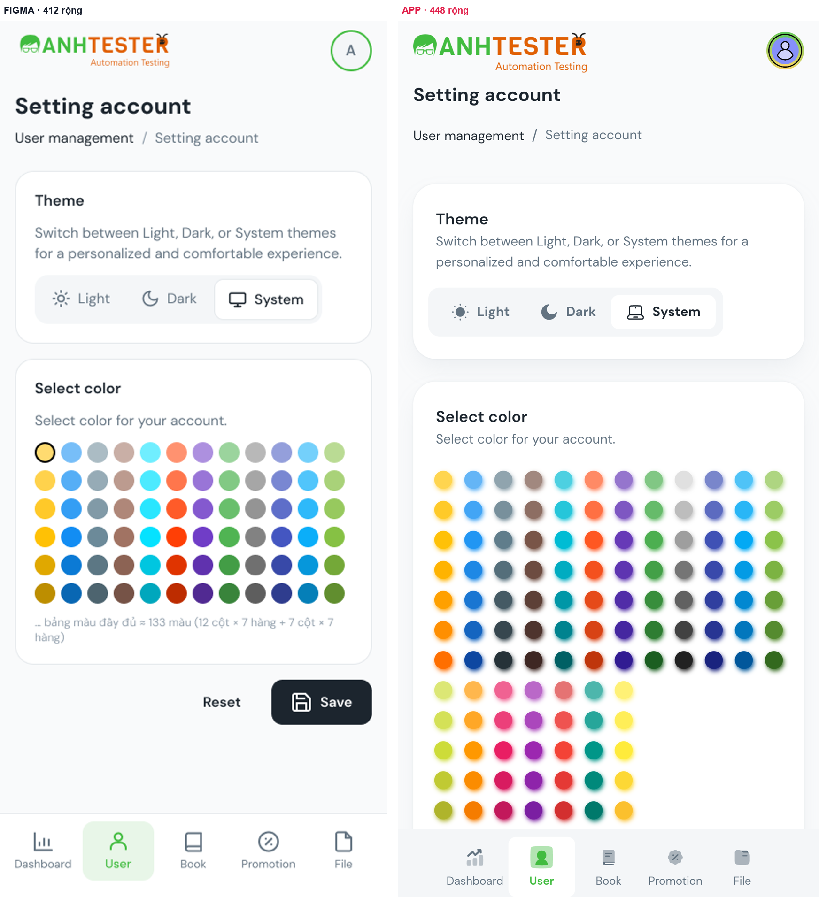

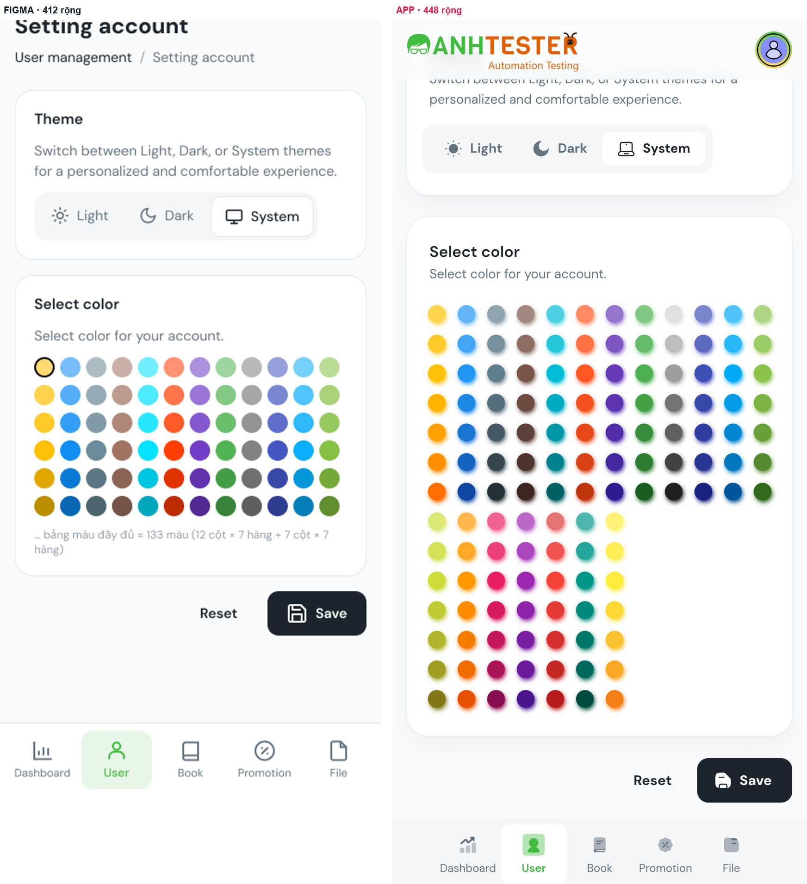

Bảng đo tự động — đoạn 1 (dc.py match)

> Khung thiết kế rộng **412** · màn thật rộng **448** (cùng đơn vị) · bỏ status bar: thiết kế 36 / thật 40 · dung sai vị trí ±4

**Tổng:** 🔍 Thiếu trên app **5** · ⚠️ Lệch nhỏ **12** · ❌ Lệch **8** · ✅ Khớp **1**

| # | Trạng thái | Chữ trong thiết kế | Trên app | Δx (neo) | Δy | Δ khoảng cách | Δ cao | Màu (thiết kế → app · ΔE) | Ghi chú |
|---|---|---|---|---|---|---|---|---|---|
| 1 | 🔍 | A | — | — | — | — | — | — |  |
| 2 | ⚠️ | Setting account | Setting account | +0 (trái) | -12 | — | +0 | — | lệch -12 tính từ đầu vùng nội dung — nguyên nhân có thể nằm ở phần tử không có chữ phía trên (ảnh, banner, header) khung phần tử app lớn hơn hộp chữ (gồm icon/padding) — không đo được số dòng, so theo tâm màu chữ không lấy mẫu được (khung có cả icon/nền) — đối chiếu bằng ảnh |
| 3 | ⚠️ | User management | User management | +0 (trái) | -1 | +11 | -3 | `#1c252e` → `#1c242c` · 0.6 | khoảng cách tới “Setting account” lệch +11 — điểm khởi phát xô lệch |
| 4 | 🔍 | / | — | — | — | — | — | — |  |
| 5 | ⚠️ | Setting account | Setting account | -9 (trái) | -3 | -2 | +0 | `#637381` → `#607080` · 1.5 |  |
| 6 | ❌ | Theme | Theme | -0.2 (tỉ lệ) | +19 | +22 | +1 | `#1c252e` → `#1c242c` · 0.6 | khoảng cách tới “Setting account” lệch +22 — điểm khởi phát xô lệch |
| 7 | ⚠️ | Switch between Light, Dark, or System themes for a personalized and comfortable experience. | Switch between Light, Dark, or System themes for a personalized and comfortable experience. | -0.2 (tỉ lệ) | +11 | -8 | -3 | `#637381` → `#607080` · 1.5 | khoảng cách tới “Theme” lệch -8 — điểm khởi phát xô lệch |
| 8 | ❌ | Light | Light | -13 (tâm-trái) | +14.5 | +3.5 | +31 | — | Δy +14.5 kế thừa từ phía trên — không tính lỗi riêng khung phần tử app lớn hơn hộp chữ (gồm icon/padding) — không đo được số dòng, so theo tâm màu chữ không lấy mẫu được (khung có cả icon/nền) — đối chiếu bằng ảnh |
| 9 | ❌ | Dark | Dark | -13.5 (tâm-trái) | +14.5 | +0 | +31 | — | Δy +14.5 kế thừa từ phía trên — không tính lỗi riêng khung phần tử app lớn hơn hộp chữ (gồm icon/padding) — không đo được số dòng, so theo tâm màu chữ không lấy mẫu được (khung có cả icon/nền) — đối chiếu bằng ảnh |
| 10 | ❌ | System | System | -15.5 (tâm-trái) | +13.5 | -1 | +31 | — | Δy +13.5 kế thừa từ phía trên — không tính lỗi riêng khung phần tử app lớn hơn hộp chữ (gồm icon/padding) — không đo được số dòng, so theo tâm màu chữ không lấy mẫu được (khung có cả icon/nền) — đối chiếu bằng ảnh |
| 11 | ❌ | Select color | Select color | -0.2 (tỉ lệ) | +29 | +15.5 | +1 | `#1c252e` → `#1c242c` · 0.6 | khoảng cách tới “System” lệch +15.5 — điểm khởi phát xô lệch |
| 12 | ⚠️ | Select color for your account. | Select color for your account. | -0.2 (tỉ lệ) | +21 | -8 | -3 | `#637381` → `#607080` · 1.5 | khoảng cách tới “Select color” lệch -8 — điểm khởi phát xô lệch |
| 13 | 🔍 | … bảng màu đầy đủ ≈ 133 màu (12 cột × 7 hàng + 7 cột × 7 hàng) | — | — | — | — | — | — |  |
| 14 | 🔍 | Reset | — | — | — | — | — | — |  |
| 15 | 🔍 | Save | — | — | — | — | — | — |  |
| 16 | ⚠️ | User | User | -4.8 (tỉ lệ · neo đáy) | -6.8 | — | +63 | — | neo đáy màn hình — Δy đo theo khoảng cách tới đáy vùng nội dung khung phần tử app lớn hơn hộp chữ (gồm icon/padding) — không đo được số dòng, so theo tâm màu chữ không lấy mẫu được (khung có cả icon/nền) — đối chiếu bằng ảnh |
| 17 | ⚠️ | Dashboard | Dashboard | -0.5 (tâm-phải · neo đáy) | -6.8 | — | +65 | — | neo đáy màn hình — Δy đo theo khoảng cách tới đáy vùng nội dung khung phần tử app lớn hơn hộp chữ (gồm icon/padding) — không đo được số dòng, so theo tâm màu chữ không lấy mẫu được (khung có cả icon/nền) — đối chiếu bằng ảnh |
| 18 | ⚠️ | Book | Book | +0 (tâm-giữa · neo đáy) | -6.8 | — | +65 | — | neo đáy màn hình — Δy đo theo khoảng cách tới đáy vùng nội dung khung phần tử app lớn hơn hộp chữ (gồm icon/padding) — không đo được số dòng, so theo tâm màu chữ không lấy mẫu được (khung có cả icon/nền) — đối chiếu bằng ảnh |
| 19 | ⚠️ | Promotion | Promotion | +2 (trái · neo đáy) | -6.8 | — | +65 | — | neo đáy màn hình — Δy đo theo khoảng cách tới đáy vùng nội dung khung phần tử app lớn hơn hộp chữ (gồm icon/padding) — không đo được số dòng, so theo tâm màu chữ không lấy mẫu được (khung có cả icon/nền) — đối chiếu bằng ảnh |
| 20 | ⚠️ | File | File | -0.5 (tâm-trái · neo đáy) | -6.8 | — | +65 | — | neo đáy màn hình — Δy đo theo khoảng cách tới đáy vùng nội dung khung phần tử app lớn hơn hộp chữ (gồm icon/padding) — không đo được số dòng, so theo tâm màu chữ không lấy mẫu được (khung có cả icon/nền) — đối chiếu bằng ảnh |

> Khối có nền/viền ghép qua chữ nằm bên trong — **heuristic**: phần tử app được chọn là khung nhỏ nhất chứa đủ các chữ đó, màu nền lấy mẫu ở mép trái. Dòng ❌ ở đây phải xem ảnh trước khi tin.

| # | Trạng thái | Khối (thiết kế) | Phần tử app | Δ rộng | Δ cao | Màu nền (thiết kế → app · ΔE) | Ghi chú |
|---|---|---|---|---|---|---|---|
| B1 | ✅ | Card · Theme [16, 196, 380, 184] | `View` [16, 214, 416, 187] | +0 | +3 | `#ffffff` → `#fcfcfc` · 0.6 |  |
| B2 | ⚠️ | Segmented · Theme [37, 307, 306, 52] | `View` [32, 324, 314, 53] | +8 | +1 | `#f4f6f8` → `#f4f4f8` · 1.7 | rộng 314 vs 306 |
| B3 | ⚠️ | Option · System [228, 311, 111, 44] | `View` [226, 324, 112, 53] | +1 | +9 | `#ffffff` → `#fcfcfc` · 0.6 | cao 53 vs 44 |
| B4 | ❌ | Card · Select color [16, 396, 380, 326] | `View` [16, 424, 416, 561] | +0 | +235 | `#ffffff` → `#fcfcfc` · 0.6 | cao 561 vs 326 |
| B5 | ❌ | BottomNav [0, 880, 412, 80] | `View` [38, 901, 372, 81] | -76 | +1 | `#ffffff` → `#f4f4f8` · 3.0 | rộng 372 vs 412 (đã trừ phần chênh bề ngang màn hình) |
| B6 | ❌ | Tab User [88, 889, 76, 63] | `View` [117, 901, 72, 81] | -4 | +18 | `#e8f6e8` → `#fcfcfc` · 9.6 | cao 81 vs 63 màu nền #fcfcfc vs #e8f6e8 (ΔE 9.6) |

Bảng đo tự động — đoạn 2 (--auto-offset) (dc.py match)

> Khung thiết kế rộng **412** · màn thật rộng **448** (cùng đơn vị) · bỏ status bar: thiết kế 36 / thật 40 · đã bù lệch dọc chung -85.5 (= độ cuộn + lệch bố cục tích luỹ phía trên, không phải độ cuộn) · dung sai vị trí ±4

**Tổng:** ⤵️ Ngoài màn hình đã chụp **2** · 🔍 Thiếu trên app **4** · ❌ Lệch **11** · ⚠️ Lệch nhỏ **4** · ✅ Khớp **6**

| # | Trạng thái | Chữ trong thiết kế | Trên app | Δx (neo) | Δy | Δ khoảng cách | Δ cao | Màu (thiết kế → app · ΔE) | Ghi chú |
|---|---|---|---|---|---|---|---|---|---|
| 1 | ⤵️ | A | — | — | — | — | — | — |  |
| 2 | ⤵️ | Setting account | — | — | — | — | — | — |  |
| 3 | 🔍 | User management | — | — | — | — | — | — |  |
| 4 | 🔍 | / | — | — | — | — | — | — |  |
| 5 | 🔍 | Setting account | — | — | — | — | — | — |  |
| 6 | ❌ | Theme | Theme | -0.2 (tỉ lệ) | -66.5 | — | +1 | `#1c252e` → `#40bc40` · 59.0 | lệch -66.5 tính từ đầu vùng nội dung — nguyên nhân có thể nằm ở phần tử không có chữ phía trên (ảnh, banner, header) màu chữ #40bc40 vs #1c252e (ΔE 59.0) |
| 7 | ⚠️ | Switch between Light, Dark, or System themes for a personalized and comfortable experience. | Switch between Light, Dark, or System themes for a personalized and comfortable experience. | -0.2 (tỉ lệ) | -74.5 | -8 | -3 | `#637381` → `#607080` · 1.5 | khoảng cách tới “Theme” lệch -8 — điểm khởi phát xô lệch |
| 8 | ❌ | Light | Light | -13 (tâm-trái) | -71 | +3.5 | +31 | — | Δy -71 kế thừa từ phía trên — không tính lỗi riêng khung phần tử app lớn hơn hộp chữ (gồm icon/padding) — không đo được số dòng, so theo tâm màu chữ không lấy mẫu được (khung có cả icon/nền) — đối chiếu bằng ảnh |
| 9 | ❌ | Dark | Dark | -13.5 (tâm-trái) | -71 | +0 | +31 | — | Δy -71 kế thừa từ phía trên — không tính lỗi riêng khung phần tử app lớn hơn hộp chữ (gồm icon/padding) — không đo được số dòng, so theo tâm màu chữ không lấy mẫu được (khung có cả icon/nền) — đối chiếu bằng ảnh |
| 10 | ❌ | System | System | -15.5 (tâm-trái) | -72 | -1 | +31 | — | Δy -72 kế thừa từ phía trên — không tính lỗi riêng khung phần tử app lớn hơn hộp chữ (gồm icon/padding) — không đo được số dòng, so theo tâm màu chữ không lấy mẫu được (khung có cả icon/nền) — đối chiếu bằng ảnh |
| 11 | ❌ | Select color | Select color | -0.2 (tỉ lệ) | -56.5 | +15.5 | +1 | `#1c252e` → `#1c242c` · 0.6 | khoảng cách tới “System” lệch +15.5 — điểm khởi phát xô lệch |
| 12 | ⚠️ | Select color for your account. | Select color for your account. | -0.2 (tỉ lệ) | -64.5 | -8 | -3 | `#637381` → `#607080` · 1.5 | khoảng cách tới “Select color” lệch -8 — điểm khởi phát xô lệch |
| 13 | 🔍 | … bảng màu đầy đủ ≈ 133 màu (12 cột × 7 hàng + 7 cột × 7 hàng) | — | — | — | — | — | — |  |
| 14 | ❌ | Reset | Reset | -3 (phải) | +166.5 | +231 | +29 | `#1c252e` → `#1c242c` · 0.6 | khoảng cách tới “Select color for your ac” lệch +231 — điểm khởi phát xô lệch cao 49 vs 20 — khác số dòng (≈2.5 vs 1.0 dòng) |
| 15 | ❌ | Save | Save | +4 (tâm-giữa) | +181 | +14.5 | +29 | — | khoảng cách tới “Reset” lệch +14.5 — điểm khởi phát xô lệch khung phần tử app lớn hơn hộp chữ (gồm icon/padding) — không đo được số dòng, so theo tâm màu chữ không lấy mẫu được (khung có cả icon/nền) — đối chiếu bằng ảnh |
| 16 | ❌ | User | User | -4.8 (tỉ lệ) | +88.5 | -92.5 | +62 | — | khoảng cách tới “Save” lệch -92.5 — điểm khởi phát xô lệch khung phần tử app lớn hơn hộp chữ (gồm icon/padding) — không đo được số dòng, so theo tâm màu chữ không lấy mẫu được (khung có cả icon/nền) — đối chiếu bằng ảnh |
| 17 | ✅ | Dashboard | Dashboard | -0.5 (tâm-phải) | +88.5 | +0 | +64 | — | Δy +88.5 kế thừa từ phía trên — không tính lỗi riêng khung phần tử app lớn hơn hộp chữ (gồm icon/padding) — không đo được số dòng, so theo tâm màu chữ không lấy mẫu được (khung có cả icon/nền) — đối chiếu bằng ảnh |
| 18 | ✅ | Book | Book | +0 (tâm-giữa) | +88.5 | +0 | +64 | — | Δy +88.5 kế thừa từ phía trên — không tính lỗi riêng khung phần tử app lớn hơn hộp chữ (gồm icon/padding) — không đo được số dòng, so theo tâm màu chữ không lấy mẫu được (khung có cả icon/nền) — đối chiếu bằng ảnh |
| 19 | ✅ | Promotion | Promotion | +2 (trái) | +88.5 | +0 | +64 | — | Δy +88.5 kế thừa từ phía trên — không tính lỗi riêng khung phần tử app lớn hơn hộp chữ (gồm icon/padding) — không đo được số dòng, so theo tâm màu chữ không lấy mẫu được (khung có cả icon/nền) — đối chiếu bằng ảnh |
| 20 | ✅ | File | File | -0.5 (tâm-trái) | +88.5 | +0 | +64 | — | Δy +88.5 kế thừa từ phía trên — không tính lỗi riêng khung phần tử app lớn hơn hộp chữ (gồm icon/padding) — không đo được số dòng, so theo tâm màu chữ không lấy mẫu được (khung có cả icon/nền) — đối chiếu bằng ảnh |

> Khối có nền/viền ghép qua chữ nằm bên trong — **heuristic**: phần tử app được chọn là khung nhỏ nhất chứa đủ các chữ đó, màu nền lấy mẫu ở mép trái. Dòng ❌ ở đây phải xem ảnh trước khi tin.

| # | Trạng thái | Khối (thiết kế) | Phần tử app | Δ rộng | Δ cao | Màu nền (thiết kế → app · ΔE) | Ghi chú |
|---|---|---|---|---|---|---|---|
| B1 | ✅ | Card · Theme [16, 196, 380, 184] | `View` [16, 43, 416, 187] | +0 | +3 | `#ffffff` → `#fcfcfc` · 0.6 |  |
| B2 | ⚠️ | Segmented · Theme [37, 307, 306, 52] | `View` [32, 153, 314, 53] | +8 | +1 | `#f4f6f8` → `#f4f4f8` · 1.7 | rộng 314 vs 306 |
| B3 | ⚠️ | Option · System [228, 311, 111, 44] | `View` [226, 153, 112, 53] | +1 | +9 | `#ffffff` → `#fcfcfc` · 0.6 | cao 53 vs 44 |
| B4 | ❌ | Card · Select color [16, 396, 380, 326] | `View` [16, 253, 416, 561] | +0 | +235 | `#ffffff` → `#fcfcfc` · 0.6 | cao 561 vs 326 |
| B5 | ✅ | Button [289, 738, 107, 48] | `Button` [329, 837, 103, 49] | -4 | +1 | `#1c252e` → `#1c242c` · 0.6 |  |
| B6 | ❌ | BottomNav [0, 880, 412, 80] | `View` [0, 902, 448, 95.3] | +0 | +15.3 | `#ffffff` → `#f4f4f8` · 3.0 | cao 95.3 vs 80 |
| B7 | ❌ | Tab User [88, 889, 76, 63] | `View` [117, 902, 72, 80] | -4 | +17 | `#e8f6e8` → `#fcfcfc` · 9.6 | cao 80 vs 63 màu nền #fcfcfc vs #e8f6e8 (ΔE 9.6) |

## 5. Khung / trạng thái không so được

| Khung | Lý do | Cần gì để so |
|---|---|---|
| A-08 — ô màu đang chọn | Ở thiết kế ô đầu có vòng chọn; trên app không nhận ra ô nào đang chọn bằng mắt ở cỡ ảnh này (màu chủ đề của tài khoản test có thể là ô khác) | Đặt về màu mặc định rồi chụp phóng to vùng bảng màu |

## 6. Ghi chú tham khảo (không tính DIFF — ngoài phạm vi của wireframe)

- Nền thẻ Welcome / thống kê trên app là **gradient** màu (xanh lơ, xanh lá, cam), thiết kế nền trắng viền `#e4e8eb`
- Banner thật (ảnh "RESTful API Book Management") thay cho khung giữ chỗ — đúng ý đồ wireframe
- Icon: menu tài khoản dùng icon **đặc** (app) so với icon **nét** (thiết kế); ô icon thẻ Welcome là ảnh avatar tròn (app) so với ô vuông bo `#cafdf5` (thiết kế); toast lỗi dùng ô icon đỏ (app) so với icon tròn nét
- Header app lấn vào vùng status bar 13 dp (header bắt đầu ở 40 dp, status bar cao 53 dp) — logo vẫn không chạm giờ/biểu tượng hệ thống trên máy này; nên kiểm thêm trên máy có notch
- Chữ trong ô nhập có giá trị dùng nhãn nổi (floating label) "Email address \*" trên viền — thiết kế không vẽ trạng thái *đã nhập* nên không so

## 7. Việc tiếp theo

- **DIFF-BK-AUTH-09** (Cần PO quyết) → PO xác nhận thẻ Promotion và khối *Test message server* có thuộc Dashboard bản chính thức không; có thì designer vẽ bản cuộn của A-04/A-05
- **14 DIFF `Design`** → gửi designer cập nhật wireframe theo app (đặc biệt DIFF-04: tách A-02 thành 2 khung *lỗi bắt buộc* và *sai mật khẩu*)
- Không DIFF nào giao `Dev` → không cần `/create-bug-report` ở lượt này
- Đã so đủ 8/8 khung · page `USER`, `BOOK` đã so — xem [danh mục](../../../README.md)
