# So thiết kế Figma ↔ Android — Quản lý sách (`BOOK`)

| Mục | Giá trị |
|---|---|
| Mode | MOBILE |
| Ngày chạy | 20-10-2026 14:50 – 15:10 |
| Figma | File `hEWOqd9cGxTwZoVOJCg7nM` · page `BOOK — Sách` · https://www.figma.com/design/hEWOqd9cGxTwZoVOJCg7nM |
| Độ trung thực thiết kế | **Wireframe có bảng màu thật** — cùng bộ kit với page AUTH. Ảnh bìa là khung giữ chỗ; tên sách, danh mục, giá, tác giả là **dữ liệu mẫu** (`Tên sách mẫu`, `Danh mục A/B/C`, `50.000 ₫`…) · B-07 vẽ sẵn ở vị trí đã cuộn |
| Phạm vi so | Nội dung chữ · có/thiếu phần tử · bố cục · trạng thái (khách / đã đăng nhập / form tạo / form sửa) · màu chữ. Ảnh bìa, icon nhãn khuyến mãi → **tham khảo** (mục 6) |
| Bản build | Android `com.canhnt14.book` 1.0 (versionCode 1) — Hybrid Capacitor, WebView không bật debug |
| Môi trường | Emulator Pixel 10 Pro XL · Android 17 · 1344×2992 px · density 480 (×3) → **448 dp** rộng · `font_scale` 1.0 · dark mode tắt · locale en_US |
| Mốc dọc | Đỉnh header: thiết kế 36 dp ↔ app **40 dp** (`--actual-top 40`) |
| Dung sai | Vị trí ±4 dp (⚠️ ≤ 12) · ΔE chữ ≤ 6 · ΔE nền ≤ 3 — rule `design_compare_rules.md` mục 4 |
| Phạm vi khung | **9/9** khung (B-01 → B-09) |
| Ảnh Figma | 7/9 khung lấy bằng `get_screenshot`. **B-08, B-09: ảnh dựng lại** từ dữ liệu đã trích (`dc.py render`) — Figma MCP báo hết lượt gọi của gói Starter. Số đo của 2 khung này **không** bị ảnh hưởng (đo từ JSON, không đo từ ảnh) |
| Dữ liệu | Môi trường dùng chung, dữ liệu sách thật. 🔒 Tên + email tác giả (B-05) đã **che** trên ảnh và trong bảng đo. Không tạo / sửa / xoá bản ghi: form *Modify book* chỉ mở xem, hộp xoá chỉ bấm *Cancel* |
| Tài khoản | Tài khoản test trong `.env` (không ghi vào tài liệu) |
| Tài liệu liên quan | REQ: [`REQUIREMENTS_BOOK_SUMMARY.md`](../../../../../requirements/_book-api/book/REQUIREMENTS_BOOK_SUMMARY.md) · cùng hệ thống: [AUTH](../../../auth/mobile/run_20261020_135829/design_compare_report.md) · [USER](../../../user/mobile/run_20261020_150000/design_compare_report.md) |
| Công cụ | `/compare-ui-from-figma-design MOBILE` · `scripts/design-compare/` (figma_extract.js · dc.py) |

## 1. Tóm tắt

| Mức độ | DIFF 🔴 Mở | Dev | Design | Cần PO quyết | ✅ Khắc phục lượt này | ⚪ Chấp nhận |
|---|---|---|---|---|---|---|
| High | 1 | | | 1 | — | — |
| Medium | 4 | 3 | 1 | | — | — |
| Low | 6 | 1 | 4 | 1 | — | — |
| **Tổng** | **11** | **4** | **5** | **2** | — (lần chạy đầu) | — |

**Nhận xét chung:** Danh sách, bộ lọc, form tạo sách bám wireframe tốt (B-06 lệch chủ yếu ⚠️ trong ngưỡng). Lỗi phía app tập trung ở **nội dung chữ**: breadcrumb trang *Modify book* ghi sai *Create a new book* (**DIFF-BK-BOOK-08**), hộp xác nhận xoá **mất tên sách** (**DIFF-BK-BOOK-11**); và bảng chọn khuyến mãi tràn ngang như bảng người dùng (**DIFF-BK-BOOK-07**, cùng gốc với DIFF-BK-USER-02). **DIFF-BK-BOOK-01** lặp lại vấn đề quyền hiển thị của khách ở page USER.

**Dùng chung với module khác (không cấp mã mới — rule `design_compare_rules.md` mục 6, *thành phần dùng chung*):** tiêu đề trang + nút *New book* → [DIFF-BK-USER-01](../../../user/mobile/run_20261020_150000/design_compare_report.md) · nút chân hộp thoại (B-09) → DIFF-BK-USER-09 · placeholder ô nhập (*Description*, *Regular price*) → [DIFF-BK-AUTH-02](../../../auth/mobile/run_20261020_135829/design_compare_report.md) · nút *Reset* xám khi form chưa sửa → DIFF-BK-AUTH-15 · avatar header → DIFF-BK-AUTH-10 · bottom nav → DIFF-BK-AUTH-11 / 12.

## 2. Bản đồ màn hình

| Mã khung | Khung Figma (node-id) | Trạng thái vẽ | Cách tới trên app | Kết quả | DIFF |
|---|---|---|---|---|---|
| B-01 | Book Management — đã đăng nhập (`9:570`) | Danh sách thẻ sách | Đăng nhập › tab *Book* | ⚠️ 1 DIFF | 02 |
| B-02 | Book Management — khách (`9:729`) | Không có *New book*, không có bút sửa | Đăng xuất › tab *Book* | ⚠️ 2 DIFF | 01 · 02 |
| B-03 | Bộ lọc mở (`9:881`) | Khoảng giá 10000 → 100000 | *Filter* › nhập 2 ô giá | ⚠️ 1 DIFF | 03 |
| B-04 | Sort By mở (`9:1053`) | Menu 4 mục | Bấm *Sort By* | ⚠️ 1 DIFF | 04 |
| B-05 | Chi tiết sách (`9:1221`) | Có giá gốc + giá giảm, tác giả | Bấm thẻ sách đầu · cuộn 2 đoạn | ⚠️ 2 DIFF | 05 · 06 |
| B-06 | Create a new book — toàn trang (`9:1303`) | Form trống | *New book* · cuộn 3 đoạn | ⚠️ 1 DIFF | 09 |
| B-07 | Chọn khuyến mãi (`9:1439`) | Bảng mã khuyến mãi mở | Form sách › *Promotion* | ⚠️ 1 DIFF | 07 |
| B-08 | Modify book — toàn trang (`9:1555`) | Form có dữ liệu | Bút sửa trên thẻ sách · cuộn 3 đoạn | ⚠️ 3 DIFF | 08 · 09 · 10 |
| B-09 | Xác nhận xoá sách (`9:1705`) | Hộp thoại xác nhận | B-08 › *Delete* (rồi *Cancel*) | ⚠️ 1 DIFF | 11 |

## 3. Danh sách DIFF

| Mã | Trạng thái | Khung | Loại | Mức độ | Ai xử lý | Mô tả | Thực tế (số đo) | Thiết kế (số đo) | Evidence |
|---|---|---|---|---|---|---|---|---|---|
| DIFF-BK-BOOK-01 | 🔴 Mở | B-02 | EXTRA | **High** | **Cần PO quyết** | Khách (chưa đăng nhập) vẫn thấy nút **New book** và biểu tượng **bút sửa** trên thẻ sách — thiết kế B-02 bỏ cả hai | Nút 124 × 36 dp · bút sửa 36 × 36 dp trên mọi thẻ | Không có | [B-02 side](evidence/B-02_book_list_guest_side.png) · [marked](evidence/B-02_book_list_guest_marked.png) |
| DIFF-BK-BOOK-02 | 🔴 Mở | B-01 → B-04 | CONTENT | Low | **Cần PO quyết** | Ngày trên thẻ sách định dạng tên tháng viết tắt tiếng Việt, dù máy để locale en_US | `23 Th12 2025` | `23/12/2025` | [marked](evidence/B-02_book_list_guest_marked.png) |
| DIFF-BK-BOOK-03 | 🔴 Mở | B-03 | STATE | Low | **Dev** | Đã nhập khoảng giá nhưng dòng mô tả vẫn báo *Price not specified*; hai danh sách gợi ý giá mở cùng lúc, che dòng mô tả và thanh danh mục; không có nút xoá × | `Price not specified` · 2 danh sách gợi ý mở | `Price between 10.000 ₫ and 100.000 ₫` · nút × cuối ô | [B-03 side](evidence/B-03_book_price_filter_side.png) · [marked](evidence/B-03_book_price_filter_marked.png) |
| DIFF-BK-BOOK-04 | 🔴 Mở | B-04 | LAYOUT | Low | Design | Menu *Sort By* hẹp hơn, sát mép phải | **160** × 224 dp · x 272 | **220** × 208 dp · x 176 | [marked](evidence/B-04_book_sort_menu_marked.png) |
| DIFF-BK-BOOK-05 | 🔴 Mở | B-05 | EXTRA | **Medium** | Design | Trang chi tiết có thêm liên kết **Back** và dãy **chip khuyến mãi** (*Mã Giảm Giá* × 6); thiết kế có nhãn **NEW** mà app không hiện | *Back* 74 × 36 dp · 6 chip 2 hàng · không có *NEW* | Không có *Back*, không có chip · nhãn *NEW* | [B-05 side đoạn 1](evidence/B-05_book_detail_side_part1.png) · [marked](evidence/B-05_book_detail_marked_part1.png) |
| DIFF-BK-BOOK-06 | 🔴 Mở | B-05 | LAYOUT | Low | Design | Ảnh carousel lớn hơn; khoảng trống giữa tên sách và giá lớn | Carousel 416 × **368 dp** · tên → giá gốc **≈ 40 dp** | 380 × **300 dp** · **6 dp** | [marked](evidence/B-05_book_detail_marked_part2.png) |
| DIFF-BK-BOOK-07 | 🔴 Mở | B-07 | LAYOUT | **Medium** | **Dev** | Bảng chọn khuyến mãi tràn ngang: cột *CODE* rộng gần gấp đôi, cột *Name* bị cắt ở mép phải và xuống 3 dòng làm hàng cao lên | Cột CODE **219 dp** · hàng cao **90 dp** · *Name* bị cắt | Cột CODE 118 dp · hàng **69 dp** · *Name* + mô tả đủ | [B-07 side](evidence/B-07_select_promotion_side.png) · [marked](evidence/B-07_select_promotion_marked.png) |
| DIFF-BK-BOOK-08 | 🔴 Mở | B-08 | CONTENT | **Medium** | **Dev** | Breadcrumb của trang **Modify book** ghi sai tên trang | `Book management / Create a new book` | `Book management / Modify book` | [marked](evidence/B-08_modify_book_marked_part1.png) |
| DIFF-BK-BOOK-09 | 🔴 Mở | B-06 · B-08 | LAYOUT | Low | Design | Hàng *Available book* / *Reset* và nút *Create book* / *Save changes* thụt vào so với lề thẻ | Nút bắt đầu x **32 dp** · toggle x 28 | Nút và toggle sát lề **16 dp** | [marked](evidence/B-06_create_book_marked_part3.png) |
| DIFF-BK-BOOK-10 | 🔴 Mở | B-08 | STATE | Low | Design | Form sửa hiện ảnh đã tải (ảnh thu nhỏ có nút ×) và nút **Remove all** dưới vùng thả file — thiết kế B-08 vẽ vùng thả file trống như form tạo | Ảnh thu nhỏ + *Remove all* 88 × 31 dp | Vùng thả file trống | [marked](evidence/B-08_modify_book_marked_part2.png) |
| DIFF-BK-BOOK-11 | 🔴 Mở | B-09 | CONTENT | **Medium** | **Dev** | Câu xác nhận xoá **thiếu tên sách** — người dùng không biết đang xoá sách nào | `Do you want delete , after delete you can't undo` | `Do you want delete <tên sách>, after delete you can't undo` | [B-09 side](evidence/B-09_delete_book_confirm_side.png) · [marked](evidence/B-09_delete_book_confirm_marked.png) |

## 4. Chi tiết từng khung

Mốc so: dp, tính từ đỉnh header ở cả hai phía (`--actual-top 40`). Bảng đo là **dữ liệu thô** của `dc.py match` — kết luận nằm ở mục 3. Thẻ sách (`BookCard` × 2) được nhận là **danh sách** — chữ trong thẻ là dữ liệu mẫu (❔). Dấu `/` của breadcrumb là icon trên app nên luôn báo 🔍 — **không** phải DIFF.

### B-01 · Book Management — đã đăng nhập

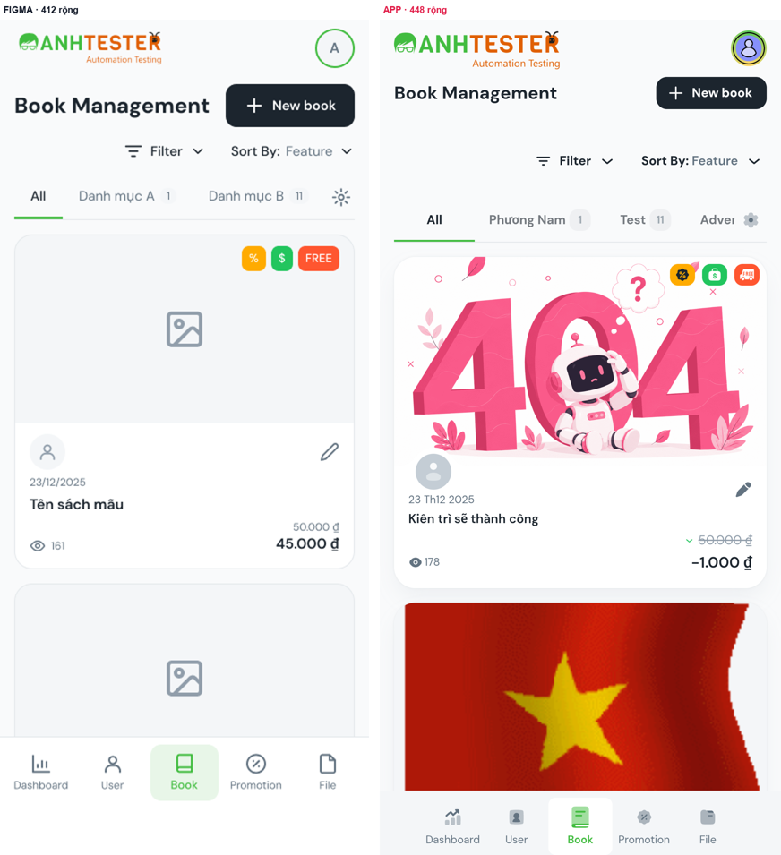

Bảng đo tự động (dc.py match)

> Khung thiết kế rộng **412** · màn thật rộng **448** (cùng đơn vị) · bỏ status bar: thiết kế 36 / thật 40 · dung sai vị trí ±4
> Danh sách lặp trong thiết kế: `BookCard` × 2 (cao 374) — chữ bên trong là dữ liệu mẫu; so chiều cao hàng, cột, căn lề bằng ảnh
> Dữ liệu mẫu khai báo tay (coi như ô động): `Danh mục A` · `Danh mục B` · `Danh mục C`

**Tổng:** 🔍 Thiếu trên app **3** · ❌ Lệch **8** · ⚠️ Lệch nhỏ **1** · ❔ Không so được **15** · ⤵️ Ngoài màn hình đã chụp **1**

| # | Trạng thái | Chữ trong thiết kế | Trên app | Δx (neo) | Δy | Δ khoảng cách | Δ cao | Màu (thiết kế → app · ΔE) | Ghi chú |
|---|---|---|---|---|---|---|---|---|---|
| 1 | 🔍 | A | — | — | — | — | — | — |  |
| 2 | ❌ | Book Management | Book Management | +0 (trái) | -14 | — | +0 | `#1c252e` → `#1c242c` · 0.6 | lệch -14 tính từ đầu vùng nội dung — nguyên nhân có thể nằm ở phần tử không có chữ phía trên (ảnh, banner, header) |
| 3 | ⚠️ | New book | New book | +8 (phải) | -14 | +0 | -1 | `#ffffff` → `#fcfcfc` · 0.6 | Δy -14 kế thừa từ phía trên — không tính lỗi riêng |
| 4 | ❌ | Filter | Filter | +0 (trái) | +11 | +25 | +14 | — | khoảng cách tới “New book” lệch +25 — điểm khởi phát xô lệch khung phần tử app lớn hơn hộp chữ (gồm icon/padding) — không đo được số dòng, so theo tâm màu chữ không lấy mẫu được (khung có cả icon/nền) — đối chiếu bằng ảnh |
| 5 | ❔ | Sort By: | Sort By:  Feature | — | — | — | — | — | chữ có trên app nhưng nằm chung node “Sort By:  Feature” — vị trí, màu không đo tự động, đối chiếu bằng ảnh |
| 6 | ❔ | Feature | Sort By:  Feature | — | — | — | — | — | chữ có trên app nhưng nằm chung node “Sort By:  Feature” — vị trí, màu không đo tự động, đối chiếu bằng ảnh |
| 7 | ❌ | All | All | +0 (tâm-giữa) | +27 | +16 | +26 | — | khoảng cách tới “Filter” lệch +16 — điểm khởi phát xô lệch khung phần tử app lớn hơn hộp chữ (gồm icon/padding) — không đo được số dòng, so theo tâm màu chữ không lấy mẫu được (khung có cả icon/nền) — đối chiếu bằng ảnh |
| 8 | ❌ | <mẫu:Danh mục A> | Phương Nam 1 | +0 (giữa) | +14 | -13 | +26 | `#637381` → `#747880` · 5.7 | khoảng cách tới “All” lệch -13 — điểm khởi phát xô lệch cao 48 vs 22 — khác số dòng (≈2.2 vs 1.0 dòng) |
| 9 | ❌ | <mẫu:Danh mục B> | Test 11 | +0 (giữa) | +14 | +0 | +26 | `#637381` → `#747880` · 5.7 | Δy +14 kế thừa từ phía trên — không tính lỗi riêng cao 48 vs 22 — khác số dòng (≈2.2 vs 1.0 dòng) |
| 10 | ❌ | <mẫu:Danh mục C> | Adventure1 1 | -40 (trái) | +14 | +0 | +26 | `#637381` → `#747880` · 5.7 | Δy +14 kế thừa từ phía trên — không tính lỗi riêng cao 48 vs 22 — khác số dòng (≈2.2 vs 1.0 dòng) |
| 11 | 🔍 | 1 | — | — | — | — | — | — |  |
| 12 | 🔍 | 11 | — | — | — | — | — | — |  |
| 13 | ⤵️ | 4 | — | — | — | — | — | — | nằm ngoài bề ngang khung — vùng cuộn ngang, so khi cuộn tới |
| 14 | ❔ | % | — | — | — | — | — | — | dữ liệu mẫu trong hàng lặp — so cấu trúc hàng (cao, cột, căn) bằng ảnh, không so chữ |
| 15 | ❔ | $ | — | — | — | — | — | — | dữ liệu mẫu trong hàng lặp — so cấu trúc hàng (cao, cột, căn) bằng ảnh, không so chữ |
| 16 | ❔ | FREE | — | — | — | — | — | — | dữ liệu mẫu trong hàng lặp — so cấu trúc hàng (cao, cột, căn) bằng ảnh, không so chữ |
| 17 | ❔ | 23/12/2025 | — | — | — | — | — | — | dữ liệu mẫu trong hàng lặp — so cấu trúc hàng (cao, cột, căn) bằng ảnh, không so chữ |
| 18 | ❔ | Tên sách mẫu | — | — | — | — | — | — | dữ liệu mẫu trong hàng lặp — so cấu trúc hàng (cao, cột, căn) bằng ảnh, không so chữ |
| 19 | ❔ | 50.000 ₫ | — | — | — | — | — | — | dữ liệu mẫu trong hàng lặp — so cấu trúc hàng (cao, cột, căn) bằng ảnh, không so chữ |
| 20 | ❔ | 45.000 ₫ | — | — | — | — | — | — | dữ liệu mẫu trong hàng lặp — so cấu trúc hàng (cao, cột, căn) bằng ảnh, không so chữ |
| 21 | ❔ | 161 | — | — | — | — | — | — | dữ liệu mẫu trong hàng lặp — so cấu trúc hàng (cao, cột, căn) bằng ảnh, không so chữ |
| 22 | ❔ | 23/12/2025 | — | — | — | — | — | — | dữ liệu mẫu trong hàng lặp — so cấu trúc hàng (cao, cột, căn) bằng ảnh, không so chữ |
| 23 | ❔ | Sách mẫu thứ hai | — | — | — | — | — | — | dữ liệu mẫu trong hàng lặp — so cấu trúc hàng (cao, cột, căn) bằng ảnh, không so chữ |
| 24 | ❔ | 50.000 ₫ | — | — | — | — | — | — | dữ liệu mẫu trong hàng lặp — so cấu trúc hàng (cao, cột, căn) bằng ảnh, không so chữ |
| 25 | ❔ | 45.000 ₫ | — | — | — | — | — | — | dữ liệu mẫu trong hàng lặp — so cấu trúc hàng (cao, cột, căn) bằng ảnh, không so chữ |
| 26 | ❔ | 161 | — | — | — | — | — | — | dữ liệu mẫu trong hàng lặp — so cấu trúc hàng (cao, cột, căn) bằng ảnh, không so chữ |

> Khối có nền/viền ghép qua chữ nằm bên trong — **heuristic**: phần tử app được chọn là khung nhỏ nhất chứa đủ các chữ đó, màu nền lấy mẫu ở mép trái. Dòng ❌ ở đây phải xem ảnh trước khi tin.

| # | Trạng thái | Khối (thiết kế) | Phần tử app | Δ rộng | Δ cao | Màu nền (thiết kế → app · ΔE) | Ghi chú |
|---|---|---|---|---|---|---|---|
| B1 | ❌ | Button [252, 108, 144, 48] | `View` [308, 104, 124, 36] | -20 | -12 | `#1c252e` → `#1c242c` · 0.6 | cao 36 vs 48 rộng 124 vs 144 |
| B2 | ❌ | Category tabs [16, 210, 380, 50] | `View` [16, 240, 380, 48] | -36 | -2 | — | rộng 380 vs 380 (đã trừ phần chênh bề ngang màn hình) |

### B-02 · Book Management — khách

Bảng đo tự động (dc.py match)

> Khung thiết kế rộng **412** · màn thật rộng **448** (cùng đơn vị) · bỏ status bar: thiết kế 36 / thật 40 · dung sai vị trí ±4
> Danh sách lặp trong thiết kế: `BookCard` × 2 (cao 374) — chữ bên trong là dữ liệu mẫu; so chiều cao hàng, cột, căn lề bằng ảnh
> Dữ liệu mẫu khai báo tay (coi như ô động): `Danh mục A` · `Danh mục B` · `Danh mục C`

**Tổng:** ⚠️ Lệch nhỏ **1** · ❌ Lệch **6** · ❔ Không so được **15** · 🔍 Thiếu trên app **2** · ⤵️ Ngoài màn hình đã chụp **1** · ➕ Thừa trên app **1**

| # | Trạng thái | Chữ trong thiết kế | Trên app | Δx (neo) | Δy | Δ khoảng cách | Δ cao | Màu (thiết kế → app · ΔE) | Ghi chú |
|---|---|---|---|---|---|---|---|---|---|
| 1 | ⚠️ | Book Management | Book Management | +0 (trái) | -5 | — | +0 | `#1c252e` → `#1c242c` · 0.6 | lệch -5 tính từ đầu vùng nội dung — nguyên nhân có thể nằm ở phần tử không có chữ phía trên (ảnh, banner, header) |
| 2 | ❌ | Filter | Filter | +0 (trái) | +29 | +34 | +14 | — | khoảng cách tới “Book Management” lệch +34 — điểm khởi phát xô lệch khung phần tử app lớn hơn hộp chữ (gồm icon/padding) — không đo được số dòng, so theo tâm màu chữ không lấy mẫu được (khung có cả icon/nền) — đối chiếu bằng ảnh |
| 3 | ❔ | Sort By: | Sort By:  Feature | — | — | — | — | — | chữ có trên app nhưng nằm chung node “Sort By:  Feature” — vị trí, màu không đo tự động, đối chiếu bằng ảnh |
| 4 | ❔ | Feature | Sort By:  Feature | — | — | — | — | — | chữ có trên app nhưng nằm chung node “Sort By:  Feature” — vị trí, màu không đo tự động, đối chiếu bằng ảnh |
| 5 | ❌ | All | All | +0 (tâm-giữa) | +45 | +16 | +26 | — | khoảng cách tới “Filter” lệch +16 — điểm khởi phát xô lệch khung phần tử app lớn hơn hộp chữ (gồm icon/padding) — không đo được số dòng, so theo tâm màu chữ không lấy mẫu được (khung có cả icon/nền) — đối chiếu bằng ảnh |
| 6 | ❌ | <mẫu:Danh mục A> | Phương Nam 1 | +0 (giữa) | +32 | -13 | +26 | `#637381` → `#747880` · 5.7 | khoảng cách tới “All” lệch -13 — điểm khởi phát xô lệch cao 48 vs 22 — khác số dòng (≈2.2 vs 1.0 dòng) |
| 7 | ❌ | <mẫu:Danh mục B> | Test 11 | +0 (giữa) | +32 | +0 | +26 | `#637381` → `#747880` · 5.7 | Δy +32 kế thừa từ phía trên — không tính lỗi riêng cao 48 vs 22 — khác số dòng (≈2.2 vs 1.0 dòng) |
| 8 | ❌ | <mẫu:Danh mục C> | Adventure1 1 | -40 (trái) | +32 | +0 | +26 | `#637381` → `#747880` · 5.7 | Δy +32 kế thừa từ phía trên — không tính lỗi riêng cao 48 vs 22 — khác số dòng (≈2.2 vs 1.0 dòng) |
| 9 | 🔍 | 1 | — | — | — | — | — | — |  |
| 10 | 🔍 | 11 | — | — | — | — | — | — |  |
| 11 | ⤵️ | 4 | — | — | — | — | — | — | nằm ngoài bề ngang khung — vùng cuộn ngang, so khi cuộn tới |
| 12 | ❔ | % | — | — | — | — | — | — | dữ liệu mẫu trong hàng lặp — so cấu trúc hàng (cao, cột, căn) bằng ảnh, không so chữ |
| 13 | ❔ | $ | — | — | — | — | — | — | dữ liệu mẫu trong hàng lặp — so cấu trúc hàng (cao, cột, căn) bằng ảnh, không so chữ |
| 14 | ❔ | FREE | — | — | — | — | — | — | dữ liệu mẫu trong hàng lặp — so cấu trúc hàng (cao, cột, căn) bằng ảnh, không so chữ |
| 15 | ❔ | 23/12/2025 | — | — | — | — | — | — | dữ liệu mẫu trong hàng lặp — so cấu trúc hàng (cao, cột, căn) bằng ảnh, không so chữ |
| 16 | ❔ | Tên sách mẫu | — | — | — | — | — | — | dữ liệu mẫu trong hàng lặp — so cấu trúc hàng (cao, cột, căn) bằng ảnh, không so chữ |
| 17 | ❔ | 50.000 ₫ | — | — | — | — | — | — | dữ liệu mẫu trong hàng lặp — so cấu trúc hàng (cao, cột, căn) bằng ảnh, không so chữ |
| 18 | ❔ | 45.000 ₫ | — | — | — | — | — | — | dữ liệu mẫu trong hàng lặp — so cấu trúc hàng (cao, cột, căn) bằng ảnh, không so chữ |
| 19 | ❔ | 161 | — | — | — | — | — | — | dữ liệu mẫu trong hàng lặp — so cấu trúc hàng (cao, cột, căn) bằng ảnh, không so chữ |
| 20 | ❔ | 23/12/2025 | — | — | — | — | — | — | dữ liệu mẫu trong hàng lặp — so cấu trúc hàng (cao, cột, căn) bằng ảnh, không so chữ |
| 21 | ❔ | Sách mẫu thứ hai | — | — | — | — | — | — | dữ liệu mẫu trong hàng lặp — so cấu trúc hàng (cao, cột, căn) bằng ảnh, không so chữ |
| 22 | ❔ | 50.000 ₫ | — | — | — | — | — | — | dữ liệu mẫu trong hàng lặp — so cấu trúc hàng (cao, cột, căn) bằng ảnh, không so chữ |
| 23 | ❔ | 45.000 ₫ | — | — | — | — | — | — | dữ liệu mẫu trong hàng lặp — so cấu trúc hàng (cao, cột, căn) bằng ảnh, không so chữ |
| 24 | ❔ | 161 | — | — | — | — | — | — | dữ liệu mẫu trong hàng lặp — so cấu trúc hàng (cao, cột, căn) bằng ảnh, không so chữ |

> Khối có nền/viền ghép qua chữ nằm bên trong — **heuristic**: phần tử app được chọn là khung nhỏ nhất chứa đủ các chữ đó, màu nền lấy mẫu ở mép trái. Dòng ❌ ở đây phải xem ảnh trước khi tin.

| # | Trạng thái | Khối (thiết kế) | Phần tử app | Δ rộng | Δ cao | Màu nền (thiết kế → app · ΔE) | Ghi chú |
|---|---|---|---|---|---|---|---|
| B1 | ❌ | Category tabs [16, 192, 380, 50] | `View` [16, 240, 380, 48] | -36 | -2 | — | rộng 380 vs 380 (đã trừ phần chênh bề ngang màn hình) |

| ➕ Chữ có trên app nhưng không có trong thiết kế | Loại | Vị trí |
|---|---|---|
| New book | text | [348, 112, 68, 19] |

### B-03 · Bộ lọc mở (khoảng giá 10000 → 100000)

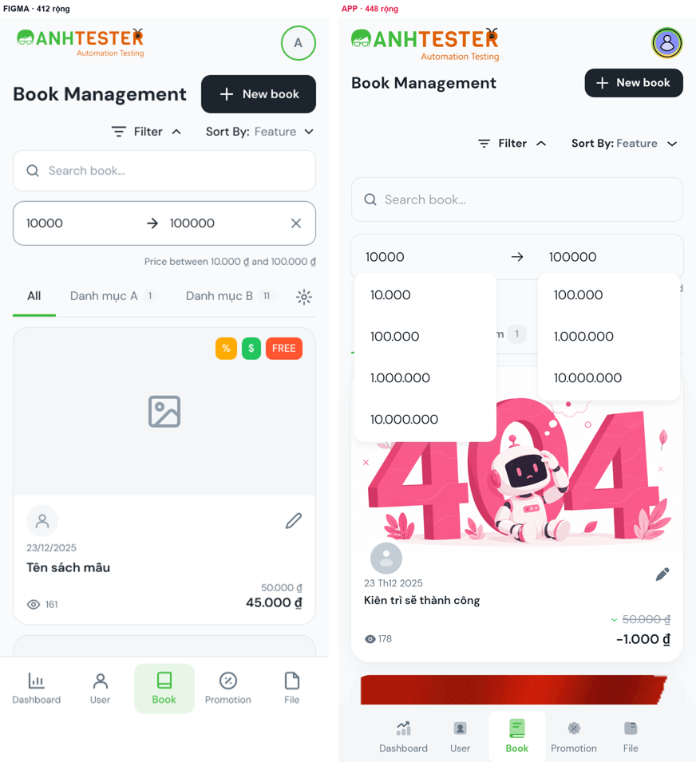

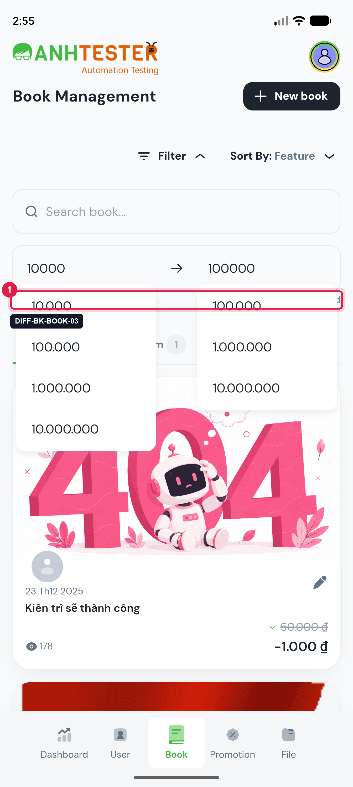

Bảng đo tự động (dc.py match)

> Khung thiết kế rộng **412** · màn thật rộng **448** (cùng đơn vị) · bỏ status bar: thiết kế 36 / thật 40 · dung sai vị trí ±4
> Danh sách lặp trong thiết kế: `BookCard` × 2 (cao 374) — chữ bên trong là dữ liệu mẫu; so chiều cao hàng, cột, căn lề bằng ảnh
> Dữ liệu mẫu khai báo tay (coi như ô động): `Danh mục A` · `Danh mục B` · `Danh mục C`

**Tổng:** 🔍 Thiếu trên app **5** · ❌ Lệch **7** · ⚠️ Lệch nhỏ **3** · ❔ Không so được **15** · ⤵️ Ngoài màn hình đã chụp **1** · ➕ Thừa trên app **5** · ✅ Khớp **1**

| # | Trạng thái | Chữ trong thiết kế | Trên app | Δx (neo) | Δy | Δ khoảng cách | Δ cao | Màu (thiết kế → app · ΔE) | Ghi chú |
|---|---|---|---|---|---|---|---|---|---|
| 1 | 🔍 | A | — | — | — | — | — | — |  |
| 2 | ❌ | Book Management | Book Management | +0 (trái) | -14 | — | +0 | `#1c252e` → `#1c242c` · 0.6 | lệch -14 tính từ đầu vùng nội dung — nguyên nhân có thể nằm ở phần tử không có chữ phía trên (ảnh, banner, header) |
| 3 | ⚠️ | New book | New book | +8 (phải) | -14 | +0 | -1 | `#ffffff` → `#fcfcfc` · 0.6 | Δy -14 kế thừa từ phía trên — không tính lỗi riêng |
| 4 | ❌ | Filter | Filter | +0 (trái) | +15 | +29 | +14 | — | khoảng cách tới “New book” lệch +29 — điểm khởi phát xô lệch khung phần tử app lớn hơn hộp chữ (gồm icon/padding) — không đo được số dòng, so theo tâm màu chữ không lấy mẫu được (khung có cả icon/nền) — đối chiếu bằng ảnh |
| 5 | ❔ | Sort By: | Sort By:  Feature | — | — | — | — | — | chữ có trên app nhưng nằm chung node “Sort By:  Feature” — vị trí, màu không đo tự động, đối chiếu bằng ảnh |
| 6 | ❔ | Feature | Sort By:  Feature | — | — | — | — | — | chữ có trên app nhưng nằm chung node “Sort By:  Feature” — vị trí, màu không đo tự động, đối chiếu bằng ảnh |
| 7 | 🔍 | Search book... | — | — | — | — | — | — |  |
| 8 | ❌ | 10000 | 10000 | -7 (trái) | +39 | +24 | +6 | — | ô nhập đang có giá trị — không phải placeholder khoảng cách tới “Filter” lệch +24 — điểm khởi phát xô lệch |
| 9 | ⚠️ | 100000 | 100000 | +7 (phải) | +39 | +0 | +6 | — | ô nhập đang có giá trị — không phải placeholder Δy +39 kế thừa từ phía trên — không tính lỗi riêng |
| 10 | 🔍 | Price between 10.000 ₫ and 100.000 ₫ | — | — | — | — | — | — |  |
| 11 | ⚠️ | All | All | +0 (tâm-giữa) | +48 | +9 | +26 | — | khoảng cách tới “100000” lệch +9 — điểm khởi phát xô lệch khung phần tử app lớn hơn hộp chữ (gồm icon/padding) — không đo được số dòng, so theo tâm màu chữ không lấy mẫu được (khung có cả icon/nền) — đối chiếu bằng ảnh |
| 12 | ❌ | <mẫu:Danh mục A> | Price not specified | +57.5 (tâm-phải) | -9 | -57 | -4 | — | khoảng cách tới “All” lệch -57 — điểm khởi phát xô lệch khung phần tử app lớn hơn hộp chữ (gồm icon/padding) — không đo được số dòng, so theo tâm màu chữ không lấy mẫu được (khung có cả icon/nền) — đối chiếu bằng ảnh |
| 13 | ❌ | <mẫu:Danh mục B> | Test 11 | +0 (giữa) | +35 | +44 | +26 | `#637381` → `#1c242c` · 26.6 | khoảng cách tới “<mẫu:Danh mục A>” lệch +44 — điểm khởi phát xô lệch cao 48 vs 22 — khác số dòng (≈2.2 vs 1.0 dòng) màu chữ #1c242c vs #637381 (ΔE 26.6) |
| 14 | ❌ | <mẫu:Danh mục C> | Adventure1 1 | -40 (trái) | +35 | +0 | +26 | `#637381` → `#1c242c` · 26.6 | Δy +35 kế thừa từ phía trên — không tính lỗi riêng cao 48 vs 22 — khác số dòng (≈2.2 vs 1.0 dòng) màu chữ #1c242c vs #637381 (ΔE 26.6) |
| 15 | 🔍 | 1 | — | — | — | — | — | — |  |
| 16 | 🔍 | 11 | — | — | — | — | — | — |  |
| 17 | ⤵️ | 4 | — | — | — | — | — | — | nằm ngoài bề ngang khung — vùng cuộn ngang, so khi cuộn tới |
| 18 | ❔ | % | — | — | — | — | — | — | dữ liệu mẫu trong hàng lặp — so cấu trúc hàng (cao, cột, căn) bằng ảnh, không so chữ |
| 19 | ❔ | $ | — | — | — | — | — | — | dữ liệu mẫu trong hàng lặp — so cấu trúc hàng (cao, cột, căn) bằng ảnh, không so chữ |
| 20 | ❔ | FREE | — | — | — | — | — | — | dữ liệu mẫu trong hàng lặp — so cấu trúc hàng (cao, cột, căn) bằng ảnh, không so chữ |
| 21 | ❔ | 23/12/2025 | — | — | — | — | — | — | dữ liệu mẫu trong hàng lặp — so cấu trúc hàng (cao, cột, căn) bằng ảnh, không so chữ |
| 22 | ❔ | Tên sách mẫu | — | — | — | — | — | — | dữ liệu mẫu trong hàng lặp — so cấu trúc hàng (cao, cột, căn) bằng ảnh, không so chữ |
| 23 | ❔ | 50.000 ₫ | — | — | — | — | — | — | dữ liệu mẫu trong hàng lặp — so cấu trúc hàng (cao, cột, căn) bằng ảnh, không so chữ |
| 24 | ❔ | 45.000 ₫ | — | — | — | — | — | — | dữ liệu mẫu trong hàng lặp — so cấu trúc hàng (cao, cột, căn) bằng ảnh, không so chữ |
| 25 | ❔ | 161 | — | — | — | — | — | — | dữ liệu mẫu trong hàng lặp — so cấu trúc hàng (cao, cột, căn) bằng ảnh, không so chữ |
| 26 | ❔ | 23/12/2025 | — | — | — | — | — | — | dữ liệu mẫu trong hàng lặp — so cấu trúc hàng (cao, cột, căn) bằng ảnh, không so chữ |
| 27 | ❔ | Sách mẫu thứ hai | — | — | — | — | — | — | dữ liệu mẫu trong hàng lặp — so cấu trúc hàng (cao, cột, căn) bằng ảnh, không so chữ |
| 28 | ❔ | 50.000 ₫ | — | — | — | — | — | — | dữ liệu mẫu trong hàng lặp — so cấu trúc hàng (cao, cột, căn) bằng ảnh, không so chữ |
| 29 | ❔ | 45.000 ₫ | — | — | — | — | — | — | dữ liệu mẫu trong hàng lặp — so cấu trúc hàng (cao, cột, căn) bằng ảnh, không so chữ |
| 30 | ❔ | 161 | — | — | — | — | — | — | dữ liệu mẫu trong hàng lặp — so cấu trúc hàng (cao, cột, căn) bằng ảnh, không so chữ |

> Khối có nền/viền ghép qua chữ nằm bên trong — **heuristic**: phần tử app được chọn là khung nhỏ nhất chứa đủ các chữ đó, màu nền lấy mẫu ở mép trái. Dòng ❌ ở đây phải xem ảnh trước khi tin.

| # | Trạng thái | Khối (thiết kế) | Phần tử app | Δ rộng | Δ cao | Màu nền (thiết kế → app · ΔE) | Ghi chú |
|---|---|---|---|---|---|---|---|
| B1 | ❌ | Button [252, 108, 144, 48] | `View` [308, 104, 124, 36] | -20 | -12 | `#1c252e` → `#1c242c` · 0.6 | cao 36 vs 48 rộng 124 vs 144 |
| B2 | ✅ | Price range [16, 266, 380, 56] | `View` [16, 312, 416, 56] | +0 | +0 | `#ffffff` → `#f8f8f8` · 1.4 |  |

| ➕ Chữ có trên app nhưng không có trong thiết kế | Loại | Vị trí |
|---|---|---|
| Phương Nam 1 | text | [106, 413, 146, 48] |
| 10.000 | text | [24, 364, 170, 48] |
| 100.000 | text | [24, 416, 170, 48] |
| 100.000 | text | [254, 364, 170, 48] |
| 1.000.000 | text | [254, 416, 170, 48] |

### B-04 · Sort By mở (`SCOPE = Menu`)

Bảng đo tự động (dc.py match)

> Khung thiết kế rộng **412** · màn thật rộng **448** (cùng đơn vị) · bỏ status bar: thiết kế 36 / thật 40 · đã bù lệch dọc chung 8 (= độ cuộn + lệch bố cục tích luỹ phía trên, không phải độ cuộn) · dung sai vị trí ±4
> lớp phủ `Menu`: thiết kế y 204 · app y 216 — chữ đo tương đối với khung lớp phủ (đã bù +8)

**Tổng:** ❌ Lệch **6**

| # | Trạng thái | Chữ trong thiết kế | Trên app | Δx (neo) | Δy | Δ khoảng cách | Δ cao | Màu (thiết kế → app · ΔE) | Ghi chú |
|---|---|---|---|---|---|---|---|---|---|
| 1 | ❌ | Feature | Feature | +43 (phải) | -4 | — | +26 | — | khung phần tử app lớn hơn hộp chữ (gồm icon/padding) — không đo được số dòng, so theo tâm màu chữ không lấy mẫu được (khung có cả icon/nền) — đối chiếu bằng ảnh |
| 2 | ❌ | Newest | Newest | +43 (phải) | +4 | +8 | +26 | — | khoảng cách tới “Feature” lệch +8 — điểm khởi phát xô lệch khung phần tử app lớn hơn hộp chữ (gồm icon/padding) — không đo được số dòng, so theo tâm màu chữ không lấy mẫu được (khung có cả icon/nền) — đối chiếu bằng ảnh |
| 3 | ❌ | Price: Low to High | Price: Low to High | +43 (phải) | -1 | -5 | +26 | `#1c252e` → `#1c242c` · 0.6 | khoảng cách tới “Newest” lệch -5 — điểm khởi phát xô lệch cao 48 vs 22 — khác số dòng (≈2.2 vs 1.0 dòng) |
| 4 | ❌ | Price: High to Low | Price: High to Low | +43 (phải) | +7 | +8 | +26 | `#1c252e` → `#1c242c` · 0.6 | khoảng cách tới “Price: Low to High” lệch +8 — điểm khởi phát xô lệch cao 48 vs 22 — khác số dòng (≈2.2 vs 1.0 dòng) |

> Khối có nền/viền ghép qua chữ nằm bên trong — **heuristic**: phần tử app được chọn là khung nhỏ nhất chứa đủ các chữ đó, màu nền lấy mẫu ở mép trái. Dòng ❌ ở đây phải xem ảnh trước khi tin.

| # | Trạng thái | Khối (thiết kế) | Phần tử app | Δ rộng | Δ cao | Màu nền (thiết kế → app · ΔE) | Ghi chú |
|---|---|---|---|---|---|---|---|
| B1 | ❌ | Menu [176, 204, 220, 208] | `View` [272, 216, 160, 224] | -60 | +16 | `#ffffff` → `#fcfcfc` · 0.6 | cao 224 vs 208 rộng 160 vs 220 |
| B2 | ❌ | Item · Feature [185, 213, 202, 46] | `MenuItem` [276, 220, 152, 48] | -50 | +2 | `#f4f6f8` → `#ececf0` · 2.6 | rộng 152 vs 202 |

### B-05 · Chi tiết sách (2 đoạn cuộn)

> Tên, danh mục, giá, tác giả trong thiết kế là **dữ liệu mẫu** (`--sample`). 🔒 Tên + email tác giả thật đã **che** trên ảnh và trong bảng đo.

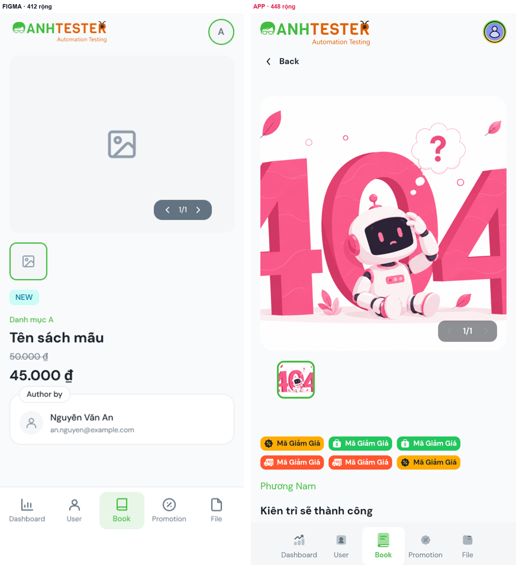

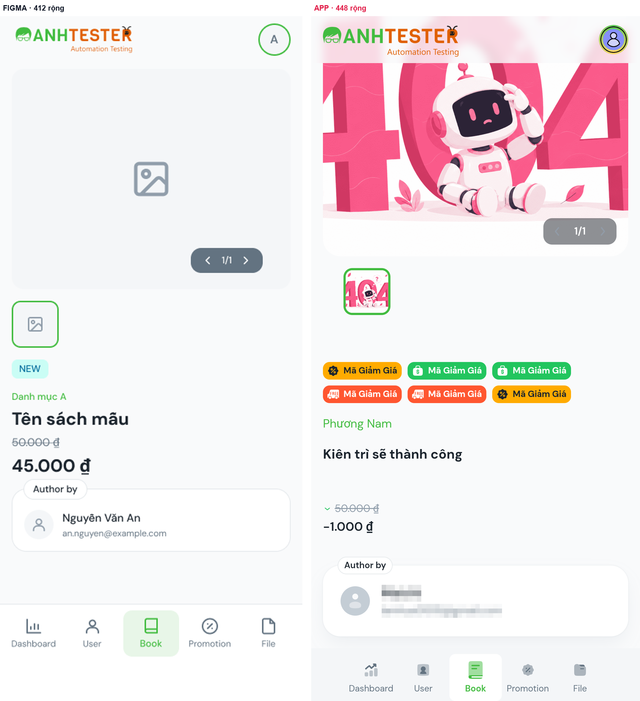

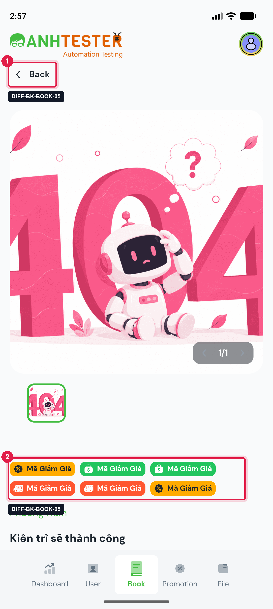

Bảng đo tự động — đoạn 1 (dc.py match)

> Khung thiết kế rộng **412** · màn thật rộng **448** (cùng đơn vị) · bỏ status bar: thiết kế 36 / thật 40 · dung sai vị trí ±4
> Dữ liệu mẫu khai báo tay (coi như ô động): `Tên sách mẫu` · `Danh mục A` · `Nguyễn Văn An` · `an.nguyen@example.com` · `50.000 ₫` · `45.000 ₫`

**Tổng:** 🔍 Thiếu trên app **4** · ❌ Lệch **8** · ➕ Thừa trên app **8**

| # | Trạng thái | Chữ trong thiết kế | Trên app | Δx (neo) | Δy | Δ khoảng cách | Δ cao | Màu (thiết kế → app · ΔE) | Ghi chú |
|---|---|---|---|---|---|---|---|---|---|
| 1 | 🔍 | A | — | — | — | — | — | — |  |
| 2 | ❌ | 1/1 | 1/1 | +20 (phải) | +203 | — | +4 | `#ffffff` → `#fcfcfc` · 0.6 | lệch +203 tính từ đầu vùng nội dung — nguyên nhân có thể nằm ở phần tử không có chữ phía trên (ảnh, banner, header) |
| 3 | 🔍 | NEW | — | — | — | — | — | — |  |
| 4 | ❌ | <mẫu:Danh mục A> | Mã Giảm Giá | +107 (phải) | +242 | +39 | -2 | `#42bc40` → `#fcfcfc` · 35.2 | khoảng cách tới “1/1” lệch +39 — điểm khởi phát xô lệch màu chữ #fcfcfc vs #42bc40 (ΔE 35.2) |
| 5 | ❌ | <mẫu:Tên sách mẫu> | Mã Giảm Giá | +107 (phải) | +186 | -56 | -14 | `#1c252e` → `#fcfcfc` · 78.6 | khoảng cách tới “<mẫu:Danh mục A>” lệch -56 — điểm khởi phát xô lệch màu chữ #fcfcfc vs #1c252e (ΔE 78.6) |
| 6 | ❌ | <mẫu:50.000 ₫> | Phương Nam | +0 (trái) | +219 | +33 | +0 | `#637381` → `#40bc40` · 40.9 | khoảng cách tới “<mẫu:Tên sách mẫu>” lệch +33 — điểm khởi phát xô lệch màu chữ #40bc40 vs #637381 (ΔE 40.9) |
| 7 | ❌ | <mẫu:45.000 ₫> | Mã Giảm Giá | -8 (phải) | +154 | -65 | -14 | `#1c252e` → `#fcfcfc` · 78.6 | khoảng cách tới “<mẫu:50.000 ₫>” lệch -65 — điểm khởi phát xô lệch màu chữ #fcfcfc vs #1c252e (ΔE 78.6) |
| 8 | 🔍 | Author by | — | — | — | — | — | — |  |
| 9 | ❌ | <mẫu:Nguyễn Văn An> | Mã Giảm Giá | -41 (trái) | +47 | -107 | -6 | `#1c252e` → `#1c242c` · 0.6 | khoảng cách tới “<mẫu:45.000 ₫>” lệch -107 — điểm khởi phát xô lệch |
| 10 | 🔍 | <mẫu:an.nguyen@example.com> | — | — | — | — | — | — |  |

> Khối có nền/viền ghép qua chữ nằm bên trong — **heuristic**: phần tử app được chọn là khung nhỏ nhất chứa đủ các chữ đó, màu nền lấy mẫu ở mép trái. Dòng ❌ ở đây phải xem ảnh trước khi tin.

| # | Trạng thái | Khối (thiết kế) | Phần tử app | Δ rộng | Δ cao | Màu nền (thiết kế → app · ΔE) | Ghi chú |
|---|---|---|---|---|---|---|---|
| B1 | ❌ | Image carousel [16, 108, 380, 300] | `View` [16, 180, 416, 432] | +0 | +132 | `#f4f6f8` → `#fcfcfc` · 1.8 | cao 432 vs 300 |
| B2 | ❌ | Pager [260, 352, 98, 34] | `View` [316, 560, 100, 36] | +2 | +2 | `#637381` → `#8c9094` · 13.0 | màu nền #8c9094 vs #637381 (ΔE 13.0) |

| ➕ Chữ có trên app nhưng không có trong thiết kế | Loại | Vị trí |
|---|---|---|
| Back | text | [16, 104, 74, 36] |
| Kiên trì sẽ thành công | text | [16, 868, 191, 27] |
| -1.000 ₫ 50.000 ₫ | text | [16, 967, 69, 27] |
| Dashboard | text | [46, 901, 72, 81] |
| User | text | [117, 901, 72, 81] |
| Book | text | [188, 901, 72, 81] |
| Promotion | text | [259, 901, 72, 81] |
| File | text | [330, 901, 72, 81] |

Bảng đo tự động — đoạn 2 (dc.py match)

> Khung thiết kế rộng **412** · màn thật rộng **448** (cùng đơn vị) · bỏ status bar: thiết kế 36 / thật 40 · đã bù lệch dọc chung 32 (= độ cuộn + lệch bố cục tích luỹ phía trên, không phải độ cuộn) · dung sai vị trí ±4
> Dữ liệu mẫu khai báo tay (coi như ô động): `Tên sách mẫu` · `Danh mục A` · `Nguyễn Văn An` · `an.nguyen@example.com` · `50.000 ₫` · `45.000 ₫`

**Tổng:** 🔍 Thiếu trên app **2** · ❌ Lệch **9** · ✅ Khớp **2** · ➕ Thừa trên app **5** · ⚠️ Lệch nhỏ **1**

| # | Trạng thái | Chữ trong thiết kế | Trên app | Δx (neo) | Δy | Δ khoảng cách | Δ cao | Màu (thiết kế → app · ΔE) | Ghi chú |
|---|---|---|---|---|---|---|---|---|---|
| 1 | 🔍 | A | — | — | — | — | — | — |  |
| 2 | ❌ | 1/1 | 1/1 | +20 (phải) | -73 | — | +4 | `#ffffff` → `#fcfcfc` · 0.6 | lệch -73 tính từ đầu vùng nội dung — nguyên nhân có thể nằm ở phần tử không có chữ phía trên (ảnh, banner, header) |
| 3 | 🔍 | NEW | — | — | — | — | — | — |  |
| 4 | ❌ | <mẫu:Danh mục A> | Phương Nam | +0 (trái) | +3 | +76 | +4 | `#42bc40` → `#40bc40` · 0.1 | khoảng cách tới “1/1” lệch +76 — điểm khởi phát xô lệch |
| 5 | ❌ | <mẫu:Tên sách mẫu> | Kiên trì sẽ thành công | +0 (trái) | +18 | +15 | -3 | `#1c252e` → `#1c242c` · 0.6 | khoảng cách tới “<mẫu:Danh mục A>” lệch +15 — điểm khởi phát xô lệch |
| 6 | ❌ | <mẫu:50.000 ₫> | Mã Giảm Giá | -8 (phải) | -94 | -112 | -6 | `#637381` → `#fcfcfc` · 39.1 | khoảng cách tới “<mẫu:Tên sách mẫu>” lệch -112 — điểm khởi phát xô lệch màu chữ #fcfcfc vs #637381 (ΔE 39.1) |
| 7 | ❌ | <mẫu:45.000 ₫> | -1.000 ₫ 50.000 ₫ | +0 (trái) | +53 | +147 | -3 | `#1c252e` → `#1c242c` · 0.6 | khoảng cách tới “<mẫu:50.000 ₫>” lệch +147 — điểm khởi phát xô lệch |
| 8 | ❌ | Author by | Author by | +0 (trái) | +73 | +20 | -1 | `#1c252e` → `#1c242c` · 0.6 | khoảng cách tới “<mẫu:45.000 ₫>” lệch +20 — điểm khởi phát xô lệch |
| 9 | ✅ | <mẫu:Nguyễn Văn An> | <tên đã che> | +3.6 (tỉ lệ) | +70 | -3 | +1 | `#1c252e` → `#1c242c` · 0.6 | Δy +70 kế thừa từ phía trên — không tính lỗi riêng |
| 10 | ✅ | <mẫu:an.nguyen@example.com> | <email đã che> | +3.6 (tỉ lệ) | +72 | +2 | +3 | `#637381` → `#607080` · 1.5 | Δy +72 kế thừa từ phía trên — không tính lỗi riêng |

> Khối có nền/viền ghép qua chữ nằm bên trong — **heuristic**: phần tử app được chọn là khung nhỏ nhất chứa đủ các chữ đó, màu nền lấy mẫu ở mép trái. Dòng ❌ ở đây phải xem ảnh trước khi tin.

| # | Trạng thái | Khối (thiết kế) | Phần tử app | Δ rộng | Δ cao | Màu nền (thiết kế → app · ΔE) | Ghi chú |
|---|---|---|---|---|---|---|---|
| B1 | ❌ | Image carousel [16, 108, 380, 300] | `View` [16, 0, 416, 368] | +0 | +68 | `#f4f6f8` → `#fcfcfc` · 1.8 | cao 368 vs 300 |
| B2 | ❌ | Pager [260, 352, 98, 34] | `View` [316, 316, 100, 36] | +2 | +2 | `#637381` → `#8c9094` · 13.0 | màu nền #8c9094 vs #637381 (ΔE 13.0) |
| B3 | ⚠️ | Author by [16, 680, 380, 86] | `View` [16, 789, 416, 97] | +0 | +11 | `#ffffff` → `#fcfcfc` · 0.6 | cao 97 vs 86 |
| B4 | ❌ | LegendChip [32, 667, 87, 28] | `TextView` [45, 781, 58, 17] | -29 | -11 | `#ffffff` → `#1c242c` · 79.6 | cao 17 vs 28 rộng 58 vs 87 màu nền #1c242c vs #ffffff (ΔE 79.6) |

| ➕ Chữ có trên app nhưng không có trong thiết kế | Loại | Vị trí |
|---|---|---|
| Dashboard | text | [46, 902, 72, 80] |
| User | text | [117, 902, 72, 80] |
| Book | text | [188, 902, 72, 80] |
| Promotion | text | [259, 902, 72, 80] |
| File | text | [330, 902, 72, 80] |

### B-06 · Create a new book (toàn trang, 3 đoạn cuộn)

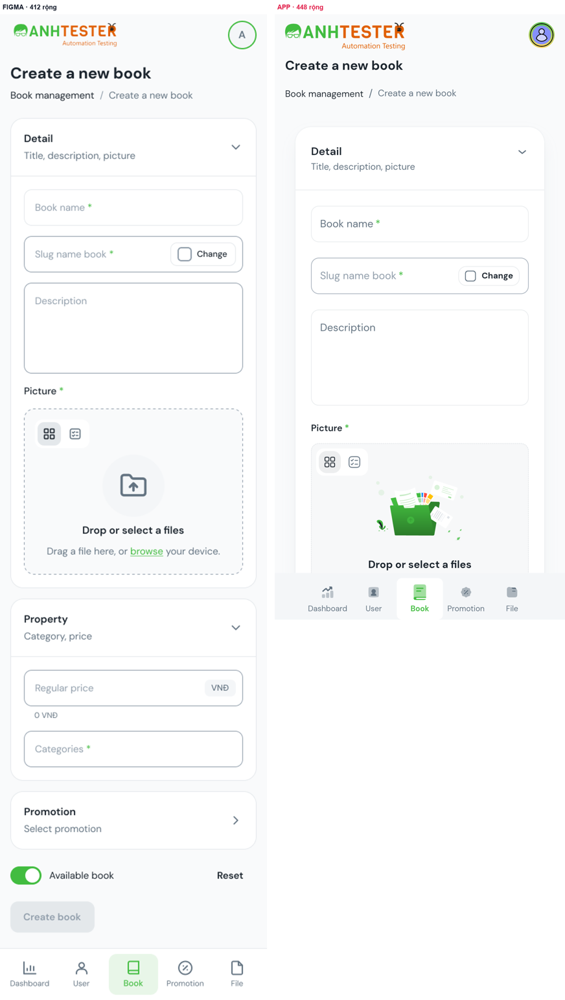

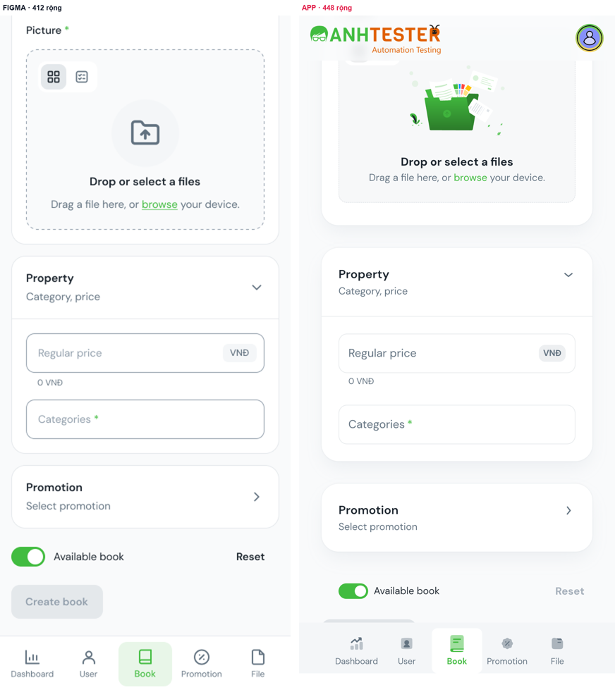

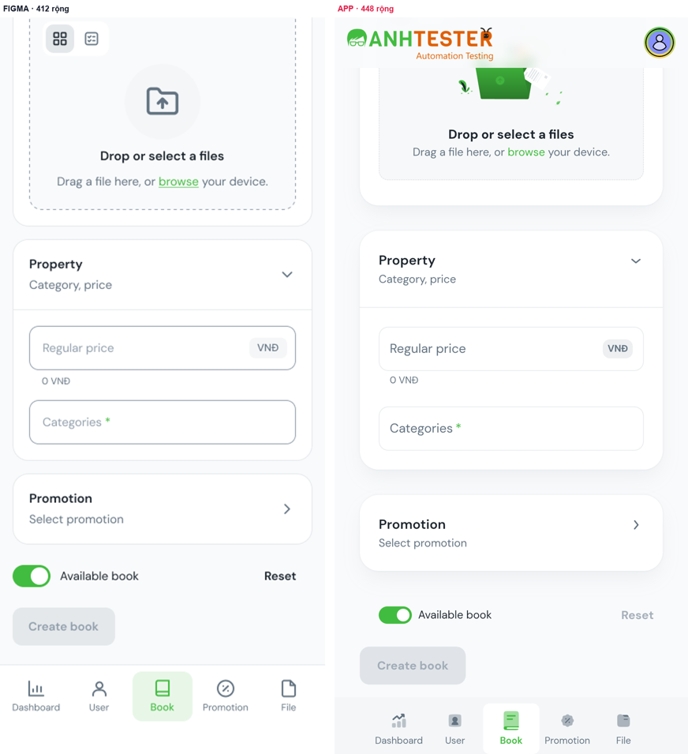

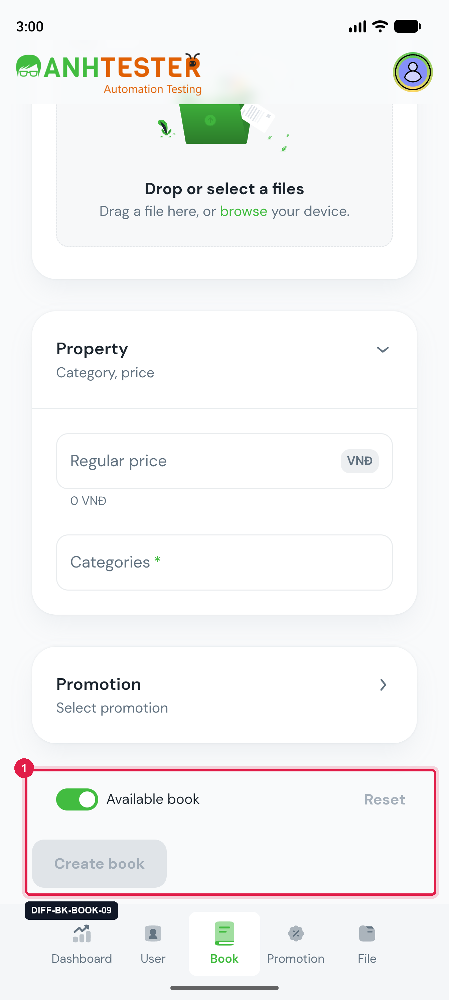

Bảng đo tự động — đoạn 1 (dc.py match)

> Khung thiết kế rộng **412** · màn thật rộng **448** (cùng đơn vị) · bỏ status bar: thiết kế 36 / thật 40 · dung sai vị trí ±4

**Tổng:** 🔍 Thiếu trên app **2** · ⚠️ Lệch nhỏ **6** · ❌ Lệch **12** · ✅ Khớp **2** · ⤵️ Ngoài màn hình đã chụp **9** · ❔ Không so được **1** · ➕ Thừa trên app **4**

| # | Trạng thái | Chữ trong thiết kế | Trên app | Δx (neo) | Δy | Δ khoảng cách | Δ cao | Màu (thiết kế → app · ΔE) | Ghi chú |
|---|---|---|---|---|---|---|---|---|---|
| 1 | 🔍 | A | — | — | — | — | — | — |  |
| 2 | ⚠️ | Create a new book | Create a new book | +0 (trái) | -12 | — | +0 | — | lệch -12 tính từ đầu vùng nội dung — nguyên nhân có thể nằm ở phần tử không có chữ phía trên (ảnh, banner, header) khung phần tử app lớn hơn hộp chữ (gồm icon/padding) — không đo được số dòng, so theo tâm màu chữ không lấy mẫu được (khung có cả icon/nền) — đối chiếu bằng ảnh |
| 3 | ⚠️ | Book management | Book management | +0 (trái) | -1 | +11 | -3 | `#1c252e` → `#1c242c` · 0.6 | khoảng cách tới “Create a new book” lệch +11 — điểm khởi phát xô lệch |
| 4 | 🔍 | / | — | — | — | — | — | — |  |
| 5 | ⚠️ | Create a new book | Create a new book | -9 (trái) | -3 | -2 | +0 | `#637381` → `#607080` · 1.5 |  |
| 6 | ❌ | Detail | Detail | +1 (giữa) | +19 | +22 | +1 | `#1c252e` → `#1c242c` · 0.6 | khoảng cách tới “Create a new book” lệch +22 — điểm khởi phát xô lệch |
| 7 | ✅ | Title, description, picture | Title, description, picture | +1 (giữa) | +19 | +0 | -3 | `#637381` → `#607080` · 1.5 | Δy +19 kế thừa từ phía trên — không tính lỗi riêng |
| 8 | ❌ | Book name * | Book name | -2 (giữa) | +24 | +5 | +2 | `#919eab` → `#607080` · 17.0 | chữ khác phần đuôi: “Book name *” ↔ “Book name” (phần thiếu có thể nằm ở node/span riêng — xem ảnh) khoảng cách tới “Title, description, pict” lệch +5 — điểm khởi phát xô lệch màu chữ #607080 vs #919eab (ΔE 17.0) |
| 9 | ⚠️ | Slug name book * | Slug name book | -2 (giữa) | +32 | +8 | +2 | `#919eab` → `#909ca8` · 0.8 | chữ khác phần đuôi: “Slug name book *” ↔ “Slug name book” (phần thiếu có thể nằm ở node/span riêng — xem ảnh) khoảng cách tới “Book name *” lệch +8 — điểm khởi phát xô lệch |
| 10 | ✅ | Change | Change | +3 (tâm-trái) | +33.5 | +1.5 | +13 | — | Δy +33.5 kế thừa từ phía trên — không tính lỗi riêng khung phần tử app lớn hơn hộp chữ (gồm icon/padding) — không đo được số dòng, so theo tâm màu chữ không lấy mẫu được (khung có cả icon/nền) — đối chiếu bằng ảnh |
| 11 | ❌ | Description | Description | -2 (giữa) | +40 | +6.5 | +2 | `#919eab` → `#607080` · 17.0 | khoảng cách tới “Change” lệch +6.5 — điểm khởi phát xô lệch màu chữ #607080 vs #919eab (ΔE 17.0) |
| 12 | ❌ | Picture * | Picture * | +1 (giữa) | +57 | +17 | +1 | `#1c252e` → `#1c242c` · 0.6 | khoảng cách tới “Description” lệch +17 — điểm khởi phát xô lệch |
| 13 | ⚠️ | Drop or select a files | Drop or select a files | -1 (giữa) | +51 | -6 | +3 | `#1c252e` → `#1c242c` · 0.6 | khoảng cách tới “Picture *” lệch -6 — điểm khởi phát xô lệch |
| 14 | ❌ | Drag a file here, or browse your device. | Drag a file here, or browse your device. | +0 (giữa) | +43 | -8 | +0 | `#637381` → `#a0dca0` · 40.0 | khoảng cách tới “Drop or select a files” lệch -8 — điểm khởi phát xô lệch màu chữ #a0dca0 vs #637381 (ΔE 40.0) |
| 15 | ⤵️ | Property | — | — | — | — | — | — |  |
| 16 | ⤵️ | Category, price | — | — | — | — | — | — |  |
| 17 | ⤵️ | Regular price | — | — | — | — | — | — |  |
| 18 | ⤵️ | VNĐ | — | — | — | — | — | — |  |
| 19 | ⤵️ | 0 VNĐ | — | — | — | — | — | — |  |
| 20 | ⤵️ | Categories * | — | — | — | — | — | — |  |
| 21 | ❌ | Promotion | Promotion | +182 (tâm-phải) | -328.5 | -371.5 | +59 | — | khoảng cách tới “Drag a file here, or bro” lệch -371.5 — điểm khởi phát xô lệch khung phần tử app lớn hơn hộp chữ (gồm icon/padding) — không đo được số dòng, so theo tâm màu chữ không lấy mẫu được (khung có cả icon/nền) — đối chiếu bằng ảnh |
| 22 | ❔ | Select promotion | Promotion | — | — | — | — | — | chữ có trên app nhưng nằm chung node “Promotion” — vị trí, màu không đo tự động, đối chiếu bằng ảnh |
| 23 | ⤵️ | Available book | — | — | — | — | — | — |  |
| 24 | ⤵️ | Reset | — | — | — | — | — | — |  |
| 25 | ⤵️ | Create book | — | — | — | — | — | — |  |

> Khối có nền/viền ghép qua chữ nằm bên trong — **heuristic**: phần tử app được chọn là khung nhỏ nhất chứa đủ các chữ đó, màu nền lấy mẫu ở mép trái. Dòng ❌ ở đây phải xem ảnh trước khi tin.

| # | Trạng thái | Khối (thiết kế) | Phần tử app | Δ rộng | Δ cao | Màu nền (thiết kế → app · ΔE) | Ghi chú |
|---|---|---|---|---|---|---|---|
| B1 | ❌ | Section · Detail [16, 196, 380, 725] | `View` [32, 214, 384, 783.3] | -32 | +58.3 | `#ffffff` → `#fcfcfc` · 0.6 | cao 783.3 vs 725 rộng 384 vs 380 (đã trừ phần chênh bề ngang màn hình) |
| B2 | ❌ | Box [37, 306, 338, 56] | `View` [56, 335, 336, 57] | -38 | +1 | `#ffffff` → `#fcfcfc` · 0.6 | rộng 336 vs 338 (đã trừ phần chênh bề ngang màn hình) |
| B3 | ❌ | Field · Slug name book * [37, 378, 338, 56] | `View` [56, 415, 336, 57] | -38 | +1 | `#ffffff` → `#fcfcfc` · 0.6 | rộng 336 vs 338 (đã trừ phần chênh bề ngang màn hình) |
| B4 | ⚠️ | Change [263, 388, 101, 36] | `Button` [283, 428, 95, 31] | -6 | -5 | — | cao 31 vs 36 rộng 95 vs 101 |
| B5 | ❌ | TextArea [37, 450, 338, 140] | `View` [56, 495, 336, 149] | -38 | +9 | `#ffffff` → `#fcfcfc` · 0.6 | cao 149 vs 140 rộng 336 vs 338 (đã trừ phần chênh bề ngang màn hình) |
| B6 | ❌ | Dropzone [37, 644, 338, 256] | `View` [56, 701, 336, 254] | -38 | -2 | `#f9fafb` → `#f4f8f8` · 1.8 | rộng 336 vs 338 (đã trừ phần chênh bề ngang màn hình) |
| B7 | ❌ | Section · Promotion [16, 1234, 380, 90] | `View` [0, 901, 448, 96.3] | +32 | +6.3 | `#ffffff` → `#f4f4f8` · 3.0 | cao 96.3 vs 90 rộng 448 vs 380 (đã trừ phần chênh bề ngang màn hình) |

| ➕ Chữ có trên app nhưng không có trong thiết kế | Loại | Vị trí |
|---|---|---|
| Dashboard | text | [46, 901, 72, 81] |
| User | text | [117, 901, 72, 81] |
| Book | text | [188, 901, 72, 81] |
| File | text | [330, 901, 72, 81] |

Bảng đo tự động — đoạn 2 (--auto-offset) (dc.py match)

> Khung thiết kế rộng **412** · màn thật rộng **448** (cùng đơn vị) · bỏ status bar: thiết kế 36 / thật 40 · đã bù lệch dọc chung -560 (= độ cuộn + lệch bố cục tích luỹ phía trên, không phải độ cuộn) · dung sai vị trí ±4

**Tổng:** ⤵️ Ngoài màn hình đã chụp **11** · 🔍 Thiếu trên app **1** · ❌ Lệch **14** · ⚠️ Lệch nhỏ **2** · ✅ Khớp **4** · ➕ Thừa trên app **4**

| # | Trạng thái | Chữ trong thiết kế | Trên app | Δx (neo) | Δy | Δ khoảng cách | Δ cao | Màu (thiết kế → app · ΔE) | Ghi chú |
|---|---|---|---|---|---|---|---|---|---|
| 1 | ⤵️ | A | — | — | — | — | — | — |  |
| 2 | ⤵️ | Create a new book | — | — | — | — | — | — |  |
| 3 | ⤵️ | Book management | — | — | — | — | — | — |  |
| 4 | ⤵️ | / | — | — | — | — | — | — |  |
| 5 | ⤵️ | Create a new book | — | — | — | — | — | — |  |
| 6 | ⤵️ | Detail | — | — | — | — | — | — |  |
| 7 | ⤵️ | Title, description, picture | — | — | — | — | — | — |  |
| 8 | ⤵️ | Book name * | — | — | — | — | — | — |  |
| 9 | ⤵️ | Slug name book * | — | — | — | — | — | — |  |
| 10 | ⤵️ | Change | — | — | — | — | — | — |  |
| 11 | ⤵️ | Description | — | — | — | — | — | — |  |
| 12 | 🔍 | Picture * | — | — | — | — | — | — |  |
| 13 | ❌ | Drop or select a files | Drop or select a files | -1 (giữa) | -29 | — | +3 | `#1c252e` → `#1c242c` · 0.6 | lệch -29 tính từ đầu vùng nội dung — nguyên nhân có thể nằm ở phần tử không có chữ phía trên (ảnh, banner, header) |
| 14 | ⚠️ | Drag a file here, or browse your device. | Drag a file here, or browse your device. | +0 (giữa) | -37 | -8 | +0 | `#637381` → `#607080` · 1.5 | khoảng cách tới “Drop or select a files” lệch -8 — điểm khởi phát xô lệch |
| 15 | ❌ | Property | Property | +1 (giữa) | -6 | +31 | +1 | `#1c252e` → `#1c242c` · 0.6 | khoảng cách tới “Drag a file here, or bro” lệch +31 — điểm khởi phát xô lệch |
| 16 | ✅ | Category, price | Category, price | +1 (giữa) | -6 | +0 | -3 | `#637381` → `#607080` · 1.5 | Δy -6 kế thừa từ phía trên — không tính lỗi riêng |
| 17 | ❌ | Regular price | Regular price | -2 (giữa) | -1 | +5 | +2 | `#919eab` → `#607080` · 17.0 | khoảng cách tới “Category, price” lệch +5 — điểm khởi phát xô lệch màu chữ #607080 vs #919eab (ΔE 17.0) |
| 18 | ✅ | VNĐ | VNĐ | +2 (giữa) | +1 | +2 | -1 | `#637381` → `#607080` · 1.5 |  |
| 19 | ✅ | 0 VNĐ | 0 VNĐ | -1 (giữa) | -1.5 | -2.5 | +3 | — | khung phần tử app lớn hơn hộp chữ (gồm icon/padding) — không đo được số dòng, so theo tâm màu chữ không lấy mẫu được (khung có cả icon/nền) — đối chiếu bằng ảnh |
| 20 | ❌ | Categories * | Categories | -2 (giữa) | +6 | +7.5 | +2 | `#919eab` → `#607080` · 17.0 | chữ khác phần đuôi: “Categories *” ↔ “Categories” (phần thiếu có thể nằm ở node/span riêng — xem ảnh) khoảng cách tới “0 VNĐ” lệch +7.5 — điểm khởi phát xô lệch màu chữ #607080 vs #919eab (ΔE 17.0) |
| 21 | ❌ | Promotion | Promotion | +1 (giữa) | +31 | +25 | +2 | `#1c252e` → `#1c242c` · 0.6 | khoảng cách tới “Categories *” lệch +25 — điểm khởi phát xô lệch |
| 22 | ✅ | Select promotion | Select promotion | +1 (giữa) | +31 | +0 | -2 | `#637381` → `#607080` · 1.5 | Δy +31 kế thừa từ phía trên — không tính lỗi riêng |
| 23 | ❌ | Available book | Available book | -6 (phải) | +50 | +19 | -2 | `#1c252e` → `#1c242c` · 0.6 | khoảng cách tới “Select promotion” lệch +19 — điểm khởi phát xô lệch |
| 24 | ❌ | Reset | Reset | -1 (giữa) | +35 | -15 | +29 | — | khoảng cách tới “Available book” lệch -15 — điểm khởi phát xô lệch cao 49 vs 20 — khác số dòng (≈2.5 vs 1.0 dòng) |
| 25 | ❌ | Create book | Create book | -4 (trái) | +35 | +0 | +29 | `#919eab` → `#607080` · 17.0 | Δy +35 kế thừa từ phía trên — không tính lỗi riêng cao 49 vs 20 — khác số dòng (≈2.5 vs 1.0 dòng) màu chữ #607080 vs #919eab (ΔE 17.0) |

> Khối có nền/viền ghép qua chữ nằm bên trong — **heuristic**: phần tử app được chọn là khung nhỏ nhất chứa đủ các chữ đó, màu nền lấy mẫu ở mép trái. Dòng ❌ ở đây phải xem ảnh trước khi tin.

| # | Trạng thái | Khối (thiết kế) | Phần tử app | Δ rộng | Δ cao | Màu nền (thiết kế → app · ΔE) | Ghi chú |
|---|---|---|---|---|---|---|---|
| B1 | ❌ | Section · Detail [16, 196, 380, 725] | `View` [32, 0, 384, 946] | -32 | +221 | `#ffffff` → `#fcfcfc` · 0.6 | cao 946 vs 725 rộng 384 vs 380 (đã trừ phần chênh bề ngang màn hình) |
| B2 | ❌ | Dropzone [37, 644, 338, 256] | `View` [56, 61, 336, 254] | -38 | -2 | `#f9fafb` → `#f4f8f8` · 1.8 | rộng 336 vs 338 (đã trừ phần chênh bề ngang màn hình) |
| B3 | ❌ | Section · Property [16, 937, 380, 281] | `View` [32, 370, 384, 303] | -32 | +22 | `#ffffff` → `#fcfcfc` · 0.6 | cao 303 vs 281 rộng 384 vs 380 (đã trừ phần chênh bề ngang màn hình) |
| B4 | ❌ | Field · Regular price [37, 1047, 338, 56] | `View` [56, 491, 336, 57] | -38 | +1 | `#ffffff` → `#fcfcfc` · 0.6 | rộng 336 vs 338 (đã trừ phần chênh bề ngang màn hình) |
| B5 | ❌ | Field · Categories * [37, 1141, 338, 56] | `View` [56, 592, 336, 57] | -38 | +1 | `#ffffff` → `#fcfcfc` · 0.6 | rộng 336 vs 338 (đã trừ phần chênh bề ngang màn hình) |
| B6 | ❌ | Section · Promotion [16, 1234, 380, 90] | `View` [32, 704, 384, 98] | -32 | +8 | `#ffffff` → `#fcfcfc` · 0.6 | cao 98 vs 90 rộng 384 vs 380 (đã trừ phần chênh bề ngang màn hình) |
| B7 | ⚠️ | Button [16, 1404, 130, 48] | `Button` [32, 897, 135, 49] | +5 | +1 | `#e4e8eb` → `#f4f4f8` · 3.5 | rộng 135 vs 130 màu nền #f4f4f8 vs #e4e8eb (ΔE 3.5) |

| ➕ Chữ có trên app nhưng không có trong thiết kế | Loại | Vị trí |
|---|---|---|
| Dashboard | text | [46, 902, 72, 80] |
| User | text | [117, 902, 72, 80] |
| Book | text | [188, 902, 72, 80] |
| File | text | [330, 902, 72, 80] |

Bảng đo tự động — đoạn 3 (--auto-offset) (dc.py match)

> Khung thiết kế rộng **412** · màn thật rộng **448** (cùng đơn vị) · bỏ status bar: thiết kế 36 / thật 40 · đã bù lệch dọc chung -620 (= độ cuộn + lệch bố cục tích luỹ phía trên, không phải độ cuộn) · dung sai vị trí ±4

**Tổng:** ⤵️ Ngoài màn hình đã chụp **12** · ❌ Lệch **14** · ⚠️ Lệch nhỏ **2** · ✅ Khớp **4** · ➕ Thừa trên app **4**

| # | Trạng thái | Chữ trong thiết kế | Trên app | Δx (neo) | Δy | Δ khoảng cách | Δ cao | Màu (thiết kế → app · ΔE) | Ghi chú |
|---|---|---|---|---|---|---|---|---|---|
| 1 | ⤵️ | A | — | — | — | — | — | — |  |
| 2 | ⤵️ | Create a new book | — | — | — | — | — | — |  |
| 3 | ⤵️ | Book management | — | — | — | — | — | — |  |
| 4 | ⤵️ | / | — | — | — | — | — | — |  |
| 5 | ⤵️ | Create a new book | — | — | — | — | — | — |  |
| 6 | ⤵️ | Detail | — | — | — | — | — | — |  |
| 7 | ⤵️ | Title, description, picture | — | — | — | — | — | — |  |
| 8 | ⤵️ | Book name * | — | — | — | — | — | — |  |
| 9 | ⤵️ | Slug name book * | — | — | — | — | — | — |  |
| 10 | ⤵️ | Change | — | — | — | — | — | — |  |
| 11 | ⤵️ | Description | — | — | — | — | — | — |  |
| 12 | ⤵️ | Picture * | — | — | — | — | — | — |  |
| 13 | ❌ | Drop or select a files | Drop or select a files | -1 (giữa) | -29 | — | +3 | `#1c252e` → `#1c242c` · 0.6 | lệch -29 tính từ đầu vùng nội dung — nguyên nhân có thể nằm ở phần tử không có chữ phía trên (ảnh, banner, header) |
| 14 | ⚠️ | Drag a file here, or browse your device. | Drag a file here, or browse your device. | +0 (giữa) | -37 | -8 | +0 | `#637381` → `#607080` · 1.5 | khoảng cách tới “Drop or select a files” lệch -8 — điểm khởi phát xô lệch |
| 15 | ❌ | Property | Property | +1 (giữa) | -6 | +31 | +1 | `#1c252e` → `#1c242c` · 0.6 | khoảng cách tới “Drag a file here, or bro” lệch +31 — điểm khởi phát xô lệch |
| 16 | ✅ | Category, price | Category, price | +1 (giữa) | -6 | +0 | -3 | `#637381` → `#607080` · 1.5 | Δy -6 kế thừa từ phía trên — không tính lỗi riêng |
| 17 | ❌ | Regular price | Regular price | -2 (giữa) | -1 | +5 | +2 | `#919eab` → `#607080` · 17.0 | khoảng cách tới “Category, price” lệch +5 — điểm khởi phát xô lệch màu chữ #607080 vs #919eab (ΔE 17.0) |
| 18 | ✅ | VNĐ | VNĐ | +2 (giữa) | +1 | +2 | -1 | `#637381` → `#607080` · 1.5 |  |
| 19 | ✅ | 0 VNĐ | 0 VNĐ | -1 (giữa) | -1.5 | -2.5 | +3 | — | khung phần tử app lớn hơn hộp chữ (gồm icon/padding) — không đo được số dòng, so theo tâm màu chữ không lấy mẫu được (khung có cả icon/nền) — đối chiếu bằng ảnh |
| 20 | ❌ | Categories * | Categories | -2 (giữa) | +6 | +7.5 | +2 | `#919eab` → `#607080` · 17.0 | chữ khác phần đuôi: “Categories *” ↔ “Categories” (phần thiếu có thể nằm ở node/span riêng — xem ảnh) khoảng cách tới “0 VNĐ” lệch +7.5 — điểm khởi phát xô lệch màu chữ #607080 vs #919eab (ΔE 17.0) |
| 21 | ❌ | Promotion | Promotion | +1 (giữa) | +31 | +25 | +2 | `#1c252e` → `#1c242c` · 0.6 | khoảng cách tới “Categories *” lệch +25 — điểm khởi phát xô lệch |
| 22 | ✅ | Select promotion | Select promotion | +1 (giữa) | +31 | +0 | -2 | `#637381` → `#607080` · 1.5 | Δy +31 kế thừa từ phía trên — không tính lỗi riêng |
| 23 | ❌ | Available book | Available book | -6 (phải) | +50 | +19 | -2 | `#1c252e` → `#1c242c` · 0.6 | khoảng cách tới “Select promotion” lệch +19 — điểm khởi phát xô lệch |
| 24 | ❌ | Reset | Reset | -1 (giữa) | +35 | -15 | +29 | — | khoảng cách tới “Available book” lệch -15 — điểm khởi phát xô lệch cao 49 vs 20 — khác số dòng (≈2.5 vs 1.0 dòng) |
| 25 | ❌ | Create book | Create book | -4 (trái) | +35 | +0 | +29 | — | Δy +35 kế thừa từ phía trên — không tính lỗi riêng cao 49 vs 20 — khác số dòng (≈2.5 vs 1.0 dòng) |

> Khối có nền/viền ghép qua chữ nằm bên trong — **heuristic**: phần tử app được chọn là khung nhỏ nhất chứa đủ các chữ đó, màu nền lấy mẫu ở mép trái. Dòng ❌ ở đây phải xem ảnh trước khi tin.

| # | Trạng thái | Khối (thiết kế) | Phần tử app | Δ rộng | Δ cao | Màu nền (thiết kế → app · ΔE) | Ghi chú |
|---|---|---|---|---|---|---|---|
| B1 | ❌ | Section · Detail [16, 196, 380, 725] | `View` [32, 0, 384, 886] | -32 | +161 | `#ffffff` → `#fcfcfc` · 0.6 | cao 886 vs 725 rộng 384 vs 380 (đã trừ phần chênh bề ngang màn hình) |
| B2 | ❌ | Dropzone [37, 644, 338, 256] | `View` [32, 0, 384, 279] | +10 | +23 | `#f9fafb` → `#fcfcfc` · 0.8 | cao 279 vs 256 rộng 384 vs 338 (đã trừ phần chênh bề ngang màn hình) |
| B3 | ❌ | Section · Property [16, 937, 380, 281] | `View` [32, 310, 384, 303] | -32 | +22 | `#ffffff` → `#fcfcfc` · 0.6 | cao 303 vs 281 rộng 384 vs 380 (đã trừ phần chênh bề ngang màn hình) |
| B4 | ❌ | Field · Regular price [37, 1047, 338, 56] | `View` [56, 431, 336, 57] | -38 | +1 | `#ffffff` → `#fcfcfc` · 0.6 | rộng 336 vs 338 (đã trừ phần chênh bề ngang màn hình) |
| B5 | ❌ | Field · Categories * [37, 1141, 338, 56] | `View` [56, 532, 336, 57] | -38 | +1 | `#ffffff` → `#fcfcfc` · 0.6 | rộng 336 vs 338 (đã trừ phần chênh bề ngang màn hình) |
| B6 | ❌ | Section · Promotion [16, 1234, 380, 90] | `View` [32, 644, 384, 98] | -32 | +8 | `#ffffff` → `#fcfcfc` · 0.6 | cao 98 vs 90 rộng 384 vs 380 (đã trừ phần chênh bề ngang màn hình) |
| B7 | ⚠️ | Button [16, 1404, 130, 48] | `Button` [32, 837, 135, 49] | +5 | +1 | `#e4e8eb` → `#e0e4e8` · 1.0 | rộng 135 vs 130 |

| ➕ Chữ có trên app nhưng không có trong thiết kế | Loại | Vị trí |
|---|---|---|
| Dashboard | text | [46, 901, 72, 81] |
| User | text | [117, 901, 72, 81] |
| Book | text | [188, 901, 72, 81] |
| File | text | [330, 901, 72, 81] |

### B-07 · Chọn khuyến mãi (khung vẽ sẵn ở vị trí đã cuộn)

> Khung ghi *"đã cuộn xuống phần Promotion của form B-06 / B-08"* → so bằng `--auto-offset`. Mã và tên khuyến mãi là dữ liệu mẫu (danh sách lặp).

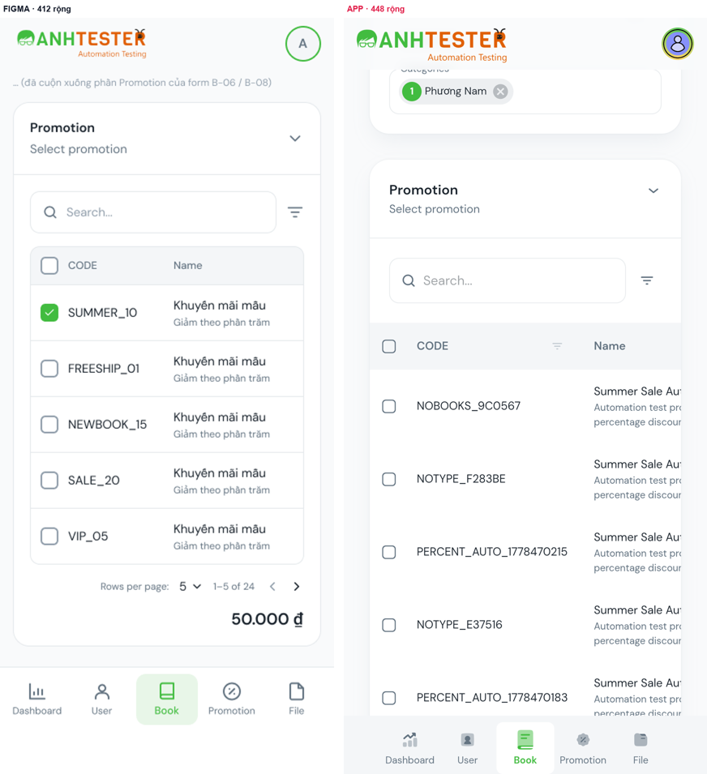

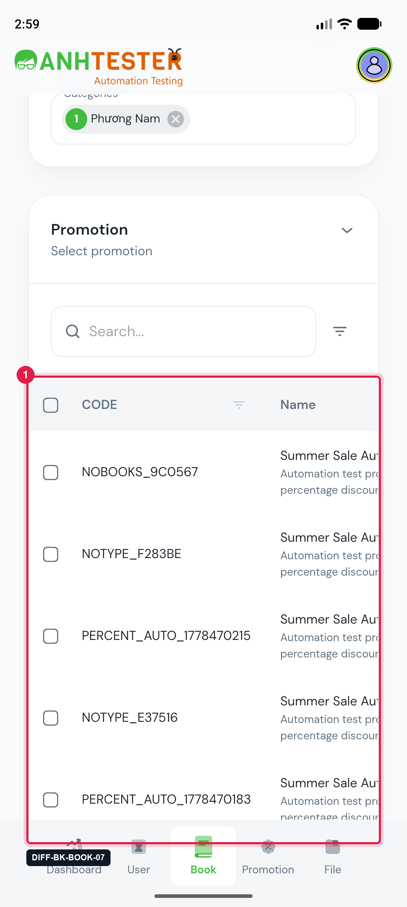

Bảng đo tự động (dc.py match)

> Khung thiết kế rộng **412** · màn thật rộng **448** (cùng đơn vị) · bỏ status bar: thiết kế 36 / thật 40 · đã bù lệch dọc chung 205 (= độ cuộn + lệch bố cục tích luỹ phía trên, không phải độ cuộn) · dung sai vị trí ±4
> Danh sách lặp trong thiết kế: `Row` × 5 (cao 69) — chữ bên trong là dữ liệu mẫu; so chiều cao hàng, cột, căn lề bằng ảnh
> Dữ liệu mẫu khai báo tay (coi như ô động): `50.000 ₫`

**Tổng:** 🔍 Thiếu trên app **2** · ❔ Không so được **16** · ❌ Lệch **8** · ✅ Khớp **1** · ⚠️ Lệch nhỏ **1** · ⤵️ Ngoài màn hình đã chụp **1** · ➕ Thừa trên app **11**

| # | Trạng thái | Chữ trong thiết kế | Trên app | Δx (neo) | Δy | Δ khoảng cách | Δ cao | Màu (thiết kế → app · ΔE) | Ghi chú |
|---|---|---|---|---|---|---|---|---|---|
| 1 | 🔍 | A | — | — | — | — | — | — |  |
| 2 | ❔ | … (đã cuộn xuống phần Promotion của form B-06 / B-08) | — | — | — | — | — | — | ghi chú của thiết kế — không phải chữ giao diện |
| 3 | ❌ | Promotion | Promotion | +1 (giữa) | -129 | — | +1 | `#1c252e` → `#1c242c` · 0.6 | lệch -129 tính từ đầu vùng nội dung — nguyên nhân có thể nằm ở phần tử không có chữ phía trên (ảnh, banner, header) |
| 4 | ✅ | Select promotion | Select promotion | +1 (giữa) | -129 | +0 | -3 | `#637381` → `#607080` · 1.5 | Δy -129 kế thừa từ phía trên — không tính lỗi riêng |
| 5 | 🔍 | Search... | — | — | — | — | — | — |  |
| 6 | ❌ | CODE | CODE | -1.3 (tỉ lệ) | -110 | +19 | +9 | `#637381` → `#607080` · 1.5 | khoảng cách tới “Select promotion” lệch +19 — điểm khởi phát xô lệch |
| 7 | ❌ | Name | Name | +58 (phải) | -110 | +0 | +9 | `#637381` → `#607080` · 1.5 | Δy -110 kế thừa từ phía trên — không tính lỗi riêng |
| 8 | ❔ | Khuyến mãi mẫu | — | — | — | — | — | — | dữ liệu mẫu trong hàng lặp — so cấu trúc hàng (cao, cột, căn) bằng ảnh, không so chữ |
| 9 | ❔ | SUMMER_10 | — | — | — | — | — | — | dữ liệu mẫu trong hàng lặp — so cấu trúc hàng (cao, cột, căn) bằng ảnh, không so chữ |
| 10 | ❔ | Giảm theo phần trăm | — | — | — | — | — | — | dữ liệu mẫu trong hàng lặp — so cấu trúc hàng (cao, cột, căn) bằng ảnh, không so chữ |
| 11 | ❔ | Khuyến mãi mẫu | — | — | — | — | — | — | dữ liệu mẫu trong hàng lặp — so cấu trúc hàng (cao, cột, căn) bằng ảnh, không so chữ |
| 12 | ❔ | FREESHIP_01 | — | — | — | — | — | — | dữ liệu mẫu trong hàng lặp — so cấu trúc hàng (cao, cột, căn) bằng ảnh, không so chữ |
| 13 | ❔ | Giảm theo phần trăm | — | — | — | — | — | — | dữ liệu mẫu trong hàng lặp — so cấu trúc hàng (cao, cột, căn) bằng ảnh, không so chữ |
| 14 | ❔ | Khuyến mãi mẫu | — | — | — | — | — | — | dữ liệu mẫu trong hàng lặp — so cấu trúc hàng (cao, cột, căn) bằng ảnh, không so chữ |
| 15 | ❔ | NEWBOOK_15 | — | — | — | — | — | — | dữ liệu mẫu trong hàng lặp — so cấu trúc hàng (cao, cột, căn) bằng ảnh, không so chữ |
| 16 | ❔ | Giảm theo phần trăm | — | — | — | — | — | — | dữ liệu mẫu trong hàng lặp — so cấu trúc hàng (cao, cột, căn) bằng ảnh, không so chữ |
| 17 | ❔ | Khuyến mãi mẫu | — | — | — | — | — | — | dữ liệu mẫu trong hàng lặp — so cấu trúc hàng (cao, cột, căn) bằng ảnh, không so chữ |
| 18 | ❔ | SALE_20 | — | — | — | — | — | — | dữ liệu mẫu trong hàng lặp — so cấu trúc hàng (cao, cột, căn) bằng ảnh, không so chữ |
| 19 | ❔ | Giảm theo phần trăm | — | — | — | — | — | — | dữ liệu mẫu trong hàng lặp — so cấu trúc hàng (cao, cột, căn) bằng ảnh, không so chữ |
| 20 | ❔ | Khuyến mãi mẫu | — | — | — | — | — | — | dữ liệu mẫu trong hàng lặp — so cấu trúc hàng (cao, cột, căn) bằng ảnh, không so chữ |
| 21 | ❔ | VIP_05 | — | — | — | — | — | — | dữ liệu mẫu trong hàng lặp — so cấu trúc hàng (cao, cột, căn) bằng ảnh, không so chữ |
| 22 | ❔ | Giảm theo phần trăm | — | — | — | — | — | — | dữ liệu mẫu trong hàng lặp — so cấu trúc hàng (cao, cột, căn) bằng ảnh, không so chữ |
| 23 | ❌ | 5 | 5 | -27.5 (tâm-trái) | +4 | +114 | +8 | — | khoảng cách tới “Name” lệch +114 — điểm khởi phát xô lệch khung phần tử app lớn hơn hộp chữ (gồm icon/padding) — không đo được số dòng, so theo tâm màu chữ không lấy mẫu được (khung có cả icon/nền) — đối chiếu bằng ảnh |
| 24 | ❌ | Rows per page: | Rows per page: | -55 (trái) | +0 | -4 | +7 | `#637381` → `#607080` · 1.5 |  |
| 25 | ⚠️ | 1–5 of 24 | 1–5 of 24 | -9 (trái) | +0 | +0 | +7 | `#637381` → `#607080` · 1.5 |  |
| 26 | ⤵️ | <mẫu:50.000 ₫> | — | — | — | — | — | — | có trên app nhưng bị mép màn cắt dở — đo ở đoạn cuộn khác |

> Khối có nền/viền ghép qua chữ nằm bên trong — **heuristic**: phần tử app được chọn là khung nhỏ nhất chứa đủ các chữ đó, màu nền lấy mẫu ở mép trái. Dòng ❌ ở đây phải xem ảnh trước khi tin.

| # | Trạng thái | Khối (thiết kế) | Phần tử app | Δ rộng | Δ cao | Màu nền (thiết kế → app · ΔE) | Ghi chú |
|---|---|---|---|---|---|---|---|
| B1 | ❌ | Section · Promotion [16, 140, 380, 672] | `View` [32, 215, 384, 782.3] | -32 | +110.3 | `#ffffff` → `#fcfcfc` · 0.6 | cao 782.3 vs 672 rộng 384 vs 380 (đã trừ phần chênh bề ngang màn hình) |
| B2 | ❌ | Promotion table [37, 318, 338, 393] | `View` [32, 416, 384, 509] | +10 | +116 | — | cao 509 vs 393 rộng 384 vs 338 (đã trừ phần chênh bề ngang màn hình) |
| B3 | ❌ | Header [38, 319, 336, 46] | `View` [32, 416, 384, 59] | +12 | +13 | `#f4f6f8` → `#f4f4f8` · 1.7 | cao 59 vs 46 rộng 384 vs 336 (đã trừ phần chênh bề ngang màn hình) |

| ➕ Chữ có trên app nhưng không có trong thiết kế | Loại | Vị trí |
|---|---|---|
| 50000 | input | [56, 2, 277, 57] |
| 50.000 VNĐ | text | [70, 61, 308, 19] |
| Categories | text | [70, 94, 69, 18] |
| 1 Phương Nam | text | [68, 115, 142, 33] |
| NOBOOKS_9C0567 | text | [74, 474, 219, 91] |
| NOBOOKS_9C0567 | text | [90, 508, 187, 23] |
| Summer Sale Auto 1778470243 Automation test promotion — percentage discount | text | [292, 474, 124, 91] |
| Summer Sale Auto 1778470243 | text | [308, 490, 108, 23] |
| Automation test promotion — percentage discount | text | [308, 513, 108, 35] |
| NOTYPE_F283BE | text | [74, 564, 219, 91] |
| Summer Sale Auto 1778470243 Automation test promotion — percentage discount | text | [292, 564, 124, 91] |

### B-08 · Modify book (toàn trang, 3 đoạn cuộn)

> ⚠️ **Ảnh Figma của khung này là ảnh DỰNG LẠI** từ dữ liệu đã trích (`dc.py render`) — Figma MCP hết lượt gọi của gói Starter khi lấy ảnh. Toạ độ, chữ, màu, khối đúng như Figma; **không** có icon, ảnh, đổ bóng. Bảng đo không bị ảnh hưởng (đo từ JSON).

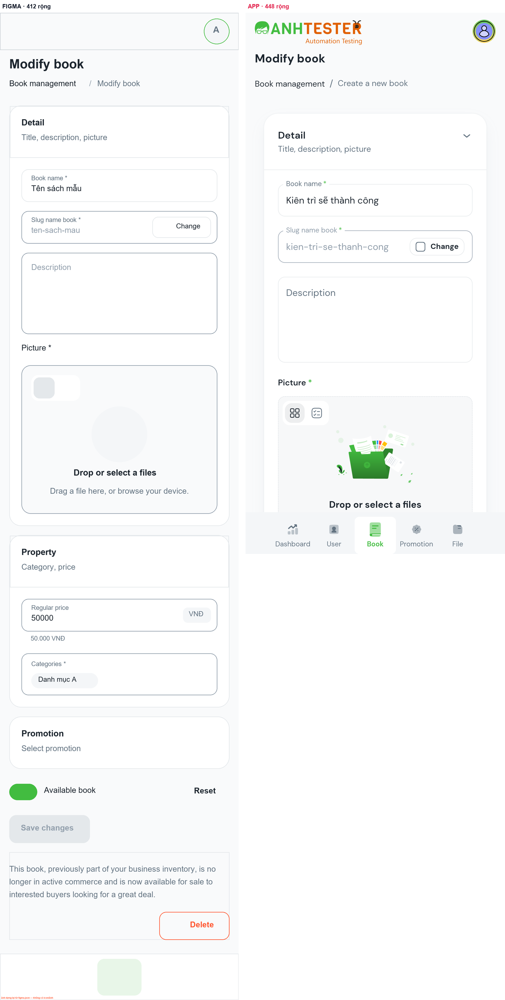

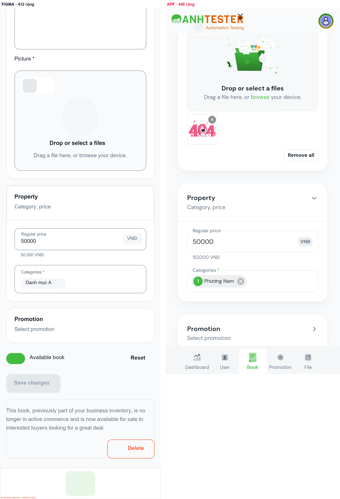

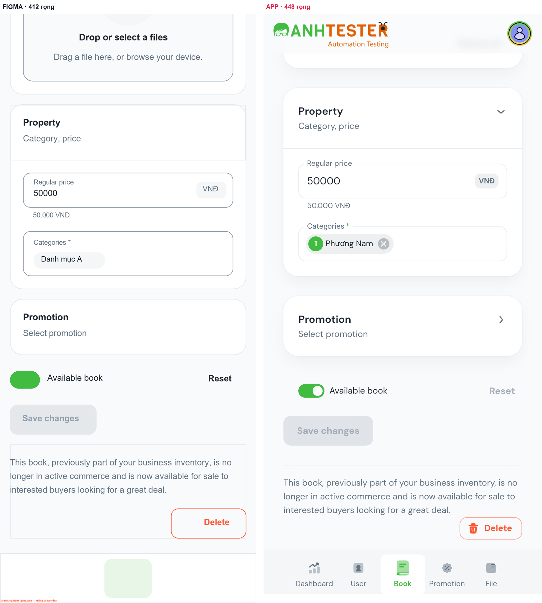

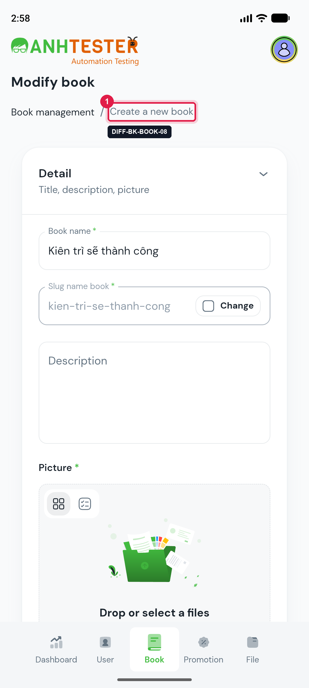

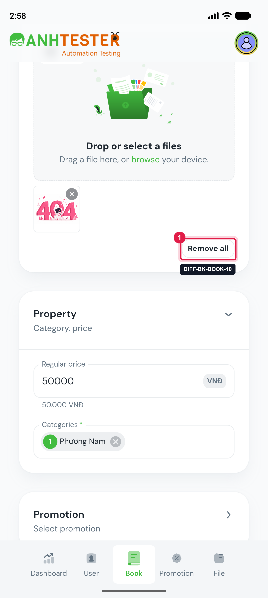

Bảng đo tự động — đoạn 1 (dc.py match)

> Khung thiết kế rộng **412** · màn thật rộng **448** (cùng đơn vị) · bỏ status bar: thiết kế 36 / thật 40 · dung sai vị trí ±4
> Dữ liệu mẫu khai báo tay (coi như ô động): `Tên sách mẫu` · `ten-sach-mau` · `Danh mục A` · `50000` · `50.000 VNĐ`

**Tổng:** 🔍 Thiếu trên app **3** · ⚠️ Lệch nhỏ **7** · ❌ Lệch **15** · ✅ Khớp **1** · ⤵️ Ngoài màn hình đã chụp **10** · ❔ Không so được **2** · ➕ Thừa trên app **3**

| # | Trạng thái | Chữ trong thiết kế | Trên app | Δx (neo) | Δy | Δ khoảng cách | Δ cao | Màu (thiết kế → app · ΔE) | Ghi chú |
|---|---|---|---|---|---|---|---|---|---|
| 1 | 🔍 | A | — | — | — | — | — | — |  |
| 2 | ⚠️ | Modify book | Modify book | +0 (trái) | -12 | — | +0 | — | lệch -12 tính từ đầu vùng nội dung — nguyên nhân có thể nằm ở phần tử không có chữ phía trên (ảnh, banner, header) khung phần tử app lớn hơn hộp chữ (gồm icon/padding) — không đo được số dòng, so theo tâm màu chữ không lấy mẫu được (khung có cả icon/nền) — đối chiếu bằng ảnh |
| 3 | ⚠️ | Book management | Book management | +0 (trái) | -1 | +11 | -3 | `#1c252e` → `#1c242c` · 0.6 | khoảng cách tới “Modify book” lệch +11 — điểm khởi phát xô lệch |
| 4 | 🔍 | / | — | — | — | — | — | — |  |
| 5 | 🔍 | Modify book | — | — | — | — | — | — |  |
| 6 | ❌ | Detail | Detail | +1 (giữa) | +19 | +20 | +1 | `#1c252e` → `#1c242c` · 0.6 | khoảng cách tới “Book management” lệch +20 — điểm khởi phát xô lệch |
| 7 | ✅ | Title, description, picture | Title, description, picture | +1 (giữa) | +19 | +0 | -3 | `#637381` → `#607080` · 1.5 | Δy +19 kế thừa từ phía trên — không tính lỗi riêng |
| 8 | ⚠️ | Book name * | Book name | -2 (giữa) | +7 | -12 | +2 | `#637381` → `#607080` · 1.5 | chữ khác phần đuôi: “Book name *” ↔ “Book name” (phần thiếu có thể nằm ở node/span riêng — xem ảnh) khoảng cách tới “Title, description, pict” lệch -12 — điểm khởi phát xô lệch |
| 9 | ❌ | <mẫu:Tên sách mẫu> | Kiên trì sẽ thành công | +2 (trái) | +0 | -7 | +35 | — | ô nhập đang có giá trị — không phải placeholder khoảng cách tới “Book name *” lệch -7 — điểm khởi phát xô lệch cao 57 vs 22 — khác số dòng (≈2.6 vs 1.0 dòng) |
| 10 | ❌ | Slug name book * | Slug name book | -2 (giữa) | +15 | +15 | +2 | `#637381` → `#909ca8` · 15.2 | chữ khác phần đuôi: “Slug name book *” ↔ “Slug name book” (phần thiếu có thể nằm ở node/span riêng — xem ảnh) khoảng cách tới “<mẫu:Tên sách mẫu>” lệch +15 — điểm khởi phát xô lệch màu chữ #909ca8 vs #637381 (ΔE 15.2) |
| 11 | ❌ | Change | Change | +3 (tâm-trái) | +33.5 | +18.5 | +13 | — | khoảng cách tới “Slug name book *” lệch +18.5 — điểm khởi phát xô lệch khung phần tử app lớn hơn hộp chữ (gồm icon/padding) — không đo được số dòng, so theo tâm màu chữ không lấy mẫu được (khung có cả icon/nền) — đối chiếu bằng ảnh |
| 12 | ⚠️ | <mẫu:ten-sach-mau> | kien-tri-se-thanh-cong | +2 (trái) | +25.5 | -8 | +35 | — | ô nhập đang có giá trị — không phải placeholder khoảng cách tới “Change” lệch -8 — điểm khởi phát xô lệch khung phần tử app lớn hơn hộp chữ (gồm icon/padding) — không đo được số dòng, so theo tâm màu chữ không lấy mẫu được (khung có cả icon/nền) — đối chiếu bằng ảnh |
| 13 | ❌ | Description | Description | -2 (giữa) | +40 | +14.5 | +2 | `#919eab` → `#607080` · 17.0 | khoảng cách tới “<mẫu:ten-sach-mau>” lệch +14.5 — điểm khởi phát xô lệch màu chữ #607080 vs #919eab (ΔE 17.0) |
| 14 | ❌ | Picture * | Picture * | +1 (giữa) | +57 | +17 | +1 | `#1c252e` → `#1c242c` · 0.6 | khoảng cách tới “Description” lệch +17 — điểm khởi phát xô lệch |
| 15 | ⚠️ | Drop or select a files | Drop or select a files | -1 (giữa) | +51 | -6 | +3 | `#1c252e` → `#1c242c` · 0.6 | khoảng cách tới “Picture *” lệch -6 — điểm khởi phát xô lệch |
| 16 | ❌ | Drag a file here, or browse your device. | Drag a file here, or browse your device. | +0 (giữa) | +43 | -8 | +0 | `#637381` → `#a0dca0` · 40.0 | khoảng cách tới “Drop or select a files” lệch -8 — điểm khởi phát xô lệch màu chữ #a0dca0 vs #637381 (ΔE 40.0) |
| 17 | ⤵️ | Property | — | — | — | — | — | — |  |
| 18 | ⤵️ | Category, price | — | — | — | — | — | — |  |
| 19 | ⤵️ | Regular price | — | — | — | — | — | — |  |
| 20 | ⤵️ | VNĐ | — | — | — | — | — | — |  |
| 21 | ⤵️ | <mẫu:50000> | — | — | — | — | — | — |  |
| 22 | ❌ | <mẫu:50.000 VNĐ> | Dashboard | -5.5 (tâm-trái) | -179.5 | -222.5 | +65 | — | khoảng cách tới “Drag a file here, or bro” lệch -222.5 — điểm khởi phát xô lệch khung phần tử app lớn hơn hộp chữ (gồm icon/padding) — không đo được số dòng, so theo tâm màu chữ không lấy mẫu được (khung có cả icon/nền) — đối chiếu bằng ảnh |
| 23 | ⤵️ | Categories * | — | — | — | — | — | — |  |
| 24 | ❌ | <mẫu:Danh mục A> | Create a new book | +57 (phải) | -1032 | -852.5 | +4 | `#1c252e` → `#607080` · 25.2 | khoảng cách tới “<mẫu:50.000 VNĐ>” lệch -852.5 — điểm khởi phát xô lệch màu chữ #607080 vs #1c252e (ΔE 25.2) |
| 25 | ❌ | Promotion | Promotion | +182 (tâm-phải) | -344.5 | +687.5 | +59 | — | khoảng cách tới “<mẫu:Danh mục A>” lệch +687.5 — điểm khởi phát xô lệch khung phần tử app lớn hơn hộp chữ (gồm icon/padding) — không đo được số dòng, so theo tâm màu chữ không lấy mẫu được (khung có cả icon/nền) — đối chiếu bằng ảnh |
| 26 | ❔ | Select promotion | Promotion | — | — | — | — | — | chữ có trên app nhưng nằm chung node “Promotion” — vị trí, màu không đo tự động, đối chiếu bằng ảnh |
| 27 | ⤵️ | Available book | — | — | — | — | — | — |  |
| 28 | ⤵️ | Reset | — | — | — | — | — | — |  |
| 29 | ❔ | Save changes | Change | — | — | — | — | — | chữ có trên app nhưng nằm chung node “Change” — vị trí, màu không đo tự động, đối chiếu bằng ảnh |
| 30 | ⤵️ | This book, previously part of your business inventory, is no longer in active commerce and is now available for sale to interested buyers looking for a great deal. | — | — | — | — | — | — |  |
| 31 | ⤵️ | Delete | — | — | — | — | — | — |  |

> Khối có nền/viền ghép qua chữ nằm bên trong — **heuristic**: phần tử app được chọn là khung nhỏ nhất chứa đủ các chữ đó, màu nền lấy mẫu ở mép trái. Dòng ❌ ở đây phải xem ảnh trước khi tin.

| # | Trạng thái | Khối (thiết kế) | Phần tử app | Δ rộng | Δ cao | Màu nền (thiết kế → app · ΔE) | Ghi chú |
|---|---|---|---|---|---|---|---|
| B1 | ❌ | Section · Detail [16, 196, 380, 725] | `View` [32, 214, 384, 783.3] | -32 | +58.3 | `#ffffff` → `#fcfcfc` · 0.6 | cao 783.3 vs 725 rộng 384 vs 380 (đã trừ phần chênh bề ngang màn hình) |
| B2 | ⚠️ | Change [263, 388, 101, 36] | `Button` [283, 428, 95, 31] | -6 | -5 | — | cao 31 vs 36 rộng 95 vs 101 |
| B3 | ❌ | TextArea [37, 450, 338, 140] | `View` [56, 495, 336, 149] | -38 | +9 | `#ffffff` → `#fcfcfc` · 0.6 | cao 149 vs 140 rộng 336 vs 338 (đã trừ phần chênh bề ngang màn hình) |
| B4 | ❌ | Dropzone [37, 644, 338, 256] | `View` [56, 701, 336, 296.3] | -38 | +40.3 | `#f9fafb` → `#f4f8f8` · 1.8 | cao 296.3 vs 256 rộng 336 vs 338 (đã trừ phần chênh bề ngang màn hình) |
| B5 | ❌ | Field · Categories * [37, 1141, 338, 72] | `NavigationView` [16, 150, 416, 24] | +42 | -48 | `#ffffff` → `#f8f8f8` · 1.4 | cao 24 vs 72 rộng 416 vs 338 (đã trừ phần chênh bề ngang màn hình) |
| B6 | ⚠️ | Category chip [54, 1175, 115, 26] | `View` [159, 151, 122, 22] | +7 | -4 | `#f4f6f8` → `#f8f8f8` · 1.3 | rộng 122 vs 115 |
| B7 | ❌ | Section · Promotion [16, 1250, 380, 90] | `View` [0, 901, 448, 96.3] | +32 | +6.3 | `#ffffff` → `#f4f4f8` · 3.0 | cao 96.3 vs 90 rộng 448 vs 380 (đã trừ phần chênh bề ngang màn hình) |

| ➕ Chữ có trên app nhưng không có trong thiết kế | Loại | Vị trí |
|---|---|---|
| User | text | [117, 901, 72, 81] |
| Book | text | [188, 901, 72, 81] |
| File | text | [330, 901, 72, 81] |

Bảng đo tự động — đoạn 2 (--auto-offset) (dc.py match)

> Khung thiết kế rộng **412** · màn thật rộng **448** (cùng đơn vị) · bỏ status bar: thiết kế 36 / thật 40 · đã bù lệch dọc chung -450 (= độ cuộn + lệch bố cục tích luỹ phía trên, không phải độ cuộn) · dung sai vị trí ±4
> Dữ liệu mẫu khai báo tay (coi như ô động): `Tên sách mẫu` · `ten-sach-mau` · `Danh mục A` · `50000` · `50.000 VNĐ`

**Tổng:** ⤵️ Ngoài màn hình đã chụp **17** · 🔍 Thiếu trên app **1** · ❌ Lệch **12** · ⚠️ Lệch nhỏ **3** · ✅ Khớp **3** · ➕ Thừa trên app **7**

| # | Trạng thái | Chữ trong thiết kế | Trên app | Δx (neo) | Δy | Δ khoảng cách | Δ cao | Màu (thiết kế → app · ΔE) | Ghi chú |
|---|---|---|---|---|---|---|---|---|---|
| 1 | ⤵️ | A | — | — | — | — | — | — |  |
| 2 | ⤵️ | Modify book | — | — | — | — | — | — |  |
| 3 | ⤵️ | Book management | — | — | — | — | — | — |  |
| 4 | ⤵️ | / | — | — | — | — | — | — |  |
| 5 | ⤵️ | Modify book | — | — | — | — | — | — |  |
| 6 | ⤵️ | Detail | — | — | — | — | — | — |  |
| 7 | ⤵️ | Title, description, picture | — | — | — | — | — | — |  |
| 8 | ⤵️ | Book name * | — | — | — | — | — | — |  |
| 9 | ⤵️ | <mẫu:Tên sách mẫu> | — | — | — | — | — | — | có trên app nhưng bị mép màn cắt dở — đo ở đoạn cuộn khác |
| 10 | ⤵️ | Slug name book * | — | — | — | — | — | — |  |
| 11 | ⤵️ | Change | — | — | — | — | — | — |  |
| 12 | ⤵️ | <mẫu:ten-sach-mau> | — | — | — | — | — | — |  |
| 13 | ⤵️ | Description | — | — | — | — | — | — |  |
| 14 | 🔍 | Picture * | — | — | — | — | — | — |  |
| 15 | ❌ | Drop or select a files | Drop or select a files | -1 (giữa) | -143 | — | +3 | `#1c252e` → `#1c242c` · 0.6 | lệch -143 tính từ đầu vùng nội dung — nguyên nhân có thể nằm ở phần tử không có chữ phía trên (ảnh, banner, header) |
| 16 | ⚠️ | Drag a file here, or browse your device. | Drag a file here, or browse your device. | +0 (giữa) | -151 | -8 | +0 | `#637381` → `#607080` · 1.5 | khoảng cách tới “Drop or select a files” lệch -8 — điểm khởi phát xô lệch |
| 17 | ❌ | Property | Property | +1 (giữa) | +0 | +151 | +2 | `#1c252e` → `#1c242c` · 0.6 | khoảng cách tới “Drag a file here, or bro” lệch +151 — điểm khởi phát xô lệch |
| 18 | ✅ | Category, price | Category, price | +1 (giữa) | +0 | +0 | -2 | `#637381` → `#607080` · 1.5 |  |
| 19 | ⚠️ | Regular price | Regular price | -2 (giữa) | -11 | -11 | +2 | `#637381` → `#607080` · 1.5 | khoảng cách tới “Category, price” lệch -11 — điểm khởi phát xô lệch |
| 20 | ❌ | VNĐ | VNĐ | +2 (giữa) | +8 | +19 | -2 | `#637381` → `#607080` · 1.5 | khoảng cách tới “Regular price” lệch +19 — điểm khởi phát xô lệch |
| 21 | ⚠️ | <mẫu:50000> | 50000 | +2 (trái) | -0.5 | -8.5 | +35 | — | ô nhập đang có giá trị — không phải placeholder khoảng cách tới “VNĐ” lệch -8.5 — điểm khởi phát xô lệch khung phần tử app lớn hơn hộp chữ (gồm icon/padding) — không đo được số dòng, so theo tâm màu chữ không lấy mẫu được (khung có cả icon/nền) — đối chiếu bằng ảnh |
| 22 | ❌ | <mẫu:50.000 VNĐ> | Categories 1 Phương Nam | -3 (giữa) | +56 | +56.5 | +38 | — | khoảng cách tới “<mẫu:50000>” lệch +56.5 — điểm khởi phát xô lệch khung phần tử app lớn hơn hộp chữ (gồm icon/padding) — không đo được số dòng, so theo tâm màu chữ không lấy mẫu được (khung có cả icon/nền) — đối chiếu bằng ảnh |
| 23 | ❌ | Categories * | Categories | -2 (giữa) | -7 | -63 | +2 | `#637381` → `#607080` · 1.5 | chữ khác phần đuôi: “Categories *” ↔ “Categories” (phần thiếu có thể nằm ở node/span riêng — xem ảnh) khoảng cách tới “<mẫu:50.000 VNĐ>” lệch -63 — điểm khởi phát xô lệch |
| 24 | ✅ | <mẫu:Danh mục A> | 1 Phương Nam | -0.5 (tâm-phải) | -4.5 | +2.5 | +15 | — | Δy -4.5 kế thừa từ phía trên — không tính lỗi riêng khung phần tử app lớn hơn hộp chữ (gồm icon/padding) — không đo được số dòng, so theo tâm màu chữ không lấy mẫu được (khung có cả icon/nền) — đối chiếu bằng ảnh |
| 25 | ❌ | Promotion | Promotion | +1 (giữa) | +22 | +26.5 | +1 | `#1c252e` → `#1c242c` · 0.6 | khoảng cách tới “<mẫu:Danh mục A>” lệch +26.5 — điểm khởi phát xô lệch |
| 26 | ✅ | Select promotion | Select promotion | +1 (giữa) | +22 | +0 | -3 | `#637381` → `#607080` · 1.5 | Δy +22 kế thừa từ phía trên — không tính lỗi riêng |
| 27 | ❌ | Available book | Available book | -6 (phải) | +41 | +19 | -3 | — | khoảng cách tới “Select promotion” lệch +19 — điểm khởi phát xô lệch |
| 28 | ⤵️ | Reset | — | — | — | — | — | — | có trên app nhưng bị mép màn cắt dở — đo ở đoạn cuộn khác |
| 29 | ⤵️ | Save changes | — | — | — | — | — | — |  |
| 30 | ⤵️ | This book, previously part of your business inventory, is no longer in active commerce and is now available for sale to interested buyers looking for a great deal. | — | — | — | — | — | — |  |
| 31 | ⤵️ | Delete | — | — | — | — | — | — |  |

> Khối có nền/viền ghép qua chữ nằm bên trong — **heuristic**: phần tử app được chọn là khung nhỏ nhất chứa đủ các chữ đó, màu nền lấy mẫu ở mép trái. Dòng ❌ ở đây phải xem ảnh trước khi tin.

| # | Trạng thái | Khối (thiết kế) | Phần tử app | Δ rộng | Δ cao | Màu nền (thiết kế → app · ΔE) | Ghi chú |
|---|---|---|---|---|---|---|---|
| B1 | ❌ | Section · Detail [16, 196, 380, 725] | `View` [32, 0, 384, 997.3] | -32 | +272.3 | `#ffffff` → `#fcfcfc` · 0.6 | cao 997.3 vs 725 rộng 384 vs 380 (đã trừ phần chênh bề ngang màn hình) |
| B2 | ❌ | Dropzone [37, 644, 338, 256] | `View` [56, 57, 336, 246] | -38 | -10 | `#f9fafb` → `#f4f8f8` · 1.8 | cao 246 vs 256 rộng 336 vs 338 (đã trừ phần chênh bề ngang màn hình) |
| B3 | ❌ | Section · Property [16, 937, 380, 297] | `View` [32, 486, 384, 304] | -32 | +7 | `#ffffff` → `#fcfcfc` · 0.6 | cao 304 vs 297 rộng 384 vs 380 (đã trừ phần chênh bề ngang màn hình) |
| B4 | ❌ | Category chip [54, 1175, 115, 26] | `Button` [68, 721, 142, 33] | +27 | +7 | `#f4f6f8` → `#40bc40` · 35.5 | cao 33 vs 26 rộng 142 vs 115 màu nền #40bc40 vs #f4f6f8 (ΔE 35.5) |
| B5 | ❌ | Section · Promotion [16, 1250, 380, 90] | `View` [32, 821, 384, 97] | -32 | +7 | `#ffffff` → `#fcfcfc` · 0.6 | cao 97 vs 90 rộng 384 vs 380 (đã trừ phần chênh bề ngang màn hình) |

| ➕ Chữ có trên app nhưng không có trong thiết kế | Loại | Vị trí |
|---|---|---|
| 404_image_optimized_vua0 | text | [56, 310, 78, 79] |
| Remove all | text | [304, 400, 88, 31] |
| 50.000 VNĐ | text | [70, 667, 308, 19] |
| Dashboard | text | [46, 902, 72, 80] |
| User | text | [117, 902, 72, 80] |
| Book | text | [188, 902, 72, 80] |
| File | text | [330, 902, 72, 80] |

Bảng đo tự động — đoạn 3 (--auto-offset) (dc.py match)

> Khung thiết kế rộng **412** · màn thật rộng **448** (cùng đơn vị) · bỏ status bar: thiết kế 36 / thật 40 · đã bù lệch dọc chung -755.5 (= độ cuộn + lệch bố cục tích luỹ phía trên, không phải độ cuộn) · dung sai vị trí ±4
> Dữ liệu mẫu khai báo tay (coi như ô động): `Tên sách mẫu` · `ten-sach-mau` · `Danh mục A` · `50000` · `50.000 VNĐ`

**Tổng:** ⤵️ Ngoài màn hình đã chụp **14** · 🔍 Thiếu trên app **2** · ❌ Lệch **14** · ✅ Khớp **3** · ⚠️ Lệch nhỏ **3** · ➕ Thừa trên app **7**

| # | Trạng thái | Chữ trong thiết kế | Trên app | Δx (neo) | Δy | Δ khoảng cách | Δ cao | Màu (thiết kế → app · ΔE) | Ghi chú |
|---|---|---|---|---|---|---|---|---|---|
| 1 | ⤵️ | A | — | — | — | — | — | — |  |
| 2 | ⤵️ | Modify book | — | — | — | — | — | — |  |
| 3 | ⤵️ | Book management | — | — | — | — | — | — |  |
| 4 | ⤵️ | / | — | — | — | — | — | — |  |
| 5 | ⤵️ | Modify book | — | — | — | — | — | — |  |
| 6 | ⤵️ | Detail | — | — | — | — | — | — |  |
| 7 | ⤵️ | Title, description, picture | — | — | — | — | — | — |  |
| 8 | ⤵️ | Book name * | — | — | — | — | — | — |  |
| 9 | ⤵️ | <mẫu:Tên sách mẫu> | — | — | — | — | — | — |  |
| 10 | ⤵️ | Slug name book * | — | — | — | — | — | — |  |
| 11 | ⤵️ | Change | — | — | — | — | — | — |  |
| 12 | ⤵️ | <mẫu:ten-sach-mau> | — | — | — | — | — | — |  |
| 13 | ⤵️ | Description | — | — | — | — | — | — |  |
| 14 | ⤵️ | Picture * | — | — | — | — | — | — |  |
| 15 | 🔍 | Drop or select a files | — | — | — | — | — | — |  |
| 16 | 🔍 | Drag a file here, or browse your device. | — | — | — | — | — | — |  |
| 17 | ❌ | Property | Property | +1 (giữa) | -21.5 | — | +2 | `#1c252e` → `#1c242c` · 0.6 | lệch -21.5 tính từ đầu vùng nội dung — nguyên nhân có thể nằm ở phần tử không có chữ phía trên (ảnh, banner, header) |
| 18 | ✅ | Category, price | Category, price | +1 (giữa) | -21.5 | +0 | -2 | `#637381` → `#607080` · 1.5 | Δy -21.5 kế thừa từ phía trên — không tính lỗi riêng |
| 19 | ⚠️ | Regular price | Regular price | -2 (giữa) | -32.5 | -11 | +2 | `#637381` → `#607080` · 1.5 | khoảng cách tới “Category, price” lệch -11 — điểm khởi phát xô lệch |
| 20 | ❌ | VNĐ | VNĐ | +2 (giữa) | -13.5 | +19 | -2 | `#637381` → `#607080` · 1.5 | khoảng cách tới “Regular price” lệch +19 — điểm khởi phát xô lệch |
| 21 | ⚠️ | <mẫu:50000> | 50000 | +2 (trái) | -22 | -8.5 | +35 | — | ô nhập đang có giá trị — không phải placeholder khoảng cách tới “VNĐ” lệch -8.5 — điểm khởi phát xô lệch khung phần tử app lớn hơn hộp chữ (gồm icon/padding) — không đo được số dòng, so theo tâm màu chữ không lấy mẫu được (khung có cả icon/nền) — đối chiếu bằng ảnh |
| 22 | ❌ | <mẫu:50.000 VNĐ> | Categories 1 Phương Nam | -3 (giữa) | +34.5 | +56.5 | +38 | — | khoảng cách tới “<mẫu:50000>” lệch +56.5 — điểm khởi phát xô lệch khung phần tử app lớn hơn hộp chữ (gồm icon/padding) — không đo được số dòng, so theo tâm màu chữ không lấy mẫu được (khung có cả icon/nền) — đối chiếu bằng ảnh |
| 23 | ❌ | Categories * | Categories | -2 (giữa) | -28.5 | -63 | +2 | `#637381` → `#607080` · 1.5 | chữ khác phần đuôi: “Categories *” ↔ “Categories” (phần thiếu có thể nằm ở node/span riêng — xem ảnh) khoảng cách tới “<mẫu:50.000 VNĐ>” lệch -63 — điểm khởi phát xô lệch |
| 24 | ✅ | <mẫu:Danh mục A> | 1 Phương Nam | -0.5 (tâm-phải) | -26 | +2.5 | +15 | — | Δy -26 kế thừa từ phía trên — không tính lỗi riêng khung phần tử app lớn hơn hộp chữ (gồm icon/padding) — không đo được số dòng, so theo tâm màu chữ không lấy mẫu được (khung có cả icon/nền) — đối chiếu bằng ảnh |
| 25 | ❌ | Promotion | Promotion | +1 (giữa) | +0.5 | +26.5 | +1 | `#1c252e` → `#1c242c` · 0.6 | khoảng cách tới “<mẫu:Danh mục A>” lệch +26.5 — điểm khởi phát xô lệch |
| 26 | ✅ | Select promotion | Select promotion | +1 (giữa) | +0.5 | +0 | -3 | `#637381` → `#607080` · 1.5 |  |
| 27 | ❌ | Available book | Available book | -6 (phải) | +19.5 | +19 | -3 | `#1c252e` → `#1c242c` · 0.6 | khoảng cách tới “Select promotion” lệch +19 — điểm khởi phát xô lệch |
| 28 | ❌ | Reset | Reset | -1 (giữa) | +3.5 | -16 | +29 | — | khoảng cách tới “Available book” lệch -16 — điểm khởi phát xô lệch cao 49 vs 20 — khác số dòng (≈2.5 vs 1.0 dòng) |
| 29 | ❌ | Save changes | Save changes | -4 (trái) | +3.5 | +0 | +29 | — | cao 49 vs 20 — khác số dòng (≈2.5 vs 1.0 dòng) |
| 30 | ❌ | This book, previously part of your business inventory, is no longer in active commerce and is now available for sale to interested buyers looking for a great deal. | This book, previously part of your business inventory, is no longer in active commerce and is now available for sale to interested buyers looking for a great deal. | -2 (giữa) | +29.5 | +26 | +1 | `#637381` → `#607080` · 1.5 | khoảng cách tới “Save changes” lệch +26 — điểm khởi phát xô lệch |
| 31 | ❌ | Delete | Delete | -4 (tâm-giữa) | +8 | -21.5 | +17 | — | khoảng cách tới “This book, previously pa” lệch -21.5 — điểm khởi phát xô lệch khung phần tử app lớn hơn hộp chữ (gồm icon/padding) — không đo được số dòng, so theo tâm màu chữ không lấy mẫu được (khung có cả icon/nền) — đối chiếu bằng ảnh |

> Khối có nền/viền ghép qua chữ nằm bên trong — **heuristic**: phần tử app được chọn là khung nhỏ nhất chứa đủ các chữ đó, màu nền lấy mẫu ở mép trái. Dòng ❌ ở đây phải xem ảnh trước khi tin.

| # | Trạng thái | Khối (thiết kế) | Phần tử app | Δ rộng | Δ cao | Màu nền (thiết kế → app · ΔE) | Ghi chú |
|---|---|---|---|---|---|---|---|
| B1 | ❌ | Section · Property [16, 937, 380, 297] | `View` [32, 159, 384, 304] | -32 | +7 | `#ffffff` → `#fcfcfc` · 0.6 | cao 304 vs 297 rộng 384 vs 380 (đã trừ phần chênh bề ngang màn hình) |
| B2 | ❌ | Category chip [54, 1175, 115, 26] | `Button` [68, 394, 142, 33] | +27 | +7 | `#f4f6f8` → `#40bc40` · 35.5 | cao 33 vs 26 rộng 142 vs 115 màu nền #40bc40 vs #f4f6f8 (ΔE 35.5) |
| B3 | ❌ | Section · Promotion [16, 1250, 380, 90] | `View` [32, 494, 384, 97] | -32 | +7 | `#ffffff` → `#fcfcfc` · 0.6 | cao 97 vs 90 rộng 384 vs 380 (đã trừ phần chênh bề ngang màn hình) |
| B4 | ⚠️ | Button [16, 1420, 139, 48] | `Button` [32, 686, 145, 49] | +6 | +1 | `#e4e8eb` → `#e0e4e8` · 1.0 | rộng 145 vs 139 |
| B5 | ❌ | Button [275, 1587, 121, 48] | `Button` [315, 849, 101, 37] | -20 | -11 | — | cao 37 vs 48 rộng 101 vs 121 |

| ➕ Chữ có trên app nhưng không có trong thiết kế | Loại | Vị trí |
|---|---|---|
| 404_image_optimized_vua0 | text | [56, 0, 78, 62] |
| Remove all | text | [304, 73, 88, 31] |
| 50.000 VNĐ | text | [70, 340, 308, 19] |
| Dashboard | text | [46, 901, 72, 81] |
| User | text | [117, 901, 72, 81] |
| Book | text | [188, 901, 72, 81] |
| File | text | [330, 901, 72, 81] |

### B-09 · Xác nhận xoá sách (`SCOPE = Dialog`)

> Ảnh Figma **dựng lại** như B-08. Chỉ mở hộp thoại rồi bấm **Cancel** — không xoá dữ liệu.

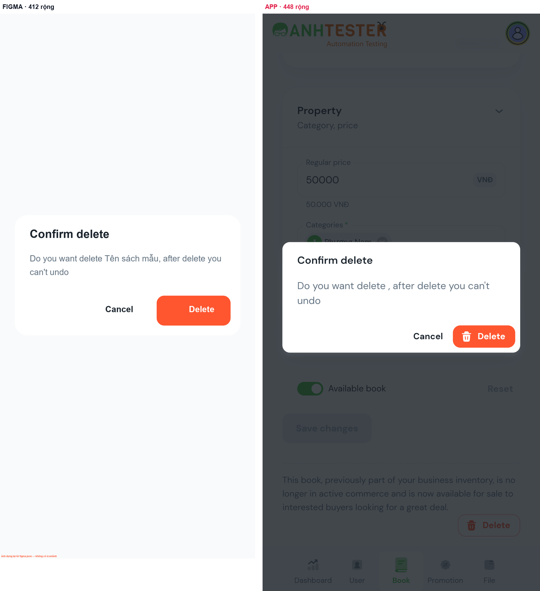

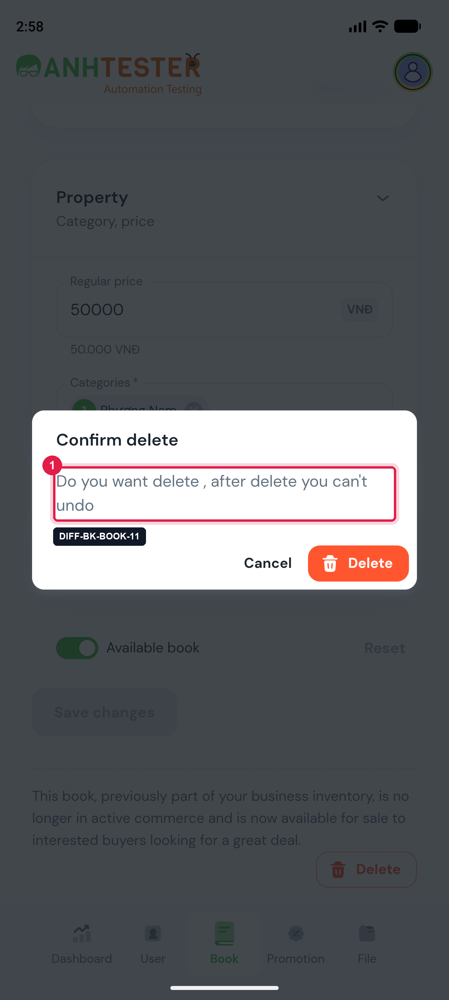

Bảng đo tự động (dc.py match)

> Khung thiết kế rộng **412** · màn thật rộng **448** (cùng đơn vị) · bỏ status bar: thiết kế 36 / thật 40 · đã bù lệch dọc chung 43 (= độ cuộn + lệch bố cục tích luỹ phía trên, không phải độ cuộn) · dung sai vị trí ±4
> lớp phủ `Dialog · Confirm delete`: thiết kế y 362 · app y 409 — chữ đo tương đối với khung lớp phủ (đã bù +43)
> Dữ liệu mẫu khai báo tay (coi như ô động): `Tên sách mẫu`

**Tổng:** ❌ Lệch **5** · ⚠️ Lệch nhỏ **1**

| # | Trạng thái | Chữ trong thiết kế | Trên app | Δx (neo) | Δy | Δ khoảng cách | Δ cao | Màu (thiết kế → app · ΔE) | Ghi chú |
|---|---|---|---|---|---|---|---|---|---|
| 1 | ❌ | Confirm delete | Confirm delete | -16 (trái) | -3 | — | +34 | — | khung phần tử app lớn hơn hộp chữ (gồm icon/padding) — không đo được số dòng, so theo tâm màu chữ không lấy mẫu được (khung có cả icon/nền) — đối chiếu bằng ảnh |
| 2 | ❌ | Do you want delete <mẫu:Tên sách mẫu>, after delete you can't undo | Do you want delete , after delete you can't undo | +3.8 (tỉ lệ) | -3 | +0 | +5 | `#637381` → `#607080` · 1.5 | nội dung chữ khác: “Do you want delete <mẫu:Tên sách mẫu>, after delete you can't undo” ↔ “Do you want delete , after delete you can't undo” |
| 3 | ❌ | Cancel | Cancel | +29 (phải) | -9 | -6 | +17 | `#1c252e` → `#1c242c` · 0.6 | khoảng cách tới “Do you want delete <mẫu:” lệch -6 — điểm khởi phát xô lệch cao 37 vs 20 — khác số dòng (≈1.9 vs 1.0 dòng) |
| 4 | ⚠️ | Delete | Delete | +2 (trái) | -0.5 | +8.5 | +17 | — | khoảng cách tới “Cancel” lệch +8.5 — điểm khởi phát xô lệch khung phần tử app lớn hơn hộp chữ (gồm icon/padding) — không đo được số dòng, so theo tâm màu chữ không lấy mẫu được (khung có cả icon/nền) — đối chiếu bằng ảnh |

> Khối có nền/viền ghép qua chữ nằm bên trong — **heuristic**: phần tử app được chọn là khung nhỏ nhất chứa đủ các chữ đó, màu nền lấy mẫu ở mép trái. Dòng ❌ ở đây phải xem ảnh trước khi tin.

| # | Trạng thái | Khối (thiết kế) | Phần tử app | Δ rộng | Δ cao | Màu nền (thiết kế → app · ΔE) | Ghi chú |
|---|---|---|---|---|---|---|---|
| B1 | ❌ | Dialog · Confirm delete [24, 362, 364, 194] | `AlertDialog` [32, 409, 384, 180] | -16 | -14 | `#ffffff` → `#fcfcfc` · 0.6 | cao 180 vs 194 rộng 384 vs 364 (đã trừ phần chênh bề ngang màn hình) |
| B2 | ❌ | Button [253, 492, 119, 48] | `Button#dialog-delete-action` [307, 544, 101, 37] | -18 | -11 | `#ff5630` → `#fc5430` · 0.8 | cao 37 vs 48 rộng 101 vs 119 |

## 5. Khung / trạng thái không so được

| Khung | Lý do | Cần gì để so |
|---|---|---|
| B-08, B-09 — so bằng mắt | Không lấy được ảnh Figma (hết lượt gọi Figma MCP gói Starter) — dùng ảnh dựng lại từ JSON | Lần chạy sau lấy lại ảnh thật (`get_screenshot` node `9:1555` với `maxDimension` 1739 · `9:1705`), thay 2 ảnh `_figma_render` |
| B-05 — nhãn *NEW* | Sách đang mở không có nhãn *NEW* (nhãn phụ thuộc dữ liệu) — chưa rõ app có hiện nhãn này với sách mới không | Tạo / chọn một sách mới đăng rồi mở chi tiết |

## 6. Ghi chú tham khảo (không tính DIFF — ngoài phạm vi của wireframe)

- Nhãn khuyến mãi trên thẻ sách: app dùng ô icon (%, túi tiền, xe FREE), thiết kế dùng chữ `%` `$` `FREE` — đúng tinh thần wireframe
- Giá gốc trên app có thêm mũi tên ↓ xanh trước giá gạch
- Vùng thả file: app có ảnh minh hoạ thư mục, không viền đứt; thiết kế khung đứt + icon tải lên
- **Quan sát ngoài phạm vi so thiết kế** — **cần Dev xác minh**: sách đầu danh sách hiển thị giá bán **âm** (`-1.000 ₫`) — có thể thiếu ràng buộc giá ≥ 0

## 7. Việc tiếp theo

- **4 DIFF `Dev`** (03 · 07 · 08 · 11) → `/create-bug-report`. Ưu tiên **08** và **11** (sai nội dung, sửa nhanh); **07** gom chung nguyên nhân với DIFF-BK-USER-02 (bảng rộng hơn màn hình)
- **DIFF-BK-BOOK-01** (Cần PO quyết) — cùng câu hỏi với DIFF-BK-USER-04, PO chốt một lần cho cả hai
- **DIFF-BK-BOOK-02** (Cần PO quyết) — chốt định dạng ngày hiển thị cho toàn app
- **5 DIFF `Design`** → gửi designer cập nhật page BOOK
