# So thiết kế Figma ↔ Android — Quản lý người dùng (`USER`)

| Mục | Giá trị |
|---|---|
| Mode | MOBILE |
| Ngày chạy | 20-10-2026 14:40 – 15:10 |
| Figma | File `hEWOqd9cGxTwZoVOJCg7nM` · page `USER — Người dùng` · https://www.figma.com/design/hEWOqd9cGxTwZoVOJCg7nM |
| Độ trung thực thiết kế | **Wireframe có bảng màu thật** — cùng bộ kit với page AUTH (DM Sans, biến `Wireframe` mode "App"). Danh sách dùng **dữ liệu mẫu** (5 người tên tiếng Việt, số điện thoại `09…`) · U-06 ghi chú *"lược bớt cho gọn"* |
| Phạm vi so | Nội dung chữ · có/thiếu phần tử · bố cục, khoảng cách · trạng thái (khách / đã đăng nhập / lỗi / rỗng) · màu chữ. Đường kẻ nét đứt, icon, ảnh đại diện → **tham khảo** (mục 6) |
| Bản build | Android `com.anhtester.book` 1.0 (versionCode 1) — Hybrid Capacitor, WebView không bật debug |
| Môi trường | Emulator Pixel 10 Pro XL · Android 17 · 1344×2992 px · density 480 (×3) → **448 dp** rộng · `font_scale` 1.0 · dark mode tắt · locale en_US |
| Mốc dọc | Đỉnh header: thiết kế 36 dp ↔ app **40 dp** (`--actual-top 40`, như AUTH) |
| Dung sai | Vị trí ±4 dp (⚠️ ≤ 12) · ΔE chữ ≤ 6 · ΔE nền ≤ 3 — rule `design_compare_rules.md` mục 4 |
| Phạm vi khung | **9/9** khung (U-01 → U-09) |
| Dữ liệu | Danh sách thật trên môi trường dùng chung — chỉ người dùng tự sinh `auto_…@auto.test`, không có dữ liệu cá nhân → **không** cần che. Không tạo / sửa / xoá bản ghi nào: form chỉ bấm *Save* khi chắc chắn bị validation chặn, hộp xoá chỉ bấm *Cancel* |
| Tài khoản | Tài khoản test trong `.env` (không ghi vào tài liệu) |
| Tài liệu liên quan | REQ: [`REQUIREMENTS_USER_SUMMARY.md`](../../../../../requirements/_book-api/user/REQUIREMENTS_USER_SUMMARY.md) · lần so trước của hệ thống: [AUTH](../../../auth/mobile/run_20261020_135829/design_compare_report.md) |
| Công cụ | `/compare-ui-from-figma-design MOBILE` · `scripts/design-compare/` (figma_extract.js · dc.py) |

## 1. Tóm tắt

| Mức độ | DIFF 🔴 Mở | Dev | Design | Cần PO quyết | ✅ Khắc phục lượt này | ⚪ Chấp nhận |
|---|---|---|---|---|---|---|
| High | 1 | | | 1 | — | — |
| Medium | 4 | 4 | | | — | — |
| Low | 6 | 1 | 5 | | — | — |
| **Tổng** | **11** | **5** | **5** | **1** | — (lần chạy đầu) | — |

**Nhận xét chung:** Khác AUTH (gần như toàn `Design`), page USER lộ **5 lỗi phía app** — thông tin bị đẩy khuất ngoài mép phải trên màn hẹp (cột *Phone*, nút *Add filter*, trạng thái *No Data* — cùng một gốc: bảng/hàng lọc rộng hơn màn và cuộn ngang), lỗi validation của *Add user* dính sang *Update user*, và dòng định dạng ảnh thiếu dấu phân cách. **DIFF-BK-USER-04** (khách vẫn thấy *New user* và menu ⋮) cần PO chốt quyền hiển thị; phía server có chặn thao tác của khách hay không **cần Dev xác minh** — ngoài phạm vi so thiết kế.

**Dùng chung với module khác (không cấp mã mới — rule `design_compare_rules.md` mục 6, *thành phần dùng chung*):** placeholder ô nhập đậm hơn → [DIFF-BK-AUTH-02](../../../auth/mobile/run_20261020_135829/design_compare_report.md) · fieldset Address thấp hơn → DIFF-BK-AUTH-07 · avatar header → DIFF-BK-AUTH-10 · bottom nav → DIFF-BK-AUTH-11 / 12.

## 2. Bản đồ màn hình

| Mã khung | Khung Figma (node-id) | Trạng thái vẽ | Cách tới trên app | Kết quả | DIFF |
|---|---|---|---|---|---|
| U-01 | User Management — đã đăng nhập (`7:570`) | Danh sách 5 dòng | Đăng nhập › tab *User* | ⚠️ 3 DIFF | 01 · 02 · 03 |
| U-02 | User Management — khách (`7:746`) | Không có *New user*, không có ⋮ | Đăng xuất › tab *User* | ⚠️ 2 DIFF | 02 · 04 |
| U-03 | Bộ lọc nâng cao (`7:990`) | 2 điều kiện + menu Logic mở | Bấm icon lọc › *Add filter* › mở ô Logic | ⚠️ 2 DIFF | 05 · 06 |
| U-04 | Menu ⋮ của dòng (`7:1099`) | Menu Edit / Delete | Bấm ⋮ dòng đầu | ⚠️ 1 DIFF | 07 |
| U-05 | Add user — toàn hộp thoại (`7:1373`) | Mặc định, ô trống | *New user* · cuộn trong hộp thoại 2 đoạn | ⚠️ 2 DIFF | 08 · 09 |
| U-06 | Add user — validation (`7:1608`) | Tên 251 ký tự + email sai + mật khẩu trống | Nhập rồi bấm *Save* (bị chặn, không tạo bản ghi) | ✅ chữ + trạng thái lỗi khớp · thiết kế lược bớt | 08 · 09 |
| U-07 | Update user — toàn hộp thoại (`7:1874`) | Có sẵn dữ liệu người dùng | ⋮ › *Edit* · cuộn 2 đoạn | ⚠️ 3 DIFF | 08 · 09 · 10 |
| U-08 | Xác nhận xoá (`7:2051`) | Hộp thoại xác nhận | ⋮ › *Delete* (rồi *Cancel*) | ⚠️ 1 DIFF | 09 |
| U-09 | Không có dữ liệu (`7:2243`) | Từ khoá không khớp | Gõ `khong-ton-tai` vào ô tìm | ⚠️ 2 DIFF | 01 · 11 |

## 3. Danh sách DIFF

| Mã | Trạng thái | Khung | Loại | Mức độ | Ai xử lý | Mô tả | Thực tế (số đo) | Thiết kế (số đo) | Evidence |
|---|---|---|---|---|---|---|---|---|---|
| DIFF-BK-USER-01 | 🔴 Mở | U-01 · U-03 · U-04 · U-09 | LAYOUT | Low | Design | Tiêu đề trang nằm cao hơn, nút *New user* nhỏ hơn (áp cả trang Book — B-01…B-04) | Tiêu đề **−14 dp** · nút 120 × **36 dp**, icon đặc | Nút 139 × **48 dp**, icon nét | [U-01 side](evidence/U-01_user_list_signed_in_side.png) · [marked](evidence/U-01_user_list_signed_in_marked.png) |
| DIFF-BK-USER-02 | 🔴 Mở | U-01 · U-02 · U-03 · U-04 | LAYOUT | **Medium** | **Dev** | Cột **Phone** bị đẩy ra ngoài mép phải — số điện thoại không nhìn thấy nếu không cuộn ngang | Cột Name rộng **365 dp**, cột Phone bắt đầu x **380 dp**, chỉ lộ 52 dp sau mép thẻ (448 dp) | Name + Phone cùng hiện, Phone ở x **267 dp** | [marked](evidence/U-01_user_list_signed_in_marked.png) |
| DIFF-BK-USER-03 | 🔴 Mở | U-01 · U-02 · U-09 | STYLE | Low | Design | Đầu bảng: thiết kế có icon sắp xếp ↑↓ cạnh *Name* và icon lọc **trước** *Phone*; app chỉ có icon lọc ở **cuối** mỗi cột | Icon lọc cuối cột, không có icon sắp xếp | ↑↓ sau *Name* · icon lọc trước *Phone* | [U-09 side](evidence/U-09_user_search_empty_side.png) |
| DIFF-BK-USER-04 | 🔴 Mở | U-02 | EXTRA | **High** | **Cần PO quyết** | Khách (chưa đăng nhập) vẫn thấy nút **New user** và menu **⋮** (Edit / Delete) trên từng dòng — thiết kế U-02 bỏ cả hai | Nút *New user* 120 × 36 dp · ⋮ trên 5/5 dòng | Không có nút, không có ⋮ | [U-02 side](evidence/U-02_user_list_guest_side.png) · [marked](evidence/U-02_user_list_guest_marked.png) |
| DIFF-BK-USER-05 | 🔴 Mở | U-03 | LAYOUT | **Medium** | **Dev** | Hàng nút của bộ lọc: *Add filter* bị đẩy ra mép phải (chỉ lộ icon +), **không có** *Clear filter* | *Add filter* x **406 dp**, lộ 26 dp · *Clear filter* không có trong cây phần tử | *Add filter* + *Clear filter* thành hàng riêng dưới điều kiện lọc | [marked](evidence/U-03_user_filter_marked.png) |
| DIFF-BK-USER-06 | 🔴 Mở | U-03 | STATE | Low | Design | Mở bộ lọc thì ô tìm kiếm biến mất; ô Logic không có nhãn nổi *Logic* | Ô tìm kiếm ẩn · ô `AND` không nhãn | Ô tìm kiếm giữ trên cùng · nhãn *Logic* | [U-03 side](evidence/U-03_user_filter_side.png) |
| DIFF-BK-USER-07 | 🔴 Mở | U-04 | LAYOUT | Low | Design | Menu ⋮ hẹp hơn, đè lên tên người dùng | Rộng **140 dp** × 108 · x 244 | Rộng **200 dp** × 112 · x 188 | [marked](evidence/U-04_user_row_menu_marked.png) |
| DIFF-BK-USER-08 | 🔴 Mở | U-05 · U-06 · U-07 (+ A-07) | CONTENT | Low | **Dev** | Dòng định dạng ảnh thiếu dấu phẩy và khoảng trắng giữa các đuôi file | `Allowed *.jpeg,*.jpg*.png*.gif*.webp*.bmp*.svg` | `Allowed *.jpeg, *.jpg, *.png, *.gif, *.webp, *.bmp, *.svg` | [marked](evidence/U-05_add_user_marked.png) |
| DIFF-BK-USER-09 | 🔴 Mở | U-05 · U-07 · U-08 (+ B-09) | LAYOUT | Low | Design | Nút ở chân hộp thoại thấp và hẹp hơn; hộp thoại rộng hơn, sát mép trên | *Save* 89 × **37 dp** · *Delete* −18 × −11 · hộp thoại 384 dp, cách đỉnh 32 dp | *Save* 107 × **48 dp** · hộp thoại 364 dp | [U-05 side đoạn 1](evidence/U-05_add_user_side_part1.png) · [marked](evidence/U-05_add_user_marked.png) |
| DIFF-BK-USER-10 | 🔴 Mở | U-07 | STATE | **Medium** | **Dev** | Lỗi validation của *Add user* **dính sang** *Update user*: ô đã có giá trị vẫn báo lỗi | Bấm *Save* ở *Add user* khi trống › *Cancel* › ⋮ › *Edit*: *Name* có giá trị vẫn hiện "Name is required.", *Email* hợp lệ vẫn "Email is required." — **tái hiện 2/2 lần** | Mở *Update user* sạch lỗi, ô có dữ liệu sẵn | [tái hiện](evidence/U-07_update_user_stale_errors_marked.png) · [U-07 side](evidence/U-07_update_user_side_part1.png) |
| DIFF-BK-USER-11 | 🔴 Mở | U-09 | LAYOUT | **Medium** | **Dev** | Trạng thái không có dữ liệu: bảng giãn đủ 3 cột (Name · Phone · Address), hình minh hoạ và chữ *No Data* căn giữa **bề ngang bảng** nên gần như khuất ngoài mép phải | *No Data* x **404 dp** (màn 448) · vùng rỗng 416 × 380 | *No Data* căn giữa thẻ, x **175 dp** | [U-09 side](evidence/U-09_user_search_empty_side.png) · [marked](evidence/U-09_user_search_empty_marked.png) |

## 4. Chi tiết từng khung

Mốc so: dp, tính từ đỉnh header ở cả hai phía (`--actual-top 40`). Bảng đo là **dữ liệu thô** của `dc.py match` — kết luận nằm ở mục 3. Hàng lặp (`UserRow` × 5) được nhận là **danh sách** — chữ trong hàng là dữ liệu mẫu, không so (❔).

### U-01 · User Management — đã đăng nhập

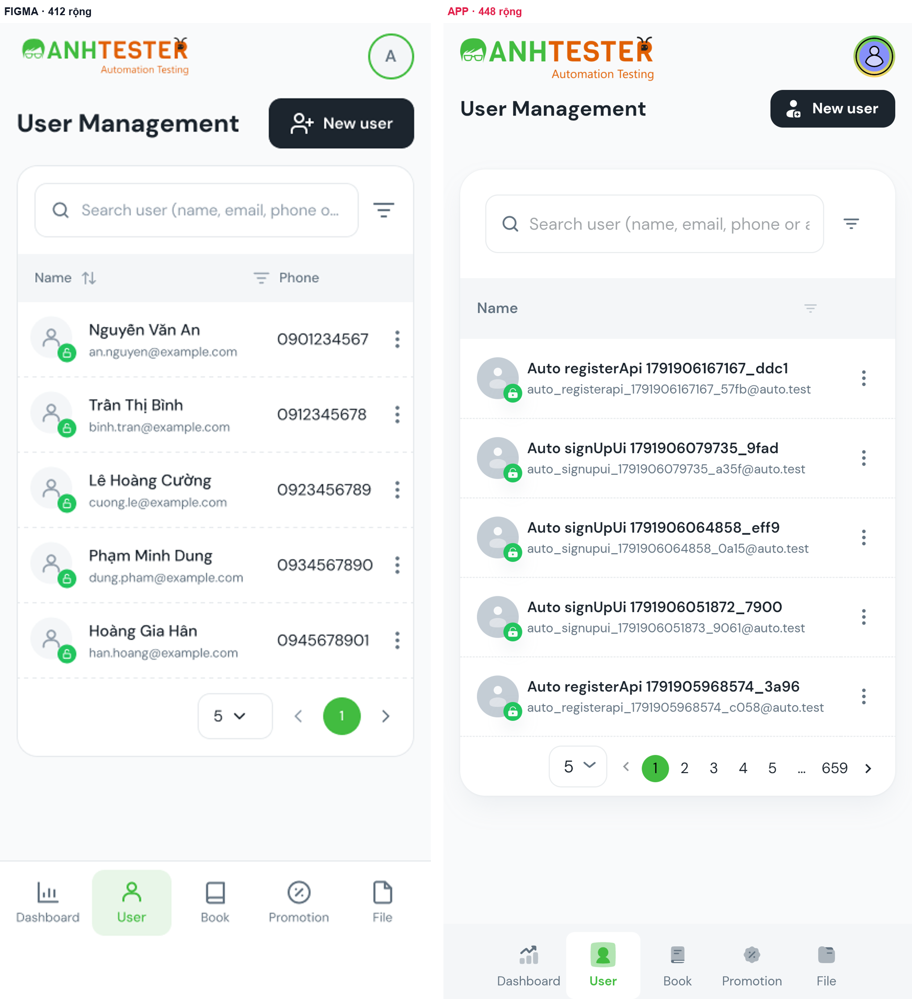

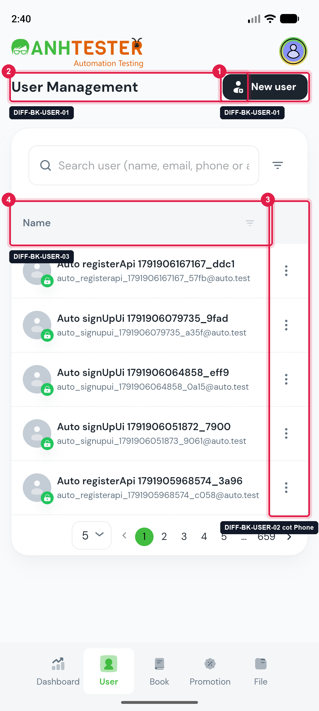

Bảng đo tự động (dc.py match)

> Khung thiết kế rộng **412** · màn thật rộng **448** (cùng đơn vị) · bỏ status bar: thiết kế 36 / thật 40 · dung sai vị trí ±4
> Danh sách lặp trong thiết kế: `UserRow` × 5 (cao 72) — chữ bên trong là dữ liệu mẫu; so chiều cao hàng, cột, căn lề bằng ảnh

**Tổng:** 🔍 Thiếu trên app **3** · ❌ Lệch **10** · ❔ Không so được **15** · ⚠️ Lệch nhỏ **6** · ➕ Thừa trên app **1**

| # | Trạng thái | Chữ trong thiết kế | Trên app | Δx (neo) | Δy | Δ khoảng cách | Δ cao | Màu (thiết kế → app · ΔE) | Ghi chú |
|---|---|---|---|---|---|---|---|---|---|
| 1 | 🔍 | A | — | — | — | — | — | — |  |
| 2 | ❌ | User Management | User Management | +0 (trái) | -14 | — | +0 | `#1c252e` → `#1c242c` · 0.6 | lệch -14 tính từ đầu vùng nội dung — nguyên nhân có thể nằm ở phần tử không có chữ phía trên (ảnh, banner, header) |
| 3 | ❌ | New user | New user | +3 (trái) | -22 | -8 | +16 | `#ffffff` → `#fcfcfc` · 0.6 | khoảng cách tới “User Management” lệch -8 — điểm khởi phát xô lệch cao 36 vs 20 — khác số dòng (≈1.8 vs 1.0 dòng) |
| 4 | 🔍 | Search user (name, email, phone or address) | — | — | — | — | — | — |  |
| 5 | ❌ | Name | Name | -17 (trái) | +29 | +51 | +40 | — | khoảng cách tới “New user” lệch +51 — điểm khởi phát xô lệch khung phần tử app lớn hơn hộp chữ (gồm icon/padding) — không đo được số dòng, so theo tâm màu chữ không lấy mẫu được (khung có cả icon/nền) — đối chiếu bằng ảnh |
| 6 | ❌ | Phone | Phone | +47 (tâm-phải) | +29 | +0 | +40 | — | Δy +29 kế thừa từ phía trên — không tính lỗi riêng khung phần tử app lớn hơn hộp chữ (gồm icon/padding) — không đo được số dòng, so theo tâm |
| 7 | ❔ | Nguyễn Văn An | — | — | — | — | — | — | dữ liệu mẫu trong hàng lặp — so cấu trúc hàng (cao, cột, căn) bằng ảnh, không so chữ |
| 8 | ❔ | 0901234567 | — | — | — | — | — | — | dữ liệu mẫu trong hàng lặp — so cấu trúc hàng (cao, cột, căn) bằng ảnh, không so chữ |
| 9 | ❔ | an.nguyen@example.com | — | — | — | — | — | — | dữ liệu mẫu trong hàng lặp — so cấu trúc hàng (cao, cột, căn) bằng ảnh, không so chữ |
| 10 | ❔ | Trần Thị Bình | — | — | — | — | — | — | dữ liệu mẫu trong hàng lặp — so cấu trúc hàng (cao, cột, căn) bằng ảnh, không so chữ |
| 11 | ❔ | 0912345678 | — | — | — | — | — | — | dữ liệu mẫu trong hàng lặp — so cấu trúc hàng (cao, cột, căn) bằng ảnh, không so chữ |
| 12 | ❔ | binh.tran@example.com | — | — | — | — | — | — | dữ liệu mẫu trong hàng lặp — so cấu trúc hàng (cao, cột, căn) bằng ảnh, không so chữ |
| 13 | ❔ | Lê Hoàng Cường | — | — | — | — | — | — | dữ liệu mẫu trong hàng lặp — so cấu trúc hàng (cao, cột, căn) bằng ảnh, không so chữ |
| 14 | ❔ | 0923456789 | — | — | — | — | — | — | dữ liệu mẫu trong hàng lặp — so cấu trúc hàng (cao, cột, căn) bằng ảnh, không so chữ |
| 15 | ❔ | cuong.le@example.com | — | — | — | — | — | — | dữ liệu mẫu trong hàng lặp — so cấu trúc hàng (cao, cột, căn) bằng ảnh, không so chữ |
| 16 | ❔ | Phạm Minh Dung | — | — | — | — | — | — | dữ liệu mẫu trong hàng lặp — so cấu trúc hàng (cao, cột, căn) bằng ảnh, không so chữ |
| 17 | ❔ | 0934567890 | — | — | — | — | — | — | dữ liệu mẫu trong hàng lặp — so cấu trúc hàng (cao, cột, căn) bằng ảnh, không so chữ |
| 18 | ❔ | dung.pham@example.com | — | — | — | — | — | — | dữ liệu mẫu trong hàng lặp — so cấu trúc hàng (cao, cột, căn) bằng ảnh, không so chữ |
| 19 | ❔ | Hoàng Gia Hân | — | — | — | — | — | — | dữ liệu mẫu trong hàng lặp — so cấu trúc hàng (cao, cột, căn) bằng ảnh, không so chữ |
| 20 | ❔ | 0945678901 | — | — | — | — | — | — | dữ liệu mẫu trong hàng lặp — so cấu trúc hàng (cao, cột, căn) bằng ảnh, không so chữ |
| 21 | ❔ | han.hoang@example.com | — | — | — | — | — | — | dữ liệu mẫu trong hàng lặp — so cấu trúc hàng (cao, cột, căn) bằng ảnh, không so chữ |
| 22 | ❌ | 5 | 5 | -80.5 (tâm-trái) | +48 | +19 | +18 | — | khoảng cách tới “Phone” lệch +19 — điểm khởi phát xô lệch khung phần tử app lớn hơn hộp chữ (gồm icon/padding) — không đo được số dòng, so theo tâm màu chữ không lấy mẫu được (khung có cả icon/nền) — đối chiếu bằng ảnh |
| 23 | 🔍 | 1 | — | — | — | — | — | — |  |
| 24 | ⚠️ | User | User | -4.8 (tỉ lệ · neo đáy) | -6.8 | — | +63 | — | neo đáy màn hình — Δy đo theo khoảng cách tới đáy vùng nội dung khung phần tử app lớn hơn hộp chữ (gồm icon/padding) — không đo được số dòng, so theo tâm màu chữ không lấy mẫu được (khung có cả icon/nền) — đối chiếu bằng ảnh |
| 25 | ⚠️ | Dashboard | Dashboard | -0.5 (tâm-phải · neo đáy) | -6.8 | — | +65 | — | neo đáy màn hình — Δy đo theo khoảng cách tới đáy vùng nội dung khung phần tử app lớn hơn hộp chữ (gồm icon/padding) — không đo được số dòng, so theo tâm màu chữ không lấy mẫu được (khung có cả icon/nền) — đối chiếu bằng ảnh |
| 26 | ⚠️ | Book | Book | +0 (tâm-giữa · neo đáy) | -6.8 | — | +65 | — | neo đáy màn hình — Δy đo theo khoảng cách tới đáy vùng nội dung khung phần tử app lớn hơn hộp chữ (gồm icon/padding) — không đo được số dòng, so theo tâm màu chữ không lấy mẫu được (khung có cả icon/nền) — đối chiếu bằng ảnh |
| 27 | ⚠️ | Promotion | Promotion | +2 (trái · neo đáy) | -6.8 | — | +65 | — | neo đáy màn hình — Δy đo theo khoảng cách tới đáy vùng nội dung khung phần tử app lớn hơn hộp chữ (gồm icon/padding) — không đo được số dòng, so theo tâm màu chữ không lấy mẫu được (khung có cả icon/nền) — đối chiếu bằng ảnh |
| 28 | ⚠️ | File | File | -0.5 (tâm-trái · neo đáy) | -6.8 | — | +65 | — | neo đáy màn hình — Δy đo theo khoảng cách tới đáy vùng nội dung khung phần tử app lớn hơn hộp chữ (gồm icon/padding) — không đo được số dòng, so theo tâm màu chữ không lấy mẫu được (khung có cả icon/nền) — đối chiếu bằng ảnh |

> Khối có nền/viền ghép qua chữ nằm bên trong — **heuristic**: phần tử app được chọn là khung nhỏ nhất chứa đủ các chữ đó, màu nền lấy mẫu ở mép trái. Dòng ❌ ở đây phải xem ảnh trước khi tin.

| # | Trạng thái | Khối (thiết kế) | Phần tử app | Δ rộng | Δ cao | Màu nền (thiết kế → app · ΔE) | Ghi chú |
|---|---|---|---|---|---|---|---|
| B1 | ❌ | Button [257, 108, 139, 48] | `Button` [312, 104, 120, 36] | -19 | -12 | `#1c252e` → `#1c242c` · 0.6 | cao 36 vs 48 rộng 120 vs 139 |
| B2 | ❌ | Card · User list [16, 172, 380, 566] | `View` [16, 180, 416, 599] | +0 | +33 | `#ffffff` → `#fcfcfc` · 0.6 | cao 599 vs 566 |
| B3 | ⚠️ | Table header [17, 257, 378, 46] | `View` [16, 284, 416, 58] | +2 | +12 | `#f4f6f8` → `#f4f4f8` · 1.7 | cao 58 vs 46 |
| B4 | ❌ | Page size [189, 677, 72, 44] | `View` [100, 731, 57, 40] | -15 | -4 | `#ffffff` → `#fcfcfc` · 0.6 | rộng 57 vs 72 |
| B5 | ❌ | BottomNav [0, 837, 412, 80] | `View` [38, 901, 372, 81] | -76 | +1 | `#ffffff` → `#f4f4f8` · 3.0 | rộng 372 vs 412 (đã trừ phần chênh bề ngang màn hình) |
| B6 | ❌ | Tab User [88, 846, 76, 63] | `View` [117, 901, 72, 81] | -4 | +18 | `#e8f6e8` → `#fcfcfc` · 9.6 | cao 81 vs 63 màu nền #fcfcfc vs #e8f6e8 (ΔE 9.6) |

| ➕ Chữ có trên app nhưng không có trong thiết kế | Loại | Vị trí |
|---|---|---|
| … | text | [329, 742, 27, 22] |

### U-02 · User Management — khách

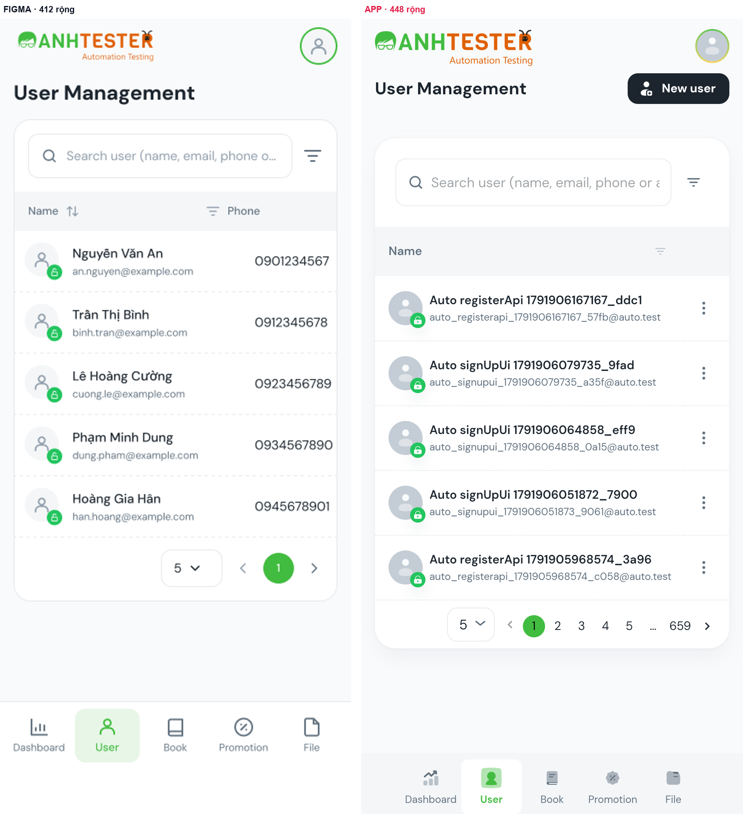

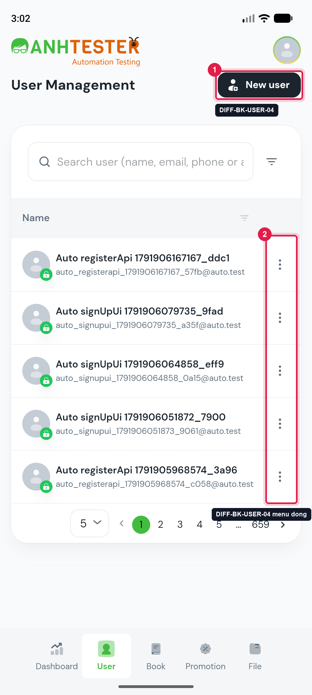

Bảng đo tự động (dc.py match)

> Khung thiết kế rộng **412** · màn thật rộng **448** (cùng đơn vị) · bỏ status bar: thiết kế 36 / thật 40 · dung sai vị trí ±4
> Danh sách lặp trong thiết kế: `UserRow` × 5 (cao 72) — chữ bên trong là dữ liệu mẫu; so chiều cao hàng, cột, căn lề bằng ảnh

**Tổng:** ⚠️ Lệch nhỏ **7** · 🔍 Thiếu trên app **2** · ❌ Lệch **7** · ❔ Không so được **15** · ➕ Thừa trên app **2**

| # | Trạng thái | Chữ trong thiết kế | Trên app | Δx (neo) | Δy | Δ khoảng cách | Δ cao | Màu (thiết kế → app · ΔE) | Ghi chú |
|---|---|---|---|---|---|---|---|---|---|
| 1 | ⚠️ | User Management | User Management | +0 (trái) | -5 | — | +0 | `#1c252e` → `#1c242c` · 0.6 | lệch -5 tính từ đầu vùng nội dung — nguyên nhân có thể nằm ở phần tử không có chữ phía trên (ảnh, banner, header) |
| 2 | 🔍 | Search user (name, email, phone or address) | — | — | — | — | — | — |  |
| 3 | ❌ | Name | Name | -1 (trái) | +47 | +52 | +8 | — | khoảng cách tới “User Management” lệch +52 — điểm khởi phát xô lệch khung phần tử app lớn hơn hộp chữ (gồm icon/padding) — không đo được số dòng, so theo tâm màu chữ không lấy mẫu được (khung có cả icon/nền) — đối chiếu bằng ảnh |
| 4 | ❌ | Phone | Phone | +47 (tâm-phải) | +47 | +0 | +40 | — | Δy +47 kế thừa từ phía trên — không tính lỗi riêng khung phần tử app lớn hơn hộp chữ (gồm icon/padding) — không đo được số dòng, so theo tâm |
| 5 | ❔ | Nguyễn Văn An | — | — | — | — | — | — | dữ liệu mẫu trong hàng lặp — so cấu trúc hàng (cao, cột, căn) bằng ảnh, không so chữ |
| 6 | ❔ | 0901234567 | — | — | — | — | — | — | dữ liệu mẫu trong hàng lặp — so cấu trúc hàng (cao, cột, căn) bằng ảnh, không so chữ |
| 7 | ❔ | an.nguyen@example.com | — | — | — | — | — | — | dữ liệu mẫu trong hàng lặp — so cấu trúc hàng (cao, cột, căn) bằng ảnh, không so chữ |
| 8 | ❔ | Trần Thị Bình | — | — | — | — | — | — | dữ liệu mẫu trong hàng lặp — so cấu trúc hàng (cao, cột, căn) bằng ảnh, không so chữ |
| 9 | ❔ | 0912345678 | — | — | — | — | — | — | dữ liệu mẫu trong hàng lặp — so cấu trúc hàng (cao, cột, căn) bằng ảnh, không so chữ |
| 10 | ❔ | binh.tran@example.com | — | — | — | — | — | — | dữ liệu mẫu trong hàng lặp — so cấu trúc hàng (cao, cột, căn) bằng ảnh, không so chữ |
| 11 | ❔ | Lê Hoàng Cường | — | — | — | — | — | — | dữ liệu mẫu trong hàng lặp — so cấu trúc hàng (cao, cột, căn) bằng ảnh, không so chữ |
| 12 | ❔ | 0923456789 | — | — | — | — | — | — | dữ liệu mẫu trong hàng lặp — so cấu trúc hàng (cao, cột, căn) bằng ảnh, không so chữ |
| 13 | ❔ | cuong.le@example.com | — | — | — | — | — | — | dữ liệu mẫu trong hàng lặp — so cấu trúc hàng (cao, cột, căn) bằng ảnh, không so chữ |
| 14 | ❔ | Phạm Minh Dung | — | — | — | — | — | — | dữ liệu mẫu trong hàng lặp — so cấu trúc hàng (cao, cột, căn) bằng ảnh, không so chữ |
| 15 | ❔ | 0934567890 | — | — | — | — | — | — | dữ liệu mẫu trong hàng lặp — so cấu trúc hàng (cao, cột, căn) bằng ảnh, không so chữ |
| 16 | ❔ | dung.pham@example.com | — | — | — | — | — | — | dữ liệu mẫu trong hàng lặp — so cấu trúc hàng (cao, cột, căn) bằng ảnh, không so chữ |
| 17 | ❔ | Hoàng Gia Hân | — | — | — | — | — | — | dữ liệu mẫu trong hàng lặp — so cấu trúc hàng (cao, cột, căn) bằng ảnh, không so chữ |
| 18 | ❔ | 0945678901 | — | — | — | — | — | — | dữ liệu mẫu trong hàng lặp — so cấu trúc hàng (cao, cột, căn) bằng ảnh, không so chữ |
| 19 | ❔ | han.hoang@example.com | — | — | — | — | — | — | dữ liệu mẫu trong hàng lặp — so cấu trúc hàng (cao, cột, căn) bằng ảnh, không so chữ |
| 20 | ❌ | 5 | 5 | -80.5 (tâm-trái) | +66 | +19 | +18 | — | khoảng cách tới “Phone” lệch +19 — điểm khởi phát xô lệch khung phần tử app lớn hơn hộp chữ (gồm icon/padding) — không đo được số dòng, so theo tâm màu chữ không lấy mẫu được (khung có cả icon/nền) — đối chiếu bằng ảnh |
| 21 | 🔍 | 1 | — | — | — | — | — | — |  |
| 22 | ⚠️ | User | User | -4.8 (tỉ lệ · neo đáy) | -6.8 | — | +63 | — | neo đáy màn hình — Δy đo theo khoảng cách tới đáy vùng nội dung khung phần tử app lớn hơn hộp chữ (gồm icon/padding) — không đo được số dòng, so theo tâm màu chữ không lấy mẫu được (khung có cả icon/nền) — đối chiếu bằng ảnh |
| 23 | ⚠️ | Dashboard | Dashboard | -0.5 (tâm-phải · neo đáy) | -6.8 | — | +65 | — | neo đáy màn hình — Δy đo theo khoảng cách tới đáy vùng nội dung khung phần tử app lớn hơn hộp chữ (gồm icon/padding) — không đo được số dòng, so theo tâm màu chữ không lấy mẫu được (khung có cả icon/nền) — đối chiếu bằng ảnh |
| 24 | ⚠️ | Book | Book | +0 (tâm-giữa · neo đáy) | -6.8 | — | +65 | — | neo đáy màn hình — Δy đo theo khoảng cách tới đáy vùng nội dung khung phần tử app lớn hơn hộp chữ (gồm icon/padding) — không đo được số dòng, so theo tâm màu chữ không lấy mẫu được (khung có cả icon/nền) — đối chiếu bằng ảnh |
| 25 | ⚠️ | Promotion | Promotion | +2 (trái · neo đáy) | -6.8 | — | +65 | — | neo đáy màn hình — Δy đo theo khoảng cách tới đáy vùng nội dung khung phần tử app lớn hơn hộp chữ (gồm icon/padding) — không đo được số dòng, so theo tâm màu chữ không lấy mẫu được (khung có cả icon/nền) — đối chiếu bằng ảnh |
| 26 | ⚠️ | File | File | -0.5 (tâm-trái · neo đáy) | -6.8 | — | +65 | — | neo đáy màn hình — Δy đo theo khoảng cách tới đáy vùng nội dung khung phần tử app lớn hơn hộp chữ (gồm icon/padding) — không đo được số dòng, so theo tâm màu chữ không lấy mẫu được (khung có cả icon/nền) — đối chiếu bằng ảnh |

> Khối có nền/viền ghép qua chữ nằm bên trong — **heuristic**: phần tử app được chọn là khung nhỏ nhất chứa đủ các chữ đó, màu nền lấy mẫu ở mép trái. Dòng ❌ ở đây phải xem ảnh trước khi tin.

| # | Trạng thái | Khối (thiết kế) | Phần tử app | Δ rộng | Δ cao | Màu nền (thiết kế → app · ΔE) | Ghi chú |
|---|---|---|---|---|---|---|---|
| B1 | ❌ | Card · User list [16, 154, 380, 566] | `View` [16, 180, 416, 599] | +0 | +33 | `#ffffff` → `#fcfcfc` · 0.6 | cao 599 vs 566 |
| B2 | ⚠️ | Table header [17, 239, 378, 46] | `View` [16, 284, 416, 58] | +2 | +12 | `#f4f6f8` → `#f4f4f8` · 1.7 | cao 58 vs 46 |
| B3 | ❌ | Page size [189, 659, 72, 44] | `View` [100, 731, 57, 40] | -15 | -4 | `#ffffff` → `#fcfcfc` · 0.6 | rộng 57 vs 72 |
| B4 | ❌ | BottomNav [0, 837, 412, 80] | `View` [38, 901, 372, 81] | -76 | +1 | `#ffffff` → `#f4f4f8` · 3.0 | rộng 372 vs 412 (đã trừ phần chênh bề ngang màn hình) |
| B5 | ❌ | Tab User [88, 846, 76, 63] | `View` [117, 901, 72, 81] | -4 | +18 | `#e8f6e8` → `#fcfcfc` · 9.6 | cao 81 vs 63 màu nền #fcfcfc vs #e8f6e8 (ΔE 9.6) |

| ➕ Chữ có trên app nhưng không có trong thiết kế | Loại | Vị trí |
|---|---|---|
| New user | text | [312, 104, 120, 36] |
| … | text | [329, 742, 27, 22] |

### U-03 · Bộ lọc nâng cao (+ menu Logic AND/OR — `SCOPE = Menu`)

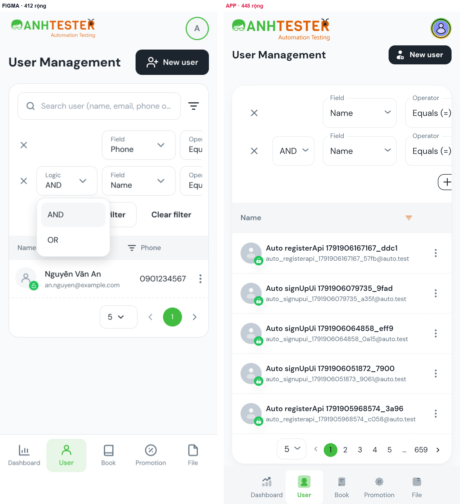

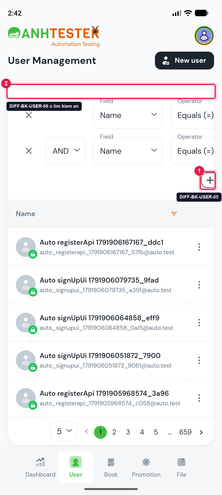

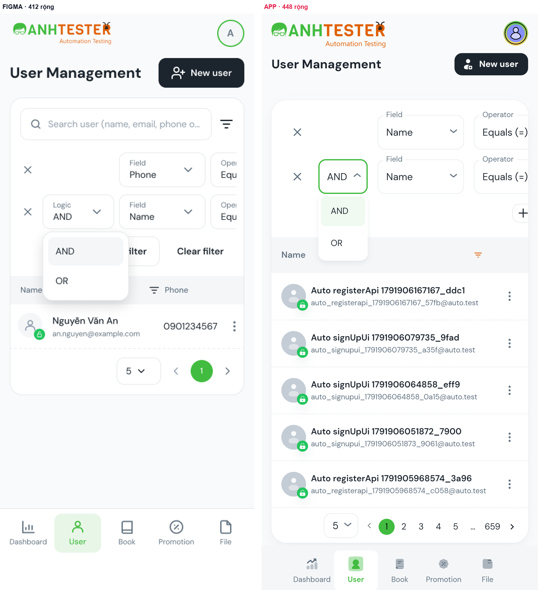

Bảng đo tự động — toàn khung (dc.py match)

> Khung thiết kế rộng **412** · màn thật rộng **448** (cùng đơn vị) · bỏ status bar: thiết kế 36 / thật 40 · dung sai vị trí ±4

**Tổng:** 🔍 Thiếu trên app **8** · ❌ Lệch **18** · ✅ Khớp **2** · ⤵️ Ngoài màn hình đã chụp **4** · ⚠️ Lệch nhỏ **7** · ➕ Thừa trên app **22**

| # | Trạng thái | Chữ trong thiết kế | Trên app | Δx (neo) | Δy | Δ khoảng cách | Δ cao | Màu (thiết kế → app · ΔE) | Ghi chú |
|---|---|---|---|---|---|---|---|---|---|
| 1 | 🔍 | A | — | — | — | — | — | — |  |
| 2 | ❌ | User Management | User Management | +0 (trái) | -14 | — | +0 | `#1c252e` → `#1c242c` · 0.6 | lệch -14 tính từ đầu vùng nội dung — nguyên nhân có thể nằm ở phần tử không có chữ phía trên (ảnh, banner, header) |
| 3 | ❌ | New user | New user | +3 (trái) | -22 | -8 | +16 | `#ffffff` → `#fcfcfc` · 0.6 | khoảng cách tới “User Management” lệch -8 — điểm khởi phát xô lệch cao 36 vs 20 — khác số dòng (≈1.8 vs 1.0 dòng) |
| 4 | 🔍 | Search user (name, email, phone or address) | — | — | — | — | — | — |  |
| 5 | ❌ | Field | Field | -8 (trái) | -79 | -57 | +2 | `#637381` → `#607080` · 1.5 | khoảng cách tới “New user” lệch -57 — điểm khởi phát xô lệch |
| 6 | ✅ | Operator | Operator | +0 (trái) | -79 | +0 | +2 | `#637381` → `#607080` · 1.5 | Δy -79 kế thừa từ phía trên — không tính lỗi riêng |
| 7 | ⤵️ | Value | — | — | — | — | — | — | nằm ngoài bề ngang khung — vùng cuộn ngang, so khi cuộn tới |
| 8 | ❌ | Phone | Phone | +134 (phải) | +112 | +191 | +36 | — | khoảng cách tới “Operator” lệch +191 — điểm khởi phát xô lệch cao 58 vs 22 — khác số dòng (≈2.6 vs 1.0 dòng) |
| 9 | ❌ | Equals (=) | Equals (=) | -14 (trái) | -86 | -198 | +34 | `#1c252e` → `#1c242c` · 0.6 | khoảng cách tới “Phone” lệch -198 — điểm khởi phát xô lệch cao 56 vs 22 — khác số dòng (≈2.5 vs 1.0 dòng) |
| 10 | ⤵️ | 0901234567 | — | — | — | — | — | — | nằm ngoài bề ngang khung — vùng cuộn ngang, so khi cuộn tới |
| 11 | 🔍 | Logic | — | — | — | — | — | — |  |
| 12 | ⚠️ | Field | Field | -8 (trái) | -75 | +11 | +2 | `#637381` → `#607080` · 1.5 | khoảng cách tới “Equals (=)” lệch +11 — điểm khởi phát xô lệch |
| 13 | ✅ | Operator | Operator | +0 (trái) | -75 | +0 | +2 | `#637381` → `#607080` · 1.5 | Δy -75 kế thừa từ phía trên — không tính lỗi riêng |
| 14 | ⤵️ | Value | — | — | — | — | — | — | nằm ngoài bề ngang khung — vùng cuộn ngang, so khi cuộn tới |
| 15 | ❌ | AND | AND | -1.5 (tỉ lệ) | -82 | -7 | +34 | `#1c252e` → `#1c242c` · 0.6 | khoảng cách tới “Operator” lệch -7 — điểm khởi phát xô lệch cao 56 vs 22 — khác số dòng (≈2.5 vs 1.0 dòng) |
| 16 | ❌ | Name | Name | -6 (tâm-giữa) | -65 | +17 | +34 | — | khoảng cách tới “AND” lệch +17 — điểm khởi phát xô lệch khung phần tử app lớn hơn hộp chữ (gồm icon/padding) — không đo được số dòng, so theo tâm màu chữ không lấy mẫu được (khung có cả icon/nền) — đối chiếu bằng ảnh |
| 17 | ❌ | Equals (=) | Equals (=) | -14 (trái) | -82 | -17 | +34 | `#1c252e` → `#1c242c` · 0.6 | khoảng cách tới “Name” lệch -17 — điểm khởi phát xô lệch cao 56 vs 22 — khác số dòng (≈2.5 vs 1.0 dòng) |
| 18 | ⤵️ | Nguyễn Văn An | — | — | — | — | — | — | nằm ngoài bề ngang khung — vùng cuộn ngang, so khi cuộn tới |
| 19 | ❌ | Add filter | Add filter | +199 (phải) | -67 | +15 | +11 | `#1c252e` → `#1c242c` · 0.6 | khoảng cách tới “Equals (=)” lệch +15 — điểm khởi phát xô lệch |
| 20 | 🔍 | Clear filter | — | — | — | — | — | — |  |
| 21 | ❌ | Name | Name | -17 (trái) | -57 | +10 | +40 | — | khoảng cách tới “Add filter” lệch +10 — điểm khởi phát xô lệch khung phần tử app lớn hơn hộp chữ (gồm icon/padding) — không đo được số dòng, so theo tâm màu chữ không lấy mẫu được (khung có cả icon/nền) — đối chiếu bằng ảnh |
| 22 | ❌ | Phone | Phone | +93 (phải) | -61 | -4 | +8 | — | Δy -61 kế thừa từ phía trên — không tính lỗi riêng |
| 23 | 🔍 | Nguyễn Văn An | — | — | — | — | — | — |  |
| 24 | 🔍 | 0901234567 | — | — | — | — | — | — |  |
| 25 | 🔍 | an.nguyen@example.com | — | — | — | — | — | — |  |
| 26 | ❌ | 5 | 5 | -80.5 (tâm-trái) | +250 | +311 | +18 | — | khoảng cách tới “Phone” lệch +311 — điểm khởi phát xô lệch khung phần tử app lớn hơn hộp chữ (gồm icon/padding) — không đo được số dòng, so theo tâm màu chữ không lấy mẫu được (khung có cả icon/nền) — đối chiếu bằng ảnh |
| 27 | 🔍 | 1 | — | — | — | — | — | — |  |
| 28 | ⚠️ | User | User | -4.8 (tỉ lệ · neo đáy) | -6.8 | — | +63 | — | neo đáy màn hình — Δy đo theo khoảng cách tới đáy vùng nội dung khung phần tử app lớn hơn hộp chữ (gồm icon/padding) — không đo được số dòng, so theo tâm màu chữ không lấy mẫu được (khung có cả icon/nền) — đối chiếu bằng ảnh |
| 29 | ⚠️ | Dashboard | Dashboard | -0.5 (tâm-phải · neo đáy) | -6.8 | — | +65 | — | neo đáy màn hình — Δy đo theo khoảng cách tới đáy vùng nội dung khung phần tử app lớn hơn hộp chữ (gồm icon/padding) — không đo được số dòng, so theo tâm màu chữ không lấy mẫu được (khung có cả icon/nền) — đối chiếu bằng ảnh |
| 30 | ⚠️ | Book | Book | +0 (tâm-giữa · neo đáy) | -6.8 | — | +65 | — | neo đáy màn hình — Δy đo theo khoảng cách tới đáy vùng nội dung khung phần tử app lớn hơn hộp chữ (gồm icon/padding) — không đo được số dòng, so theo tâm màu chữ không lấy mẫu được (khung có cả icon/nền) — đối chiếu bằng ảnh |
| 31 | ⚠️ | Promotion | Promotion | +2 (trái · neo đáy) | -6.8 | — | +65 | — | neo đáy màn hình — Δy đo theo khoảng cách tới đáy vùng nội dung khung phần tử app lớn hơn hộp chữ (gồm icon/padding) — không đo được số dòng, so theo tâm màu chữ không lấy mẫu được (khung có cả icon/nền) — đối chiếu bằng ảnh |
| 32 | ⚠️ | File | File | -0.5 (tâm-trái · neo đáy) | -6.8 | — | +65 | — | neo đáy màn hình — Δy đo theo khoảng cách tới đáy vùng nội dung khung phần tử app lớn hơn hộp chữ (gồm icon/padding) — không đo được số dòng, so theo tâm màu chữ không lấy mẫu được (khung có cả icon/nền) — đối chiếu bằng ảnh |

> Khối có nền/viền ghép qua chữ nằm bên trong — **heuristic**: phần tử app được chọn là khung nhỏ nhất chứa đủ các chữ đó, màu nền lấy mẫu ở mép trái. Dòng ❌ ở đây phải xem ảnh trước khi tin.

| # | Trạng thái | Khối (thiết kế) | Phần tử app | Δ rộng | Δ cao | Màu nền (thiết kế → app · ΔE) | Ghi chú |
|---|---|---|---|---|---|---|---|
| B1 | ❌ | Button [257, 108, 139, 48] | `Button` [312, 104, 120, 36] | -19 | -12 | `#1c252e` → `#1c242c` · 0.6 | cao 36 vs 48 rộng 120 vs 139 |
| B2 | ❌ | Card · User list [16, 172, 380, 482] | `View` [16, 180, 416, 717] | +0 | +235 | `#ffffff` → `#fcfcfc` · 0.6 | cao 717 vs 482 |
| B3 | ❌ | Box [69, 329, 116, 56] | `View` [92, 276, 80, 56] | -36 | +0 | `#ffffff` → `#fcfcfc` · 0.6 | rộng 80 vs 116 |
| B4 | ⚠️ | Table header [17, 461, 378, 46] | `View` [16, 402, 416, 58] | +2 | +12 | `#f4f6f8` → `#f4f4f8` · 1.7 | cao 58 vs 46 |
| B5 | ❌ | Page size [189, 593, 72, 44] | `View` [100, 849, 57, 40] | -15 | -4 | `#ffffff` → `#fcfcfc` · 0.6 | rộng 57 vs 72 |
| B6 | ❌ | BottomNav [0, 837, 412, 80] | `View` [38, 901, 372, 81] | -76 | +1 | `#ffffff` → `#f4f4f8` · 3.0 | rộng 372 vs 412 (đã trừ phần chênh bề ngang màn hình) |
| B7 | ❌ | Tab User [88, 846, 76, 63] | `View` [117, 901, 72, 81] | -4 | +18 | `#e8f6e8` → `#fcfcfc` · 9.6 | cao 81 vs 63 màu nền #fcfcfc vs #e8f6e8 (ΔE 9.6) |

| ➕ Chữ có trên app nhưng không có trong thiết kế | Loại | Vị trí |
|---|---|---|
| Auto registerApi 1791906167167_ddc1 auto_registerapi_1791906167167_57fb@auto.test | text | [16, 460, 365, 76] |
| Auto registerApi 1791906167167_ddc1 | text | [80, 477, 285, 23] |
| auto_registerapi_1791906167167_57fb@auto.test | text | [80, 500, 272, 17] |
| Auto signUpUi 1791906079735_9fad auto_signupui_1791906079735_a35f@auto.test | text | [16, 536, 365, 76] |
| Auto signUpUi 1791906079735_9fad | text | [80, 554, 285, 22] |
| auto_signupui_1791906079735_a35f@auto.test | text | [80, 577, 267, 16] |
| 0955373653 | text | [380, 536, 52, 76] |
| 0955373653 | text | [396, 563, 36, 22] |
| Auto signUpUi 1791906064858_eff9 auto_signupui_1791906064858_0a15@auto.test | text | [16, 612, 365, 76] |
| Auto signUpUi 1791906064858_eff9 | text | [80, 630, 285, 22] |
| auto_signupui_1791906064858_0a15@auto.test | text | [80, 653, 270, 16] |
| 0984616013 | text | [380, 612, 52, 76] |
| 0984616013 | text | [396, 639, 36, 22] |
| Auto signUpUi 1791906051872_7900 auto_signupui_1791906051873_9061@auto.test | text | [16, 688, 365, 76] |
| Auto signUpUi 1791906051872_7900 | text | [80, 706, 285, 22] |
| auto_signupui_1791906051873_9061@auto.test | text | [80, 729, 266, 16] |
| 0972017511 | text | [380, 688, 52, 76] |
| 0972017511 | text | [396, 715, 36, 22] |
| Auto registerApi 1791905968574_3a96 auto_registerapi_1791905968574_c058@auto.test | text | [16, 764, 365, 76] |
| Auto registerApi 1791905968574_3a96 | text | [80, 782, 285, 22] |
| auto_registerapi_1791905968574_c058@auto.test | text | [80, 805, 285, 16] |
| … | text | [329, 860, 27, 22] |

Bảng đo tự động — lớp phủ menu Logic (dc.py match)

> Khung thiết kế rộng **412** · màn thật rộng **448** (cùng đơn vị) · bỏ status bar: thiết kế 36 / thật 40 · đã bù lệch dọc chung -61 (= độ cuộn + lệch bố cục tích luỹ phía trên, không phải độ cuộn) · dung sai vị trí ±4
> lớp phủ `Menu`: thiết kế y 389 · app y 332 — chữ đo tương đối với khung lớp phủ (đã bù -61)

**Tổng:** ❌ Lệch **3**

| # | Trạng thái | Chữ trong thiết kế | Trên app | Δx (neo) | Δy | Δ khoảng cách | Δ cao | Màu (thiết kế → app · ΔE) | Ghi chú |
|---|---|---|---|---|---|---|---|---|---|
| 1 | ❌ | AND | AND | -3 (giữa) | -19 | — | +6 | `#1c252e` → `#1c242c` · 0.6 | lệch -19 tính từ đầu vùng nội dung — nguyên nhân có thể nằm ở phần tử không có chữ phía trên (ảnh, banner, header) |
| 2 | ❌ | OR | OR | -3 (giữa) | -35 | -16 | +6 | — | khoảng cách tới “AND” lệch -16 — điểm khởi phát xô lệch khung phần tử app lớn hơn hộp chữ (gồm icon/padding) — không đo được số dòng, so theo tâm màu chữ không lấy mẫu được (khung có cả icon/nền) — đối chiếu bằng ảnh |

> Khối có nền/viền ghép qua chữ nằm bên trong — **heuristic**: phần tử app được chọn là khung nhỏ nhất chứa đủ các chữ đó, màu nền lấy mẫu ở mép trái. Dòng ❌ ở đây phải xem ảnh trước khi tin.

| # | Trạng thái | Khối (thiết kế) | Phần tử app | Δ rộng | Δ cao | Màu nền (thiết kế → app · ΔE) | Ghi chú |
|---|---|---|---|---|---|---|---|
| B1 | ❌ | Item · AND [78, 398, 122, 46] | `View` [102, 332, 60, 61] | -62 | +15 | `#f4f6f8` → `#f0f8f0` · 6.2 | cao 61 vs 46 rộng 60 vs 122 màu nền #f0f8f0 vs #f4f6f8 (ΔE 6.2) |

### U-04 · Menu ⋮ của dòng (`SCOPE = Menu`)

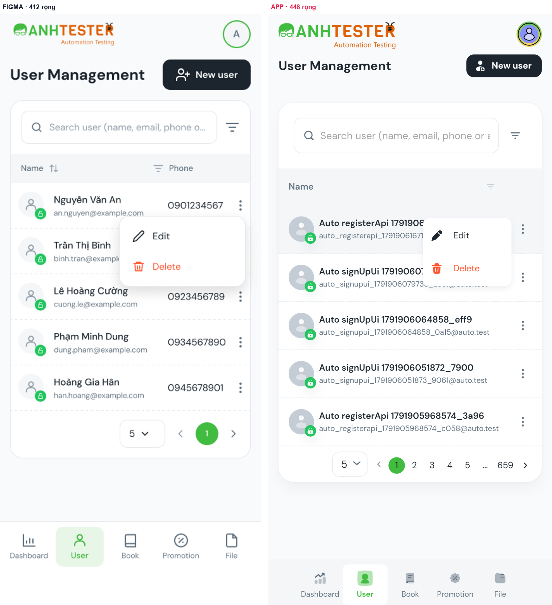

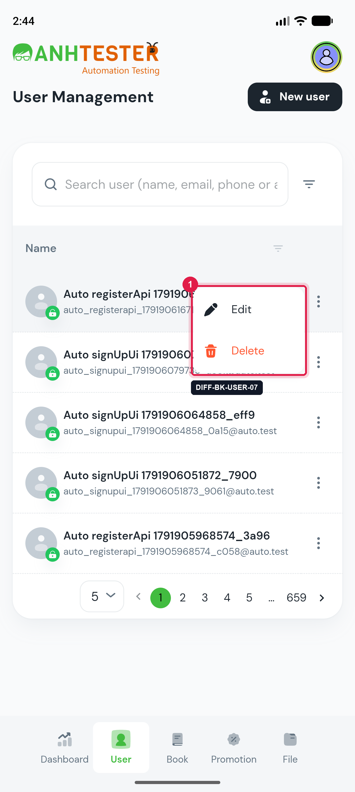

Bảng đo tự động (dc.py match)

> Khung thiết kế rộng **412** · màn thật rộng **448** (cùng đơn vị) · bỏ status bar: thiết kế 36 / thật 40 · đã bù lệch dọc chung 7 (= độ cuộn + lệch bố cục tích luỹ phía trên, không phải độ cuộn) · dung sai vị trí ±4
> lớp phủ `Menu`: thiết kế y 355 · app y 366 — chữ đo tương đối với khung lớp phủ (đã bù +7)

**Tổng:** ⚠️ Lệch nhỏ **2** · ❌ Lệch **1**

| # | Trạng thái | Chữ trong thiết kế | Trên app | Δx (neo) | Δy | Δ khoảng cách | Δ cao | Màu (thiết kế → app · ΔE) | Ghi chú |
|---|---|---|---|---|---|---|---|---|---|
| 1 | ⚠️ | Edit | Edit | +7 (trái) | -8 | — | +26 | — | lệch -8 tính từ đầu vùng nội dung — nguyên nhân có thể nằm ở phần tử không có chữ phía trên (ảnh, banner, header) khung phần tử app lớn hơn hộp chữ (gồm icon/padding) — không đo được số dòng, so theo tâm màu chữ không lấy mẫu được (khung có cả icon/nền) — đối chiếu bằng ảnh |
| 2 | ⚠️ | Delete | Delete | +7 (trái) | -4 | +4 | +26 | — | khung phần tử app lớn hơn hộp chữ (gồm icon/padding) — không đo được số dòng, so theo tâm màu chữ không lấy mẫu được (khung có cả icon/nền) — đối chiếu bằng ảnh |

> Khối có nền/viền ghép qua chữ nằm bên trong — **heuristic**: phần tử app được chọn là khung nhỏ nhất chứa đủ các chữ đó, màu nền lấy mẫu ở mép trái. Dòng ❌ ở đây phải xem ảnh trước khi tin.

| # | Trạng thái | Khối (thiết kế) | Phần tử app | Δ rộng | Δ cao | Màu nền (thiết kế → app · ΔE) | Ghi chú |
|---|---|---|---|---|---|---|---|
| B1 | ❌ | Menu [188, 355, 200, 112] | `View` [244, 362, 140, 108] | -60 | -4 | `#ffffff` → `#fcfcfc` · 0.6 | rộng 140 vs 200 |

### U-05 · Add user (hộp thoại cao hơn màn — 2 đoạn cuộn, `SCOPE = Dialog`)

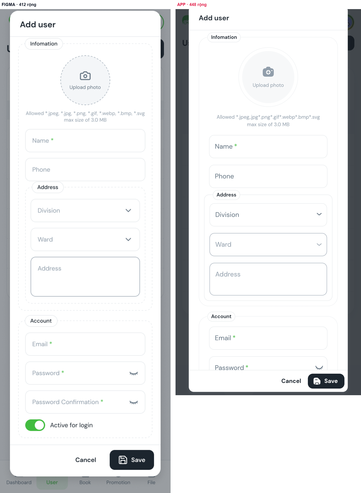

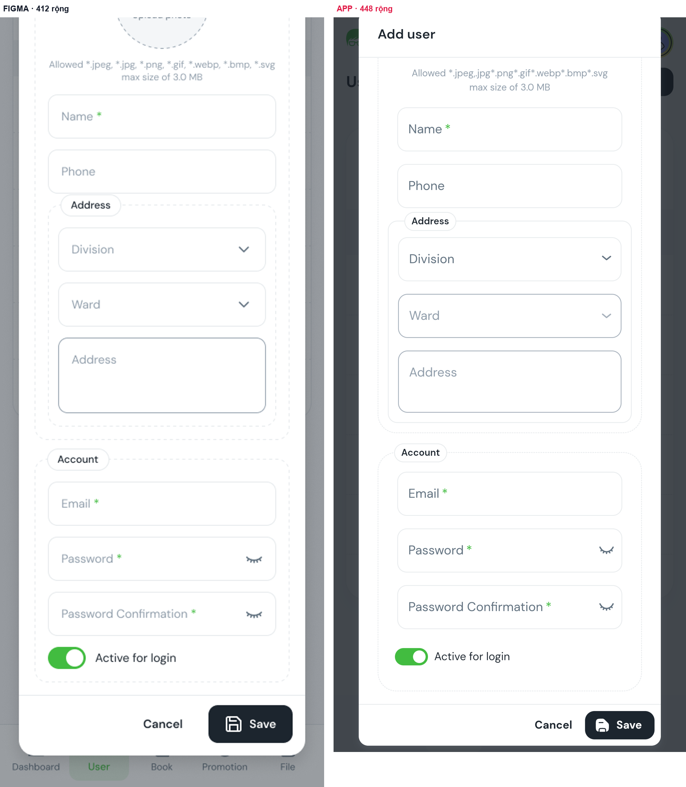

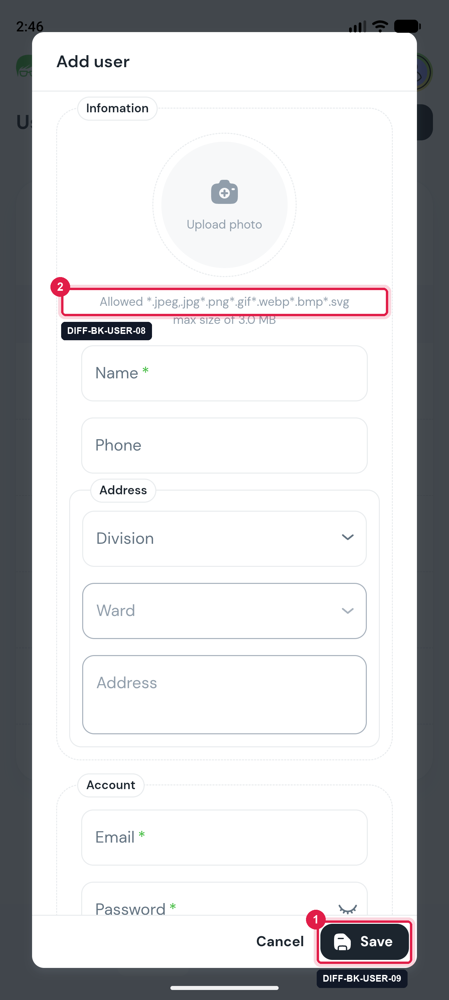

Bảng đo tự động — đoạn 1 (dc.py match)

> Khung thiết kế rộng **412** · màn thật rộng **448** (cùng đơn vị) · bỏ status bar: thiết kế 36 / thật 40 · dung sai vị trí ±4

**Tổng:** ❌ Lệch **26** · ⚠️ Lệch nhỏ **2** · ✅ Khớp **3** · ⤵️ Ngoài màn hình đã chụp **1** · ➕ Thừa trên app **1**

| # | Trạng thái | Chữ trong thiết kế | Trên app | Δx (neo) | Δy | Δ khoảng cách | Δ cao | Màu (thiết kế → app · ΔE) | Ghi chú |
|---|---|---|---|---|---|---|---|---|---|
| 1 | ❌ | Add user | Add user | -16 (trái) | -15.5 | — | +33 | — | lệch -15.5 tính từ đầu vùng nội dung — nguyên nhân có thể nằm ở phần tử không có chữ phía trên (ảnh, banner, header) khung phần tử app lớn hơn hộp chữ (gồm icon/padding) — không đo được số dòng, so theo tâm màu chữ không lấy mẫu được (khung có cả icon/nền) — đối chiếu bằng ảnh |
| 2 | ⚠️ | Infomation | Infomation | -5 (giữa) | -15 | +0.5 | -1 | `#1c252e` → `#1c242c` · 0.6 | Δy -15 kế thừa từ phía trên — không tính lỗi riêng |
| 3 | ⚠️ | Upload photo | Upload photo | +0 (tâm-giữa) | -24.5 | -9.5 | +129 | — | khoảng cách tới “Infomation” lệch -9.5 — điểm khởi phát xô lệch khung phần tử app lớn hơn hộp chữ (gồm icon/padding) — không đo được số dòng, so theo tâm màu chữ không lấy mẫu được (khung có cả icon/nền) — đối chiếu bằng ảnh |
| 4 | ❌ | Allowed *.jpeg, *.jpg, *.png, *.gif, *.webp, *.bmp, *.svg
max size of 3.0 MB | Allowed *.jpeg,.jpg *.png *.gif *.webp *.bmp *.svg max size of 3.0 MB | +0 (giữa) | +9 | +33.5 | +3 | `#919eab` → `#909ca8` · 0.8 | nội dung chữ khác: “Allowed *.jpeg, *.jpg, *.png, *.gif, *.webp, *.bmp, *.svg
max size of 3.0 MB” ↔ “Allowed *.jpeg,.jpg *.png *.gif *.webp *.bmp *.svg max size of 3.0 MB” khoảng cách tới “Upload photo” lệch +33.5 — điểm khởi phát xô lệch |
| 5 | ❌ | Name * | Name | -1 (giữa) | +13 | +4 | +2 | `#919eab` → `#607080` · 17.0 | chữ khác phần đuôi: “Name *” ↔ “Name” (phần thiếu có thể nằm ở node/span riêng — xem ảnh) Δy +13 kế thừa từ phía trên — không tính lỗi riêng màu chữ #607080 vs #919eab (ΔE 17.0) |
| 6 | ❌ | Phone | Phone | -1 (giữa) | +15 | +2 | +2 | `#919eab` → `#607080` · 17.0 | Δy +15 kế thừa từ phía trên — không tính lỗi riêng màu chữ #607080 vs #919eab (ΔE 17.0) |
| 7 | ✅ | Address | Address | +1.1 (tỉ lệ) | +19 | +4 | -1 | `#1c252e` → `#1c242c` · 0.6 | Δy +19 kế thừa từ phía trên — không tính lỗi riêng |
| 8 | ❌ | Division | Division | -3 (tỉ lệ) | +9 | -10 | +2 | `#919eab` → `#607080` · 17.0 | khoảng cách tới “Address” lệch -10 — điểm khởi phát xô lệch màu chữ #607080 vs #919eab (ΔE 17.0) |
| 9 | ✅ | Ward | Ward | -3 (tỉ lệ) | +11 | +2 | +2 | `#919eab` → `#909ca8` · 0.8 | Δy +11 kế thừa từ phía trên — không tính lỗi riêng |
| 10 | ✅ | Address | Address | -3 (tỉ lệ) | +13 | +2 | +2 | `#919eab` → `#909ca8` · 0.8 | Δy +13 kế thừa từ phía trên — không tính lỗi riêng |
| 11 | ❌ | Account | Account | -5 (giữa) | -10 | -23 | -1 | `#1c252e` → `#1c242c` · 0.6 | khoảng cách tới “Address” lệch -23 — điểm khởi phát xô lệch |
| 12 | ❌ | Email * | Email | -1 (giữa) | -16 | -6 | +2 | `#919eab` → `#607080` · 17.0 | chữ khác phần đuôi: “Email *” ↔ “Email” (phần thiếu có thể nằm ở node/span riêng — xem ảnh) khoảng cách tới “Account” lệch -6 — điểm khởi phát xô lệch màu chữ #607080 vs #919eab (ΔE 17.0) |
| 13 | ❌ | Password * | Password | -1 (giữa) | -14 | +2 | -3 | `#919eab` → `#607080` · 17.0 | chữ khác phần đuôi: “Password *” ↔ “Password” (phần thiếu có thể nằm ở node/span riêng — xem ảnh) Δy -14 kế thừa từ phía trên — không tính lỗi riêng màu chữ #607080 vs #919eab (ΔE 17.0) |
| 14 | ❌ | Password Confirmation * | Password Confirmation | -1 (giữa) | -12 | +2 | +2 | `#919eab` → `#f0f0f0` · 22.3 | chữ khác phần đuôi: “Password Confirmation *” ↔ “Password Confirmation” (phần thiếu có thể nằm ở node/span riêng — xem ảnh) Δy -12 kế thừa từ phía trên — không tính lỗi riêng màu chữ #f0f0f0 vs #919eab (ΔE 22.3) |
| 15 | ⤵️ | Active for login | — | — | — | — | — | — |  |
| 16 | ❌ | Cancel | Cancel | +29 (phải · neo đáy) | +54.7 | — | +17 | `#1c252e` → `#1c242c` · 0.6 | neo đáy màn hình — Δy đo theo khoảng cách tới đáy vùng nội dung cao 37 vs 20 — khác số dòng (≈1.9 vs 1.0 dòng) |
| 17 | ❌ | Save | Save | +2 (trái · neo đáy) | +46.2 | — | +17 | — | neo đáy màn hình — Δy đo theo khoảng cách tới đáy vùng nội dung khung phần tử app lớn hơn hộp chữ (gồm icon/padding) — không đo được số dòng, so theo tâm màu chữ không lấy mẫu được (khung có cả icon/nền) — đối chiếu bằng ảnh |

> Khối có nền/viền ghép qua chữ nằm bên trong — **heuristic**: phần tử app được chọn là khung nhỏ nhất chứa đủ các chữ đó, màu nền lấy mẫu ở mép trái. Dòng ❌ ở đây phải xem ảnh trước khi tin.

| # | Trạng thái | Khối (thiết kế) | Phần tử app | Δ rộng | Δ cao | Màu nền (thiết kế → app · ΔE) | Ghi chú |
|---|---|---|---|---|---|---|---|
| B1 | ❌ | Header [24, 40, 364, 63] | `TextView#_r_m_` [32, 32, 384, 59] | -16 | -4 | — | rộng 384 vs 364 (đã trừ phần chênh bề ngang màn hình) |
| B2 | ❌ | Fieldset · Infomation [44, 119, 324, 646] | `View` [56, 107, 336, 652] | -24 | +6 | — | cao 652 vs 646 rộng 336 vs 324 (đã trừ phần chênh bề ngang màn hình) |
| B3 | ❌ | Photo circle [146, 148, 120, 120] | `TextView` [152, 132, 144, 145] | +24 | +25 | `#f4f6f8` → `#fcfcfc` · 1.8 | cao 145 vs 120 rộng 144 vs 120 |
| B4 | ❌ | Box [61, 326, 290, 56] | `View` [81, 344, 286, 57] | -40 | +1 | `#ffffff` → `#fcfcfc` · 0.6 | rộng 286 vs 290 (đã trừ phần chênh bề ngang màn hình) |
| B5 | ❌ | Box [61, 396, 290, 56] | `View` [81, 416, 286, 57] | -40 | +1 | `#ffffff` → `#fcfcfc` · 0.6 | rộng 286 vs 290 (đã trừ phần chênh bề ngang màn hình) |
| B6 | ❌ | Fieldset · Address [61, 466, 290, 282] | `View` [69, 488, 310, 258] | -16 | -24 | — | cao 258 vs 282 rộng 310 vs 290 (đã trừ phần chênh bề ngang màn hình) |
| B7 | ❌ | Box [74, 495, 264, 56] | `View` [82, 509, 284, 57] | -16 | +1 | `#ffffff` → `#fcfcfc` · 0.6 | rộng 284 vs 264 (đã trừ phần chênh bề ngang màn hình) |
| B8 | ❌ | Box [74, 565, 264, 56] | `View` [82, 581, 284, 57] | -16 | +1 | `#ffffff` → `#fcfcfc` · 0.6 | rộng 284 vs 264 (đã trừ phần chênh bề ngang màn hình) |
| B9 | ❌ | TextArea [74, 635, 264, 96] | `View` [16, 646, 365, 76] | +65 | -20 | `#ffffff` → `#44484c` · 57.2 | cao 76 vs 96 rộng 365 vs 264 (đã trừ phần chênh bề ngang màn hình) màu nền #44484c vs #ffffff (ΔE 57.2) |
| B10 | ❌ | LegendChip [60, 106, 92, 28] | `TextView` [86, 100, 63, 17] | -29 | -11 | `#ffffff` → `#fcfcfc` · 0.6 | cao 17 vs 28 rộng 63 vs 92 |
| B11 | ❌ | Box [61, 818, 290, 56] | `View` [81, 807, 286, 57] | -40 | +1 | `#ffffff` → `#fcfcfc` · 0.6 | rộng 286 vs 290 (đã trừ phần chênh bề ngang màn hình) |
| B12 | ❌ | Box [61, 888, 290, 56] | `View` [81, 879, 286, 35] | -40 | -21 | `#ffffff` → `#fcfcfc` · 0.6 | cao 35 vs 56 rộng 286 vs 290 (đã trừ phần chênh bề ngang màn hình) |
| B13 | ❌ | Box [61, 958, 290, 56] | `View` [81, 951, 286, 46.3] | -40 | -9.7 | `#ffffff` → `#40484c` · 57.7 | cao 46.3 vs 56 rộng 286 vs 290 (đã trừ phần chênh bề ngang màn hình) màu nền #40484c vs #ffffff (ΔE 57.7) |
| B14 | ❌ | Actions [24, 1089, 364, 77] | `View` [38, 901, 372, 81] | -28 | +4 | — | rộng 372 vs 364 (đã trừ phần chênh bề ngang màn hình) |
| B15 | ❌ | Button [265, 1102, 107, 48] | `Button` [319, 921, 89, 37] | -18 | -11 | `#1c252e` → `#1c242c` · 0.6 | cao 37 vs 48 rộng 89 vs 107 |

| ➕ Chữ có trên app nhưng không có trong thiết kế | Loại | Vị trí |
|---|---|---|
| No file chosen | text | [224, 132, 1, 2] |

Bảng đo tự động — đoạn 2 (--auto-offset) (dc.py match)

> Khung thiết kế rộng **412** · màn thật rộng **448** (cùng đơn vị) · bỏ status bar: thiết kế 36 / thật 40 · đã bù lệch dọc chung -192 (= độ cuộn + lệch bố cục tích luỹ phía trên, không phải độ cuộn) · dung sai vị trí ±4

**Tổng:** ⤵️ Ngoài màn hình đã chụp **2** · ⚠️ Lệch nhỏ **3** · ❌ Lệch **22** · ✅ Khớp **3** · ➕ Thừa trên app **1**

| # | Trạng thái | Chữ trong thiết kế | Trên app | Δx (neo) | Δy | Δ khoảng cách | Δ cao | Màu (thiết kế → app · ΔE) | Ghi chú |
|---|---|---|---|---|---|---|---|---|---|
| 1 | ⤵️ | Add user | — | — | — | — | — | — | có trên app nhưng bị mép màn cắt dở — đo ở đoạn cuộn khác |
| 2 | ⤵️ | Infomation | — | — | — | — | — | — |  |
| 3 | ⚠️ | Upload photo | Upload photo | +0 (tâm-giữa) | +6.5 | — | +71 | — | lệch +6.5 tính từ đầu vùng nội dung — nguyên nhân có thể nằm ở phần tử không có chữ phía trên (ảnh, banner, header) khung phần tử app lớn hơn hộp chữ (gồm icon/padding) — không đo được số dòng, so theo tâm màu chữ không lấy mẫu được (khung có cả icon/nền) — đối chiếu bằng ảnh |
| 4 | ❌ | Allowed *.jpeg, *.jpg, *.png, *.gif, *.webp, *.bmp, *.svg
max size of 3.0 MB | Allowed *.jpeg,.jpg *.png *.gif *.webp *.bmp *.svg max size of 3.0 MB | +0 (giữa) | +11 | +4.5 | +3 | `#919eab` → `#909ca8` · 0.8 | nội dung chữ khác: “Allowed *.jpeg, *.jpg, *.png, *.gif, *.webp, *.bmp, *.svg
max size of 3.0 MB” ↔ “Allowed *.jpeg,.jpg *.png *.gif *.webp *.bmp *.svg max size of 3.0 MB” khoảng cách tới “Upload photo” lệch +4.5 — điểm khởi phát xô lệch |
| 5 | ❌ | Name * | Name | -1 (giữa) | +15 | +4 | +2 | `#919eab` → `#607080` · 17.0 | chữ khác phần đuôi: “Name *” ↔ “Name” (phần thiếu có thể nằm ở node/span riêng — xem ảnh) Δy +15 kế thừa từ phía trên — không tính lỗi riêng màu chữ #607080 vs #919eab (ΔE 17.0) |
| 6 | ❌ | Phone | Phone | -1 (giữa) | +17 | +2 | +2 | `#919eab` → `#607080` · 17.0 | Δy +17 kế thừa từ phía trên — không tính lỗi riêng màu chữ #607080 vs #919eab (ΔE 17.0) |
| 7 | ✅ | Address | Address | +1.1 (tỉ lệ) | +21 | +4 | -1 | `#1c252e` → `#1c242c` · 0.6 | Δy +21 kế thừa từ phía trên — không tính lỗi riêng |
| 8 | ❌ | Division | Division | -3 (tỉ lệ) | +11 | -10 | +2 | `#919eab` → `#607080` · 17.0 | khoảng cách tới “Address” lệch -10 — điểm khởi phát xô lệch màu chữ #607080 vs #919eab (ΔE 17.0) |
| 9 | ✅ | Ward | Ward | -3 (tỉ lệ) | +13 | +2 | +2 | `#919eab` → `#909ca8` · 0.8 | Δy +13 kế thừa từ phía trên — không tính lỗi riêng |
| 10 | ✅ | Address | Address | -3 (tỉ lệ) | +15 | +2 | +2 | `#919eab` → `#909ca8` · 0.8 | Δy +15 kế thừa từ phía trên — không tính lỗi riêng |
| 11 | ❌ | Account | Account | -5 (giữa) | -8 | -23 | -1 | `#1c252e` → `#1c242c` · 0.6 | khoảng cách tới “Address” lệch -23 — điểm khởi phát xô lệch |
| 12 | ❌ | Email * | Email | -1 (giữa) | -14 | -6 | +2 | `#919eab` → `#607080` · 17.0 | chữ khác phần đuôi: “Email *” ↔ “Email” (phần thiếu có thể nằm ở node/span riêng — xem ảnh) khoảng cách tới “Account” lệch -6 — điểm khởi phát xô lệch màu chữ #607080 vs #919eab (ΔE 17.0) |
| 13 | ❌ | Password * | Password | -1 (giữa) | -12 | +2 | +2 | `#919eab` → `#607080` · 17.0 | chữ khác phần đuôi: “Password *” ↔ “Password” (phần thiếu có thể nằm ở node/span riêng — xem ảnh) Δy -12 kế thừa từ phía trên — không tính lỗi riêng màu chữ #607080 vs #919eab (ΔE 17.0) |
| 14 | ❌ | Password Confirmation * | Password Confirmation | -1 (giữa) | -10 | +2 | +2 | `#919eab` → `#607080` · 17.0 | chữ khác phần đuôi: “Password Confirmation *” ↔ “Password Confirmation” (phần thiếu có thể nằm ở node/span riêng — xem ảnh) Δy -10 kế thừa từ phía trên — không tính lỗi riêng màu chữ #607080 vs #919eab (ΔE 17.0) |
| 15 | ⚠️ | Active for login | Active for login | -3.6 (tỉ lệ) | +0 | +10 | -3 | `#1c252e` → `#1c242c` · 0.6 | khoảng cách tới “Password Confirmation *” lệch +10 — điểm khởi phát xô lệch |
| 16 | ❌ | Cancel | Cancel | +29 (phải) | -7 | -7 | +17 | `#1c252e` → `#1c242c` · 0.6 | khoảng cách tới “Active for login” lệch -7 — điểm khởi phát xô lệch cao 37 vs 20 — khác số dòng (≈1.9 vs 1.0 dòng) |
| 17 | ⚠️ | Save | Save | +2 (trái) | +1.5 | +8.5 | +17 | — | khoảng cách tới “Cancel” lệch +8.5 — điểm khởi phát xô lệch khung phần tử app lớn hơn hộp chữ (gồm icon/padding) — không đo được số dòng, so theo tâm màu chữ không lấy mẫu được (khung có cả icon/nền) — đối chiếu bằng ảnh |

> Khối có nền/viền ghép qua chữ nằm bên trong — **heuristic**: phần tử app được chọn là khung nhỏ nhất chứa đủ các chữ đó, màu nền lấy mẫu ở mép trái. Dòng ❌ ở đây phải xem ảnh trước khi tin.

| # | Trạng thái | Khối (thiết kế) | Phần tử app | Δ rộng | Δ cao | Màu nền (thiết kế → app · ΔE) | Ghi chú |
|---|---|---|---|---|---|---|---|
| B1 | ❌ | Photo circle [146, 148, 120, 120] | `TextView` [152, 0, 144, 87] | +24 | -33 | `#f4f6f8` → `#fcfcfc` · 1.8 | cao 87 vs 120 rộng 144 vs 120 |
| B2 | ❌ | Box [61, 326, 290, 56] | `View` [81, 154, 286, 57] | -40 | +1 | `#ffffff` → `#fcfcfc` · 0.6 | rộng 286 vs 290 (đã trừ phần chênh bề ngang màn hình) |
| B3 | ❌ | Box [61, 396, 290, 56] | `View` [81, 226, 286, 57] | -40 | +1 | `#ffffff` → `#fcfcfc` · 0.6 | rộng 286 vs 290 (đã trừ phần chênh bề ngang màn hình) |
| B4 | ❌ | Fieldset · Address [61, 466, 290, 282] | `View` [69, 298, 310, 258] | -16 | -24 | — | cao 258 vs 282 rộng 310 vs 290 (đã trừ phần chênh bề ngang màn hình) |
| B5 | ❌ | Box [74, 495, 264, 56] | `View` [82, 319, 284, 57] | -16 | +1 | `#ffffff` → `#fcfcfc` · 0.6 | rộng 284 vs 264 (đã trừ phần chênh bề ngang màn hình) |
| B6 | ❌ | Box [74, 565, 264, 56] | `View` [82, 391, 284, 57] | -16 | +1 | `#ffffff` → `#fcfcfc` · 0.6 | rộng 284 vs 264 (đã trừ phần chênh bề ngang màn hình) |
| B7 | ❌ | TextArea [74, 635, 264, 96] | `View` [82, 463, 284, 80] | -16 | -16 | `#ffffff` → `#fcfcfc` · 0.6 | cao 80 vs 96 rộng 284 vs 264 (đã trừ phần chênh bề ngang màn hình) |
| B8 | ❌ | Fieldset · Account [44, 789, 324, 284] | `View` [56, 592, 336, 305] | -24 | +21 | — | cao 305 vs 284 rộng 336 vs 324 (đã trừ phần chênh bề ngang màn hình) |
| B9 | ❌ | Box [61, 818, 290, 56] | `View` [81, 617, 286, 57] | -40 | +1 | `#ffffff` → `#fcfcfc` · 0.6 | rộng 286 vs 290 (đã trừ phần chênh bề ngang màn hình) |
| B10 | ❌ | Box [61, 888, 290, 56] | `View` [81, 689, 286, 57] | -40 | +1 | `#ffffff` → `#fcfcfc` · 0.6 | rộng 286 vs 290 (đã trừ phần chênh bề ngang màn hình) |
| B11 | ❌ | Box [61, 958, 290, 56] | `View` [81, 761, 286, 57] | -40 | +1 | `#ffffff` → `#fcfcfc` · 0.6 | rộng 286 vs 290 (đã trừ phần chênh bề ngang màn hình) |
| B12 | ❌ | Actions [24, 1089, 364, 77] | `View` [38, 901, 372, 81] | -28 | +4 | — | rộng 372 vs 364 (đã trừ phần chênh bề ngang màn hình) |
| B13 | ❌ | Button [265, 1102, 107, 48] | `Button` [319, 921, 89, 37] | -18 | -11 | `#1c252e` → `#1c242c` · 0.6 | cao 37 vs 48 rộng 89 vs 107 |

| ➕ Chữ có trên app nhưng không có trong thiết kế | Loại | Vị trí |
|---|---|---|
| Add user | text | [32, 32, 384, 59] |

### U-06 · Add user — validation (thiết kế lược bớt)

> Thiết kế ghi *"(Ảnh đại diện và khối Address lược bớt cho gọn)"* → bảng đo tắt so vị trí, chỉ so **chữ · trạng thái lỗi · màu**. Tên 251 ký tự nhập bằng `--sample` (chuỗi `b` × 44 trong thiết kế là dữ liệu mẫu).

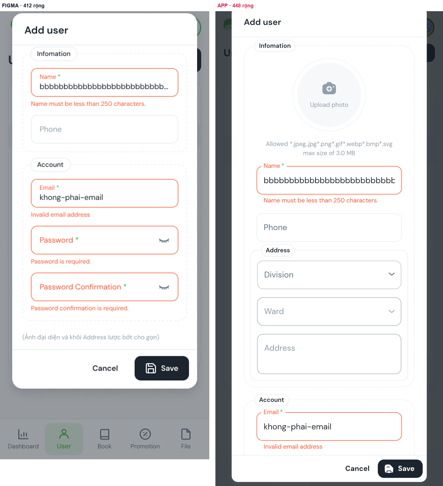

Bảng đo tự động (dc.py match)

> Khung thiết kế rộng **412** · màn thật rộng **448** (cùng đơn vị) · bỏ status bar: thiết kế 36 / thật 40 · dung sai vị trí ±4
> ⚠️ Thiết kế ghi chú vẽ rút gọn (“(Ảnh đại diện và khối Address lược bớt cho gọn)”) — **không so vị trí**, chỉ so nội dung chữ + màu; chữ app không có trong thiết kế ghi ❔
> Dữ liệu mẫu khai báo tay (coi như ô động): `bbbbbbbbbbbbbbbbbbbbbbbbbbbbbbbbbbbbbbbbbbbb`

**Tổng:** ✅ Khớp **10** · ⚠️ Lệch nhỏ **3** · ❌ Lệch **7** · 🔍 Thiếu trên app **2** · ❔ Không so được **15**

| # | Trạng thái | Chữ trong thiết kế | Trên app | Δx (neo) | Δy | Δ khoảng cách | Δ cao | Màu (thiết kế → app · ΔE) | Ghi chú |
|---|---|---|---|---|---|---|---|---|---|
| 1 | ✅ | Add user | Add user | — | — | — | — | — | màu chữ không lấy mẫu được (khung có cả icon/nền) — đối chiếu bằng ảnh |
| 2 | ✅ | Infomation | Infomation | — | — | — | — | `#1c252e` → `#1c242c` · 0.6 |  |
| 3 | ⚠️ | Name * | Name | — | — | — | — | `#ff5630` → `#fc5430` · 0.8 | chữ khác phần đuôi: “Name *” ↔ “Name” (phần thiếu có thể nằm ở node/span riêng — xem ảnh) |
| 4 | ✅ | <mẫu:bbbbbbbbbbbbbbbbbbbbbbbbbbbbbb> | bbbbbbbbbbbbbbbbbbbbbbbbbbbbbbbbbbbbbbbbbbbbbbbbbbbbbbbbbbbbbbbbbbbbbbbbbbbbbbbbbbbbbbbbbbbbbbbbbbbbbbbbbbbbbbbbbbbbbbbbbbbbbbbbbbbbbbbbbbbbbbbbbbbbbbbbbbbbbbbbbbbbbbbbbbbbbbbbbbbbbbbbbbbbbbbbbbbbbbbbbbbbbbbbbbbbbbbbbbbbbbbbbbbbbbbbbbbbbbbbbbbbbbbbbbbbbb | — | — | — | — | — | ô nhập đang có giá trị — không phải placeholder |
| 5 | ✅ | Name must be less than 250 characters. | Name must be less than 250 characters. | — | — | — | — | `#ff5630` → `#fc5430` · 0.8 |  |
| 6 | ❌ | Phone | Phone | — | — | — | — | `#919eab` → `#607080` · 17.0 | màu chữ #607080 vs #919eab (ΔE 17.0) |
| 7 | ✅ | Account | Account | — | — | — | — | `#1c252e` → `#1c242c` · 0.6 |  |
| 8 | ⚠️ | Email * | Email | — | — | — | — | `#ff5630` → `#fc5430` · 0.8 | chữ khác phần đuôi: “Email *” ↔ “Email” (phần thiếu có thể nằm ở node/span riêng — xem ảnh) |
| 9 | ✅ | khong-phai-email | khong-phai-email | — | — | — | — | — | ô nhập đang có giá trị — không phải placeholder |
| 10 | ✅ | Invalid email address | Invalid email address | — | — | — | — | `#ff5630` → `#fc5430` · 0.8 |  |
| 11 | ⚠️ | Password * | Password | — | — | — | — | — | chữ khác phần đuôi: “Password *” ↔ “Password” (phần thiếu có thể nằm ở node/span riêng — xem ảnh) |
| 12 | ✅ | Password is required. | Password is required. | — | — | — | — | — | màu chữ không lấy mẫu được (khung có cả icon/nền) — đối chiếu bằng ảnh |
| 13 | 🔍 | Password Confirmation * | — | — | — | — | — | — |  |
| 14 | 🔍 | Password confirmation is required. | — | — | — | — | — | — |  |
| 15 | ❔ | (Ảnh đại diện và khối Address lược bớt cho gọn) | — | — | — | — | — | — | ghi chú của thiết kế |
| 16 | ✅ | Cancel | Cancel | — | — | — | — | `#1c252e` → `#1c242c` · 0.6 |  |
| 17 | ✅ | Save | Save | — | — | — | — | — | màu chữ không lấy mẫu được (khung có cả icon/nền) — đối chiếu bằng ảnh |

> Khối có nền/viền ghép qua chữ nằm bên trong — **heuristic**: phần tử app được chọn là khung nhỏ nhất chứa đủ các chữ đó, màu nền lấy mẫu ở mép trái. Dòng ❌ ở đây phải xem ảnh trước khi tin.

| # | Trạng thái | Khối (thiết kế) | Phần tử app | Δ rộng | Δ cao | Màu nền (thiết kế → app · ΔE) | Ghi chú |
|---|---|---|---|---|---|---|---|
| B1 | ❌ | Header [24, 40, 364, 63] | `TextView#_r_m_` [32, 32, 384, 59] | -16 | -4 | — | rộng 384 vs 364 (đã trừ phần chênh bề ngang màn hình) |
| B2 | ❌ | Box [61, 240, 290, 56] | `View` [81, 437, 286, 57] | -40 | +1 | `#ffffff` → `#fcfcfc` · 0.6 | rộng 286 vs 290 (đã trừ phần chênh bề ngang màn hình) |
| B3 | ❌ | LegendChip [60, 106, 92, 28] | `TextView` [86, 100, 63, 17] | -29 | -11 | `#ffffff` → `#fcfcfc` · 0.6 | cao 17 vs 28 rộng 63 vs 92 |
| B4 | ❌ | Box [61, 366, 290, 56] | `View` [56, 803, 336, 111] | +10 | +55 | `#ffffff` → `#fcfcfc` · 0.6 | cao 111 vs 56 rộng 336 vs 290 (đã trừ phần chênh bề ngang màn hình) |
| B5 | ❌ | Box [61, 458, 290, 56] | `View` [81, 921, 286, 57] | -40 | +1 | `#ffffff` → `#fcfcfc` · 0.6 | rộng 286 vs 290 (đã trừ phần chênh bề ngang màn hình) |
| B6 | ❌ | Button [265, 714, 107, 48] | `Button` [319, 921, 89, 37] | -18 | -11 | `#1c252e` → `#1c242c` · 0.6 | cao 37 vs 48 rộng 89 vs 107 |

| ➕ Chữ có trên app nhưng không có trong thiết kế | Loại | Vị trí |
|---|---|---|
| Upload photo | text | [152, 132, 144, 145] |
| Allowed | text | [99, 293, 48, 17] |
| *.jpeg,.jpg | text | [146, 293, 54, 17] |
| *.png | text | [199, 293, 30, 17] |
| *.gif | text | [228, 293, 23, 17] |
| *.webp | text | [250, 293, 39, 17] |
| *.bmp | text | [288, 293, 35, 17] |
| *.svg | text | [322, 293, 27, 17] |
| max size of | text | [172, 311, 66, 17] |
| 3.0 MB | text | [237, 311, 39, 17] |
| Address | text | [99, 502, 48, 17] |
| Division | text | [96, 546, 58, 24] |
| Ward | text | [96, 618, 40, 24] |
| Address | text | [96, 690, 62, 24] |

### U-07 · Update user (2 đoạn cuộn)

> Ảnh đoạn 1–2 chụp **sau** U-06 trong cùng phiên — các thông báo lỗi trên ảnh chính là **DIFF-BK-USER-10** (lỗi của *Add user* dính sang). Ảnh tái hiện độc lập: `U-07_update_user_stale_errors_*`.

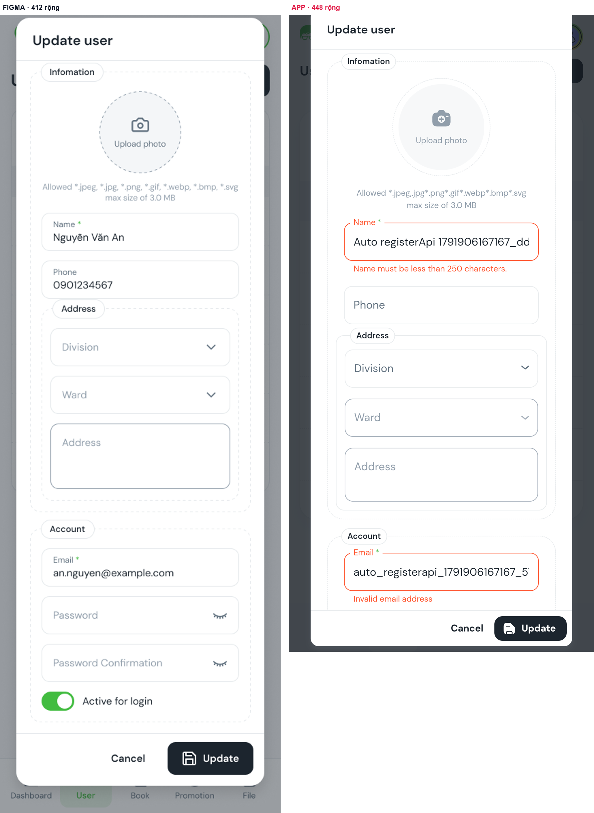

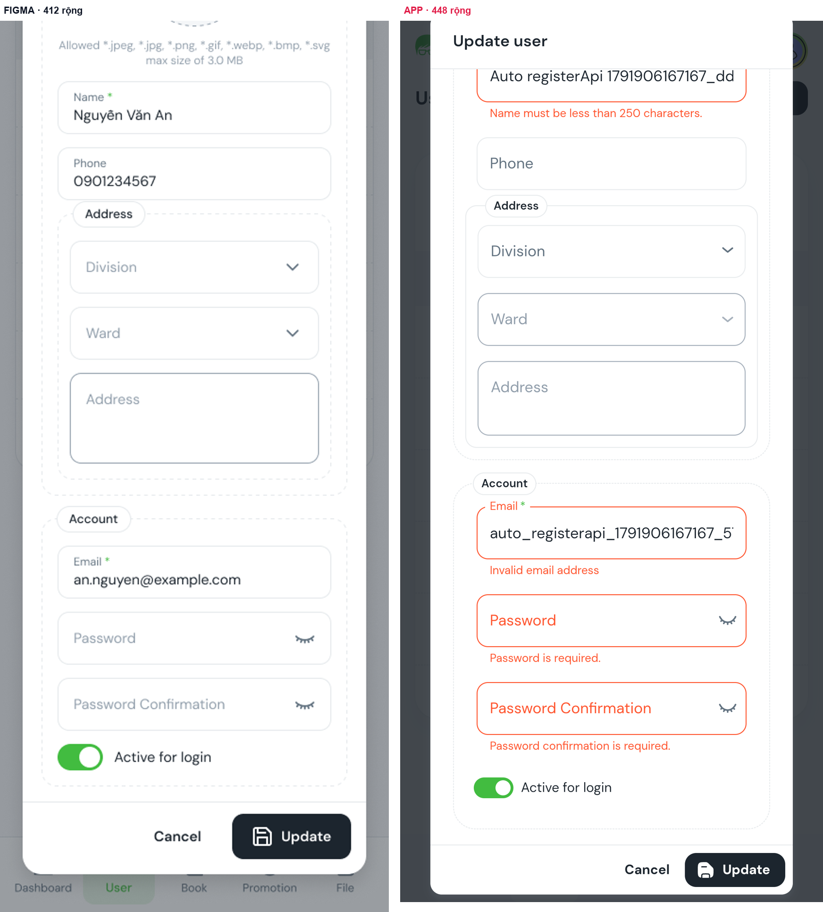

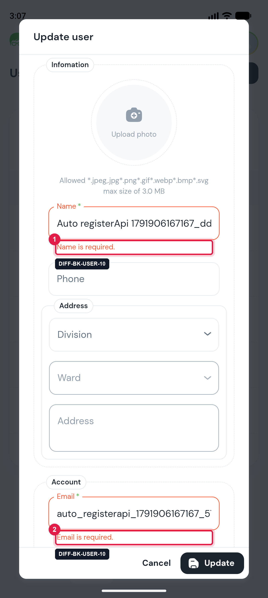

Bảng đo tự động — đoạn 1 (dc.py match)

> Khung thiết kế rộng **412** · màn thật rộng **448** (cùng đơn vị) · bỏ status bar: thiết kế 36 / thật 40 · dung sai vị trí ±4
> Dữ liệu mẫu khai báo tay (coi như ô động): `Nguyễn Văn An` · `0901234567` · `an.nguyen@example.com`

**Tổng:** ❌ Lệch **26** · ⚠️ Lệch nhỏ **2** · 🔍 Thiếu trên app **1** · ✅ Khớp **3** · ⤵️ Ngoài màn hình đã chụp **2** · ➕ Thừa trên app **3**

| # | Trạng thái | Chữ trong thiết kế | Trên app | Δx (neo) | Δy | Δ khoảng cách | Δ cao | Màu (thiết kế → app · ΔE) | Ghi chú |
|---|---|---|---|---|---|---|---|---|---|
| 1 | ❌ | Update user | Update user | -16 (trái) | -15.5 | — | +33 | — | lệch -15.5 tính từ đầu vùng nội dung — nguyên nhân có thể nằm ở phần tử không có chữ phía trên (ảnh, banner, header) khung phần tử app lớn hơn hộp chữ (gồm icon/padding) — không đo được số dòng, so theo tâm màu chữ không lấy mẫu được (khung có cả icon/nền) — đối chiếu bằng ảnh |
| 2 | ⚠️ | Infomation | Infomation | -5 (giữa) | -15 | +0.5 | -1 | `#1c252e` → `#1c242c` · 0.6 | Δy -15 kế thừa từ phía trên — không tính lỗi riêng |
| 3 | ⚠️ | Upload photo | Upload photo | +0 (tâm-giữa) | -24.5 | -9.5 | +129 | — | khoảng cách tới “Infomation” lệch -9.5 — điểm khởi phát xô lệch khung phần tử app lớn hơn hộp chữ (gồm icon/padding) — không đo được số dòng, so theo tâm màu chữ không lấy mẫu được (khung có cả icon/nền) — đối chiếu bằng ảnh |
| 4 | ❌ | Allowed *.jpeg, *.jpg, *.png, *.gif, *.webp, *.bmp, *.svg
max size of 3.0 MB | Allowed *.jpeg,.jpg *.png *.gif *.webp *.bmp *.svg max size of 3.0 MB | +0 (giữa) | +9 | +33.5 | +3 | `#919eab` → `#909ca8` · 0.8 | nội dung chữ khác: “Allowed *.jpeg, *.jpg, *.png, *.gif, *.webp, *.bmp, *.svg
max size of 3.0 MB” ↔ “Allowed *.jpeg,.jpg *.png *.gif *.webp *.bmp *.svg max size of 3.0 MB” khoảng cách tới “Upload photo” lệch +33.5 — điểm khởi phát xô lệch |
| 5 | ❌ | Name * | Name | -1 (giữa) | -4 | -13 | +2 | `#637381` → `#fc5430` · 39.4 | chữ khác phần đuôi: “Name *” ↔ “Name” (phần thiếu có thể nằm ở node/span riêng — xem ảnh) khoảng cách tới “Allowed *.jpeg, *.jpg, *” lệch -13 — điểm khởi phát xô lệch màu chữ #fc5430 vs #637381 (ΔE 39.4) |
| 6 | ❌ | <mẫu:Nguyễn Văn An> | Auto registerApi 1791906167167_ddc1 | +3 (trái) | -11 | -7 | +35 | — | ô nhập đang có giá trị — không phải placeholder khoảng cách tới “Name *” lệch -7 — điểm khởi phát xô lệch cao 57 vs 22 — khác số dòng (≈2.6 vs 1.0 dòng) |
| 7 | ❌ | Phone | Phone | -1 (giữa) | +44 | +55 | +8 | `#637381` → `#607080` · 1.5 | khoảng cách tới “<mẫu:Nguyễn Văn An>” lệch +55 — điểm khởi phát xô lệch |
| 8 | 🔍 | <mẫu:0901234567> | — | — | — | — | — | — |  |
| 9 | ✅ | Address | Address | +1.1 (tỉ lệ) | +40 | -4 | -1 | `#1c252e` → `#1c242c` · 0.6 | Δy +40 kế thừa từ phía trên — không tính lỗi riêng |
| 10 | ❌ | Division | Division | -3 (tỉ lệ) | +30 | -10 | +2 | `#919eab` → `#607080` · 17.0 | khoảng cách tới “Address” lệch -10 — điểm khởi phát xô lệch màu chữ #607080 vs #919eab (ΔE 17.0) |
| 11 | ✅ | Ward | Ward | -3 (tỉ lệ) | +32 | +2 | +2 | `#919eab` → `#909ca8` · 0.8 | Δy +32 kế thừa từ phía trên — không tính lỗi riêng |
| 12 | ✅ | Address | Address | -3 (tỉ lệ) | +34 | +2 | +2 | `#919eab` → `#909ca8` · 0.8 | Δy +34 kế thừa từ phía trên — không tính lỗi riêng |
| 13 | ❌ | Account | Account | -5 (giữa) | +11 | -23 | -1 | `#1c252e` → `#1c242c` · 0.6 | khoảng cách tới “Address” lệch -23 — điểm khởi phát xô lệch |
| 14 | ❌ | Email * | Email | -1 (giữa) | -12 | -23 | +2 | `#637381` → `#fc5430` · 39.4 | chữ khác phần đuôi: “Email *” ↔ “Email” (phần thiếu có thể nằm ở node/span riêng — xem ảnh) khoảng cách tới “Account” lệch -23 — điểm khởi phát xô lệch màu chữ #fc5430 vs #637381 (ΔE 39.4) |
| 15 | ❌ | <mẫu:an.nguyen@example.com> | auto_registerapi_1791906167167_57fb@auto.test | +3 (trái) | -19 | -7 | +35 | — | ô nhập đang có giá trị — không phải placeholder khoảng cách tới “Email *” lệch -7 — điểm khởi phát xô lệch cao 57 vs 22 — khác số dòng (≈2.6 vs 1.0 dòng) |
| 16 | ❌ | Password | Password | -1 (giữa) | +28 | +47 | +2 | — | khoảng cách tới “<mẫu:an.nguyen@example.c” lệch +47 — điểm khởi phát xô lệch |
| 17 | ⤵️ | Password Confirmation | — | — | — | — | — | — |  |
| 18 | ⤵️ | Active for login | — | — | — | — | — | — |  |
| 19 | ❌ | Cancel | Cancel | +30 (phải · neo đáy) | +54.7 | — | +17 | `#1c252e` → `#1c242c` · 0.6 | neo đáy màn hình — Δy đo theo khoảng cách tới đáy vùng nội dung cao 37 vs 20 — khác số dòng (≈1.9 vs 1.0 dòng) |
| 20 | ❌ | Update | Update | +3 (trái · neo đáy) | +46.2 | — | +17 | — | neo đáy màn hình — Δy đo theo khoảng cách tới đáy vùng nội dung khung phần tử app lớn hơn hộp chữ (gồm icon/padding) — không đo được số dòng, so theo tâm màu chữ không lấy mẫu được (khung có cả icon/nền) — đối chiếu bằng ảnh |

> Khối có nền/viền ghép qua chữ nằm bên trong — **heuristic**: phần tử app được chọn là khung nhỏ nhất chứa đủ các chữ đó, màu nền lấy mẫu ở mép trái. Dòng ❌ ở đây phải xem ảnh trước khi tin.

| # | Trạng thái | Khối (thiết kế) | Phần tử app | Δ rộng | Δ cao | Màu nền (thiết kế → app · ΔE) | Ghi chú |
|---|---|---|---|---|---|---|---|
| B1 | ❌ | Dialog · Update user [24, 40, 364, 1126] | `AlertDialog` [32, 32, 384, 934] | -16 | -192 | `#ffffff` → `#fcfcfc` · 0.6 | cao 934 vs 1126 rộng 384 vs 364 (đã trừ phần chênh bề ngang màn hình) |
| B2 | ❌ | Header [24, 40, 364, 63] | `TextView#_r_m_` [32, 32, 384, 59] | -16 | -4 | — | rộng 384 vs 364 (đã trừ phần chênh bề ngang màn hình) |
| B3 | ❌ | Fieldset · Infomation [44, 119, 324, 646] | `View` [56, 107, 336, 673] | -24 | +27 | — | cao 673 vs 646 rộng 336 vs 324 (đã trừ phần chênh bề ngang màn hình) |
| B4 | ❌ | Photo circle [146, 148, 120, 120] | `TextView` [152, 132, 144, 145] | +24 | +25 | `#f4f6f8` → `#fcfcfc` · 1.8 | cao 145 vs 120 rộng 144 vs 120 |
| B5 | ❌ | Box [61, 396, 290, 56] | `View` [81, 437, 286, 57] | -40 | +1 | `#ffffff` → `#fcfcfc` · 0.6 | rộng 286 vs 290 (đã trừ phần chênh bề ngang màn hình) |
| B6 | ❌ | Fieldset · Address [61, 466, 290, 282] | `View` [69, 509, 310, 258] | -16 | -24 | — | cao 258 vs 282 rộng 310 vs 290 (đã trừ phần chênh bề ngang màn hình) |
| B7 | ❌ | Box [74, 495, 264, 56] | `View` [82, 530, 284, 57] | -16 | +1 | `#ffffff` → `#fcfcfc` · 0.6 | rộng 284 vs 264 (đã trừ phần chênh bề ngang màn hình) |
| B8 | ❌ | Box [74, 565, 264, 56] | `View` [82, 602, 284, 57] | -16 | +1 | `#ffffff` → `#fcfcfc` · 0.6 | rộng 284 vs 264 (đã trừ phần chênh bề ngang màn hình) |
| B9 | ❌ | TextArea [74, 635, 264, 96] | `View` [16, 646, 365, 76] | +65 | -20 | `#ffffff` → `#44484c` · 57.2 | cao 76 vs 96 rộng 365 vs 264 (đã trừ phần chênh bề ngang màn hình) màu nền #44484c vs #ffffff (ΔE 57.2) |
| B10 | ❌ | LegendChip [60, 106, 92, 28] | `TextView` [86, 100, 63, 17] | -29 | -11 | `#ffffff` → `#fcfcfc` · 0.6 | cao 17 vs 28 rộng 63 vs 92 |
| B11 | ❌ | Box [61, 818, 290, 56] | `View` [56, 803, 336, 111] | +10 | +55 | `#ffffff` → `#fcfcfc` · 0.6 | cao 111 vs 56 rộng 336 vs 290 (đã trừ phần chênh bề ngang màn hình) |
| B12 | ❌ | Box [61, 888, 290, 56] | `View` [81, 921, 286, 57] | -40 | +1 | `#ffffff` → `#fcfcfc` · 0.6 | rộng 286 vs 290 (đã trừ phần chênh bề ngang màn hình) |
| B13 | ❌ | Actions [24, 1089, 364, 77] | `View` [38, 901, 372, 81] | -28 | +4 | — | rộng 372 vs 364 (đã trừ phần chênh bề ngang màn hình) |
| B14 | ❌ | Button [246, 1102, 126, 48] | `Button` [301, 921, 107, 37] | -19 | -11 | `#1c252e` → `#1c242c` · 0.6 | cao 37 vs 48 rộng 107 vs 126 |

| ➕ Chữ có trên app nhưng không có trong thiết kế | Loại | Vị trí |
|---|---|---|
| Name must be less than 250 characters. | text | [95, 403, 258, 19] |
| Invalid email address | text | [95, 887, 258, 19] |
| Password is required. | input | [81, 921, 240, 57] |

Bảng đo tự động — đoạn 2 (--auto-offset) (dc.py match)

> Khung thiết kế rộng **412** · màn thật rộng **448** (cùng đơn vị) · bỏ status bar: thiết kế 36 / thật 40 · đã bù lệch dọc chung -226.5 (= độ cuộn + lệch bố cục tích luỹ phía trên, không phải độ cuộn) · dung sai vị trí ±4
> Dữ liệu mẫu khai báo tay (coi như ô động): `Nguyễn Văn An` · `0901234567` · `an.nguyen@example.com`

**Tổng:** ⤵️ Ngoài màn hình đã chụp **3** · 🔍 Thiếu trên app **2** · ❌ Lệch **22** · ⚠️ Lệch nhỏ **2** · ✅ Khớp **3** · ➕ Thừa trên app **7**

| # | Trạng thái | Chữ trong thiết kế | Trên app | Δx (neo) | Δy | Δ khoảng cách | Δ cao | Màu (thiết kế → app · ΔE) | Ghi chú |
|---|---|---|---|---|---|---|---|---|---|
| 1 | ⤵️ | Update user | — | — | — | — | — | — |  |
| 2 | ⤵️ | Infomation | — | — | — | — | — | — |  |
| 3 | ⤵️ | Upload photo | — | — | — | — | — | — |  |
| 4 | 🔍 | Allowed *.jpeg, *.jpg, *.png, *.gif, *.webp, *.bmp, *.svg
max size of 3.0 MB | — | — | — | — | — | — |  |
| 5 | ❌ | Name * | Name | -1 (giữa) | -51.5 | — | +2 | `#637381` → `#1c242c` · 26.6 | chữ khác phần đuôi: “Name *” ↔ “Name” (phần thiếu có thể nằm ở node/span riêng — xem ảnh) lệch -51.5 tính từ đầu vùng nội dung — nguyên nhân có thể nằm ở phần tử không có chữ phía trên (ảnh, banner, header) màu chữ #1c242c vs #637381 (ΔE 26.6) |
| 6 | ❌ | <mẫu:Nguyễn Văn An> | Name must be less than 250 characters. | -1 (giữa) | +0.5 | +52 | -3 | `#1c252e` → `#fc5430` · 51.6 | khoảng cách tới “Name *” lệch +52 — điểm khởi phát xô lệch màu chữ #fc5430 vs #1c252e (ΔE 51.6) |
| 7 | ⚠️ | Phone | Phone | -1 (giữa) | -3.5 | -4 | +8 | `#637381` → `#607080` · 1.5 |  |
| 8 | 🔍 | <mẫu:0901234567> | — | — | — | — | — | — |  |
| 9 | ✅ | Address | Address | +1.1 (tỉ lệ) | -7.5 | -4 | -1 | `#1c252e` → `#1c242c` · 0.6 | Δy -7.5 kế thừa từ phía trên — không tính lỗi riêng |
| 10 | ❌ | Division | Division | -3 (tỉ lệ) | -17.5 | -10 | +2 | `#919eab` → `#607080` · 17.0 | khoảng cách tới “Address” lệch -10 — điểm khởi phát xô lệch màu chữ #607080 vs #919eab (ΔE 17.0) |
| 11 | ✅ | Ward | Ward | -3 (tỉ lệ) | -15.5 | +2 | +2 | `#919eab` → `#909ca8` · 0.8 | Δy -15.5 kế thừa từ phía trên — không tính lỗi riêng |
| 12 | ✅ | Address | Address | -3 (tỉ lệ) | -13.5 | +2 | +2 | `#919eab` → `#909ca8` · 0.8 | Δy -13.5 kế thừa từ phía trên — không tính lỗi riêng |
| 13 | ❌ | Account | Account | -5 (giữa) | -36.5 | -23 | -1 | `#1c252e` → `#1c242c` · 0.6 | khoảng cách tới “Address” lệch -23 — điểm khởi phát xô lệch |
| 14 | ❌ | Email * | Email | -1 (giữa) | -59.5 | -23 | +2 | `#637381` → `#fc5430` · 39.4 | chữ khác phần đuôi: “Email *” ↔ “Email” (phần thiếu có thể nằm ở node/span riêng — xem ảnh) khoảng cách tới “Account” lệch -23 — điểm khởi phát xô lệch màu chữ #fc5430 vs #637381 (ΔE 39.4) |
| 15 | ❌ | <mẫu:an.nguyen@example.com> | auto_registerapi_1791906167167_57fb@auto.test | +3 (trái) | -66.5 | -7 | +35 | — | ô nhập đang có giá trị — không phải placeholder khoảng cách tới “Email *” lệch -7 — điểm khởi phát xô lệch cao 57 vs 22 — khác số dòng (≈2.6 vs 1.0 dòng) |
| 16 | ❌ | Password | Password | -1 (giữa) | -19.5 | +47 | +2 | `#919eab` → `#fc5430` · 36.6 | khoảng cách tới “<mẫu:an.nguyen@example.c” lệch +47 — điểm khởi phát xô lệch màu chữ #fc5430 vs #919eab (ΔE 36.6) |
| 17 | ❌ | Password Confirmation | Password Confirmation | -1 (giữa) | +3.5 | +23 | +2 | `#919eab` → `#fc5430` · 36.6 | khoảng cách tới “Password” lệch +23 — điểm khởi phát xô lệch màu chữ #fc5430 vs #919eab (ΔE 36.6) |
| 18 | ❌ | Active for login | Active for login | -3.6 (tỉ lệ) | +34.5 | +31 | -3 | `#1c252e` → `#1c242c` · 0.6 | khoảng cách tới “Password Confirmation” lệch +31 — điểm khởi phát xô lệch |
| 19 | ❌ | Cancel | Cancel | +30 (phải) | +27.5 | -7 | +17 | `#1c252e` → `#1c242c` · 0.6 | khoảng cách tới “Active for login” lệch -7 — điểm khởi phát xô lệch cao 37 vs 20 — khác số dòng (≈1.9 vs 1.0 dòng) |
| 20 | ⚠️ | Update | Update | +3 (trái) | +36 | +8.5 | +17 | — | khoảng cách tới “Cancel” lệch +8.5 — điểm khởi phát xô lệch khung phần tử app lớn hơn hộp chữ (gồm icon/padding) — không đo được số dòng, so theo tâm màu chữ không lấy mẫu được (khung có cả icon/nền) — đối chiếu bằng ảnh |

> Khối có nền/viền ghép qua chữ nằm bên trong — **heuristic**: phần tử app được chọn là khung nhỏ nhất chứa đủ các chữ đó, màu nền lấy mẫu ở mép trái. Dòng ❌ ở đây phải xem ảnh trước khi tin.

| # | Trạng thái | Khối (thiết kế) | Phần tử app | Δ rộng | Δ cao | Màu nền (thiết kế → app · ΔE) | Ghi chú |
|---|---|---|---|---|---|---|---|
| B1 | ❌ | Dialog · Update user [24, 40, 364, 1126] | `AlertDialog` [32, 32, 384, 934] | -16 | -192 | `#ffffff` → `#fcfcfc` · 0.6 | cao 934 vs 1126 rộng 384 vs 364 (đã trừ phần chênh bề ngang màn hình) |
| B2 | ❌ | Fieldset · Infomation [44, 119, 324, 646] | `AlertDialog` [32, 32, 384, 934] | +24 | +288 | — | cao 934 vs 646 rộng 384 vs 324 (đã trừ phần chênh bề ngang màn hình) |
| B3 | ❌ | Box [61, 396, 290, 56] | `View` [81, 163, 286, 57] | -40 | +1 | `#ffffff` → `#fcfcfc` · 0.6 | rộng 286 vs 290 (đã trừ phần chênh bề ngang màn hình) |
| B4 | ❌ | Fieldset · Address [61, 466, 290, 282] | `View` [69, 235, 310, 258] | -16 | -24 | — | cao 258 vs 282 rộng 310 vs 290 (đã trừ phần chênh bề ngang màn hình) |
| B5 | ❌ | Box [74, 495, 264, 56] | `View` [82, 256, 284, 57] | -16 | +1 | `#ffffff` → `#fcfcfc` · 0.6 | rộng 284 vs 264 (đã trừ phần chênh bề ngang màn hình) |
| B6 | ❌ | Box [74, 565, 264, 56] | `View` [82, 328, 284, 57] | -16 | +1 | `#ffffff` → `#fcfcfc` · 0.6 | rộng 284 vs 264 (đã trừ phần chênh bề ngang màn hình) |
| B7 | ❌ | TextArea [74, 635, 264, 96] | `View` [16, 418, 365, 76] | +65 | -20 | `#ffffff` → `#44484c` · 57.2 | cao 76 vs 96 rộng 365 vs 264 (đã trừ phần chênh bề ngang màn hình) màu nền #44484c vs #ffffff (ΔE 57.2) |
| B8 | ❌ | Fieldset · Account [44, 789, 324, 284] | `View` [56, 529, 336, 368] | -24 | +84 | — | cao 368 vs 284 rộng 336 vs 324 (đã trừ phần chênh bề ngang màn hình) |
| B9 | ❌ | Box [61, 888, 290, 56] | `View` [81, 647, 286, 57] | -40 | +1 | `#ffffff` → `#fcfcfc` · 0.6 | rộng 286 vs 290 (đã trừ phần chênh bề ngang màn hình) |
| B10 | ❌ | Box [61, 958, 290, 56] | `View` [81, 740, 286, 57] | -40 | +1 | `#ffffff` → `#fcfcfc` · 0.6 | rộng 286 vs 290 (đã trừ phần chênh bề ngang màn hình) |
| B11 | ❌ | Actions [24, 1089, 364, 77] | `View` [38, 901, 372, 81] | -28 | +4 | — | rộng 372 vs 364 (đã trừ phần chênh bề ngang màn hình) |
| B12 | ❌ | Button [246, 1102, 126, 48] | `Button` [301, 921, 107, 37] | -19 | -11 | `#1c252e` → `#1c242c` · 0.6 | cao 37 vs 48 rộng 107 vs 126 |

| ➕ Chữ có trên app nhưng không có trong thiết kế | Loại | Vị trí |
|---|---|---|
| Update user | text | [32, 32, 384, 59] |
| Auto registerApi 1791906167167_ddc1 | input | [81, 90, 286, 37] |
| Invalid email address | text | [95, 613, 258, 19] |
| Password is required. | input | [81, 647, 240, 57] |
| Password is required. | text | [95, 706, 258, 19] |
| Password confirmation is required. | input | [81, 740, 240, 57] |
| Password confirmation is required. | text | [95, 799, 258, 19] |

### U-08 · Xác nhận xoá người dùng (`SCOPE = Dialog`)

> Chỉ mở hộp thoại rồi bấm **Cancel** — không xoá dữ liệu (môi trường dùng chung). Dòng ❌ của câu xác nhận là do tên trong thiết kế (`--sample`) khác hình dạng tên thật (có chữ số) — **không** phải DIFF.

Bảng đo tự động (dc.py match)

> Khung thiết kế rộng **412** · màn thật rộng **448** (cùng đơn vị) · bỏ status bar: thiết kế 36 / thật 40 · đã bù lệch dọc chung 53 (= độ cuộn + lệch bố cục tích luỹ phía trên, không phải độ cuộn) · dung sai vị trí ±4
> lớp phủ `Dialog · Confirm delete`: thiết kế y 352 · app y 409 — chữ đo tương đối với khung lớp phủ (đã bù +53)
> Dữ liệu mẫu khai báo tay (coi như ô động): `Nguyễn Văn An`

**Tổng:** ❌ Lệch **5** · ⚠️ Lệch nhỏ **1**

| # | Trạng thái | Chữ trong thiết kế | Trên app | Δx (neo) | Δy | Δ khoảng cách | Δ cao | Màu (thiết kế → app · ΔE) | Ghi chú |
|---|---|---|---|---|---|---|---|---|---|
| 1 | ❌ | Confirm delete | Confirm delete | -16 (trái) | -3.5 | — | +33 | — | khung phần tử app lớn hơn hộp chữ (gồm icon/padding) — không đo được số dòng, so theo tâm màu chữ không lấy mẫu được (khung có cả icon/nền) — đối chiếu bằng ảnh |
| 2 | ❌ | Confirm you want to delete user "<mẫu:Nguyễn Văn An>". | Confirm you want to delete user "Auto registerApi 1791906167167_ddc1". | -6 (giữa) | -20 | -16.5 | +5 | `#637381` → `#607080` · 1.5 | nội dung chữ khác: “Confirm you want to delete user "<mẫu:Nguyễn Văn An>".” ↔ “Confirm you want to delete user "Auto registerApi 1791906167167_ddc1".” khoảng cách tới “Confirm delete” lệch -16.5 — điểm khởi phát xô lệch |
| 3 | ❌ | Cancel | Cancel | +29 (phải) | -30 | -10 | +17 | `#1c252e` → `#1c242c` · 0.6 | khoảng cách tới “Confirm you want to dele” lệch -10 — điểm khởi phát xô lệch cao 37 vs 20 — khác số dòng (≈1.9 vs 1.0 dòng) |
| 4 | ⚠️ | Delete | Delete | +2 (trái) | -21.5 | +8.5 | +17 | — | khoảng cách tới “Cancel” lệch +8.5 — điểm khởi phát xô lệch khung phần tử app lớn hơn hộp chữ (gồm icon/padding) — không đo được số dòng, so theo tâm màu chữ không lấy mẫu được (khung có cả icon/nền) — đối chiếu bằng ảnh |

> Khối có nền/viền ghép qua chữ nằm bên trong — **heuristic**: phần tử app được chọn là khung nhỏ nhất chứa đủ các chữ đó, màu nền lấy mẫu ở mép trái. Dòng ❌ ở đây phải xem ảnh trước khi tin.

| # | Trạng thái | Khối (thiết kế) | Phần tử app | Δ rộng | Δ cao | Màu nền (thiết kế → app · ΔE) | Ghi chú |
|---|---|---|---|---|---|---|---|
| B1 | ❌ | Dialog · Confirm delete [24, 352, 364, 214] | `AlertDialog` [32, 409, 384, 179] | -16 | -35 | `#ffffff` → `#fcfcfc` · 0.6 | cao 179 vs 214 rộng 384 vs 364 (đã trừ phần chênh bề ngang màn hình) |
| B2 | ❌ | Button [253, 502, 119, 48] | `Button#dialog-delete-action` [307, 543, 101, 37] | -18 | -11 | `#ff5630` → `#fc5430` · 0.8 | cao 37 vs 48 rộng 101 vs 119 |

### U-09 · Tìm kiếm không có kết quả

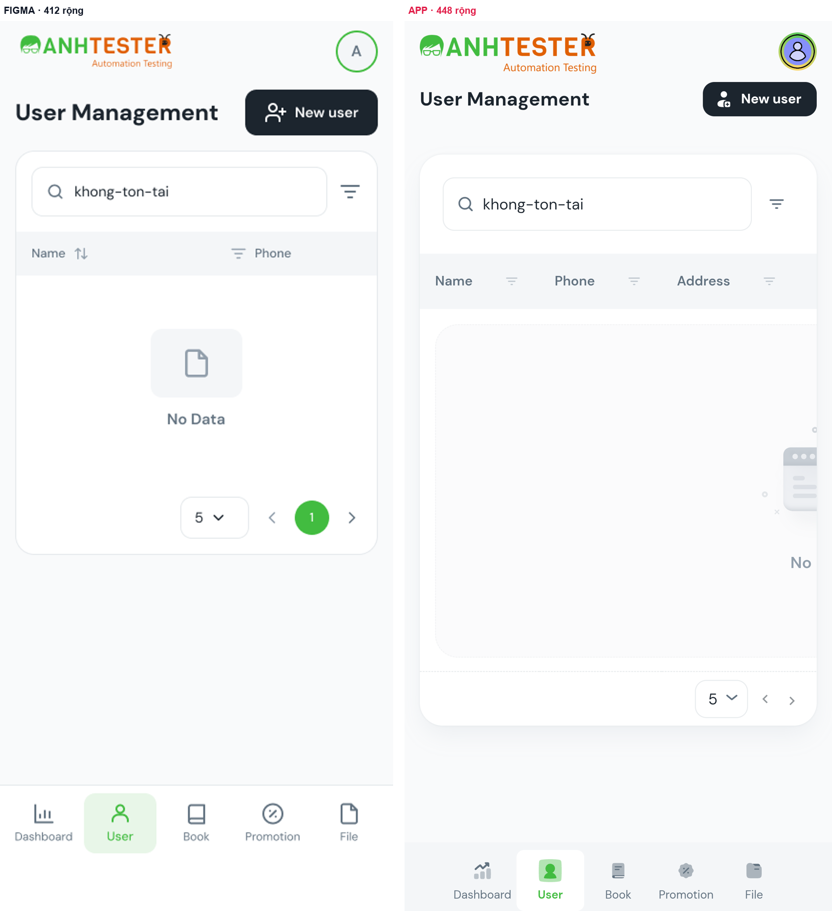

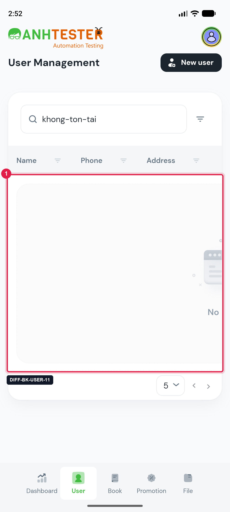

Bảng đo tự động (dc.py match)

> Khung thiết kế rộng **412** · màn thật rộng **448** (cùng đơn vị) · bỏ status bar: thiết kế 36 / thật 40 · dung sai vị trí ±4

**Tổng:** 🔍 Thiếu trên app **2** · ❌ Lệch **11** · ➕ Thừa trên app **9** · ⚠️ Lệch nhỏ **1**

| # | Trạng thái | Chữ trong thiết kế | Trên app | Δx (neo) | Δy | Δ khoảng cách | Δ cao | Màu (thiết kế → app · ΔE) | Ghi chú |
|---|---|---|---|---|---|---|---|---|---|
| 1 | 🔍 | A | — | — | — | — | — | — |  |
| 2 | ❌ | User Management | User Management | +0 (trái) | -14 | — | +0 | `#1c252e` → `#1c242c` · 0.6 | lệch -14 tính từ đầu vùng nội dung — nguyên nhân có thể nằm ở phần tử không có chữ phía trên (ảnh, banner, header) |
| 3 | ❌ | New user | New user | +3 (trái) | -22 | -8 | +16 | `#ffffff` → `#fcfcfc` · 0.6 | khoảng cách tới “User Management” lệch -8 — điểm khởi phát xô lệch cao 36 vs 20 — khác số dòng (≈1.8 vs 1.0 dòng) |
| 4 | ❌ | khong-ton-tai | khong-ton-tai | -2.8 (tỉ lệ) | -4 | +18 | +34 | — | ô nhập đang có giá trị — không phải placeholder khoảng cách tới “New user” lệch +18 — điểm khởi phát xô lệch cao 56 vs 22 — khác số dòng (≈2.5 vs 1.0 dòng) |
| 5 | ❌ | Name | Name | -1 (trái) | +25 | +29 | +8 | `#637381` → `#607080` · 1.5 | khoảng cách tới “khong-ton-tai” lệch +29 — điểm khởi phát xô lệch |
| 6 | ❌ | Phone | Phone | -110 (trái) | +25 | +0 | +8 | `#637381` → `#607080` · 1.5 | Δy +25 kế thừa từ phía trên — không tính lỗi riêng |
| 7 | ❌ | No Data | No Data | +193 (phải) | +147 | +122 | +5 | `#637381` → `#909ca8` · 15.2 | khoảng cách tới “Phone” lệch +122 — điểm khởi phát xô lệch màu chữ #909ca8 vs #637381 (ΔE 15.2) |
| 8 | ❌ | 5 | 5 | +64 (phải) | +190 | +43 | +18 | — | khoảng cách tới “No Data” lệch +43 — điểm khởi phát xô lệch khung phần tử app lớn hơn hộp chữ (gồm icon/padding) — không đo được số dòng, so theo tâm màu chữ không lấy mẫu được (khung có cả icon/nền) — đối chiếu bằng ảnh |
| 9 | 🔍 | 1 | — | — | — | — | — | — |  |

> Khối có nền/viền ghép qua chữ nằm bên trong — **heuristic**: phần tử app được chọn là khung nhỏ nhất chứa đủ các chữ đó, màu nền lấy mẫu ở mép trái. Dòng ❌ ở đây phải xem ảnh trước khi tin.

| # | Trạng thái | Khối (thiết kế) | Phần tử app | Δ rộng | Δ cao | Màu nền (thiết kế → app · ΔE) | Ghi chú |
|---|---|---|---|---|---|---|---|
| B1 | ❌ | Button [257, 108, 139, 48] | `Button` [312, 104, 120, 36] | -19 | -12 | `#1c252e` → `#1c242c` · 0.6 | cao 36 vs 48 rộng 120 vs 139 |
| B2 | ❌ | Card · User list [16, 172, 380, 424] | `View` [16, 180, 416, 599] | +0 | +175 | `#ffffff` → `#fcfcfc` · 0.6 | cao 599 vs 424 |
| B3 | ❌ | Search field [33, 189, 310, 52] | `View` [40, 204, 324, 56] | +14 | +4 | `#ffffff` → `#fcfcfc` · 0.6 | rộng 324 vs 310 |
| B4 | ⚠️ | Table header [17, 257, 378, 46] | `View` [16, 284, 416, 58] | +2 | +12 | `#f4f6f8` → `#f4f4f8` · 1.7 | cao 58 vs 46 |
| B5 | ❌ | Page size [189, 535, 72, 44] | `View` [304, 731, 56, 40] | -16 | -4 | `#ffffff` → `#fcfcfc` · 0.6 | rộng 56 vs 72 |

| ➕ Chữ có trên app nhưng không có trong thiết kế | Loại | Vị trí |
|---|---|---|
| Address | text | [269, 284, 143, 58] |
| Address | text | [285, 300, 85, 26] |
| Active | text | [411, 284, 21, 58] |
| Active | text | [427, 300, 5, 26] |
| Dashboard | text | [46, 901, 72, 81] |
| User | text | [117, 901, 72, 81] |
| Book | text | [188, 901, 72, 81] |
| Promotion | text | [259, 901, 72, 81] |
| File | text | [330, 901, 72, 81] |

## 5. Khung / trạng thái không so được

| Khung | Lý do | Cần gì để so |
|---|---|---|
| U-01 — dữ liệu từng dòng, dãy trang | Thiết kế dùng 5 người mẫu và chỉ 1 trang; app có hàng trăm trang dữ liệu thật | Không cần — so cấu trúc hàng bằng ảnh (chiều cao hàng 76 dp vs 72 dp, ⚠️ trong ngưỡng) |
| U-06 — vị trí phần tử | Thiết kế lược bớt ảnh đại diện + khối Address | Designer vẽ bản đầy đủ nếu cần so bố cục trạng thái lỗi |

## 6. Ghi chú tham khảo (không tính DIFF — ngoài phạm vi của wireframe)

- Đường phân cách giữa các dòng, viền fieldset và khung *Upload photo*: app nét **liền**, thiết kế nét **đứt**
- Icon nút *New user* / *Save*: app icon đặc, thiết kế icon nét
- Toggle *Active for login*, select Division/Ward: khớp
- Màu chữ thông báo lỗi validation (U-06) khớp ΔE ≤ 1,5; nội dung lỗi khớp nguyên văn

## 7. Việc tiếp theo

- **5 DIFF `Dev`** (02 · 05 · 08 · 10 · 11) → `/create-bug-report` cho từng mã (hậu tố tên bug là mã DIFF). Ưu tiên **DIFF-BK-USER-10** (lỗi validation dính sang form khác — người dùng không lưu được dù dữ liệu hợp lệ cho tới khi tự sửa từng ô) và nhóm **02 · 05 · 11** (cùng gốc: bảng rộng hơn màn hình)
- **DIFF-BK-USER-04** (Cần PO quyết) → PO xác nhận khách có được thấy *New user* / ⋮ không. Song song: **cần Dev xác minh** phía server có chặn thao tác của khách
- **5 DIFF `Design`** → gửi designer cập nhật wireframe page USER
