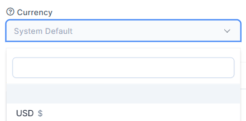
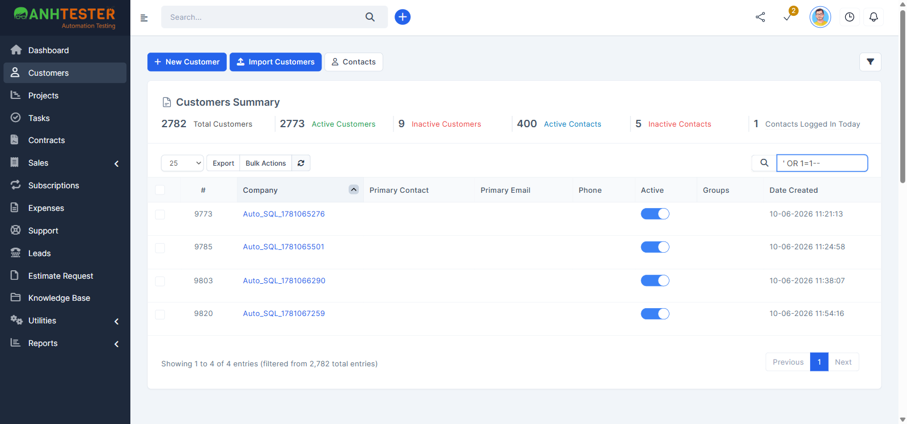

# Execution Report — Khách hàng · TC_001 → TC_030

| Thông tin | Nội dung |
|---|---|
| Run ID | run_1791926209 |
| Nền tảng | `web` |
| Loại nguồn | `Bộ TC` |
| Nguồn TC | [part_01_web_smoke.md](../../../../testcases/customers/web/parts/part_01_web_smoke.md) (TC_001 → TC_016) · [part_02_web_danh_sach.md](../../../../testcases/customers/web/parts/part_02_web_danh_sach.md) (TC_017 → TC_030) |
| Phạm vi | **30 TC** đầu của module — `CRM_CUST_TC_001` → `CRM_CUST_TC_030`. 0 TC `@Deprecated`, 0 TC `@PersonalOnly` trong dải |
| Môi trường | https://crm.canhnt14.com — **Dùng chung** — auto-skip TC phá huỷ đang BẬT |
| Tài khoản | Admin (`admin@example.com`) · Project Manager (`PM_EMAIL` trong `.env`, chỉ cho `TC_025-b`) — mật khẩu do **người dùng tự gõ** |
| Trình duyệt | Chrome (Playwright MCP, headed, viewport `1600×750`) |
| Người thực hiện | canhnt14 (agent hỗ trợ — Claude Code) |
| Bắt đầu → Kết thúc | 14-10-2026 04:16 → 04:49 (~33 phút, gồm thời gian chờ người dùng đăng nhập PM cho `TC_025-b`) |
| Môi trường dùng chung? | Có — auto-skip TC phá huỷ đang BẬT |

> 🧪 **Test data:** mọi bản ghi mang hậu tố `202610140416` (thời điểm chạy) thay cho hậu tố `202609191…` cố định trong TC — tránh trùng với lần chạy khác, vẫn truy vết được. Tên giữ đúng mẫu của TC (`auto_cust_tc009_<hậu tố>` …).

## 1. Tổng kết

| Trạng thái | Số lượng | Tỷ lệ |
|---|---|---|
| ✅ PASS | 27 | 90.0% |
| ❌ FAIL | 3 | 10.0% |
| ⚠️ BLOCKED | 0 | 0% |
| ⏭️ SKIPPED | 0 | 0% |
| **Tổng** | **30** | 100% |

> **Pass rate (không tính SKIPPED):** 27/30 = 90.0%.
>
> **Không FAIL nào là lỗi hệ thống đã xác nhận.** `TC_022-c` do dữ liệu dùng chung trùng chuỗi tìm kiếm. `TC_027` (`@NeedsVerify`) và `TC_006` lệch ở chi tiết giao diện TC mô tả — cả 3 cần đối chiếu lại TC trước khi báo bug.
>
> **Gỡ được `@NeedsVerify`** (đã xác nhận trên UI): `TC_023` (tìm không dấu ra kết quả — hệ thống bỏ dấu khi so khớp) · `TC_025` · `TC_028` · `TC_029`.

## 2. Kết quả từng TC

| TC ID | Test Scenario | Kết quả | Bước fail | Ghi chú |
|---|---|---|---|---|
| CRM_CUST_TC_001 | Mở màn hình danh sách khách hàng bằng mọi lối vào | ✅ PASS | — | `a` menu trái · `b` gõ URL: dừng `/admin/clients`, tab `Customers`, có `Customers Summary` + bảng 25 dòng, menu `Customers` tô sáng. 🔧 HTTP `200`, `body.clients` |
| CRM_CUST_TC_002 | Thanh công cụ và khối Customers Summary | ✅ PASS | — | 3 nút đúng thứ tự + phễu lọc; 6 ô đúng thứ tự, số trước nhãn, Active xanh / Inactive đỏ; `2770 = 2761 + 9` — [ảnh](evidence/TC_002_003_list_default.png) |
| CRM_CUST_TC_003 | Bảng danh sách đúng cấu trúc cột và trạng thái mặc định | ✅ PASS | — | `25` · `Export` · `Bulk Actions` · nạp lại; ô `Search...`; 9 cột đúng thứ tự; `Company` đang sắp tăng; `Showing 1 to 25 of 2,770 entries`; `Previous` mờ, `1` xanh, `2 3 4 5 … 111 Next`, ô chọn trang = `1` — [ảnh](evidence/TC_003_table_footer.png) |
| CRM_CUST_TC_004 | Dữ liệu trong bảng đúng định dạng, rê chuột hiện thao tác nhanh | ✅ PASS | — | `Date Created` `14-10-2026 04:21:21`; Company + Phone là liên kết xanh; công tắc bật; chưa rê không có dòng thao tác, rê chuột hiện `View \| Contacts \| Delete` (Delete đỏ); nạp lại `2782 = 2773 + 9` — [ảnh trước](evidence/TC_004_row_before_hover.png) · [ảnh sau](evidence/TC_004_row_hover_actions.png) |
| CRM_CUST_TC_005 | Biểu mẫu thêm khách hàng đủ thành phần, con trỏ ở Company | ✅ PASS | — | 2 tab, không có `Customer Admins`; gõ `abc` vào thẳng ô Company; 12 nhãn đúng thứ tự; chỉ `Company` có `*`; `Save and create contact` (trắng) · `Save` (xanh); tab `Add new customer` — [ảnh](evidence/TC_005_new_form_abc.png) |
| CRM_CUST_TC_006 | Các ô chọn trên biểu mẫu thêm mới ở đúng trạng thái mặc định | ❌ FAIL | 2 · mục `3` | Xem FAIL #1. Các mục còn lại đạt |
| CRM_CUST_TC_007 | Tab Billing & Shipping hiển thị đủ hai khối địa chỉ | ✅ PASS | — | Tab chuyển xanh; 2 khối + 2 liên kết sao chép; 5 ô mỗi khối đúng thứ tự; chú giải nguyên văn; 2 nút vẫn ở chân — [ảnh](evidence/TC_007_billing_shipping.png) |
| CRM_CUST_TC_008 | Mở biểu mẫu thêm khách hàng bằng mọi lối vào | ✅ PASS | — | `a` nút `+ New Customer` · `b` gõ URL: `/admin/clients/client`, tab `Add new customer`, biểu mẫu rỗng, con trỏ ở `Company` |
| CRM_CUST_TC_009 | Tạo khách hàng chỉ với Company | ✅ PASS | — | Không lỗi; `/admin/clients/client/15485`, tab + tiêu đề `#15485 auto_cust_tc009_202610140416` — [ảnh](evidence/TC_009_created_profile.png). Bước 6 (`D1`) dồn vào teardown, xem mục 5 |
| CRM_CUST_TC_010 | Tạo khách hàng đủ mọi trường, mở lại đúng dữ liệu | ✅ PASS | — | 12 ô Customer Details + 10 ô Billing/Shipping khớp từng ký tự (Group `123`, `USD`, `Vietnamese`, `Vietnam`), không tráo khối — [ảnh](evidence/TC_010_profile_details.png) · [ảnh B&S](evidence/TC_010_profile_billing_shipping.png) |
| CRM_CUST_TC_011 | Khách hàng vừa tạo hiện đúng ở danh sách, mặc định Active | ✅ PASS | — | 1 dòng: Phone `0912345678`, Contact/Email/Groups trống, công tắc bật, `14-10-2026 04:21:03`; Total `2772 → 2773`, Active `2763 → 2764` — [ảnh](evidence/TC_011_row_in_list.png) |
| CRM_CUST_TC_012 | Save and create contact mở ngay hộp thoại thêm liên hệ | ✅ PASS | — | `/client/15488?group=contacts&new_contact=true`, tab `Contacts`; hộp thoại `Add new contact` + tên công ty, đủ 8 ô; đóng `X` khách hàng vẫn còn — [ảnh](evidence/TC_012_add_contact_modal.png) |
| CRM_CUST_TC_013 | Hồ sơ khách hàng (Admin) đủ 19 tab, biểu mẫu sửa đúng cấu trúc | ✅ PASS | — | `#15490 …` có mũi tên; đủ 19 tab đúng thứ tự, `Profile` tô xanh; 3 tab biểu mẫu; nút quả cầu cạnh Website; chỉ 1 nút `Save`; không có ô `Show primary contact…` — [ảnh](evidence/TC_013_profile_structure.png) |
| CRM_CUST_TC_014 | Mở hồ sơ khách hàng bằng mọi lối vào | ✅ PASS | — | `a` bấm tên · `b` `View` · `c` gõ URL: cùng `/client/15491`, tab + tiêu đề đúng, mở tab `Profile` |
| CRM_CUST_TC_015 | Màn hình Nhập khách hàng, 4 hướng dẫn nguyên văn | ✅ PASS | — | `a`, `b`: `/admin/clients/import`, tab `Import`, khối `Import Customers`; 4 mục nguyên văn, mục 2 hiện `2026-10-14` (ngày chạy), mục 4 chữ đỏ — [ảnh](evidence/TC_015_import_instructions.png) |
| CRM_CUST_TC_016 | Biểu mẫu nhập CSV và bảng cột mẫu | ✅ PASS | — | 27 cột đúng thứ tự; 4 cột `*`; 5 cột đầu `Contact field`; `Download Sample` xanh lá; thứ tự ô đúng; ô mật khẩu mặc định **hiện rõ** `MatKhau@2026` (ghi nhận hiện trạng); `Import` · `Simulate Import` — [ảnh](evidence/TC_016_import_form.png) |
| CRM_CUST_TC_017 | Sắp xếp tăng/giảm theo Company, #, Date Created | ✅ PASS | — | `a` desc → asc · `b`, `c` asc → desc; 5 dòng đầu đúng chiều; chỉ 1 cột mang mũi tên. 🔧 `POST /admin/clients/table` `order[0][column]` `2`/`1`/`8`, `dir` đúng |
| CRM_CUST_TC_018 | Sắp xếp theo Primary Contact, Primary Email, Phone, Active, Groups | ✅ PASS | — | 5/5 biến thể đảo chiều đúng; `d` Active: asc toàn `off`, desc toàn `on` |
| CRM_CUST_TC_019 | Đổi số dòng mỗi trang | ✅ PASS | — | Đúng 5 lựa chọn `10 · 25 · 50 · 100 · All`; `a`→`d` đúng số dòng; `e` 2.782 dòng, `Showing 1 to 2,782 of 2,782`, chỉ trang `1`, cuộn được |
| CRM_CUST_TC_020 | Chuyển trang Next/Previous, số trang, ô nhảy trang | ✅ PASS | — | `26–50` → `51–75` → `26–50` → trang cuối `2,776 to 2,782`, `Next` mờ; URL không đổi, không tải lại trang, Summary giữ nguyên. 🔧 `start` = 25/50/25/2775, `length=25`, có `csrf_token_name`, `200` |
| CRM_CUST_TC_021 | Tìm kiếm khớp tên đầy đủ, một phần, khác hoa thường, số điện thoại | ✅ PASS | — | 4/4 biến thể: đúng 1 dòng `auto_cust_tc021_202610140416`, `(filtered from 2,782 total entries)` |
| CRM_CUST_TC_022 | Từ khoá không khớp — kể cả chuỗi tấn công — bảng báo rỗng | ❌ FAIL | 3 · biến thể `c` | Xem FAIL #2. `a`, `b` đạt; không hộp thoại nào bật lên |
| CRM_CUST_TC_023 | Tìm tên tiếng Việt có dấu và không dấu | ✅ PASS | — | `a` có dấu → đúng dòng. `b` **không dấu cũng tìm ra** → hệ thống **bỏ dấu khi so khớp** (ghi nhận để chốt `AMB`, gỡ `@NeedsVerify`) |
| CRM_CUST_TC_024 | Nút nạp lại làm mới bảng tại chỗ, giữ từ khoá | ✅ PASS | — | Từ khoá `auto` còn nguyên; dòng trạng thái vẫn `(filtered from …)`; URL không đổi, không điều hướng trang; request nạp bảng `200` |
| CRM_CUST_TC_025 | Dropdown bộ lọc: tạo, bộ lọc đã lưu, xoá/sửa chỉ khi đang áp | ✅ PASS | — | `a` Admin: chú giải `Filter by`; `New Filter` xanh + đường kẻ; 9 bộ lọc đã lưu (`filter by phone` … `zip code`); không có `Clear Filter`/`Edit` · `b` PM: chỉ `New Filter` + nguyên văn `No saved filters, get started by creating a new filter.` — [ảnh](evidence/TC_025-b_pm_filter_dropdown.png) |
| CRM_CUST_TC_026 | Hộp thoại Create Filter mở/đóng được, đủ 15 tiêu chí | ✅ PASS | — | Tiêu đề, `Add Rule`, công tắc `Save Filter` tắt, `Apply` xanh; đúng 15 tiêu chí; `X` đóng không đổi bảng; `Esc` đóng — [ảnh](evidence/TC_026_create_filter_modal.png) |
| CRM_CUST_TC_027 | Áp bộ lọc một điều kiện theo City | ❌ FAIL | 2 · 5 · 6 | Xem FAIL #3 — **lọc vẫn đúng**, lệch ở 3 chi tiết giao diện TC mô tả trước khi có evidence |
| CRM_CUST_TC_028 | Bộ lọc hai điều kiện, kiểu khớp "tất cả" / "bất kỳ" | ✅ PASS | — | Cặp `and`/`or` hiện, mặc định `or`, dòng 2 có nhãn `or` — [ảnh](evidence/TC_028_two_rules.png); `a` chỉ `tc028a` · `b` cả `tc028a` + `tc028b`. 🔧 `match_type` = `and`/`or`. Gỡ được `@NeedsVerify` |
| CRM_CUST_TC_029 | Lưu bộ lọc để dùng lại rồi xoá | ✅ PASS | — | Bật công tắc → hiện ô `* Filter name` + 2 ô tích, nút đổi thành `Apply and Save` — [ảnh](evidence/TC_029_save_filter_on.png); dropdown thêm `auto_filter_tc029_202610140416` — [ảnh](evidence/TC_029_saved_in_dropdown.png); xoá qua `Edit` → thùng rác → `Confirm`; mở lại không còn — [ảnh](evidence/TC_029_after_delete_dropdown.png). Gỡ được `@NeedsVerify` |
| CRM_CUST_TC_030 | Menu Export có đủ 4 lựa chọn | ✅ PASS | — | Menu ngay dưới nút: `Excel · CSV · PDF · Print`; bấm ra ngoài đóng, 0 tệp tải về |

## 3. Chi tiết TC FAIL

### FAIL #1 — CRM_CUST_TC_006 · Các ô chọn trên biểu mẫu thêm mới ở đúng trạng thái mặc định

| | |
|---|---|
| REQ ID | REQ-CUST-30 |
| Priority | Medium |
| Bước fail | Bước 2 · mục `3` của Bảng kiểm |
| **Expected** | Mở `Currency` thấy đúng 3 lựa chọn: `System Default` · `USD` · `EUR` |
| **Actual** | Có 3 dòng nhưng dòng đầu **trống chữ** (đang chọn), tiếp theo `USD $` · `EUR €`. Chữ `System Default` chỉ hiện trên ô khi đóng |
| Evidence |  |
| Nhận định | Lệch nhỏ, có thể do TC mô tả theo nhãn ô đóng. Đối chiếu lại TC (`/review-testcases`) trước khi báo bug — nếu PO coi dòng trống là lỗi giao diện thì báo bug Low |

### FAIL #2 — CRM_CUST_TC_022 · Từ khoá không khớp — kể cả chuỗi tấn công — bảng báo rỗng

| | |
|---|---|
| REQ ID | REQ-CUST-13 |
| Priority | Medium |
| Bước fail | Bước 3 · biến thể `c` (`' OR 1=1--`) — `a`, `b` đạt |
| **Expected** | `No matching records found` · `Showing 0 to 0 of 0 entries (filtered from …)` |
| **Actual** | `Showing 1 to 4 of 4 entries (filtered from 2,782 total entries)` — 4 khách hàng `Auto_SQL_1781065276` … `Auto_SQL_1781067259` (ID `9773`, `9785`, `9803`, `9820`, tạo 10-06-2026, **không** do lần chạy này tạo) |
| Evidence |  |
| Nhận định | **Không phải lỗi hệ thống.** Ô `VAT Number` của cả 4 khách hàng chứa đúng chuỗi `' OR 1=1--` (đã đọc hồ sơ `9773`) — ô tìm kiếm khớp theo nghĩa đen, chỉ ra 4/2.782 dòng, **không** trả toàn bộ bảng. TC giả định chuỗi này không tồn tại trên môi trường dùng chung — sai giả định. Đề nghị `/review-testcases`: thêm hậu tố riêng vào chuỗi (VD `' OR 1=1-- tc022_<timestamp>`) hoặc đổi kỳ vọng thành "không trả toàn bộ bảng" |

### FAIL #3 — CRM_CUST_TC_027 · Áp bộ lọc một điều kiện theo City

| | |
|---|---|
| REQ ID | REQ-CUST-14 |
| Priority | Medium |
| Bước fail | Bước 2 · bước 5 · bước 6 |
| **Expected** | 2: phía trên dòng điều kiện có cặp `and`/`or` (đang chọn `or`) · 5: dòng trạng thái dạng `(filtered from …)` · 6: dropdown có thêm `Clear Filter` và `Edit`, bấm `Clear Filter` bảng về đủ bản ghi |
| **Actual** | 2: với **1** điều kiện **không** có cặp `and`/`or` (chỉ hiện từ điều kiện thứ 2 — xem `TC_028`) — [ảnh](evidence/TC_027_rule_city_row.png) · 5: bảng lọc đúng, chỉ còn `auto_cust_tc027_202610140416`, nhưng dòng trạng thái là `Showing 1 to 1 of 1 entries` (**không** có `filtered from`) — [ảnh](evidence/TC_027_state_check.png) · 6: với bộ lọc **chưa lưu**, dropdown chỉ có `New Filter \| Edit`, `Clear Filter` bị ẩn — [ảnh](evidence/TC_027_dropdown_with_clear_edit.png). `Clear Filter` chỉ hiện khi đang áp bộ lọc **đã lưu** (thấy ở `TC_029`). Nạp lại trang thì bảng về đủ 2.782 |
| Nhận định | TC mang `@NeedsVerify` — Expected chưa có evidence. Chức năng lọc chạy đúng; 3 điểm lệch là mô tả giao diện. Đối chiếu lại TC bằng `/review-testcases` trước khi báo bug |

## 4. TC BLOCKED

| TC ID | Nguyên nhân chặn | Cần gì để chạy được |
|---|---|---|

## 5. Dữ liệu đã tạo & dọn dẹp

| Dữ liệu | ID | Nơi tạo | Đã xoá? |
|---|---|---|---|
| `auto_cust_tc009_202610140416` | 15485 | TC_009 | ✅ |
| `auto_cust_tc010_202610140416` | 15486 | TC_010 | ✅ |
| `auto_cust_tc011_202610140416` | 15487 | TC_011 | ✅ |
| `auto_cust_tc012_202610140416` | 15488 | TC_012 | ✅ |
| `auto_cust_tc004_202610140416` | 15489 | Tiền đề TC_004 | ✅ |
| `auto_cust_tc013_202610140416` | 15490 | Tiền đề TC_013 | ✅ |
| `auto_cust_tc014_202610140416` | 15491 | Tiền đề TC_014 | ✅ |
| `auto_cust_tc021_202610140416` | 15492 | Tiền đề TC_021 | ✅ |
| `Công ty Ánh Dương TC023 202610140416` | 15493 | Tiền đề TC_023 | ✅ |
| `auto_cust_tc027_202610140416` | 15494 | Tiền đề TC_027 | ✅ |
| `auto_cust_tc028a_202610140416` | 15495 | Tiền đề TC_028 | ✅ |
| `auto_cust_tc028b_202610140416` | 15496 | Tiền đề TC_028 | ✅ |
| Bộ lọc `auto_filter_tc029_202610140416` | — | TC_029 | ✅ (xoá trong chính TC) |

> Xoá theo `D1`: tìm đúng tên → đối chiếu ID + tên → `Delete` → `OK` → thông báo `Customer deleted`. Tìm lại hậu tố `202610140416` ra `No matching records found`.
> Đối chiếu số liệu: `Total Customers` trước **2770** → sau **2770** · Active 2761 → 2761 · Inactive 9 → 9 ✅ môi trường trả về nguyên trạng.

## 6. Đề xuất bước tiếp theo

- `/review-testcases` mode FIX cho 3 TC FAIL **trước** khi báo bug:
  - `TC_006` mục `3`: dòng đầu danh sách `Currency` là dòng trống — chốt với PO đây là kỳ vọng hay lỗi giao diện
  - `TC_022-c`: chuỗi `' OR 1=1--` trùng VAT của 4 khách hàng có sẵn — thêm hậu tố riêng cho chuỗi, hoặc đổi kỳ vọng thành "không trả toàn bộ bảng"
  - `TC_027`: sửa theo hành vi đã đo — 1 điều kiện không có cặp `and`/`or`; bộ lọc chưa lưu không có `Clear Filter`, dòng trạng thái không có `(filtered from …)`
- Gỡ `@NeedsVerify` ở `TC_023`, `TC_025`, `TC_028`, `TC_029`; chốt `AMB` cho kết quả `TC_023-b` (tìm không dấu ra kết quả)
- Chạy tiếp `TC_031` → `TC_129`; `TC_037` (`Mass Delete`, `@PersonalOnly`) cần môi trường riêng
