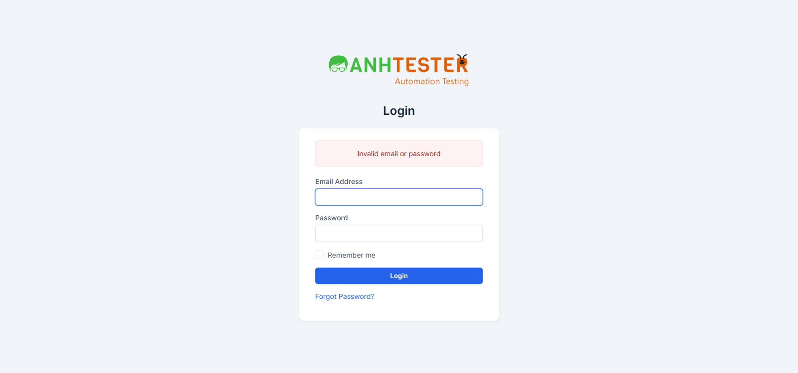
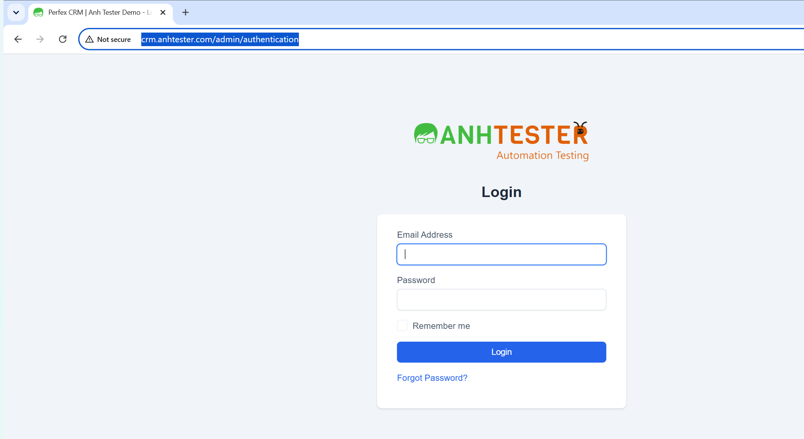

# Execution Report — Login / Xác thực · Chạy lại các TC đã sửa sau lần chạy gần nhất

| Thông tin | Nội dung |
|---|---|
| Run ID | run_1791925499 |
| Nền tảng | `web` |
| Loại nguồn | `Bộ TC` |
| Nguồn TC | [docs/testcases/login/web/test_cases_login_web.md](../../../../testcases/login/web/test_cases_login_web.md) |
| Phạm vi | **19 TC** có nội dung (Pre-Condition / Steps / Data / Expected / Tags) **khác** với bản đã dùng ở lần chạy gần nhất của chính TC đó — so từng dòng TC với bản git tại thời điểm chạy: `3604c65` cho [run_1787215085](../run_1787215085/execution_report.md) (20-08-2026), `4550fd6` cho [run_1789759574](../run_1789759574/execution_report.md) (19-09-2026). `008`, `011`, `014`, `016`, `018`, `020`, `024`, `025`, `028`, `031`, `033`, `034`, `039`, `040`, `041` (đổi sau 20-08) · `046`, `048`, `049`, `050` (đổi sau lần chạy 19-09). Loại khỏi phạm vi: `TC_026`, `TC_051` (`@PersonalOnly`). 0 TC `@Deprecated` |
| Môi trường | https://crm.canhnt14.com — **Dùng chung** — auto-skip TC phá huỷ đang BẬT |
| Tài khoản | Admin (`admin@example.com`) · Customer (`CUSTOMER_EMAIL` trong `.env`) — mật khẩu thật do **người dùng tự gõ**, agent không nhập mật khẩu thật |
| Trình duyệt | Chrome (Playwright MCP, headed, viewport `1600×750`) |
| Người thực hiện | canhnt14 (agent hỗ trợ — Claude Code) |
| Bắt đầu → Kết thúc | 14-10-2026 04:04 → 04:49 (~45 phút, gồm thời gian chờ người dùng gõ mật khẩu và chạy xen phần Customers [run_1791926209](../../../customers/web/run_1791926209/execution_report.md)) |
| Môi trường dùng chung? | Có — auto-skip TC phá huỷ đang BẬT |

## 1. Tổng kết

| Trạng thái | Số lượng | Tỷ lệ |
|---|---|---|
| ✅ PASS | 14 | 73.7% |
| ❌ FAIL | 3 | 15.8% |
| ⚠️ BLOCKED | 2 | 10.5% |
| ⏭️ SKIPPED | 0 | 0% |
| **Tổng** | **19** | 100% |

> **Pass rate (không tính SKIPPED):** 14/19 = 73.7%.
>
> **3 TC FAIL đều là bug cũ còn mở**, kết quả giống lần chạy 20-08-2026: `TC_016` (ô Email không giữ lại) · `TC_028` (Quên mật khẩu bỏ trống báo `Email not found`) · `TC_039` (HTTP không ép sang HTTPS). Không phát hiện lỗi mới.
>
> **So với lần chạy trước của chính các TC này:** `TC_018` đổi từ ❌ FAIL (biến thể email 260 ký tự, đã bỏ khỏi TC) → ✅ PASS · `TC_014` từ ✅ PASS (người dùng tự chạy) → ⚠️ BLOCKED (thiếu tài khoản test theo tiền đề mới) · `TC_050` từ ✅ PASS → ⚠️ BLOCKED (chỉ chạy được Chrome). Các TC còn lại giữ nguyên kết quả.
>
> 🔑 9 TC cần mật khẩu thật (`008`, `020`, `024`, `025`, `033`, `034`, `040`, `041`, `050-a`) chạy theo cách: agent dựng tiền đề + điền email, **người dùng tự gõ mật khẩu**, agent bấm `Login` và chấm.

## 2. Kết quả từng TC

| TC ID | Test Scenario | Kết quả | Bước fail | Ghi chú |
|---|---|---|---|---|
| CRM_LOGIN_TC_008 | Tích Ghi nhớ đăng nhập thì phát hành cookie ghi nhớ | ✅ PASS | — | Trước bước 1 danh sách cookie **rỗng** (đã xoá); tích `Remember me` → đăng nhập vào `/admin/`, không dải lỗi. 🔧 có cookie `autologin` khớp hình thái `a:2:{s:7:"user_id";…;s:3:"key";s:16:"<16 ký tự hex>";}`, phần `key` dài đúng **16** ký tự hex (không ghi giá trị). Chung lượt đăng nhập với `TC_024`, `TC_050-a` |
| CRM_LOGIN_TC_011 | Kiểm tra trường bắt buộc trên biểu mẫu đăng nhập | ✅ PASS | — | 4/4 biến thể: `a` 2 dải `The Password field is required.` → `The Email Address field is required.` · `b` chỉ 1 dải Email · `c` chỉ 1 dải Password · `d` như `a`. Cả 4 vẫn ở `/admin/authentication` |
| CRM_LOGIN_TC_014 | Mật khẩu đúng nhưng sai kiểu chữ hoa/thường thì bị từ chối | ⚠️ BLOCKED | — | Không dựng được tiền đề — xem mục 4 |
| CRM_LOGIN_TC_016 | 🐞 Ô Email phải giữ email vừa nhập sau khi đăng nhập thất bại | ❌ FAIL | 5 | Bug cũ còn nguyên — xem FAIL #1 |
| CRM_LOGIN_TC_018 | Mật khẩu đa ngôn ngữ + emoji không làm lỗi máy chủ | ✅ PASS | — | Về đúng trang đăng nhập, 1 dải `Invalid email or password`, không vỡ ký tự. 🔧 `POST` trả `303` → trang `200`, không có `500` |
| CRM_LOGIN_TC_020 | Có phiên cổng khách hàng vẫn không mở được URL khu quản trị | ✅ PASS | — | Đăng nhập `/login` bằng `CUSTOMER_EMAIL`: `https://crm.canhnt14.com/` hiện cổng khách hàng (menu `Projects`, `Invoices`, `Profile`…, có liên kết đăng xuất). Gõ `/admin/clients` → dừng `/admin/authentication`, hiện biểu mẫu đăng nhập khu quản trị, không thấy dữ liệu nghiệp vụ — [ảnh](evidence/TC_020_customer_session_admin_blocked.png) |
| CRM_LOGIN_TC_024 | Biểu mẫu đăng nhập mang mã chống CSRF đúng hình thái | ✅ PASS | — | Đăng nhập (tích `Remember me`) dừng ở `/admin/`. 🔧`1` đúng **1** ô ẩn `csrf_token_name`, dài **32**, toàn hex · 🔧`2` sau F5 mã **giữ nguyên** · 🔧`3` chưa kiểm — không đọc được thân `POST` qua công cụ của phiên này (bộ chặn request không giữ được giữa các lần gọi) |
| CRM_LOGIN_TC_025 | Mã CSRF không hợp lệ thì bị chặn | ✅ PASS | — | `a` mã `0…0` · `b` mã rỗng: tab `Error`, màn hình nguyên văn `419 Page Expired!` + `Sorry, the page has expired, return to previous page and refresh to continue.`; mở `/admin/` sau đó vẫn bị đưa về trang đăng nhập — [ảnh `a`](evidence/TC_025-a_419.png) · [ảnh `b`](evidence/TC_025-b_419.png). (HTTP `403` — TC chấm theo chữ hiển thị) |
| CRM_LOGIN_TC_028 | 🐞 Bỏ trống email ở Quên mật khẩu phải báo trường bắt buộc | ❌ FAIL | 4 | Bug cũ còn nguyên — xem FAIL #2 |
| CRM_LOGIN_TC_031 | Liên kết đặt lại mật khẩu không hợp lệ trả 500 thân rỗng | ✅ PASS | — | `a`, `b`: HTTP `500`, thân `0` byte; Chrome hiện trang lỗi của chính nó `HTTP ERROR 500` — [ảnh](evidence/TC_031_browser_error_page.png) |
| CRM_LOGIN_TC_033 | Viewport mobile đăng xuất được qua menu thu gọn | ✅ PASS | — | `375×812`, nạp lại `/admin/`: nút ba gạch mở menu, mục `Logout` hiện rõ (rộng 360 px) — [ảnh](evidence/TC_033_mobile_menu_logout.png); bấm → `/admin/authentication`. Viewport trả về `1600×750` ngay sau đó |
| CRM_LOGIN_TC_034 | Đăng xuất khi còn bộ đếm giờ phải xác nhận trước | ✅ PASS | — | Dựng task `Auto_LOGIN_TC034_1791925499` (ID 2179), bật timer: huy hiệu `1`, danh sách có task + `Started at 14-10-2026 04:41`. Bấm `Logout` → lớp xác nhận che toàn màn hình, nguyên văn `Started tasks timers found!` / `Are you sure you want to logout without stopping the timers?` + nút `Logout`; vẫn ở `/admin/` — [ảnh](evidence/TC_034_logout_confirm_overlay.png). Dọn: đóng `×` → `Stop Timer` → `Save` → `No started timers found` → xoá task → `Task deleted`, tìm lại `No matching records found` |
| CRM_LOGIN_TC_039 | 🐞 HTTP thuần phải bị ép sang HTTPS | ❌ FAIL | 3 | Bug cũ còn nguyên — xem FAIL #3 |
| CRM_LOGIN_TC_040 | Mất mạng giữa lúc gửi biểu mẫu thì không tạo phiên | ✅ PASS | — | Nhập đủ thông tin → ngắt mạng trình duyệt → `Login`: Chrome hiện trang lỗi của chính nó `ERR_INTERNET_DISCONNECTED`, không dải thông báo nào của ứng dụng — [ảnh](evidence/TC_040_offline_submit.png). Bật mạng, mở `/admin/` → về `/admin/authentication` với biểu mẫu. ℹ️ Trước khi chạy đã xoá cookie `autologin` còn sót từ `TC_008` để không lẫn kết quả. Ngắt mạng bằng chế độ offline của trình duyệt thay cho tắt Wi-Fi |
| CRM_LOGIN_TC_041 | Đường truyền chậm vẫn đăng nhập xong | ✅ PASS | — | Giả lập mạng chậm (độ trễ 2000 ms, ~50 KB/s — tương đương `Slow 3G`), bấm `Login` một lần: không báo lỗi, không hết thời gian chờ; ~4,2 s sau chuyển trang, dừng ở `https://crm.canhnt14.com/admin` (không có `/` cuối), tab `Dashboard` |
| CRM_LOGIN_TC_046 | Email có phần trước @ vượt 64 ký tự bị chặn ở bước định dạng | ✅ PASS | — | `a` (65) · `b` (100) · `c` (250 + `@auto.test`): đúng 1 dải `The Email Address field must contain a valid email address.` — khác dải `Invalid email or password` của TC_045 |
| CRM_LOGIN_TC_048 | Ô Email không tự cắt bớt ký tự khi dán chuỗi dài | ✅ PASS | — | Dán 300 ký tự `a` → giá trị ô dài đúng **300**. Bước `Ctrl+A`/`Ctrl+C` đếm ngoài trình soạn thảo thay bằng đọc độ dài giá trị ô (cùng phép đo). 🔧 không ô nào có `maxlength`; ô `Password` nhận đủ 300 |
| CRM_LOGIN_TC_049 | Trang đăng nhập giữ đúng bố cục ở mọi kích thước đã chốt | ✅ PASS | — | 5/5 biến thể: không cuộn ngang, đủ 7 thành phần, không đè nhau, khung giữa (lệch tâm 0 px), nút `Login` rộng bằng ô nhập (`e` 311 px · `a`–`d` 336 px) — [ảnh `a`](evidence/TC_049-a_1920x1080.png) · [ảnh `e`](evidence/TC_049-e_375x700.png). ⚠️ Biến thể `a` đặt viewport `1920×1080` tạm thời (lớn hơn cửa sổ) chỉ để đo, đã trả về `1600×750` ngay sau đó |
| CRM_LOGIN_TC_050 | Luồng đăng nhập trên các trình duyệt đã cam kết | ⚠️ BLOCKED | — | `a` Chrome ✅: đủ 7 thành phần, đăng nhập vào `/admin/`, đăng xuất rồi sai mật khẩu `SaiMatKhau_20260911` → đúng 1 dải `Invalid email or password`. `b` Edge, `c` Firefox: không chạy — xem mục 4 |

## 3. Chi tiết TC FAIL

### FAIL #1 — CRM_LOGIN_TC_016 · Ô Email phải giữ email vừa nhập sau khi đăng nhập thất bại

| | |
|---|---|
| REQ ID | REQ-LOGIN-16 |
| Priority | High |
| Bước fail | Bước 5 |
| **Expected** | Ô Email còn hiển thị `admin@example.com` |
| **Actual** | Dải `Invalid email or password` hiện đúng, nhưng ô Email **rỗng** (hồ sơ trình duyệt Playwright sạch, không có tự điền) |
| 🔧 Ghi chú kỹ thuật | HTML máy chủ trả về: `input#email` không có thuộc tính `value` |
| Evidence |  |
| Bug | [BUG_login_1787226514_TC016](../../../../bugs/login/web/BUG_login_1787226514_TC016.md) — vẫn mở |

### FAIL #2 — CRM_LOGIN_TC_028 · Bỏ trống email ở Quên mật khẩu phải báo trường bắt buộc

| | |
|---|---|
| REQ ID | REQ-LOGIN-25 |
| Priority | High |
| Bước fail | Bước 4 |
| **Expected** | 1 dải `The Email Address field is required.` |
| **Actual** | 1 dải `Email not found`; vẫn ở `/admin/authentication/forgot_password` |
| Evidence |  |
| Bug | [BUG_login_1787226516_TC028](../../../../bugs/login/web/BUG_login_1787226516_TC028.md) — vẫn mở |

### FAIL #3 — CRM_LOGIN_TC_039 · HTTP thuần phải bị ép sang HTTPS

| | |
|---|---|
| REQ ID | REQ-LOGIN-44 |
| Priority | Critical |
| Bước fail | Bước 3, 4 |
| **Expected** | Thanh địa chỉ chuyển sang `https://`, có ổ khoá |
| **Actual** | Thanh địa chỉ giữ `http://`, Chrome hiện cảnh báo `Not secure`. Chrome của Playwright **không** tự nâng cấp HTTPS nên không có PASS giả |
| 🔧 Ghi chú kỹ thuật | Request HTTP đầu tiên trả `200`, không header `Location`; bản HTTPS không có `Strict-Transport-Security` |
| Evidence |  (chụp cửa sổ OS, có thanh địa chỉ) ·  |
| Bug | [BUG_login_1785678750_TC039](../../../../bugs/login/web/BUG_login_1785678750_TC039.md) — vẫn mở |

## 4. TC BLOCKED

| TC ID | Nguyên nhân chặn | Cần gì để chạy được |
|---|---|---|
| CRM_LOGIN_TC_014 | Tiền đề mới (sửa 19-09-2026) cần tài khoản staff test có mật khẩu chứa chữ cái, khai bằng `TC014_EMAIL` / `TC014_PASSWORD` trong `.env` — `.env` hiện **chưa có** hai khoá này. Agent không được tạo tài khoản trên môi trường ngoài localhost | QA tạo 1 tài khoản staff test có mật khẩu chứa chữ cái, khai vào `.env`, chạy lại `TC_014` |
| CRM_LOGIN_TC_050 | Biến thể `b` Edge và `c` Firefox: Playwright MCP của phiên này chỉ mở Chrome. Người dùng chọn ghi BLOCKED thay vì chạy tay. Biến thể `a` Chrome đã đạt | Chạy tay trên Edge + Firefox (6 bước của TC), hoặc chạy bằng automation có cấu hình đa trình duyệt |

## 5. Dữ liệu đã tạo & dọn dẹp

| Dữ liệu | ID | Nơi tạo | Đã xoá? |
|---|---|---|---|
| Task `Auto_LOGIN_TC034_1791925499` (riêng tư) + 1 lần bấm giờ | 2179 | TC_034 bước 0 | ✅ Dừng timer → `No started timers found`; xoá task → `Task deleted`, tìm lại `No matching records found` |
| Cookie `autologin` của Admin | — | TC_008 (trong trình duyệt Playwright) | ✅ Xoá trước TC_040; cuối phiên xoá toàn bộ cookie |

> Không tạo khách hàng, người dùng hay dữ liệu nghiệp vụ nào khác. Cuối phiên đã đăng xuất mọi tài khoản và xoá cookie của trình duyệt Playwright.

## 6. Đề xuất bước tiếp theo

- 3 FAIL là bug đã có — **không** sinh bug mới. Cập nhật lịch sử retest cho [BUG_login_1787226514_TC016](../../../../bugs/login/web/BUG_login_1787226514_TC016.md), [BUG_login_1787226516_TC028](../../../../bugs/login/web/BUG_login_1787226516_TC028.md), [BUG_login_1785678750_TC039](../../../../bugs/login/web/BUG_login_1785678750_TC039.md) bằng `/retest-fixed-bugs` khi dev báo đã sửa
- `TC_014`: tạo tài khoản staff test, khai `TC014_EMAIL` / `TC014_PASSWORD` vào `.env`, chạy lại
- `TC_050` biến thể `b`, `c`: chạy tay trên Edge và Firefox
- `TC_024` 🔧`3` (thân `POST` có đủ 4 tham số, `remember=estimate`) chưa đo lại được — kiểm bằng DevTools tab Network khi cần
- `TC_041`: trang đích sau đăng nhập là `/admin` (không có `/` cuối), các lần đăng nhập khác ra `/admin/` — cùng một Dashboard, không ảnh hưởng chấm điểm; ghi nhận để xem lại nếu automation so URL tuyệt đối
