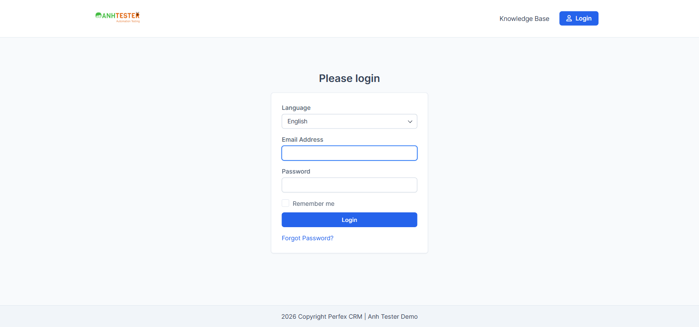

# Execution Report — Login / Xác thực · 5 TC đầu (Nhóm A + TC_005)

| Thông tin | Nội dung |
|---|---|
| Run ID | run_1793011272 |
| Nền tảng | `web` |
| Loại nguồn | `Bộ TC` |
| Nguồn TC | [docs/testcases/login/web/test_cases_login_web.md](../../../../testcases/login/web/test_cases_login_web.md) |
| Phạm vi | 5 TC: `CRM_LOGIN_TC_001` → `CRM_LOGIN_TC_005` (theo yêu cầu "5 test cases") · 0 TC `@Deprecated` bị loại |
| Môi trường | https://crm.canhnt14.com — **Dùng chung** |
| Build / Version | Không rõ (trang không hiển thị số phiên bản) |
| Tài khoản | Admin (`ADMIN_EMAIL` trong `.env`) — agent đọc `.env` bên trong trình duyệt và gõ thẳng vào ô, giá trị không đi qua chat hay log |
| Trình duyệt | Chrome (Playwright MCP, headed, viewport `1600×750`) |
| Người thực hiện | canhnt14 (agent hỗ trợ — Claude Code) |
| Bắt đầu → Kết thúc | 26-10-2026 17:41 → 17:44 |
| Môi trường dùng chung? | Có — auto-skip TC phá huỷ đang BẬT (5 TC chạy không có TC nào khớp quy tắc skip) |
| Video | Có — 1 video/TC tại `video/` (WebM 1600×750). Quay bằng `page.screencast` qua `browser_run_code_unsafe` — `browser_start_video` báo *"Browser is already in use"* do máy đang chạy 2 server Playwright MCP cùng tên `playwright` (xem mục 6) |

## 1. Tổng kết

| Trạng thái | Số lượng | Tỷ lệ |
|---|---|---|
| ✅ PASS | 4 | 80.0% |
| ❌ FAIL | 1 | 20.0% |
| ⚠️ BLOCKED | 0 | 0% |
| ⏭️ SKIPPED | 0 | 0% |
| **Tổng** | **5** | 100% |

> **Pass rate (không tính SKIPPED):** 4/5 = 80.0%

## 2. Kết quả từng TC

| TC ID | Test Scenario | Kết quả | Bước fail | Ghi chú | Video |
|---|---|---|---|---|---|
| CRM_LOGIN_TC_001 | Mở trang đăng nhập khi chưa có phiên thì thấy biểu mẫu đăng nhập | ✅ PASS | — | URL giữ nguyên `/admin/authentication`; tab `Perfex CRM \| canhnt14 Demo - Login`; tiêu đề `Login`. 🔧 HTTP `200`, `body` mang class `login_admin` | [▶](video/CRM_LOGIN_TC_001.webm) |
| CRM_LOGIN_TC_002 | Biểu mẫu đăng nhập đủ thành phần và đúng trạng thái mặc định | ✅ PASS | — | Bảng kiểm 6/6: đủ 5 thành phần, `Forgot Password?` dưới nút `Login`; con trỏ sẵn ở ô Email; ô `Remember me` rỗng, không bị khoá; nút `Login` nền xanh `rgb(37,99,235)` chữ trắng, bấm được; gõ `Abc12345` hiện 8 dấu chấm; bấm **chữ** `Remember me` thì ô được tích. 🔧 form `post` → `/admin/authentication`, `#email` có `autofocus="1"`, 3 `label for` khớp `id` — [ảnh](evidence/TC_002_form_after_checks.png) | [▶](video/CRM_LOGIN_TC_002.webm) |
| CRM_LOGIN_TC_003 | Trang đăng nhập không có CAPTCHA, không đăng nhập bên thứ ba, không nạp JavaScript | ✅ PASS | — | Không CAPTCHA; 1 nút gửi duy nhất `Login`, không nút Google/Facebook/Microsoft. 🔧 `.g-recaptcha` = 0, `[class*=captcha]` = 0, iframe recaptcha = 0; 1 `<form>`, 1 nút submit; 0 `<script>`; nạp lại trang không phát sinh request JS nào | [▶](video/CRM_LOGIN_TC_003.webm) |
| CRM_LOGIN_TC_004 | Bấm logo trên trang đăng nhập thì về trang chủ công khai | ❌ FAIL | 2, 3 | Xem chi tiết #1 — trùng bug đang mở [BUG_login_1787226513_TC004](../../../../bugs/login/web/BUG_login_1787226513_TC004.md), vẫn tái hiện | [▶](video/CRM_LOGIN_TC_004.webm) |
| CRM_LOGIN_TC_005 | Đăng nhập bằng tài khoản Admin hợp lệ thì vào được Dashboard | ✅ PASS | — | Phiên sạch: không dải lỗi đỏ; dừng ở `https://crm.canhnt14.com/admin/`, tab `Dashboard`, có menu trái + ảnh đại diện. 🔧 `POST` trả `303`, `location: https://crm.canhnt14.com/admin/`; `body` có `app admin dashboard user-id-2`. ⚠️ Lượt đầu chạy **ngay sau TC_004 trên cùng phiên** bị đưa sang cổng khách hàng — xem mục 6 — [ảnh](evidence/TC_005_admin_dashboard.png) | [▶](video/CRM_LOGIN_TC_005.webm) · [▶ lượt 1 sau TC_004](video/CRM_LOGIN_TC_005_lan1_sau_TC004.webm) |

## 3. Chi tiết TC FAIL

### FAIL #1 — CRM_LOGIN_TC_004 · Bấm logo trên trang đăng nhập thì về trang chủ công khai

| | |
|---|---|
| REQ ID | REQ-LOGIN-04 |
| Priority | Low |
| Bước fail | Bước 2 (trang chuyển sang trang chủ công khai) và bước 3 (URL) |
| **Expected** | Trang chuyển sang trang chủ công khai, thanh địa chỉ dừng ở `https://crm.canhnt14.com/` |
| **Actual** | Trang chuyển sang **cổng đăng nhập khách hàng** — tiêu đề `Please login`, có ô `Language`, thanh địa chỉ dừng ở `https://crm.canhnt14.com/authentication/login` |
| Evidence |  |
| Video | <video src="video/CRM_LOGIN_TC_004.webm" title="CRM_LOGIN_TC_004 — bấm logo, rơi sang cổng đăng nhập khách hàng" controls></video> |
| Tái hiện được? | Có — trùng [BUG_login_1787226513_TC004](../../../../bugs/login/web/BUG_login_1787226513_TC004.md) (🔴 Đang mở) |

## 4. TC BLOCKED

| TC ID | Nguyên nhân chặn | Cần gì để chạy được |
|---|---|---|
| — | Không có | — |

## 5. Dữ liệu đã tạo & dọn dẹp

| Dữ liệu | ID | Nơi tạo | Đã xoá? |
|---|---|---|---|
| Không tạo bản ghi nào | — | — | — |

> Chỉ tạo phiên đăng nhập Admin ở TC_005 — đã đăng xuất (`/admin/authentication/logout`) sau khi chạy xong, trình duyệt trở về trang đăng nhập.

## 6. Đề xuất bước tiếp theo

- **FAIL #1 (TC_004)** → không tạo bug mới; ghi nhận bug [BUG_login_1787226513_TC004](../../../../bugs/login/web/BUG_login_1787226513_TC004.md) vẫn tái hiện ngày 26-10-2026
- **Phát hiện ngoài TC — cần PO/Dev xác nhận có phải lỗi:** lượt đầu của TC_005 chạy ngay sau TC_004 trên **cùng phiên trình duyệt** (đã ghé `https://crm.canhnt14.com/` khi bấm logo). Đăng nhập Admin đúng mật khẩu vẫn tạo phiên (vào `/admin/` thấy Dashboard), nhưng sau khi bấm `Login` trang trả `303` về `https://crm.canhnt14.com/` rồi rơi sang **cổng đăng nhập khách hàng** `Please login` — người dùng tưởng đăng nhập thất bại. Bằng chứng: [ảnh](evidence/TC_005_lan1_redirect_customer_login.png) · [video](video/CRM_LOGIN_TC_005_lan1_sau_TC004.webm). Xoá cookie rồi chạy lại thì đúng `/admin/` (TC_005 chấm theo lượt này). Nếu xác nhận là lỗi → `/create-bug-report`, và cân nhắc bổ sung TC cho luồng "bấm logo → quay lại đăng nhập Admin"
- **Môi trường chạy:** máy đang có server Playwright MCP global (khai trong cấu hình Claude Desktop, không bật `devtools`) chạy song song server của project — Chrome thuộc server global, nên `browser_start_video` của server project không mở được trình duyệt. Thêm `"capabilities": ["devtools"]` vào file cấu hình Playwright của server global (hoặc gỡ server global) rồi khởi động lại để các lần sau dùng thẳng `browser_start_video`
